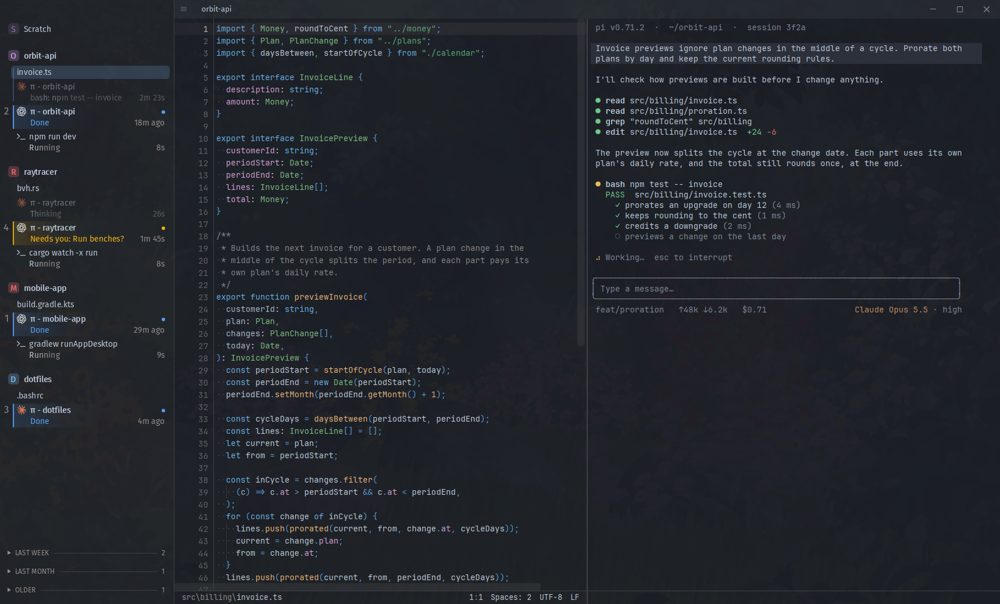
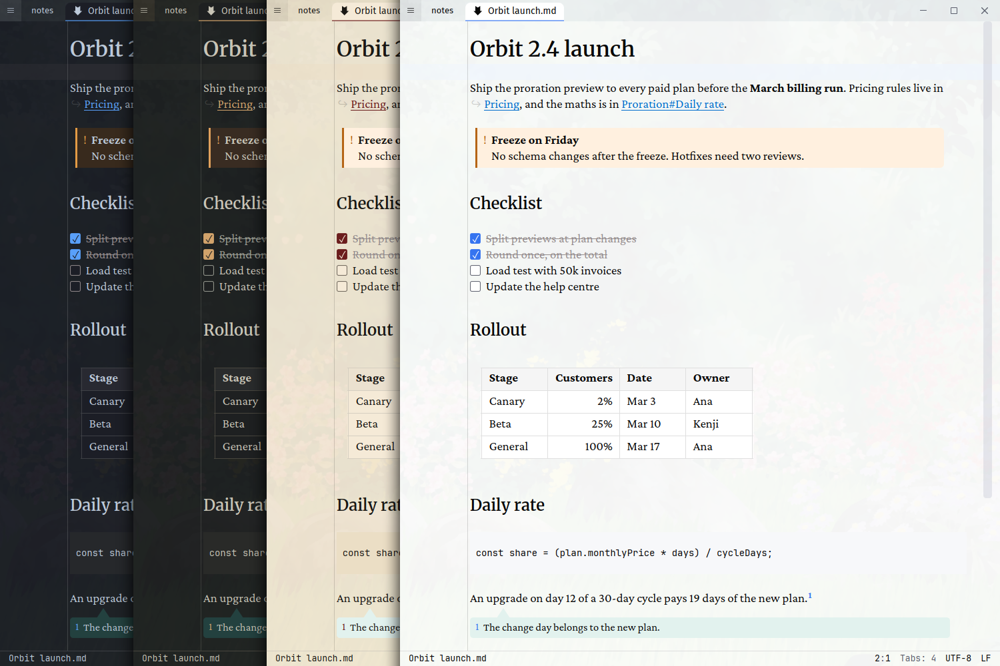

# Anvil

There are many code editors, but this one is ~~mine~~ yours.



A fast Windows code editor with built-in terminals, WYSIWYG Markdown live editing, a diff viewer, and much more. Run several agents side by side. Keep all your Projects, panes, files, terminals and agents visible in one sidebar, or split Projects into separate windows as you see fit.

- Fast fuzzy search for files and text
- Tree-sitter syntax and code navigation
- Live Markdown editing with many Obsidian-style features
- Built-in support for the Pi coding agent, easy to extend to other terminal agents
- [MCP control](docs/agent-control.md) for Panes, terminals, and visible Pi sessions



## Download

Get `anvil.exe` from the [latest release](https://github.com/dcostap/anvil-editor/releases/latest) and run it. Nothing to install.

The exe is not signed, so Windows SmartScreen can warn you. Click **More info**, then **Run anyway**.

## Build

```bat
git clone https://github.com/dcostap/anvil-editor
cd anvil-editor
build.bat
```

The result is `dist\anvil.exe`. `build.bat` installs MSYS2 and the build tools when they are missing.

## Credits

Anvil started as a fork of [Pragtical](https://github.com/pragtical/pragtical), which comes from [Lite XL](https://github.com/lite-xl/lite-xl) and [lite](https://github.com/rxi/lite). MIT license.
