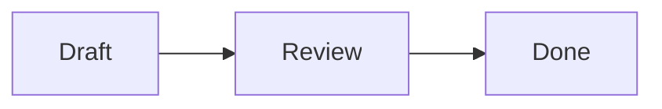
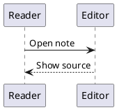
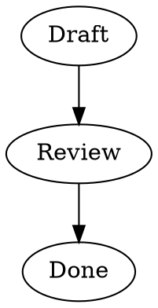

# Anvil Markdown Gallery

A working gallery of Markdown syntax and Anvil's Markdown features.

**Bold**, *italic*, ***bold italic***, ~~deleted~~, ==highlighted==, and `inline code` share one line.

> [!TIP] How to use this gallery
> Open this file in Anvil's **Live Preview**.
> Move the caret outside an example to see its presentation.
> Move the caret inside an example to edit its source.
> Use `markdown:toggle_source_mode` to inspect the complete source.

## Scope and support key

Markdown has many dialects. No single specification contains every extension.

This gallery covers CommonMark syntax families, GFM features, Anvil's Obsidian-style features, and common extensions from other systems.

Support notes follow Anvil source revision `79137524`. They describe source and test coverage, not a fresh visual test.

- **Rendered**: Anvil gives the syntax a Markdown presentation.
- **Source**: Anvil recognizes or preserves it, but does not give it the full external presentation.
- **Conditional**: Files, Project indexing, permissions, or installed language support affect the result.
- **Other dialect**: No dedicated Anvil support was found. Examples stay in code blocks.
- **Probe**: Parser support alone does not establish a rendered or clickable result.

Open the containing folder as a Project for complete note-link and embed resolution.
Some file examples deliberately use missing files. Their labels identify that condition.

### Contents

- [[#Support at a glance]]
- [[#Headings]]
- [[#Paragraphs and line breaks]]
- [[#Inline formatting]]
- [[#Lists]]
- [[#Task lists]]
- [[#Quotes]]
- [[#Callouts and alerts]]
- [[#Horizontal rules]]
- [[#Code]]
- [[#Links]]
- [[#Wiki links and block references]]
- [[#Images]]
- [[#Note embeds]]
- [[#Attachments]]
- [[#Tables]]
- [[#Footnotes and text notes]]
- [[#Tags]]
- [[#Comments]]
- [[#Escapes and literal text]]
- [[#Frontmatter]]
- [[#Math]]
- [[#HTML and compatibility probes]]
- [[#Other Markdown dialects]]
- [[#Combined examples]]
- [[#Anvil editing features]]

## Support at a glance

| Feature family | Anvil status | Important limit |
| :--- | :--- | :--- |
| ATX headings, levels 1–6 | Rendered | Markers reveal for editing |
| Setext headings, levels 1–2 | Rendered | Uses an underline source row |
| Paragraphs and soft wrapping | Rendered | Editor layout, not a browser |
| Two-space and backslash hard breaks | Rendered | Source markers hide when inactive |
| Italic, bold, and nested emphasis | Rendered | Delimiters reveal at the caret |
| Strikethrough | Rendered | Use double tildes |
| Highlight | Rendered | Obsidian-style double equals |
| Inline code | Rendered | Its contents stay literal |
| Fenced and indented code | Rendered | Highlighting depends on the language |
| Unordered and ordered lists | Rendered | Nested list structure is preserved |
| Task lists | Rendered | Checkboxes change the source |
| Blockquotes | Rendered | Quote prefixes reveal for editing |
| Thematic breaks | Rendered | Source reveals on the active line |
| Inline Markdown links | Rendered | Destination controls resolution |
| Reference links | Rendered | Requires a matching definition |
| Wiki links, aliases, heading and block links | Conditional | Requires a resolvable target |
| Note, heading, and block embeds | Conditional | Bounded previews, not full recursive pages |
| Local and embedded Base64 images | Rendered | Supported image formats only |
| Remote images | Conditional | Downloads are blocked by default |
| Image size suffixes | Rendered | Preserves aspect ratio and avoids default upscaling |
| Animated images | Conditional | Requires a supported animated image |
| PDF, audio, and video links or embeds | Rendered | Attachment chips, not inline players |
| GFM pipe tables | Rendered | No merged cells or grid-table syntax |
| Interactive table editing | Rendered | Live Preview feature |
| Table-cell `<br>` breaks | Rendered | Special table behavior, not general HTML rendering |
| Named and inline footnotes | Rendered | Number badges and note cards |
| Notes on highlighted text | Rendered | Anvil text-note behavior |
| Obsidian tags | Rendered | Not every hash is a tag |
| Obsidian `%%` comments | Rendered | Hidden when inactive |
| Backslash escapes | Rendered | Escaped punctuation stays literal |
| YAML and TOML frontmatter | Source | No property-form widget |
| Dollar-delimited math | Source | Styled TeX source, not equation typesetting |
| Raw HTML | Source | No DOM, CSS, or script execution |
| Autolinks and HTML entities | Probe | No dedicated live presentation confirmed |
| Mermaid and other diagram fences | Source | Code, not diagrams |
| Citations, definition lists, attributes, MDX | Other dialect | See the final catalogue |

## Headings

**Status: Rendered.** Both ATX and Setext styles have semantic support.

### ATX levels

# Heading level 1

## Heading level 2

### Heading level 3

#### Heading level 4

##### Heading level 5

###### Heading level 6

### ATX variants

### A heading with closing markers ###

### A heading with *emphasis*, **strong text**, and `code`

### A heading with a [link](https://example.com)

### Setext levels

Setext heading level 1
======================

Setext heading level 2
----------------------

### Heading source

```markdown
# Level 1
## Level 2
### Level 3
#### Level 4
##### Level 5
###### Level 6

### Optional closing markers ###

Level 1
=======

Level 2
-------
```

## Paragraphs and line breaks

**Status: Rendered.** Blank lines separate paragraphs. Live Preview also wraps long lines to the available width.

This is the first paragraph. It contains enough words to show ordinary text layout without any special syntax.

This is the second paragraph. Its blank-line boundary is part of the Markdown source.

### Soft source break

These two source lines
belong to one Markdown paragraph.

A soft source break is not a portable request for a forced line break.
Anvil remains an editor and can retain source-row layout.

### Hard break with a backslash

This line ends with a backslash.\
This line follows the hard break.

### Hard break with two spaces

The next example's first line ends with two spaces. Use Source Mode to inspect them.

This line has two trailing spaces.  
This line follows the hard break.

### Long paragraph

A long paragraph shows how text wraps beside ordinary punctuation, **strong phrases**, *emphasized phrases*, ==highlighted phrases==, and `small_code_fragments`. Resize the editor or change the zoom level to inspect the result. The source stays ordinary Markdown. The editor must keep the caret, selection, and visible text aligned while the available width changes.

## Inline formatting

**Status: Rendered.** Anvil composes nested formatting rather than treating each span as a separate document.

### Emphasis

*Italic with asterisks.*

_Italic with underscores._

**Bold with asterisks.**

__Bold with underscores.__

***Bold and italic with asterisks.***

___Bold and italic with underscores.___

### Nested emphasis

**Bold with an *italic phrase* inside.**

*Italic with a **bold phrase** inside.*

**Bold with `inline code` inside.**

**Bold with a [link label](https://example.com) inside.**

### Strikethrough

~~This text is deleted.~~

The replacement is **ready**, not ~~pending~~.

~~Deleted text with **strong emphasis** inside.~~

### Highlight

==This text is highlighted.==

==Highlighted text with **bold words** inside.==

==Highlighted text with *italic words* inside.==

### Inline code

Use `inline code` for a short literal value.

This span keeps formatting literal: `**bold** ==highlight== [[Note]]`.

Use two backticks when the content contains one: ``a `backtick` inside code``.

Use three backticks when the content contains two: ```a ``double delimiter`` inside code```.

### Source summary

```markdown
*italic*                 _italic_
**bold**                 __bold__
***bold italic***        ___bold italic___
~~strikethrough~~
==highlight==
`inline code`
``a `backtick` inside``
**bold with *italic* inside**
```

## Lists

**Status: Rendered.** Anvil preserves list hierarchy and source markers.

### Unordered marker variants

- Minus marker, first item.
- Minus marker, second item.

A paragraph separates the next list.

* Asterisk marker, first item.
* Asterisk marker, second item.

A paragraph separates the next list.

+ Plus marker, first item.
+ Plus marker, second item.

### Ordered lists

1. First step.
2. Second step.
3. Third step.

### Ordered list with a different start

7. Start at seven.
8. Continue at eight.
9. Finish at nine.

### Parenthesis delimiters

1) First parenthesis item.
2) Second parenthesis item.
3) Third parenthesis item.

### Nested and mixed lists

- Top-level item.
    - Nested item.
        - Third-level item.
    - Another nested item.
- Another top-level item.
    1. Ordered child.
    2. Another ordered child.
        - Unordered grandchild.

### Loose list with multiple paragraphs

- This item has a first paragraph.

    This second paragraph belongs to the same item.

- This item follows the first item.

    It also has a second paragraph.

### List with a quote and code

1. Read the instruction.

    > Keep the source readable.

2. Inspect the code.

    ```lua
    local ready = true
    print(ready)
    ```

3. Finish the review.

### List with formatted content

- **Strong item** with *emphasis*.
- Item with `code` and a [link](https://example.com).
- Item with ~~deleted text~~ and ==highlighted text==.
- A long item whose text should wrap while remaining aligned with its content rather than its list marker.

## Task lists

**Status: Rendered and interactive.** Click a checkbox to change `[ ]` to `[x]`, or back again.
The change edits the document and supports undo.

- [ ] An unchecked task.
- [x] A completed task.
- [X] A completed task with uppercase source.
- [ ] A task with **bold**, *italic*, and `code`.
- [ ] A task with a [link](https://example.com).
- [ ] A parent task.
    - [x] A completed child.
    - [ ] An open child.
        - [ ] A third-level task.
- A plain list item between tasks.
- [ ] Another open task.

### Ordered tasks

1. [ ] First ordered task.
2. [x] Second ordered task.
3. [ ] Third ordered task.

### Wrapping task

- [ ] This long task shows how the checkbox and the text behave when the content wraps across several visual rows. Edit its end, then toggle its checkbox.

### Empty task

The next item has a checkbox but no text.

- [ ]

### Nonstandard task states

Only blank, `x`, and `X` have confirmed checkbox semantics. Other task dialects use extra states:

```markdown
- [-] In progress in another dialect.
- [/] Partly complete in another dialect.
- [?] Question in another dialect.
- [!] Important in another dialect.
```

## Quotes

**Status: Rendered.** Quote prefixes reveal when their source is active.

> A simple blockquote.

> A blockquote with **strong text**, *emphasis*, and `code`.
> This is another source line in the same quote.

### Multiple paragraphs

> First quoted paragraph.
>
> Second quoted paragraph.
>
> Third quoted paragraph with a [link](https://example.com).

### Nested quotes

> Outer quote.
>
> > Inner quote.
> >
> > > Third-level quote.
>
> Back to the outer quote.

### Blocks inside a quote

> #### Quoted heading
>
> - Quoted list item.
> - Another quoted list item.
>
> ```lua
> print("Code inside a quote")
> ```

## Callouts and alerts

**Status: Rendered and interactive.** Anvil supports Obsidian-style callouts, including matching GitHub alert names.
Names and aliases are case-insensitive.

### Every canonical callout type

> [!note] Note
> A general note with **strong text** and a [link](https://example.com).

> [!abstract] Abstract
> A short summary of a larger topic.

> [!info] Information
> Additional information for the reader.

> [!todo] To do
> Work that still needs attention.

> [!tip] Tip
> A useful way to complete a task.

> [!success] Success
> The operation completed.

> [!question] Question
> Which result should the operation produce?

> [!warning] Warning
> Check the input before you continue.

> [!failure] Failure
> The operation did not complete.

> [!danger] Danger
> Stop before you change important data.

> [!bug] Bug
> The observed result differs from the expected result.

> [!example] Example
> A concrete example makes the rule easier to understand.

> [!quote] Quote
> Keep the smallest model that makes correct behavior clear.

### Default title

> [!note]
> This callout omits its custom title.

### Fold controls

> [!tip]+ Starts expanded
> The plus sign starts this callout expanded.
> Click its fold control to hide or show the body.

> [!warning]- Starts collapsed
> The minus sign starts this callout collapsed.
> The header stays visible while the body is hidden.

### Nested callouts

> [!note] Outer card
> This is the outer body.
>
> > [!tip]+ Inner card
> > The inner card has its own fold state.
>
> This line belongs to the outer card again.

### Rich callout body

> [!example] A small review
> - [x] Read the proposal.
> - [ ] Check the example.
>
> ```lua
> print("Callout code")
> ```
>
> **Result:** the body can contain ordinary Markdown blocks.

### GitHub-style alert spelling

> [!NOTE]
> Uppercase NOTE uses the note presentation.

> [!TIP]
> Uppercase TIP uses the tip presentation.

> [!IMPORTANT]
> IMPORTANT maps to tip.

> [!WARNING]
> Uppercase WARNING uses the warning presentation.

> [!CAUTION]
> CAUTION maps to warning in Anvil's callout system.

### Alias catalogue

| Canonical type | Accepted aliases |
| :--- | :--- |
| `note` | `note` |
| `abstract` | `abstract`, `summary`, `tldr` |
| `info` | `info` |
| `todo` | `todo` |
| `tip` | `tip`, `hint`, `important` |
| `success` | `success`, `check`, `done` |
| `question` | `question`, `help`, `faq` |
| `warning` | `warning`, `caution`, `attention` |
| `failure` | `failure`, `fail`, `missing` |
| `danger` | `danger`, `error` |
| `bug` | `bug` |
| `example` | `example` |
| `quote` | `quote`, `cite` |

### Unknown type

> [!custom-gallery-type] Unknown callout type
> Anvil uses the note appearance when it does not know the type.

## Horizontal rules

**Status: Rendered.** Each example below is a thematic break.

Three minus signs:

---

Three asterisks:

***

Three underscores:

___

Spaced minus signs:

- - -

More than three markers:

----------

A blank line before a minus-sign rule avoids confusion with a Setext heading.

## Code

**Status: Rendered.** Code contents stay literal. Fences do not execute code.

Fenced blocks have a code background and a hover **Copy** control.
Fence markers reveal when the caret enters the block.
Language highlighting depends on Anvil's language support.

### Plain fenced code

```
No language is specified.
**This is not bold.**
[[This is not a note link.]]
==This is not a highlight.==
```

### Lua

```lua
local function greet(name)
  return "Hello, " .. name
end

print(greet("Anvil"))
```

### C

```c
#include <stdio.h>

int main(void) {
  puts("Hello from Anvil");
  return 0;
}
```

### Python

```python
def square(value):
    return value * value

print([square(value) for value in range(5)])
```

### JavaScript

```javascript
const tasks = ["read", "edit", "save"];
for (const task of tasks) {
  console.log(task);
}
```

### JSON

```json
{
  "editor": "Anvil",
  "preview": true,
  "features": ["tables", "tasks", "footnotes"]
}
```

### SQL

```sql
SELECT name, status
FROM tasks
WHERE status = 'open'
ORDER BY name;
```

### Tilde fences

~~~lua
print("A tilde fence is also a code fence")
~~~

### Longer fences around shorter fences

````markdown
```lua
print("The outer fence contains an inner fence")
```
````

### Indented code

The next block uses four leading spaces instead of fences.

    local message = "Indented code"
    print(message)
    -- **Formatting stays literal here.**

### Unknown language

```gallery-unknown-language
A language label does not install a language parser.
This remains a code block even without dedicated highlighting.
```

## Links

**Status: Rendered.** Opening a link depends on its destination and target state.

### Inline links

[An external web link](https://example.com)

[A link with a title](https://example.com "Example site")

[A **bold label** with *emphasis*](https://example.com)

[An email link](mailto:reader@example.com)

[A Markdown heading link in this file](#navigation-target)

### Reference links

[A full reference link][gallery-site]

[gallery-site][]

[gallery-site]

[A case-insensitive reference][GALLERY-SITE]

[gallery-site]: https://example.com "Example site"

### File-link syntax

These samples require the named files. They are not included with this gallery.

```markdown
[Another note](Notes.md)
[A note with spaces](Notes%20with%20spaces.md)
[A destination in angle brackets](<Notes with spaces.md>)
[A heading in another note](Notes.md#Installation)
[A file in a child folder](guides/Setup.md)
[A file in the parent folder](../Overview.md)
```

### Source summary

```markdown
[label](https://example.com)
[label](https://example.com "Optional title")
[label][reference]
[reference][]
[reference]

[reference]: https://example.com "Optional title"
```

### Navigation target

This paragraph is a target for heading links elsewhere in the gallery.

Return to [[#Links|the links section]] or [[#Contents|the contents]].

## Wiki links and block references

**Status: Conditional.** Anvil supports note names, aliases, heading targets, and explicit block IDs.
Resolution uses the current note and the Project's note index.

### Current-note links

[[#Navigation target]]

[[#Navigation target|A custom display label]]

[[#^gallery-block|Jump to the marked paragraph]]

### Explicit note name

[[Anvil Markdown Gallery#Navigation target|This file, by note name]]

### Block target

This short paragraph is the explicit block target for gallery links and embeds. ^gallery-block

### Cross-note syntax

These examples require other notes:

```markdown
[[Note]]
[[Note|Display label]]
[[folder/Note]]
[[Note#Heading]]
[[Note#Heading|Heading label]]
[[Note#^block-id]]
[[#Heading in this note]]
[[#^block-in-this-note]]
```

### Missing target

[[Anvil Gallery Missing Note|A deliberately missing note]]

Anvil can offer a create-target action for a missing note.
Do not create this sample target unless you want an extra file.

## Images

**Status: Rendered or conditional.** Local images need files. Embedded Base64 images travel with the Markdown file.

### Self-contained image

The colored image below lives inside this Markdown file. It needs no download or companion file.


### Resized embedded image

The same image requests a width of 160 pixels through Anvil's image-label suffix.


### Local image and wiki-image syntax

These examples need an actual image file:

```markdown


![[image.png]]


![[image.png|160]]
![[image.png|160x90]]
```

Size suffixes constrain the displayed size. They do not mean crop or stretch.
Anvil avoids upscaling images by default.

### Inline placement

An image can share a source line with text:

```markdown
Before  after.
```

### Reference-style image syntax

This is standard Markdown syntax. Dedicated Anvil reference-image presentation was not confirmed during this review.

```markdown
![Alternative text][gallery-picture]

[gallery-picture]: image.png "Optional title"
```

### Remote images

Remote image downloads are disabled by default. This sample does not request a download:

```markdown

```

Use `markdown:load_remote_image` for a one-time permission.
Use `markdown:trust_project_remote_images` only for a Project you trust.
Use `markdown:untrust_project_remote_images` to remove that trust.

### Animated images

Anvil can play supported animated images in Live Preview.
Animated GIF support has a focused UI test.

```markdown

![[animation.gif]]
```

### Supported embedded image MIME types

Base64 image data accepts PNG, JPEG, GIF, WebP, AVIF, and BMP MIME types.
The decoder and image contents must also be valid.
SVG data URIs are not in this embedded-image MIME list.

### Deliberately missing image

![[anvil-gallery-missing-image.png|160]]

This sample shows the unavailable-image state. No missing image file accompanies the gallery.

## Note embeds

**Status: Conditional.** Anvil shows bounded previews for resolved notes, headings, and blocks.
These are not full recursive document renderings.

### Heading embed from this file

![[Anvil Markdown Gallery#Embed target]]

### Block embed from this file

![[Anvil Markdown Gallery#^gallery-block]]

### Embed source variants

```markdown
![[Other note]]
![[Other note#Heading]]
![[Other note#^block-id]]
```

Full-note embeds need another note for a useful nonrecursive example.
No extra note is included with this single-file gallery.

### Embed target

This is the first line of the small embed target.
This is the second line of the small embed target.

## Attachments

**Status: Rendered chips with conditional opening.** PDF, audio, and video targets do not become inline viewers or players.

The following targets are deliberately missing. They demonstrate attachment syntax and chip presentation.

![[anvil-gallery-missing-manual.pdf]]

[[anvil-gallery-missing-audio.mp3|Audio sample]]

[Video sample](anvil-gallery-missing-video.mp4)

### Attachment source

```markdown
[[manual.pdf|Read the manual]]
![[manual.pdf]]
[[recording.mp3|Audio recording]]
![[recording.mp3]]
[Video recording](recording.mp4)
![[recording.mp4]]
```

Anvil opens supported attachment links in the associated system application.
It can also copy dropped attachments and insert links.
Clipboard images can become local image attachments.
These workflows create files; this gallery does not run them.

## Tables

**Status: Rendered and interactive.** Anvil supports GFM pipe tables and live cell editing.

### Basic table

| Feature | Example |
| --- | --- |
| Plain text | A simple value |
| Strong | **Ready** |
| Emphasis | *Review* |
| Code | `value = 42` |
| Highlight | ==Important== |
| Deletion | ~~Old value~~ |
| Link | [Example](https://example.com) |

### Column alignment

| Left aligned | Center aligned | Right aligned | Default |
| :--- | :---: | ---: | --- |
| Alpha | Ready | 12 | Plain |
| Beta | Review | 345 | Plain |
| Gamma | Done | 6 | Plain |

### Table without outer pipes

Name | Count | State
--- | ---: | :---:
Alpha | 12 | Ready
Beta | 3 | Review

### Empty cells

| First | Second | Third |
| --- | --- | --- |
| Value | | Value |
| | Middle only | |
| | | |

### Escaped pipe

| Input | Meaning |
| --- | --- |
| left\|right | A pipe inside a cell |
| `a` and `b` | Separate code spans |

### Explicit cell breaks

Inside tables, Anvil treats `<br>`, `<br/>`, and `<br />` as cell breaks.
This does not imply general HTML rendering elsewhere.

| Form | Multiline content |
| --- | --- |
| Short tag | First line<br>Second line |
| Self-closing tag | First line<br/>Second line |
| Spaced tag | First line<br />Second line |
| Blank line | First line<br><br>Third line |
| Code stays literal | `one<br>two` |

### Long cells

| Topic | Description | State |
| :--- | :--- | :---: |
| Wrapping | This deliberately long cell shows how text wraps inside a table while the row grows to contain its content. | Ready |
| Mixed formatting | A long cell can also contain **strong text**, *emphasis*, `code`, and a [link](https://example.com). | Review |
| Multiple lines | First line<br>Second line with more words<br>Third line | Done |

### Sortable sample

Edit or sort this table through Anvil's table commands.

| Name | Count |
| :--- | ---: |
| Gamma | 30 |
| Alpha | 10 |
| Beta | 20 |

### Table source

```markdown
| Left | Center | Right |
| :--- | :---: | ---: |
| Alpha | Beta | 12 |
| Text | **Bold** | 34 |
| left\|right | first<br>second | 56 |
```

Tables do not support merged cells, row spans, or arbitrary nested block layouts.
See the other-dialect section for grid tables and captions.

## Footnotes and text notes

**Status: Rendered and interactive.** Footnote references become number badges.
Anvil shows note text in cards and provides note-editing commands.

### Named footnote

This sentence has a footnote.[^gallery-basic]

### Repeated reference

This sentence refers to the same note again.[^gallery-basic]

### Named label rather than a number

The source label does not need to be numeric.[^gallery-descriptive-label]

### Inline footnote

This sentence contains an inline note.^[The inline note keeps its text beside its reference in the source.]

### Formatted footnote

A footnote can contain inline Markdown.[^gallery-formatted]

### Multiline definition

This sentence points to a note with continuation text.[^gallery-long]

### Note on highlighted text

This paragraph contains ==text with an attached note==^[This note belongs to the highlighted text.].

Anvil can show this text note beside the highlight without a separate number badge.
Use `markdown:add_text_note` on selected text to create one.

### Footnote source

```markdown
A reference.[^label]

[^label]: The note body.

An inline note.^[The note body.]

==Text with a note==^[The attached note.]
```

[^gallery-basic]: This is the basic gallery footnote.

[^gallery-descriptive-label]: Anvil numbers references by document order, rather than displaying this source label.

[^gallery-formatted]: A note with **strong text**, *emphasis*, `code`, and a [link](https://example.com).

[^gallery-long]: This note starts on its definition line.
    This is indented continuation text in the same definition.

## Tags

**Status: Rendered.** Anvil recognizes Obsidian-style inline tags, including nested tag paths.

#markdown #gallery #project/anvil

These hashes are not equivalent tags: #123 C#code \#escaped.

```markdown
#markdown
#project/anvil

# A heading needs a space after the hash.
\#escaped is literal text.
C#code is not a separate tag.
#123 is not a valid tag in this supported form.
```

Tag presentation does not imply an executable query language or a tag-management dashboard.

## Comments

**Status: Rendered for Obsidian comments.** Inactive comments hide. Move the caret inside them to reveal their source.

### Inline Obsidian comment

Visible text before. %%This comment should hide when inactive.%% Visible text after.

### Multiline Obsidian comment

Visible paragraph before the comment.

%%
This whole comment spans several source lines.
**Formatting here must not become visible Markdown.**
# This is not a visible heading.
[[This is not a visible note link.]]
%%

Visible paragraph after the comment.

### Comment inside formatting

**Visible bold text %%hidden comment%% continues here.**

### Comment syntax inside code

`%%This stays literal because it is code.%%`

### HTML comment

HTML comments are a separate syntax family. Their browser-style hiding is not a confirmed Anvil live feature.

```html
<!-- An HTML comment, not an Obsidian comment. -->
```

## Escapes and literal text

**Status: Rendered.** Backslashes prevent punctuation from starting Markdown constructs.

\*Not italic\*

\*\*Not bold\*\*

\[Not a link\](https://example.com)

\# Not a heading

\> Not a quote

\- Not a list item

1\. Not an ordered list item

\`Not inline code\`

\!\[Not an image\](image.png)

A literal backslash: \\

### Punctuation in code

```text
* _ ** __ ~~ == ` [ ] ( ) ! # > - + . | \ $ % ^
```

### Literal Unicode

These characters are actual text, not Markdown commands:

Café · naïve · ação · Ελληνικά · 日本語 · 中文 · العربية

← ↑ → ↓ · ✓ ✗ · ± × ÷ · © ® ™ · … · — · “quoted text”

Emoji characters: 🙂 🚀 📄 ✅

Font coverage determines which glyphs the editor can draw.
Emoji shortcodes and automatic punctuation replacement are separate features.

## Frontmatter

**Status: Source.** Anvil recognizes YAML-style and TOML-style metadata blocks at the start of a document.
It displays the metadata as ordinary source, not a property form.

This file starts with a real YAML metadata block.
Move to the top in Source Mode to inspect it.

### YAML form

```yaml
---
title: Example note
aliases:
  - Alternate name
tags:
  - project/anvil
published: false
count: 3
---
```

### TOML form

```toml
+++
title = "Example note"
aliases = ["Alternate name"]
tags = ["project/anvil"]
published = false
count = 3
+++
```

Metadata syntax does not imply that every key drives editor behavior.
A metadata block in the middle of a document is not equivalent to document-start frontmatter.

## Math

**Status: Styled editable source.** Anvil does not typeset these expressions with MathJax or KaTeX.
The dollar delimiters and TeX source remain visible.

### Inline math

A simple expression: $x^2 + y^2 = z^2$.

A fraction: $\frac{a+b}{c}$.

Greek letters: $\alpha + \beta = \gamma$.

### Display math

$$
E = mc^2
$$

$$
\sum_{k=1}^{n} k = \frac{n(n+1)}{2}
$$

$$
\begin{bmatrix}
a & b \\
c & d
\end{bmatrix}
$$

### Literal dollars

Use an escape or code when a dollar sign is ordinary text: \$25 or `$25`.

### Other math delimiters

These forms belong to other Markdown/math integrations. No dedicated Anvil presentation was confirmed:

```text
\(x^2 + y^2\)

\[
E = mc^2
\]
```

## HTML and compatibility probes

**Status: Source or probe.** Anvil is not a browser-based HTML renderer.
Raw HTML blocks do not gain a DOM, CSS layout, or script execution.
Markdown-looking text inside a raw HTML block is not necessarily parsed as Markdown.

### Inline HTML probe

Before <span>inline HTML source</span> after.

### Raw HTML block probe

<div>
This is raw HTML block content, not a promise of browser presentation.
**These asterisks are inside the raw HTML block.**
</div>

### HTML-only presentation samples

These are intentionally fenced. They are not Anvil rendered features:

```html
<u>Underline</u>
<mark>Highlight</mark>
<small>Small text</small>
H<sub>2</sub>O
x<sup>2</sup>
<kbd>Enter</kbd>
<abbr title="Hypertext Markup Language">HTML</abbr>
<details>
  <summary>Expandable HTML content</summary>
  Hidden content in a browser renderer.
</details>

<a id="custom-anchor"></a>
<div style="text-align: center">Centered HTML text</div>
```

Use `==highlight==` for Anvil highlight, and callout fold controls for collapsible Markdown cards.

### Autolink probes

These forms are common Markdown/GFM features.
Dedicated clickable Anvil live presentation was not confirmed in this source review:

<https://example.com>

<reader@example.com>

https://example.com

www.example.com

reader@example.com

Use `[label](destination)` when you need an explicit supported link form.

### Entity probes

Named entities: &amp; &lt; &gt; &quot; &copy; &nbsp;

Numeric entities: &#169; &#x2192; &#x1F642;

Entity recognition does not prove that Live Preview decodes each entity into its glyph.
For reliable literal glyphs, type `©`, `→`, or `🙂` directly.

## Other Markdown dialects

**Status: No dedicated Anvil rendering found for the extensions below.**
These examples document common syntax families, not an installation promise.
They stay fenced so they do not appear to be supported live examples.

### Definition lists

```markdown
Term
: First definition.
: Second definition.

Another term
: Another definition.
```

### General superscript and subscript

```markdown
x^2^
H~2~O
```

Footnote badges can look raised. That does not enable general superscript syntax.

### Underline and insertion delimiters

```markdown
++inserted or underlined text++
```

### Emoji shortcodes

```markdown
:smile: :rocket: :warning: :white_check_mark:
```

Literal emoji are ordinary Unicode text. Shortcode expansion is a different feature.

### Smart punctuation

```text
"Straight quotes" -> “curly quotes”
'Quotes' -> ‘quotes’
-- -> en dash
--- -> em dash
... -> ellipsis
```

These conversions are not implied by Markdown support.

### Heading IDs, classes, and attributes

```markdown
## Custom heading {#custom-id .wide}

[Link](https://example.com){.external target=_blank}

{width=160 height=90}

Paragraph with attributes.
{.notice}
```

Anvil's explicit paragraph block IDs use `^block-id`, not this brace syntax.
Anvil's supported image size suffix uses `|160` or `|160x90` in the image label.

### Fenced divs and generic containers

```markdown
::: warning
A generic warning container.
:::

::: {.columns}
Column content.
:::
```

### Other admonition syntaxes

```markdown
!!! note "A title"
    An indented admonition body.

??? tip "Foldable admonition"
    A body for another renderer.

.. note::
   This is reStructuredText-style syntax, not Markdown.
```

Use `> [!note]` for Anvil callouts.

### Table captions and grids

```markdown
| Name | Value |
| --- | --- |
| A | 1 |

: A caption in another Markdown dialect.

+------+-------+
| Name | Value |
+======+=======+
| A    | 1     |
+------+-------+
```

Other systems also define multiline tables, row spans, column spans, and CSV-table directives.
Anvil's supported table model uses GFM pipe tables.

### Automatic contents directives

```markdown
[TOC]

[[TOC]]

[[_TOC_]]

<!-- TOC -->
```

These are not Anvil automatic-contents commands.
This gallery's contents are explicit links.

### Citations and bibliography

```markdown
A citation [@smith2024].

A narrative citation @smith2024.

A citation with a locator [@smith2024, p. 12].

::: {#refs}
:::
```

Bibliography processing requires a separate citation system.

### CriticMarkup and review changes

```text
{--deleted text--}
{++inserted text++}
{~~old text~>new text~~}
{==highlighted text==}
{>>review comment<<}
```

Use `~~deleted~~`, `==highlighted==`, and footnotes for the corresponding supported Anvil forms.

### Mermaid

This fence remains code. Anvil does not turn it into a diagram.



### Other diagrams





```vega-lite
{"mark":"bar","encoding":{}}
```

Diagram labels do not install renderers for PlantUML, Graphviz, Vega, D2, or similar systems.

### Executable notebooks and evaluated fences

````markdown
```{python}
print("Run by a notebook engine, not by ordinary Markdown")
```

`r 1 + 1`
````

Anvil's Markdown code blocks do not execute code or display calculated notebook results.

### MDX and component syntax

```mdx
import Chart from './Chart.jsx';

# Component document

<Chart data={[1, 2, 3]} />

The answer is {1 + 1}.
```

### Templates, includes, and shortcodes

```text

{{ variable }}

!include other.md
--8<-- "snippet.md"
```

Anvil's note embeds use `![[Note]]`. They do not imply these template engines.

### Wiki-style formatting from other systems

```text
__underline in some wiki systems__
[[Page#Section|label]]
{{image.png}}
[[Category:Examples]]
```

A similar delimiter can mean different things in different dialects.
In ordinary Markdown, `__text__` is strong emphasis, not underline.

### Platform-specific references

```markdown
@username
#123
owner/repository#123
0123456789abcdef
```

GitHub mentions, issue references, and commit references need platform context.
They are not general Anvil Markdown links.

### Obsidian plugin languages

```dataview
TABLE status
FROM #project
```

```tasks
not done
```

```query
tag:#project
```

Dataview, Tasks-plugin queries, search queries, Canvas files, and plugin-defined code blocks are separate systems.
Anvil's task checkboxes and tags do not execute these query languages.

### Slides, page breaks, and export controls

```markdown
<!-- slide: background="#123456" -->

\newpage

\pagebreak

<div style="page-break-after: always"></div>
```

A thematic break does not imply a presentation slide or a printed page break.
PDF export, document templates, and print pagination need separate tooling.

## Combined examples

These examples combine supported features rather than introducing more syntax.

### A short project note

> [!abstract] Release review
> The release is ready for a final check.
> Read the [[#Navigation target|navigation example]] before you continue.

- [x] Review **headings** and *body text*.
- [x] Confirm that `inline code` stays literal.
- [ ] Open a note link.
- [ ] Edit a table cell.
- [ ] Toggle a checkbox and undo the change.

| Item | Result | Note |
| :--- | :---: | :--- |
| Text | Ready | **Strong** and *emphasis* |
| Code | Ready | `print("hello")` |
| Notes | Review | Footnotes use cards |

### A quoted procedure

> [!example]+ Review procedure
> 1. Read the source.
> 2. Inspect the rendered result.
> 3. Compare a small example.
>
> ```lua
> local expected = "readable"
> print(expected)
> ```
>
> Keep ==the important part== visible.

### Mixed inline content

A **strong phrase**, an *italic phrase*, a ~~removed phrase~~, ==an important phrase==, `literal_code`, and a [link](https://example.com) can share one paragraph.

## Anvil editing features

These are editor actions, not extra Markdown syntax.
Commands depend on the active view and caret context.
Keyboard bindings can differ, so this gallery lists command IDs instead of shortcuts.

### Preview and source

- `markdown:toggle_source_mode`
- `markdown:source_mode`
- `markdown:live_mode`

Live Preview reveals editable source around the active construct.
Source Mode exposes the full Markdown document.

### Links and images

- `markdown:open_link`
- `markdown:complete_link`
- `markdown:create_link_target`
- `markdown:review_rename_link_updates`
- `markdown:load_remote_image`
- `markdown:trust_project_remote_images`
- `markdown:untrust_project_remote_images`

Link completion supports note, heading, and block targets.
Rename-link updates have a review flow before source changes.
Image clicks can open the image; embedded image data uses Anvil's image overlay.

### Tasks

- `markdown:alternate_list_item_checkbox`

Checkbox pointer actions edit the Markdown source and support undo.
Completed tasks receive completed-task presentation.

### Footnotes

- `markdown:add_footnote`
- `markdown:add_text_note`
- `markdown:edit_footnote`
- `markdown:remove_footnote`

The editor provides save and cancel actions during footnote editing.
Definition lines normally stay hidden until their source is active.
Cards can move below their block when the margin lacks room.

### Tables

Representative table commands:

- `markdown:table_insert_row_above`
- `markdown:table_insert_row_below`
- `markdown:table_delete_row`
- `markdown:table_move_row_up`
- `markdown:table_move_row_down`
- `markdown:table_insert_column_left`
- `markdown:table_insert_column_right`
- `markdown:table_delete_column`
- `markdown:table_move_column_left`
- `markdown:table_move_column_right`
- `markdown:table_align_column_left`
- `markdown:table_align_column_center`
- `markdown:table_align_column_right`
- `markdown:table_clear_column_alignment`
- `markdown:table_sort_ascending`
- `markdown:table_sort_descending`
- `markdown:table_format`

Interactive tables also support cell navigation, selection, paste, and cell breaks.
Those operations preserve Markdown table source.

### Small manual review

- [ ] Move the caret into bold text, then move it outside.
- [ ] Toggle a task checkbox, then undo the change.
- [ ] Expand and collapse a callout.
- [ ] Open a current-note heading link.
- [ ] Inspect the embedded image without a network connection.
- [ ] Edit a table cell.
- [ ] Open a footnote editor, then cancel.
- [ ] Switch between Live Preview and Source Mode.

## Source references

Support notes were checked against these Anvil files:

- `data/core/markdown/queries.lua`
- `data/core/markdown/live_render.lua`
- `data/core/markdown/callouts.lua`
- `data/core/markdown/images.lua`
- `data/core/markdown/links.lua`
- `data/core/markdown/table_presentation.lua`
- `data/core/commands/markdown.lua`
- `data/plugins/anvil_defaults.lua`
- `tests/lua/ui/markdown_live_editor.lua`
- `tests/lua/ui/markdown_interactive_tables.lua`
- `tests/lua/ui/markdown_footnotes.lua`
- `tests/lua/ui/markdown_animated_images.lua`
- `tests/lua/runtime/markdown_parser_compatibility.lua`
- `tests/native/markdown_extensions_test.c`

This is a single-file gallery. It does not install plugins, download images, create attachment files, or change Anvil settings.
---
title: Anvil Markdown Gallery
aliases:
  - Markdown Feature Gallery
tags:
  - markdown
  - gallery
  - anvil
status: reference
---

# Anvil Markdown Gallery

A working gallery of Markdown syntax and Anvil's Markdown features.

**Bold**, *italic*, ***bold italic***, ~~deleted~~, ==highlighted==, and `inline code` share one line.

> [!TIP] How to use this gallery
> Open this file in Anvil's **Live Preview**.
> Move the caret outside an example to see its presentation.
> Move the caret inside an example to edit its source.
> Use `markdown:toggle_source_mode` to inspect the complete source.

## Scope and support key

Markdown has many dialects. No single specification contains every extension.

This gallery covers CommonMark syntax families, GFM features, Anvil's Obsidian-style features, and common extensions from other systems.

Support notes follow Anvil source revision `79137524`. They describe source and test coverage, not a fresh visual test.

- **Rendered**: Anvil gives the syntax a Markdown presentation.
- **Source**: Anvil recognizes or preserves it, but does not give it the full external presentation.
- **Conditional**: Files, Project indexing, permissions, or installed language support affect the result.
- **Other dialect**: No dedicated Anvil support was found. Examples stay in code blocks.
- **Probe**: Parser support alone does not establish a rendered or clickable result.

Open the containing folder as a Project for complete note-link and embed resolution.
Some file examples deliberately use missing files. Their labels identify that condition.

### Contents

- [[#Support at a glance]]
- [[#Headings]]
- [[#Paragraphs and line breaks]]
- [[#Inline formatting]]
- [[#Lists]]
- [[#Task lists]]
- [[#Quotes]]
- [[#Callouts and alerts]]
- [[#Horizontal rules]]
- [[#Code]]
- [[#Links]]
- [[#Wiki links and block references]]
- [[#Images]]
- [[#Note embeds]]
- [[#Attachments]]
- [[#Tables]]
- [[#Footnotes and text notes]]
- [[#Tags]]
- [[#Comments]]
- [[#Escapes and literal text]]
- [[#Frontmatter]]
- [[#Math]]
- [[#HTML and compatibility probes]]
- [[#Other Markdown dialects]]
- [[#Combined examples]]
- [[#Anvil editing features]]

## Support at a glance

| Feature family | Anvil status | Important limit |
| :--- | :--- | :--- |
| ATX headings, levels 1–6 | Rendered | Markers reveal for editing |
| Setext headings, levels 1–2 | Rendered | Uses an underline source row |
| Paragraphs and soft wrapping | Rendered | Editor layout, not a browser |
| Two-space and backslash hard breaks | Rendered | Source markers hide when inactive |
| Italic, bold, and nested emphasis | Rendered | Delimiters reveal at the caret |
| Strikethrough | Rendered | Use double tildes |
| Highlight | Rendered | Obsidian-style double equals |
| Inline code | Rendered | Its contents stay literal |
| Fenced and indented code | Rendered | Highlighting depends on the language |
| Unordered and ordered lists | Rendered | Nested list structure is preserved |
| Task lists | Rendered | Checkboxes change the source |
| Blockquotes | Rendered | Quote prefixes reveal for editing |
| Thematic breaks | Rendered | Source reveals on the active line |
| Inline Markdown links | Rendered | Destination controls resolution |
| Reference links | Rendered | Requires a matching definition |
| Wiki links, aliases, heading and block links | Conditional | Requires a resolvable target |
| Note, heading, and block embeds | Conditional | Bounded previews, not full recursive pages |
| Local and embedded Base64 images | Rendered | Supported image formats only |
| Remote images | Conditional | Downloads are blocked by default |
| Image size suffixes | Rendered | Preserves aspect ratio and avoids default upscaling |
| Animated images | Conditional | Requires a supported animated image |
| PDF, audio, and video links or embeds | Rendered | Attachment chips, not inline players |
| GFM pipe tables | Rendered | No merged cells or grid-table syntax |
| Interactive table editing | Rendered | Live Preview feature |
| Table-cell `<br>` breaks | Rendered | Special table behavior, not general HTML rendering |
| Named and inline footnotes | Rendered | Number badges and note cards |
| Notes on highlighted text | Rendered | Anvil text-note behavior |
| Obsidian tags | Rendered | Not every hash is a tag |
| Obsidian `%%` comments | Rendered | Hidden when inactive |
| Backslash escapes | Rendered | Escaped punctuation stays literal |
| YAML and TOML frontmatter | Source | No property-form widget |
| Dollar-delimited math | Source | Styled TeX source, not equation typesetting |
| Raw HTML | Source | No DOM, CSS, or script execution |
| Autolinks and HTML entities | Probe | No dedicated live presentation confirmed |
| Mermaid and other diagram fences | Source | Code, not diagrams |
| Citations, definition lists, attributes, MDX | Other dialect | See the final catalogue |

## Headings

**Status: Rendered.** Both ATX and Setext styles have semantic support.

### ATX levels

# Heading level 1

## Heading level 2

### Heading level 3

#### Heading level 4

##### Heading level 5

###### Heading level 6

### ATX variants

### A heading with closing markers ###

### A heading with *emphasis*, **strong text**, and `code`

### A heading with a [link](https://example.com)

### Setext levels

Setext heading level 1
======================

Setext heading level 2
----------------------

### Heading source

```markdown
# Level 1
## Level 2
### Level 3
#### Level 4
##### Level 5
###### Level 6

### Optional closing markers ###

Level 1
=======

Level 2
-------
```

## Paragraphs and line breaks

**Status: Rendered.** Blank lines separate paragraphs. Live Preview also wraps long lines to the available width.

This is the first paragraph. It contains enough words to show ordinary text layout without any special syntax.

This is the second paragraph. Its blank-line boundary is part of the Markdown source.

### Soft source break

These two source lines
belong to one Markdown paragraph.

A soft source break is not a portable request for a forced line break.
Anvil remains an editor and can retain source-row layout.

### Hard break with a backslash

This line ends with a backslash.\
This line follows the hard break.

### Hard break with two spaces

The next example's first line ends with two spaces. Use Source Mode to inspect them.

This line has two trailing spaces.  
This line follows the hard break.

### Long paragraph

A long paragraph shows how text wraps beside ordinary punctuation, **strong phrases**, *emphasized phrases*, ==highlighted phrases==, and `small_code_fragments`. Resize the editor or change the zoom level to inspect the result. The source stays ordinary Markdown. The editor must keep the caret, selection, and visible text aligned while the available width changes.

## Inline formatting

**Status: Rendered.** Anvil composes nested formatting rather than treating each span as a separate document.

### Emphasis

*Italic with asterisks.*

_Italic with underscores._

**Bold with asterisks.**

__Bold with underscores.__

***Bold and italic with asterisks.***

___Bold and italic with underscores.___

### Nested emphasis

**Bold with an *italic phrase* inside.**

*Italic with a **bold phrase** inside.*

**Bold with `inline code` inside.**

**Bold with a [link label](https://example.com) inside.**

### Strikethrough

~~This text is deleted.~~

The replacement is **ready**, not ~~pending~~.

~~Deleted text with **strong emphasis** inside.~~

### Highlight

==This text is highlighted.==

==Highlighted text with **bold words** inside.==

==Highlighted text with *italic words* inside.==

### Inline code

Use `inline code` for a short literal value.

This span keeps formatting literal: `**bold** ==highlight== [[Note]]`.

Use two backticks when the content contains one: ``a `backtick` inside code``.

Use three backticks when the content contains two: ```a ``double delimiter`` inside code```.

### Source summary

```markdown
*italic*                 _italic_
**bold**                 __bold__
***bold italic***        ___bold italic___
~~strikethrough~~
==highlight==
`inline code`
``a `backtick` inside``
**bold with *italic* inside**
```

## Lists

**Status: Rendered.** Anvil preserves list hierarchy and source markers.

### Unordered marker variants

- Minus marker, first item.
- Minus marker, second item.

A paragraph separates the next list.

* Asterisk marker, first item.
* Asterisk marker, second item.

A paragraph separates the next list.

+ Plus marker, first item.
+ Plus marker, second item.

### Ordered lists

1. First step.
2. Second step.
3. Third step.

### Ordered list with a different start

7. Start at seven.
8. Continue at eight.
9. Finish at nine.

### Parenthesis delimiters

1) First parenthesis item.
2) Second parenthesis item.
3) Third parenthesis item.

### Nested and mixed lists

- Top-level item.
    - Nested item.
        - Third-level item.
    - Another nested item.
- Another top-level item.
    1. Ordered child.
    2. Another ordered child.
        - Unordered grandchild.

### Loose list with multiple paragraphs

- This item has a first paragraph.

    This second paragraph belongs to the same item.

- This item follows the first item.

    It also has a second paragraph.

### List with a quote and code

1. Read the instruction.

    > Keep the source readable.

2. Inspect the code.

    ```lua
    local ready = true
    print(ready)
    ```

3. Finish the review.

### List with formatted content

- **Strong item** with *emphasis*.
- Item with `code` and a [link](https://example.com).
- Item with ~~deleted text~~ and ==highlighted text==.
- A long item whose text should wrap while remaining aligned with its content rather than its list marker.

## Task lists

**Status: Rendered and interactive.** Click a checkbox to change `[ ]` to `[x]`, or back again.
The change edits the document and supports undo.

- [ ] An unchecked task.
- [x] A completed task.
- [X] A completed task with uppercase source.
- [ ] A task with **bold**, *italic*, and `code`.
- [ ] A task with a [link](https://example.com).
- [ ] A parent task.
    - [x] A completed child.
    - [ ] An open child.
        - [ ] A third-level task.
- A plain list item between tasks.
- [ ] Another open task.

### Ordered tasks

1. [ ] First ordered task.
2. [x] Second ordered task.
3. [ ] Third ordered task.

### Wrapping task

- [ ] This long task shows how the checkbox and the text behave when the content wraps across several visual rows. Edit its end, then toggle its checkbox.

### Empty task

The next item has a checkbox but no text.

- [ ]

### Nonstandard task states

Only blank, `x`, and `X` have confirmed checkbox semantics. Other task dialects use extra states:

```markdown
- [-] In progress in another dialect.
- [/] Partly complete in another dialect.
- [?] Question in another dialect.
- [!] Important in another dialect.
```

## Quotes

**Status: Rendered.** Quote prefixes reveal when their source is active.

> A simple blockquote.

> A blockquote with **strong text**, *emphasis*, and `code`.
> This is another source line in the same quote.

### Multiple paragraphs

> First quoted paragraph.
>
> Second quoted paragraph.
>
> Third quoted paragraph with a [link](https://example.com).

### Nested quotes

> Outer quote.
>
> > Inner quote.
> >
> > > Third-level quote.
>
> Back to the outer quote.

### Blocks inside a quote

> #### Quoted heading
>
> - Quoted list item.
> - Another quoted list item.
>
> ```lua
> print("Code inside a quote")
> ```

## Callouts and alerts

**Status: Rendered and interactive.** Anvil supports Obsidian-style callouts, including matching GitHub alert names.
Names and aliases are case-insensitive.

### Every canonical callout type

> [!note] Note
> A general note with **strong text** and a [link](https://example.com).

> [!abstract] Abstract
> A short summary of a larger topic.

> [!info] Information
> Additional information for the reader.

> [!todo] To do
> Work that still needs attention.

> [!tip] Tip
> A useful way to complete a task.

> [!success] Success
> The operation completed.

> [!question] Question
> Which result should the operation produce?

> [!warning] Warning
> Check the input before you continue.

> [!failure] Failure
> The operation did not complete.

> [!danger] Danger
> Stop before you change important data.

> [!bug] Bug
> The observed result differs from the expected result.

> [!example] Example
> A concrete example makes the rule easier to understand.

> [!quote] Quote
> Keep the smallest model that makes correct behavior clear.

### Default title

> [!note]
> This callout omits its custom title.

### Fold controls

> [!tip]+ Starts expanded
> The plus sign starts this callout expanded.
> Click its fold control to hide or show the body.

> [!warning]- Starts collapsed
> The minus sign starts this callout collapsed.
> The header stays visible while the body is hidden.

### Nested callouts

> [!note] Outer card
> This is the outer body.
>
> > [!tip]+ Inner card
> > The inner card has its own fold state.
>
> This line belongs to the outer card again.

### Rich callout body

> [!example] A small review
> - [x] Read the proposal.
> - [ ] Check the example.
>
> ```lua
> print("Callout code")
> ```
>
> **Result:** the body can contain ordinary Markdown blocks.

### GitHub-style alert spelling

> [!NOTE]
> Uppercase NOTE uses the note presentation.

> [!TIP]
> Uppercase TIP uses the tip presentation.

> [!IMPORTANT]
> IMPORTANT maps to tip.

> [!WARNING]
> Uppercase WARNING uses the warning presentation.

> [!CAUTION]
> CAUTION maps to warning in Anvil's callout system.

### Alias catalogue

| Canonical type | Accepted aliases |
| :--- | :--- |
| `note` | `note` |
| `abstract` | `abstract`, `summary`, `tldr` |
| `info` | `info` |
| `todo` | `todo` |
| `tip` | `tip`, `hint`, `important` |
| `success` | `success`, `check`, `done` |
| `question` | `question`, `help`, `faq` |
| `warning` | `warning`, `caution`, `attention` |
| `failure` | `failure`, `fail`, `missing` |
| `danger` | `danger`, `error` |
| `bug` | `bug` |
| `example` | `example` |
| `quote` | `quote`, `cite` |

### Unknown type

> [!custom-gallery-type] Unknown callout type
> Anvil uses the note appearance when it does not know the type.

## Horizontal rules

**Status: Rendered.** Each example below is a thematic break.

Three minus signs:

---

Three asterisks:

***

Three underscores:

___

Spaced minus signs:

- - -

More than three markers:

----------

A blank line before a minus-sign rule avoids confusion with a Setext heading.

## Code

**Status: Rendered.** Code contents stay literal. Fences do not execute code.

Fenced blocks have a code background and a hover **Copy** control.
Fence markers reveal when the caret enters the block.
Language highlighting depends on Anvil's language support.

### Plain fenced code

```
No language is specified.
**This is not bold.**
[[This is not a note link.]]
==This is not a highlight.==
```

### Lua

```lua
local function greet(name)
  return "Hello, " .. name
end

print(greet("Anvil"))
```

### C

```c
#include <stdio.h>

int main(void) {
  puts("Hello from Anvil");
  return 0;
}
```

### Python

```python
def square(value):
    return value * value

print([square(value) for value in range(5)])
```

### JavaScript

```javascript
const tasks = ["read", "edit", "save"];
for (const task of tasks) {
  console.log(task);
}
```

### JSON

```json
{
  "editor": "Anvil",
  "preview": true,
  "features": ["tables", "tasks", "footnotes"]
}
```

### SQL

```sql
SELECT name, status
FROM tasks
WHERE status = 'open'
ORDER BY name;
```

### Tilde fences

~~~lua
print("A tilde fence is also a code fence")
~~~

### Longer fences around shorter fences

````markdown
```lua
print("The outer fence contains an inner fence")
```
````

### Indented code

The next block uses four leading spaces instead of fences.

    local message = "Indented code"
    print(message)
    -- **Formatting stays literal here.**

### Unknown language

```gallery-unknown-language
A language label does not install a language parser.
This remains a code block even without dedicated highlighting.
```

## Links

**Status: Rendered.** Opening a link depends on its destination and target state.

### Inline links

[An external web link](https://example.com)

[A link with a title](https://example.com "Example site")

[A **bold label** with *emphasis*](https://example.com)

[An email link](mailto:reader@example.com)

[A Markdown heading link in this file](#navigation-target)

### Reference links

[A full reference link][gallery-site]

[gallery-site][]

[gallery-site]

[A case-insensitive reference][GALLERY-SITE]

[gallery-site]: https://example.com "Example site"

### File-link syntax

These samples require the named files. They are not included with this gallery.

```markdown
[Another note](Notes.md)
[A note with spaces](Notes%20with%20spaces.md)
[A destination in angle brackets](<Notes with spaces.md>)
[A heading in another note](Notes.md#Installation)
[A file in a child folder](guides/Setup.md)
[A file in the parent folder](../Overview.md)
```

### Source summary

```markdown
[label](https://example.com)
[label](https://example.com "Optional title")
[label][reference]
[reference][]
[reference]

[reference]: https://example.com "Optional title"
```

### Navigation target

This paragraph is a target for heading links elsewhere in the gallery.

Return to [[#Links|the links section]] or [[#Contents|the contents]].

## Wiki links and block references

**Status: Conditional.** Anvil supports note names, aliases, heading targets, and explicit block IDs.
Resolution uses the current note and the Project's note index.

### Current-note links

[[#Navigation target]]

[[#Navigation target|A custom display label]]

[[#^gallery-block|Jump to the marked paragraph]]

### Explicit note name

[[Anvil Markdown Gallery#Navigation target|This file, by note name]]

### Block target

This short paragraph is the explicit block target for gallery links and embeds. ^gallery-block

### Cross-note syntax

These examples require other notes:

```markdown
[[Note]]
[[Note|Display label]]
[[folder/Note]]
[[Note#Heading]]
[[Note#Heading|Heading label]]
[[Note#^block-id]]
[[#Heading in this note]]
[[#^block-in-this-note]]
```

### Missing target

[[Anvil Gallery Missing Note|A deliberately missing note]]

Anvil can offer a create-target action for a missing note.
Do not create this sample target unless you want an extra file.

## Images

**Status: Rendered or conditional.** Local images need files. Embedded Base64 images travel with the Markdown file.

### Self-contained image

The colored image below lives inside this Markdown file. It needs no download or companion file.


### Resized embedded image

The same image requests a width of 160 pixels through Anvil's image-label suffix.


### Local image and wiki-image syntax

These examples need an actual image file:

```markdown


![[image.png]]


![[image.png|160]]
![[image.png|160x90]]
```

Size suffixes constrain the displayed size. They do not mean crop or stretch.
Anvil avoids upscaling images by default.

### Inline placement

An image can share a source line with text:

```markdown
Before  after.
```

### Reference-style image syntax

This is standard Markdown syntax. Dedicated Anvil reference-image presentation was not confirmed during this review.

```markdown
![Alternative text][gallery-picture]

[gallery-picture]: image.png "Optional title"
```

### Remote images

Remote image downloads are disabled by default. This sample does not request a download:

```markdown

```

Use `markdown:load_remote_image` for a one-time permission.
Use `markdown:trust_project_remote_images` only for a Project you trust.
Use `markdown:untrust_project_remote_images` to remove that trust.

### Animated images

Anvil can play supported animated images in Live Preview.
Animated GIF support has a focused UI test.

```markdown

![[animation.gif]]
```

### Supported embedded image MIME types

Base64 image data accepts PNG, JPEG, GIF, WebP, AVIF, and BMP MIME types.
The decoder and image contents must also be valid.
SVG data URIs are not in this embedded-image MIME list.

### Deliberately missing image

![[anvil-gallery-missing-image.png|160]]

This sample shows the unavailable-image state. No missing image file accompanies the gallery.

## Note embeds

**Status: Conditional.** Anvil shows bounded previews for resolved notes, headings, and blocks.
These are not full recursive document renderings.

### Heading embed from this file

![[Anvil Markdown Gallery#Embed target]]

### Block embed from this file

![[Anvil Markdown Gallery#^gallery-block]]

### Embed source variants

```markdown
![[Other note]]
![[Other note#Heading]]
![[Other note#^block-id]]
```

Full-note embeds need another note for a useful nonrecursive example.
No extra note is included with this single-file gallery.

### Embed target

This is the first line of the small embed target.
This is the second line of the small embed target.

## Attachments

**Status: Rendered chips with conditional opening.** PDF, audio, and video targets do not become inline viewers or players.

The following targets are deliberately missing. They demonstrate attachment syntax and chip presentation.

![[anvil-gallery-missing-manual.pdf]]

[[anvil-gallery-missing-audio.mp3|Audio sample]]

[Video sample](anvil-gallery-missing-video.mp4)

### Attachment source

```markdown
[[manual.pdf|Read the manual]]
![[manual.pdf]]
[[recording.mp3|Audio recording]]
![[recording.mp3]]
[Video recording](recording.mp4)
![[recording.mp4]]
```

Anvil opens supported attachment links in the associated system application.
It can also copy dropped attachments and insert links.
Clipboard images can become local image attachments.
These workflows create files; this gallery does not run them.

## Tables

**Status: Rendered and interactive.** Anvil supports GFM pipe tables and live cell editing.

### Basic table

| Feature | Example |
| --- | --- |
| Plain text | A simple value |
| Strong | **Ready** |
| Emphasis | *Review* |
| Code | `value = 42` |
| Highlight | ==Important== |
| Deletion | ~~Old value~~ |
| Link | [Example](https://example.com) |

### Column alignment

| Left aligned | Center aligned | Right aligned | Default |
| :--- | :---: | ---: | --- |
| Alpha | Ready | 12 | Plain |
| Beta | Review | 345 | Plain |
| Gamma | Done | 6 | Plain |

### Table without outer pipes

Name | Count | State
--- | ---: | :---:
Alpha | 12 | Ready
Beta | 3 | Review

### Empty cells

| First | Second | Third |
| --- | --- | --- |
| Value | | Value |
| | Middle only | |
| | | |

### Escaped pipe

| Input | Meaning |
| --- | --- |
| left\|right | A pipe inside a cell |
| `a` and `b` | Separate code spans |

### Explicit cell breaks

Inside tables, Anvil treats `<br>`, `<br/>`, and `<br />` as cell breaks.
This does not imply general HTML rendering elsewhere.

| Form | Multiline content |
| --- | --- |
| Short tag | First line<br>Second line |
| Self-closing tag | First line<br/>Second line |
| Spaced tag | First line<br />Second line |
| Blank line | First line<br><br>Third line |
| Code stays literal | `one<br>two` |

### Long cells

| Topic | Description | State |
| :--- | :--- | :---: |
| Wrapping | This deliberately long cell shows how text wraps inside a table while the row grows to contain its content. | Ready |
| Mixed formatting | A long cell can also contain **strong text**, *emphasis*, `code`, and a [link](https://example.com). | Review |
| Multiple lines | First line<br>Second line with more words<br>Third line | Done |

### Sortable sample

Edit or sort this table through Anvil's table commands.

| Name | Count |
| :--- | ---: |
| Gamma | 30 |
| Alpha | 10 |
| Beta | 20 |

### Table source

```markdown
| Left | Center | Right |
| :--- | :---: | ---: |
| Alpha | Beta | 12 |
| Text | **Bold** | 34 |
| left\|right | first<br>second | 56 |
```

Tables do not support merged cells, row spans, or arbitrary nested block layouts.
See the other-dialect section for grid tables and captions.

## Footnotes and text notes

**Status: Rendered and interactive.** Footnote references become number badges.
Anvil shows note text in cards and provides note-editing commands.

### Named footnote

This sentence has a footnote.[^gallery-basic]

### Repeated reference

This sentence refers to the same note again.[^gallery-basic]

### Named label rather than a number

The source label does not need to be numeric.[^gallery-descriptive-label]

### Inline footnote

This sentence contains an inline note.^[The inline note keeps its text beside its reference in the source.]

### Formatted footnote

A footnote can contain inline Markdown.[^gallery-formatted]

### Multiline definition

This sentence points to a note with continuation text.[^gallery-long]

### Note on highlighted text

This paragraph contains ==text with an attached note==^[This note belongs to the highlighted text.].

Anvil can show this text note beside the highlight without a separate number badge.
Use `markdown:add_text_note` on selected text to create one.

### Footnote source

```markdown
A reference.[^label]

[^label]: The note body.

An inline note.^[The note body.]

==Text with a note==^[The attached note.]
```

[^gallery-basic]: This is the basic gallery footnote.

[^gallery-descriptive-label]: Anvil numbers references by document order, rather than displaying this source label.

[^gallery-formatted]: A note with **strong text**, *emphasis*, `code`, and a [link](https://example.com).

[^gallery-long]: This note starts on its definition line.
    This is indented continuation text in the same definition.

## Tags

**Status: Rendered.** Anvil recognizes Obsidian-style inline tags, including nested tag paths.

#markdown #gallery #project/anvil

These hashes are not equivalent tags: #123 C#code \#escaped.

```markdown
#markdown
#project/anvil

# A heading needs a space after the hash.
\#escaped is literal text.
C#code is not a separate tag.
#123 is not a valid tag in this supported form.
```

Tag presentation does not imply an executable query language or a tag-management dashboard.

## Comments

**Status: Rendered for Obsidian comments.** Inactive comments hide. Move the caret inside them to reveal their source.

### Inline Obsidian comment

Visible text before. %%This comment should hide when inactive.%% Visible text after.

### Multiline Obsidian comment

Visible paragraph before the comment.

%%
This whole comment spans several source lines.
**Formatting here must not become visible Markdown.**
# This is not a visible heading.
[[This is not a visible note link.]]
%%

Visible paragraph after the comment.

### Comment inside formatting

**Visible bold text %%hidden comment%% continues here.**

### Comment syntax inside code

`%%This stays literal because it is code.%%`

### HTML comment

HTML comments are a separate syntax family. Their browser-style hiding is not a confirmed Anvil live feature.

```html
<!-- An HTML comment, not an Obsidian comment. -->
```

## Escapes and literal text

**Status: Rendered.** Backslashes prevent punctuation from starting Markdown constructs.

\*Not italic\*

\*\*Not bold\*\*

\[Not a link\](https://example.com)

\# Not a heading

\> Not a quote

\- Not a list item

1\. Not an ordered list item

\`Not inline code\`

\!\[Not an image\](image.png)

A literal backslash: \\

### Punctuation in code

```text
* _ ** __ ~~ == ` [ ] ( ) ! # > - + . | \ $ % ^
```

### Literal Unicode

These characters are actual text, not Markdown commands:

Café · naïve · ação · Ελληνικά · 日本語 · 中文 · العربية

← ↑ → ↓ · ✓ ✗ · ± × ÷ · © ® ™ · … · — · “quoted text”

Emoji characters: 🙂 🚀 📄 ✅

Font coverage determines which glyphs the editor can draw.
Emoji shortcodes and automatic punctuation replacement are separate features.

## Frontmatter

**Status: Source.** Anvil recognizes YAML-style and TOML-style metadata blocks at the start of a document.
It displays the metadata as ordinary source, not a property form.

This file starts with a real YAML metadata block.
Move to the top in Source Mode to inspect it.

### YAML form

```yaml
---
title: Example note
aliases:
  - Alternate name
tags:
  - project/anvil
published: false
count: 3
---
```

### TOML form

```toml
+++
title = "Example note"
aliases = ["Alternate name"]
tags = ["project/anvil"]
published = false
count = 3
+++
```

Metadata syntax does not imply that every key drives editor behavior.
A metadata block in the middle of a document is not equivalent to document-start frontmatter.

## Math

**Status: Styled editable source.** Anvil does not typeset these expressions with MathJax or KaTeX.
The dollar delimiters and TeX source remain visible.

### Inline math

A simple expression: $x^2 + y^2 = z^2$.

A fraction: $\frac{a+b}{c}$.

Greek letters: $\alpha + \beta = \gamma$.

### Display math

$$
E = mc^2
$$

$$
\sum_{k=1}^{n} k = \frac{n(n+1)}{2}
$$

$$
\begin{bmatrix}
a & b \\
c & d
\end{bmatrix}
$$

### Literal dollars

Use an escape or code when a dollar sign is ordinary text: \$25 or `$25`.

### Other math delimiters

These forms belong to other Markdown/math integrations. No dedicated Anvil presentation was confirmed:

```text
\(x^2 + y^2\)

\[
E = mc^2
\]
```

## HTML and compatibility probes

**Status: Source or probe.** Anvil is not a browser-based HTML renderer.
Raw HTML blocks do not gain a DOM, CSS layout, or script execution.
Markdown-looking text inside a raw HTML block is not necessarily parsed as Markdown.

### Inline HTML probe

Before <span>inline HTML source</span> after.

### Raw HTML block probe

<div>
This is raw HTML block content, not a promise of browser presentation.
**These asterisks are inside the raw HTML block.**
</div>

### HTML-only presentation samples

These are intentionally fenced. They are not Anvil rendered features:

```html
<u>Underline</u>
<mark>Highlight</mark>
<small>Small text</small>
H<sub>2</sub>O
x<sup>2</sup>
<kbd>Enter</kbd>
<abbr title="Hypertext Markup Language">HTML</abbr>
<details>
  <summary>Expandable HTML content</summary>
  Hidden content in a browser renderer.
</details>

<a id="custom-anchor"></a>
<div style="text-align: center">Centered HTML text</div>
```

Use `==highlight==` for Anvil highlight, and callout fold controls for collapsible Markdown cards.

### Autolink probes

These forms are common Markdown/GFM features.
Dedicated clickable Anvil live presentation was not confirmed in this source review:

<https://example.com>

<reader@example.com>

https://example.com

www.example.com

reader@example.com

Use `[label](destination)` when you need an explicit supported link form.

### Entity probes

Named entities: &amp; &lt; &gt; &quot; &copy; &nbsp;

Numeric entities: &#169; &#x2192; &#x1F642;

Entity recognition does not prove that Live Preview decodes each entity into its glyph.
For reliable literal glyphs, type `©`, `→`, or `🙂` directly.

## Other Markdown dialects

**Status: No dedicated Anvil rendering found for the extensions below.**
These examples document common syntax families, not an installation promise.
They stay fenced so they do not appear to be supported live examples.

### Definition lists

```markdown
Term
: First definition.
: Second definition.

Another term
: Another definition.
```

### General superscript and subscript

```markdown
x^2^
H~2~O
```

Footnote badges can look raised. That does not enable general superscript syntax.

### Underline and insertion delimiters

```markdown
++inserted or underlined text++
```

### Emoji shortcodes

```markdown
:smile: :rocket: :warning: :white_check_mark:
```

Literal emoji are ordinary Unicode text. Shortcode expansion is a different feature.

### Smart punctuation

```text
"Straight quotes" -> “curly quotes”
'Quotes' -> ‘quotes’
-- -> en dash
--- -> em dash
... -> ellipsis
```

These conversions are not implied by Markdown support.

### Heading IDs, classes, and attributes

```markdown
## Custom heading {#custom-id .wide}

[Link](https://example.com){.external target=_blank}

{width=160 height=90}

Paragraph with attributes.
{.notice}
```

Anvil's explicit paragraph block IDs use `^block-id`, not this brace syntax.
Anvil's supported image size suffix uses `|160` or `|160x90` in the image label.

### Fenced divs and generic containers

```markdown
::: warning
A generic warning container.
:::

::: {.columns}
Column content.
:::
```

### Other admonition syntaxes

```markdown
!!! note "A title"
    An indented admonition body.

??? tip "Foldable admonition"
    A body for another renderer.

.. note::
   This is reStructuredText-style syntax, not Markdown.
```

Use `> [!note]` for Anvil callouts.

### Table captions and grids

```markdown
| Name | Value |
| --- | --- |
| A | 1 |

: A caption in another Markdown dialect.

+------+-------+
| Name | Value |
+======+=======+
| A    | 1     |
+------+-------+
```

Other systems also define multiline tables, row spans, column spans, and CSV-table directives.
Anvil's supported table model uses GFM pipe tables.

### Automatic contents directives

```markdown
[TOC]

[[TOC]]

[[_TOC_]]

<!-- TOC -->
```

These are not Anvil automatic-contents commands.
This gallery's contents are explicit links.

### Citations and bibliography

```markdown
A citation [@smith2024].

A narrative citation @smith2024.

A citation with a locator [@smith2024, p. 12].

::: {#refs}
:::
```

Bibliography processing requires a separate citation system.

### CriticMarkup and review changes

```text
{--deleted text--}
{++inserted text++}
{~~old text~>new text~~}
{==highlighted text==}
{>>review comment<<}
```

Use `~~deleted~~`, `==highlighted==`, and footnotes for the corresponding supported Anvil forms.

### Mermaid

This fence remains code. Anvil does not turn it into a diagram.


### Other diagrams


```vega-lite
{"mark":"bar","encoding":{}}
```

Diagram labels do not install renderers for PlantUML, Graphviz, Vega, D2, or similar systems.

### Executable notebooks and evaluated fences

````markdown
```{python}
print("Run by a notebook engine, not by ordinary Markdown")
```

`r 1 + 1`
````

Anvil's Markdown code blocks do not execute code or display calculated notebook results.

### MDX and component syntax

```mdx
import Chart from './Chart.jsx';

# Component document

<Chart data={[1, 2, 3]} />

The answer is {1 + 1}.
```

### Templates, includes, and shortcodes

```text

{{ variable }}

!include other.md
--8<-- "snippet.md"
```

Anvil's note embeds use `![[Note]]`. They do not imply these template engines.

### Wiki-style formatting from other systems

```text
__underline in some wiki systems__
[[Page#Section|label]]
{{image.png}}
[[Category:Examples]]
```

A similar delimiter can mean different things in different dialects.
In ordinary Markdown, `__text__` is strong emphasis, not underline.

### Platform-specific references

```markdown
@username
#123
owner/repository#123
0123456789abcdef
```

GitHub mentions, issue references, and commit references need platform context.
They are not general Anvil Markdown links.

### Obsidian plugin languages

```dataview
TABLE status
FROM #project
```

```tasks
not done
```

```query
tag:#project
```

Dataview, Tasks-plugin queries, search queries, Canvas files, and plugin-defined code blocks are separate systems.
Anvil's task checkboxes and tags do not execute these query languages.

### Slides, page breaks, and export controls

```markdown
<!-- slide: background="#123456" -->

\newpage

\pagebreak

<div style="page-break-after: always"></div>
```

A thematic break does not imply a presentation slide or a printed page break.
PDF export, document templates, and print pagination need separate tooling.

## Combined examples

These examples combine supported features rather than introducing more syntax.

### A short project note

> [!abstract] Release review
> The release is ready for a final check.
> Read the [[#Navigation target|navigation example]] before you continue.

- [x] Review **headings** and *body text*.
- [x] Confirm that `inline code` stays literal.
- [ ] Open a note link.
- [ ] Edit a table cell.
- [ ] Toggle a checkbox and undo the change.

| Item | Result | Note |
| :--- | :---: | :--- |
| Text | Ready | **Strong** and *emphasis* |
| Code | Ready | `print("hello")` |
| Notes | Review | Footnotes use cards |

### A quoted procedure

> [!example]+ Review procedure
> 1. Read the source.
> 2. Inspect the rendered result.
> 3. Compare a small example.
>
> ```lua
> local expected = "readable"
> print(expected)
> ```
>
> Keep ==the important part== visible.

### Mixed inline content

A **strong phrase**, an *italic phrase*, a ~~removed phrase~~, ==an important phrase==, `literal_code`, and a [link](https://example.com) can share one paragraph.

## Anvil editing features

These are editor actions, not extra Markdown syntax.
Commands depend on the active view and caret context.
Keyboard bindings can differ, so this gallery lists command IDs instead of shortcuts.

### Preview and source

- `markdown:toggle_source_mode`
- `markdown:source_mode`
- `markdown:live_mode`

Live Preview reveals editable source around the active construct.
Source Mode exposes the full Markdown document.

### Links and images

- `markdown:open_link`
- `markdown:complete_link`
- `markdown:create_link_target`
- `markdown:review_rename_link_updates`
- `markdown:load_remote_image`
- `markdown:trust_project_remote_images`
- `markdown:untrust_project_remote_images`

Link completion supports note, heading, and block targets.
Rename-link updates have a review flow before source changes.
Image clicks can open the image; embedded image data uses Anvil's image overlay.

### Tasks

- `markdown:alternate_list_item_checkbox`

Checkbox pointer actions edit the Markdown source and support undo.
Completed tasks receive completed-task presentation.

### Footnotes

- `markdown:add_footnote`
- `markdown:add_text_note`
- `markdown:edit_footnote`
- `markdown:remove_footnote`

The editor provides save and cancel actions during footnote editing.
Definition lines normally stay hidden until their source is active.
Cards can move below their block when the margin lacks room.

### Tables

Representative table commands:

- `markdown:table_insert_row_above`
- `markdown:table_insert_row_below`
- `markdown:table_delete_row`
- `markdown:table_move_row_up`
- `markdown:table_move_row_down`
- `markdown:table_insert_column_left`
- `markdown:table_insert_column_right`
- `markdown:table_delete_column`
- `markdown:table_move_column_left`
- `markdown:table_move_column_right`
- `markdown:table_align_column_left`
- `markdown:table_align_column_center`
- `markdown:table_align_column_right`
- `markdown:table_clear_column_alignment`
- `markdown:table_sort_ascending`
- `markdown:table_sort_descending`
- `markdown:table_format`

Interactive tables also support cell navigation, selection, paste, and cell breaks.
Those operations preserve Markdown table source.

### Small manual review

- [ ] Move the caret into bold text, then move it outside.
- [ ] Toggle a task checkbox, then undo the change.
- [ ] Expand and collapse a callout.
- [ ] Open a current-note heading link.
- [ ] Inspect the embedded image without a network connection.
- [ ] Edit a table cell.
- [ ] Open a footnote editor, then cancel.
- [ ] Switch between Live Preview and Source Mode.

## Source references

Support notes were checked against these Anvil files:

- `data/core/markdown/queries.lua`
- `data/core/markdown/live_render.lua`
- `data/core/markdown/callouts.lua`
- `data/core/markdown/images.lua`
- `data/core/markdown/links.lua`
- `data/core/markdown/table_presentation.lua`
- `data/core/commands/markdown.lua`
- `data/plugins/anvil_defaults.lua`
- `tests/lua/ui/markdown_live_editor.lua`
- `tests/lua/ui/markdown_interactive_tables.lua`
- `tests/lua/ui/markdown_footnotes.lua`
- `tests/lua/ui/markdown_animated_images.lua`
- `tests/lua/runtime/markdown_parser_compatibility.lua`
- `tests/native/markdown_extensions_test.c`

This is a single-file gallery. It does not install plugins, download images, create attachment files, or change Anvil settings.
---
title: Anvil Markdown Gallery
aliases:
  - Markdown Feature Gallery
tags:
  - markdown
  - gallery
  - anvil
status: reference
---

# Anvil Markdown Gallery

A working gallery of Markdown syntax and Anvil's Markdown features.

**Bold**, *italic*, ***bold italic***, ~~deleted~~, ==highlighted==, and `inline code` share one line.

> [!TIP] How to use this gallery
> Open this file in Anvil's **Live Preview**.
> Move the caret outside an example to see its presentation.
> Move the caret inside an example to edit its source.
> Use `markdown:toggle_source_mode` to inspect the complete source.

## Scope and support key

Markdown has many dialects. No single specification contains every extension.

This gallery covers CommonMark syntax families, GFM features, Anvil's Obsidian-style features, and common extensions from other systems.

Support notes follow Anvil source revision `79137524`. They describe source and test coverage, not a fresh visual test.

- **Rendered**: Anvil gives the syntax a Markdown presentation.
- **Source**: Anvil recognizes or preserves it, but does not give it the full external presentation.
- **Conditional**: Files, Project indexing, permissions, or installed language support affect the result.
- **Other dialect**: No dedicated Anvil support was found. Examples stay in code blocks.
- **Probe**: Parser support alone does not establish a rendered or clickable result.

Open the containing folder as a Project for complete note-link and embed resolution.
Some file examples deliberately use missing files. Their labels identify that condition.

### Contents

- [[#Support at a glance]]
- [[#Headings]]
- [[#Paragraphs and line breaks]]
- [[#Inline formatting]]
- [[#Lists]]
- [[#Task lists]]
- [[#Quotes]]
- [[#Callouts and alerts]]
- [[#Horizontal rules]]
- [[#Code]]
- [[#Links]]
- [[#Wiki links and block references]]
- [[#Images]]
- [[#Note embeds]]
- [[#Attachments]]
- [[#Tables]]
- [[#Footnotes and text notes]]
- [[#Tags]]
- [[#Comments]]
- [[#Escapes and literal text]]
- [[#Frontmatter]]
- [[#Math]]
- [[#HTML and compatibility probes]]
- [[#Other Markdown dialects]]
- [[#Combined examples]]
- [[#Anvil editing features]]

## Support at a glance

| Feature family | Anvil status | Important limit |
| :--- | :--- | :--- |
| ATX headings, levels 1–6 | Rendered | Markers reveal for editing |
| Setext headings, levels 1–2 | Rendered | Uses an underline source row |
| Paragraphs and soft wrapping | Rendered | Editor layout, not a browser |
| Two-space and backslash hard breaks | Rendered | Source markers hide when inactive |
| Italic, bold, and nested emphasis | Rendered | Delimiters reveal at the caret |
| Strikethrough | Rendered | Use double tildes |
| Highlight | Rendered | Obsidian-style double equals |
| Inline code | Rendered | Its contents stay literal |
| Fenced and indented code | Rendered | Highlighting depends on the language |
| Unordered and ordered lists | Rendered | Nested list structure is preserved |
| Task lists | Rendered | Checkboxes change the source |
| Blockquotes | Rendered | Quote prefixes reveal for editing |
| Thematic breaks | Rendered | Source reveals on the active line |
| Inline Markdown links | Rendered | Destination controls resolution |
| Reference links | Rendered | Requires a matching definition |
| Wiki links, aliases, heading and block links | Conditional | Requires a resolvable target |
| Note, heading, and block embeds | Conditional | Bounded previews, not full recursive pages |
| Local and embedded Base64 images | Rendered | Supported image formats only |
| Remote images | Conditional | Downloads are blocked by default |
| Image size suffixes | Rendered | Preserves aspect ratio and avoids default upscaling |
| Animated images | Conditional | Requires a supported animated image |
| PDF, audio, and video links or embeds | Rendered | Attachment chips, not inline players |
| GFM pipe tables | Rendered | No merged cells or grid-table syntax |
| Interactive table editing | Rendered | Live Preview feature |
| Table-cell `<br>` breaks | Rendered | Special table behavior, not general HTML rendering |
| Named and inline footnotes | Rendered | Number badges and note cards |
| Notes on highlighted text | Rendered | Anvil text-note behavior |
| Obsidian tags | Rendered | Not every hash is a tag |
| Obsidian `%%` comments | Rendered | Hidden when inactive |
| Backslash escapes | Rendered | Escaped punctuation stays literal |
| YAML and TOML frontmatter | Source | No property-form widget |
| Dollar-delimited math | Source | Styled TeX source, not equation typesetting |
| Raw HTML | Source | No DOM, CSS, or script execution |
| Autolinks and HTML entities | Probe | No dedicated live presentation confirmed |
| Mermaid and other diagram fences | Source | Code, not diagrams |
| Citations, definition lists, attributes, MDX | Other dialect | See the final catalogue |

## Headings

**Status: Rendered.** Both ATX and Setext styles have semantic support.

### ATX levels

# Heading level 1

## Heading level 2

### Heading level 3

#### Heading level 4

##### Heading level 5

###### Heading level 6

### ATX variants

### A heading with closing markers ###

### A heading with *emphasis*, **strong text**, and `code`

### A heading with a [link](https://example.com)

### Setext levels

Setext heading level 1
======================

Setext heading level 2
----------------------

### Heading source

```markdown
# Level 1
## Level 2
### Level 3
#### Level 4
##### Level 5
###### Level 6

### Optional closing markers ###

Level 1
=======

Level 2
-------
```

## Paragraphs and line breaks

**Status: Rendered.** Blank lines separate paragraphs. Live Preview also wraps long lines to the available width.

This is the first paragraph. It contains enough words to show ordinary text layout without any special syntax.

This is the second paragraph. Its blank-line boundary is part of the Markdown source.

### Soft source break

These two source lines
belong to one Markdown paragraph.

A soft source break is not a portable request for a forced line break.
Anvil remains an editor and can retain source-row layout.

### Hard break with a backslash

This line ends with a backslash.\
This line follows the hard break.

### Hard break with two spaces

The next example's first line ends with two spaces. Use Source Mode to inspect them.

This line has two trailing spaces.  
This line follows the hard break.

### Long paragraph

A long paragraph shows how text wraps beside ordinary punctuation, **strong phrases**, *emphasized phrases*, ==highlighted phrases==, and `small_code_fragments`. Resize the editor or change the zoom level to inspect the result. The source stays ordinary Markdown. The editor must keep the caret, selection, and visible text aligned while the available width changes.

## Inline formatting

**Status: Rendered.** Anvil composes nested formatting rather than treating each span as a separate document.

### Emphasis

*Italic with asterisks.*

_Italic with underscores._

**Bold with asterisks.**

__Bold with underscores.__

***Bold and italic with asterisks.***

___Bold and italic with underscores.___

### Nested emphasis

**Bold with an *italic phrase* inside.**

*Italic with a **bold phrase** inside.*

**Bold with `inline code` inside.**

**Bold with a [link label](https://example.com) inside.**

### Strikethrough

~~This text is deleted.~~

The replacement is **ready**, not ~~pending~~.

~~Deleted text with **strong emphasis** inside.~~

### Highlight

==This text is highlighted.==

==Highlighted text with **bold words** inside.==

==Highlighted text with *italic words* inside.==

### Inline code

Use `inline code` for a short literal value.

This span keeps formatting literal: `**bold** ==highlight== [[Note]]`.

Use two backticks when the content contains one: ``a `backtick` inside code``.

Use three backticks when the content contains two: ```a ``double delimiter`` inside code```.

### Source summary

```markdown
*italic*                 _italic_
**bold**                 __bold__
***bold italic***        ___bold italic___
~~strikethrough~~
==highlight==
`inline code`
``a `backtick` inside``
**bold with *italic* inside**
```

## Lists

**Status: Rendered.** Anvil preserves list hierarchy and source markers.

### Unordered marker variants

- Minus marker, first item.
- Minus marker, second item.

A paragraph separates the next list.

* Asterisk marker, first item.
* Asterisk marker, second item.

A paragraph separates the next list.

+ Plus marker, first item.
+ Plus marker, second item.

### Ordered lists

1. First step.
2. Second step.
3. Third step.

### Ordered list with a different start

7. Start at seven.
8. Continue at eight.
9. Finish at nine.

### Parenthesis delimiters

1) First parenthesis item.
2) Second parenthesis item.
3) Third parenthesis item.

### Nested and mixed lists

- Top-level item.
    - Nested item.
        - Third-level item.
    - Another nested item.
- Another top-level item.
    1. Ordered child.
    2. Another ordered child.
        - Unordered grandchild.

### Loose list with multiple paragraphs

- This item has a first paragraph.

    This second paragraph belongs to the same item.

- This item follows the first item.

    It also has a second paragraph.

### List with a quote and code

1. Read the instruction.

    > Keep the source readable.

2. Inspect the code.

    ```lua
    local ready = true
    print(ready)
    ```

3. Finish the review.

### List with formatted content

- **Strong item** with *emphasis*.
- Item with `code` and a [link](https://example.com).
- Item with ~~deleted text~~ and ==highlighted text==.
- A long item whose text should wrap while remaining aligned with its content rather than its list marker.

## Task lists

**Status: Rendered and interactive.** Click a checkbox to change `[ ]` to `[x]`, or back again.
The change edits the document and supports undo.

- [ ] An unchecked task.
- [x] A completed task.
- [X] A completed task with uppercase source.
- [ ] A task with **bold**, *italic*, and `code`.
- [ ] A task with a [link](https://example.com).
- [ ] A parent task.
    - [x] A completed child.
    - [ ] An open child.
        - [ ] A third-level task.
- A plain list item between tasks.
- [ ] Another open task.

### Ordered tasks

1. [ ] First ordered task.
2. [x] Second ordered task.
3. [ ] Third ordered task.

### Wrapping task

- [ ] This long task shows how the checkbox and the text behave when the content wraps across several visual rows. Edit its end, then toggle its checkbox.

### Empty task

The next item has a checkbox but no text.

- [ ]

### Nonstandard task states

Only blank, `x`, and `X` have confirmed checkbox semantics. Other task dialects use extra states:

```markdown
- [-] In progress in another dialect.
- [/] Partly complete in another dialect.
- [?] Question in another dialect.
- [!] Important in another dialect.
```

## Quotes

**Status: Rendered.** Quote prefixes reveal when their source is active.

> A simple blockquote.

> A blockquote with **strong text**, *emphasis*, and `code`.
> This is another source line in the same quote.

### Multiple paragraphs

> First quoted paragraph.
>
> Second quoted paragraph.
>
> Third quoted paragraph with a [link](https://example.com).

### Nested quotes

> Outer quote.
>
> > Inner quote.
> >
> > > Third-level quote.
>
> Back to the outer quote.

### Blocks inside a quote

> #### Quoted heading
>
> - Quoted list item.
> - Another quoted list item.
>
> ```lua
> print("Code inside a quote")
> ```

## Callouts and alerts

**Status: Rendered and interactive.** Anvil supports Obsidian-style callouts, including matching GitHub alert names.
Names and aliases are case-insensitive.

### Every canonical callout type

> [!note] Note
> A general note with **strong text** and a [link](https://example.com).

> [!abstract] Abstract
> A short summary of a larger topic.

> [!info] Information
> Additional information for the reader.

> [!todo] To do
> Work that still needs attention.

> [!tip] Tip
> A useful way to complete a task.

> [!success] Success
> The operation completed.

> [!question] Question
> Which result should the operation produce?

> [!warning] Warning
> Check the input before you continue.

> [!failure] Failure
> The operation did not complete.

> [!danger] Danger
> Stop before you change important data.

> [!bug] Bug
> The observed result differs from the expected result.

> [!example] Example
> A concrete example makes the rule easier to understand.

> [!quote] Quote
> Keep the smallest model that makes correct behavior clear.

### Default title

> [!note]
> This callout omits its custom title.

### Fold controls

> [!tip]+ Starts expanded
> The plus sign starts this callout expanded.
> Click its fold control to hide or show the body.

> [!warning]- Starts collapsed
> The minus sign starts this callout collapsed.
> The header stays visible while the body is hidden.

### Nested callouts

> [!note] Outer card
> This is the outer body.
>
> > [!tip]+ Inner card
> > The inner card has its own fold state.
>
> This line belongs to the outer card again.

### Rich callout body

> [!example] A small review
> - [x] Read the proposal.
> - [ ] Check the example.
>
> ```lua
> print("Callout code")
> ```
>
> **Result:** the body can contain ordinary Markdown blocks.

### GitHub-style alert spelling

> [!NOTE]
> Uppercase NOTE uses the note presentation.

> [!TIP]
> Uppercase TIP uses the tip presentation.

> [!IMPORTANT]
> IMPORTANT maps to tip.

> [!WARNING]
> Uppercase WARNING uses the warning presentation.

> [!CAUTION]
> CAUTION maps to warning in Anvil's callout system.

### Alias catalogue

| Canonical type | Accepted aliases |
| :--- | :--- |
| `note` | `note` |
| `abstract` | `abstract`, `summary`, `tldr` |
| `info` | `info` |
| `todo` | `todo` |
| `tip` | `tip`, `hint`, `important` |
| `success` | `success`, `check`, `done` |
| `question` | `question`, `help`, `faq` |
| `warning` | `warning`, `caution`, `attention` |
| `failure` | `failure`, `fail`, `missing` |
| `danger` | `danger`, `error` |
| `bug` | `bug` |
| `example` | `example` |
| `quote` | `quote`, `cite` |

### Unknown type

> [!custom-gallery-type] Unknown callout type
> Anvil uses the note appearance when it does not know the type.

## Horizontal rules

**Status: Rendered.** Each example below is a thematic break.

Three minus signs:

---

Three asterisks:

***

Three underscores:

___

Spaced minus signs:

- - -

More than three markers:

----------

A blank line before a minus-sign rule avoids confusion with a Setext heading.

## Code

**Status: Rendered.** Code contents stay literal. Fences do not execute code.

Fenced blocks have a code background and a hover **Copy** control.
Fence markers reveal when the caret enters the block.
Language highlighting depends on Anvil's language support.

### Plain fenced code

```
No language is specified.
**This is not bold.**
[[This is not a note link.]]
==This is not a highlight.==
```

### Lua

```lua
local function greet(name)
  return "Hello, " .. name
end

print(greet("Anvil"))
```

### C

```c
#include <stdio.h>

int main(void) {
  puts("Hello from Anvil");
  return 0;
}
```

### Python

```python
def square(value):
    return value * value

print([square(value) for value in range(5)])
```

### JavaScript

```javascript
const tasks = ["read", "edit", "save"];
for (const task of tasks) {
  console.log(task);
}
```

### JSON

```json
{
  "editor": "Anvil",
  "preview": true,
  "features": ["tables", "tasks", "footnotes"]
}
```

### SQL

```sql
SELECT name, status
FROM tasks
WHERE status = 'open'
ORDER BY name;
```

### Tilde fences

~~~lua
print("A tilde fence is also a code fence")
~~~

### Longer fences around shorter fences

````markdown
```lua
print("The outer fence contains an inner fence")
```
````

### Indented code

The next block uses four leading spaces instead of fences.

    local message = "Indented code"
    print(message)
    -- **Formatting stays literal here.**

### Unknown language

```gallery-unknown-language
A language label does not install a language parser.
This remains a code block even without dedicated highlighting.
```

## Links

**Status: Rendered.** Opening a link depends on its destination and target state.

### Inline links

[An external web link](https://example.com)

[A link with a title](https://example.com "Example site")

[A **bold label** with *emphasis*](https://example.com)

[An email link](mailto:reader@example.com)

[A Markdown heading link in this file](#navigation-target)

### Reference links

[A full reference link][gallery-site]

[gallery-site][]

[gallery-site]

[A case-insensitive reference][GALLERY-SITE]

[gallery-site]: https://example.com "Example site"

### File-link syntax

These samples require the named files. They are not included with this gallery.

```markdown
[Another note](Notes.md)
[A note with spaces](Notes%20with%20spaces.md)
[A destination in angle brackets](<Notes with spaces.md>)
[A heading in another note](Notes.md#Installation)
[A file in a child folder](guides/Setup.md)
[A file in the parent folder](../Overview.md)
```

### Source summary

```markdown
[label](https://example.com)
[label](https://example.com "Optional title")
[label][reference]
[reference][]
[reference]

[reference]: https://example.com "Optional title"
```

### Navigation target

This paragraph is a target for heading links elsewhere in the gallery.

Return to [[#Links|the links section]] or [[#Contents|the contents]].

## Wiki links and block references

**Status: Conditional.** Anvil supports note names, aliases, heading targets, and explicit block IDs.
Resolution uses the current note and the Project's note index.

### Current-note links

[[#Navigation target]]

[[#Navigation target|A custom display label]]

[[#^gallery-block|Jump to the marked paragraph]]

### Explicit note name

[[Anvil Markdown Gallery#Navigation target|This file, by note name]]

### Block target

This short paragraph is the explicit block target for gallery links and embeds. ^gallery-block

### Cross-note syntax

These examples require other notes:

```markdown
[[Note]]
[[Note|Display label]]
[[folder/Note]]
[[Note#Heading]]
[[Note#Heading|Heading label]]
[[Note#^block-id]]
[[#Heading in this note]]
[[#^block-in-this-note]]
```

### Missing target

[[Anvil Gallery Missing Note|A deliberately missing note]]

Anvil can offer a create-target action for a missing note.
Do not create this sample target unless you want an extra file.

## Images

**Status: Rendered or conditional.** Local images need files. Embedded Base64 images travel with the Markdown file.

### Self-contained image

The colored image below lives inside this Markdown file. It needs no download or companion file.


### Resized embedded image

The same image requests a width of 160 pixels through Anvil's image-label suffix.


### Local image and wiki-image syntax

These examples need an actual image file:

```markdown


![[image.png]]


![[image.png|160]]
![[image.png|160x90]]
```

Size suffixes constrain the displayed size. They do not mean crop or stretch.
Anvil avoids upscaling images by default.

### Inline placement

An image can share a source line with text:

```markdown
Before  after.
```

### Reference-style image syntax

This is standard Markdown syntax. Dedicated Anvil reference-image presentation was not confirmed during this review.

```markdown
![Alternative text][gallery-picture]

[gallery-picture]: image.png "Optional title"
```

### Remote images

Remote image downloads are disabled by default. This sample does not request a download:

```markdown

```

Use `markdown:load_remote_image` for a one-time permission.
Use `markdown:trust_project_remote_images` only for a Project you trust.
Use `markdown:untrust_project_remote_images` to remove that trust.

### Animated images

Anvil can play supported animated images in Live Preview.
Animated GIF support has a focused UI test.

```markdown

![[animation.gif]]
```

### Supported embedded image MIME types

Base64 image data accepts PNG, JPEG, GIF, WebP, AVIF, and BMP MIME types.
The decoder and image contents must also be valid.
SVG data URIs are not in this embedded-image MIME list.

### Deliberately missing image

![[anvil-gallery-missing-image.png|160]]

This sample shows the unavailable-image state. No missing image file accompanies the gallery.

## Note embeds

**Status: Conditional.** Anvil shows bounded previews for resolved notes, headings, and blocks.
These are not full recursive document renderings.

### Heading embed from this file

![[Anvil Markdown Gallery#Embed target]]

### Block embed from this file

![[Anvil Markdown Gallery#^gallery-block]]

### Embed source variants

```markdown
![[Other note]]
![[Other note#Heading]]
![[Other note#^block-id]]
```

Full-note embeds need another note for a useful nonrecursive example.
No extra note is included with this single-file gallery.

### Embed target

This is the first line of the small embed target.
This is the second line of the small embed target.

## Attachments

**Status: Rendered chips with conditional opening.** PDF, audio, and video targets do not become inline viewers or players.

The following targets are deliberately missing. They demonstrate attachment syntax and chip presentation.

![[anvil-gallery-missing-manual.pdf]]

[[anvil-gallery-missing-audio.mp3|Audio sample]]

[Video sample](anvil-gallery-missing-video.mp4)

### Attachment source

```markdown
[[manual.pdf|Read the manual]]
![[manual.pdf]]
[[recording.mp3|Audio recording]]
![[recording.mp3]]
[Video recording](recording.mp4)
![[recording.mp4]]
```

Anvil opens supported attachment links in the associated system application.
It can also copy dropped attachments and insert links.
Clipboard images can become local image attachments.
These workflows create files; this gallery does not run them.

## Tables

**Status: Rendered and interactive.** Anvil supports GFM pipe tables and live cell editing.

### Basic table

| Feature | Example |
| --- | --- |
| Plain text | A simple value |
| Strong | **Ready** |
| Emphasis | *Review* |
| Code | `value = 42` |
| Highlight | ==Important== |
| Deletion | ~~Old value~~ |
| Link | [Example](https://example.com) |

### Column alignment

| Left aligned | Center aligned | Right aligned | Default |
| :--- | :---: | ---: | --- |
| Alpha | Ready | 12 | Plain |
| Beta | Review | 345 | Plain |
| Gamma | Done | 6 | Plain |

### Table without outer pipes

Name | Count | State
--- | ---: | :---:
Alpha | 12 | Ready
Beta | 3 | Review

### Empty cells

| First | Second | Third |
| --- | --- | --- |
| Value | | Value |
| | Middle only | |
| | | |

### Escaped pipe

| Input | Meaning |
| --- | --- |
| left\|right | A pipe inside a cell |
| `a` and `b` | Separate code spans |

### Explicit cell breaks

Inside tables, Anvil treats `<br>`, `<br/>`, and `<br />` as cell breaks.
This does not imply general HTML rendering elsewhere.

| Form | Multiline content |
| --- | --- |
| Short tag | First line<br>Second line |
| Self-closing tag | First line<br/>Second line |
| Spaced tag | First line<br />Second line |
| Blank line | First line<br><br>Third line |
| Code stays literal | `one<br>two` |

### Long cells

| Topic | Description | State |
| :--- | :--- | :---: |
| Wrapping | This deliberately long cell shows how text wraps inside a table while the row grows to contain its content. | Ready |
| Mixed formatting | A long cell can also contain **strong text**, *emphasis*, `code`, and a [link](https://example.com). | Review |
| Multiple lines | First line<br>Second line with more words<br>Third line | Done |

### Sortable sample

Edit or sort this table through Anvil's table commands.

| Name | Count |
| :--- | ---: |
| Gamma | 30 |
| Alpha | 10 |
| Beta | 20 |

### Table source

```markdown
| Left | Center | Right |
| :--- | :---: | ---: |
| Alpha | Beta | 12 |
| Text | **Bold** | 34 |
| left\|right | first<br>second | 56 |
```

Tables do not support merged cells, row spans, or arbitrary nested block layouts.
See the other-dialect section for grid tables and captions.

## Footnotes and text notes

**Status: Rendered and interactive.** Footnote references become number badges.
Anvil shows note text in cards and provides note-editing commands.

### Named footnote

This sentence has a footnote.[^gallery-basic]

### Repeated reference

This sentence refers to the same note again.[^gallery-basic]

### Named label rather than a number

The source label does not need to be numeric.[^gallery-descriptive-label]

### Inline footnote

This sentence contains an inline note.^[The inline note keeps its text beside its reference in the source.]

### Formatted footnote

A footnote can contain inline Markdown.[^gallery-formatted]

### Multiline definition

This sentence points to a note with continuation text.[^gallery-long]

### Note on highlighted text

This paragraph contains ==text with an attached note==^[This note belongs to the highlighted text.].

Anvil can show this text note beside the highlight without a separate number badge.
Use `markdown:add_text_note` on selected text to create one.

### Footnote source

```markdown
A reference.[^label]

[^label]: The note body.

An inline note.^[The note body.]

==Text with a note==^[The attached note.]
```

[^gallery-basic]: This is the basic gallery footnote.

[^gallery-descriptive-label]: Anvil numbers references by document order, rather than displaying this source label.

[^gallery-formatted]: A note with **strong text**, *emphasis*, `code`, and a [link](https://example.com).

[^gallery-long]: This note starts on its definition line.
    This is indented continuation text in the same definition.

## Tags

**Status: Rendered.** Anvil recognizes Obsidian-style inline tags, including nested tag paths.

#markdown #gallery #project/anvil

These hashes are not equivalent tags: #123 C#code \#escaped.

```markdown
#markdown
#project/anvil

# A heading needs a space after the hash.
\#escaped is literal text.
C#code is not a separate tag.
#123 is not a valid tag in this supported form.
```

Tag presentation does not imply an executable query language or a tag-management dashboard.

## Comments

**Status: Rendered for Obsidian comments.** Inactive comments hide. Move the caret inside them to reveal their source.

### Inline Obsidian comment

Visible text before. %%This comment should hide when inactive.%% Visible text after.

### Multiline Obsidian comment

Visible paragraph before the comment.

%%
This whole comment spans several source lines.
**Formatting here must not become visible Markdown.**
# This is not a visible heading.
[[This is not a visible note link.]]
%%

Visible paragraph after the comment.

### Comment inside formatting

**Visible bold text %%hidden comment%% continues here.**

### Comment syntax inside code

`%%This stays literal because it is code.%%`

### HTML comment

HTML comments are a separate syntax family. Their browser-style hiding is not a confirmed Anvil live feature.

```html
<!-- An HTML comment, not an Obsidian comment. -->
```

## Escapes and literal text

**Status: Rendered.** Backslashes prevent punctuation from starting Markdown constructs.

\*Not italic\*

\*\*Not bold\*\*

\[Not a link\](https://example.com)

\# Not a heading

\> Not a quote

\- Not a list item

1\. Not an ordered list item

\`Not inline code\`

\!\[Not an image\](image.png)

A literal backslash: \\

### Punctuation in code

```text
* _ ** __ ~~ == ` [ ] ( ) ! # > - + . | \ $ % ^
```

### Literal Unicode

These characters are actual text, not Markdown commands:

Café · naïve · ação · Ελληνικά · 日本語 · 中文 · العربية

← ↑ → ↓ · ✓ ✗ · ± × ÷ · © ® ™ · … · — · “quoted text”

Emoji characters: 🙂 🚀 📄 ✅

Font coverage determines which glyphs the editor can draw.
Emoji shortcodes and automatic punctuation replacement are separate features.

## Frontmatter

**Status: Source.** Anvil recognizes YAML-style and TOML-style metadata blocks at the start of a document.
It displays the metadata as ordinary source, not a property form.

This file starts with a real YAML metadata block.
Move to the top in Source Mode to inspect it.

### YAML form

```yaml
---
title: Example note
aliases:
  - Alternate name
tags:
  - project/anvil
published: false
count: 3
---
```

### TOML form

```toml
+++
title = "Example note"
aliases = ["Alternate name"]
tags = ["project/anvil"]
published = false
count = 3
+++
```

Metadata syntax does not imply that every key drives editor behavior.
A metadata block in the middle of a document is not equivalent to document-start frontmatter.

## Math

**Status: Styled editable source.** Anvil does not typeset these expressions with MathJax or KaTeX.
The dollar delimiters and TeX source remain visible.

### Inline math

A simple expression: $x^2 + y^2 = z^2$.

A fraction: $\frac{a+b}{c}$.

Greek letters: $\alpha + \beta = \gamma$.

### Display math

$$
E = mc^2
$$

$$
\sum_{k=1}^{n} k = \frac{n(n+1)}{2}
$$

$$
\begin{bmatrix}
a & b \\
c & d
\end{bmatrix}
$$

### Literal dollars

Use an escape or code when a dollar sign is ordinary text: \$25 or `$25`.

### Other math delimiters

These forms belong to other Markdown/math integrations. No dedicated Anvil presentation was confirmed:

```text
\(x^2 + y^2\)

\[
E = mc^2
\]
```

## HTML and compatibility probes

**Status: Source or probe.** Anvil is not a browser-based HTML renderer.
Raw HTML blocks do not gain a DOM, CSS layout, or script execution.
Markdown-looking text inside a raw HTML block is not necessarily parsed as Markdown.

### Inline HTML probe

Before <span>inline HTML source</span> after.

### Raw HTML block probe

<div>
This is raw HTML block content, not a promise of browser presentation.
**These asterisks are inside the raw HTML block.**
</div>

### HTML-only presentation samples

These are intentionally fenced. They are not Anvil rendered features:

```html
<u>Underline</u>
<mark>Highlight</mark>
<small>Small text</small>
H<sub>2</sub>O
x<sup>2</sup>
<kbd>Enter</kbd>
<abbr title="Hypertext Markup Language">HTML</abbr>
<details>
  <summary>Expandable HTML content</summary>
  Hidden content in a browser renderer.
</details>

<a id="custom-anchor"></a>
<div style="text-align: center">Centered HTML text</div>
```

Use `==highlight==` for Anvil highlight, and callout fold controls for collapsible Markdown cards.

### Autolink probes

These forms are common Markdown/GFM features.
Dedicated clickable Anvil live presentation was not confirmed in this source review:

<https://example.com>

<reader@example.com>

https://example.com

www.example.com

reader@example.com

Use `[label](destination)` when you need an explicit supported link form.

### Entity probes

Named entities: &amp; &lt; &gt; &quot; &copy; &nbsp;

Numeric entities: &#169; &#x2192; &#x1F642;

Entity recognition does not prove that Live Preview decodes each entity into its glyph.
For reliable literal glyphs, type `©`, `→`, or `🙂` directly.

## Other Markdown dialects

**Status: No dedicated Anvil rendering found for the extensions below.**
These examples document common syntax families, not an installation promise.
They stay fenced so they do not appear to be supported live examples.

### Definition lists

```markdown
Term
: First definition.
: Second definition.

Another term
: Another definition.
```

### General superscript and subscript

```markdown
x^2^
H~2~O
```

Footnote badges can look raised. That does not enable general superscript syntax.

### Underline and insertion delimiters

```markdown
++inserted or underlined text++
```

### Emoji shortcodes

```markdown
:smile: :rocket: :warning: :white_check_mark:
```

Literal emoji are ordinary Unicode text. Shortcode expansion is a different feature.

### Smart punctuation

```text
"Straight quotes" -> “curly quotes”
'Quotes' -> ‘quotes’
-- -> en dash
--- -> em dash
... -> ellipsis
```

These conversions are not implied by Markdown support.

### Heading IDs, classes, and attributes

```markdown
## Custom heading {#custom-id .wide}

[Link](https://example.com){.external target=_blank}

{width=160 height=90}

Paragraph with attributes.
{.notice}
```

Anvil's explicit paragraph block IDs use `^block-id`, not this brace syntax.
Anvil's supported image size suffix uses `|160` or `|160x90` in the image label.

### Fenced divs and generic containers

```markdown
::: warning
A generic warning container.
:::

::: {.columns}
Column content.
:::
```

### Other admonition syntaxes

```markdown
!!! note "A title"
    An indented admonition body.

??? tip "Foldable admonition"
    A body for another renderer.

.. note::
   This is reStructuredText-style syntax, not Markdown.
```

Use `> [!note]` for Anvil callouts.

### Table captions and grids

```markdown
| Name | Value |
| --- | --- |
| A | 1 |

: A caption in another Markdown dialect.

+------+-------+
| Name | Value |
+======+=======+
| A    | 1     |
+------+-------+
```

Other systems also define multiline tables, row spans, column spans, and CSV-table directives.
Anvil's supported table model uses GFM pipe tables.

### Automatic contents directives

```markdown
[TOC]

[[TOC]]

[[_TOC_]]

<!-- TOC -->
```

These are not Anvil automatic-contents commands.
This gallery's contents are explicit links.

### Citations and bibliography

```markdown
A citation [@smith2024].

A narrative citation @smith2024.

A citation with a locator [@smith2024, p. 12].

::: {#refs}
:::
```

Bibliography processing requires a separate citation system.

### CriticMarkup and review changes

```text
{--deleted text--}
{++inserted text++}
{~~old text~>new text~~}
{==highlighted text==}
{>>review comment<<}
```

Use `~~deleted~~`, `==highlighted==`, and footnotes for the corresponding supported Anvil forms.

### Mermaid

This fence remains code. Anvil does not turn it into a diagram.


### Other diagrams


```vega-lite
{"mark":"bar","encoding":{}}
```

Diagram labels do not install renderers for PlantUML, Graphviz, Vega, D2, or similar systems.

### Executable notebooks and evaluated fences

````markdown
```{python}
print("Run by a notebook engine, not by ordinary Markdown")
```

`r 1 + 1`
````

Anvil's Markdown code blocks do not execute code or display calculated notebook results.

### MDX and component syntax

```mdx
import Chart from './Chart.jsx';

# Component document

<Chart data={[1, 2, 3]} />

The answer is {1 + 1}.
```

### Templates, includes, and shortcodes

```text

{{ variable }}

!include other.md
--8<-- "snippet.md"
```

Anvil's note embeds use `![[Note]]`. They do not imply these template engines.

### Wiki-style formatting from other systems

```text
__underline in some wiki systems__
[[Page#Section|label]]
{{image.png}}
[[Category:Examples]]
```

A similar delimiter can mean different things in different dialects.
In ordinary Markdown, `__text__` is strong emphasis, not underline.

### Platform-specific references

```markdown
@username
#123
owner/repository#123
0123456789abcdef
```

GitHub mentions, issue references, and commit references need platform context.
They are not general Anvil Markdown links.

### Obsidian plugin languages

```dataview
TABLE status
FROM #project
```

```tasks
not done
```

```query
tag:#project
```

Dataview, Tasks-plugin queries, search queries, Canvas files, and plugin-defined code blocks are separate systems.
Anvil's task checkboxes and tags do not execute these query languages.

### Slides, page breaks, and export controls

```markdown
<!-- slide: background="#123456" -->

\newpage

\pagebreak

<div style="page-break-after: always"></div>
```

A thematic break does not imply a presentation slide or a printed page break.
PDF export, document templates, and print pagination need separate tooling.

## Combined examples

These examples combine supported features rather than introducing more syntax.

### A short project note

> [!abstract] Release review
> The release is ready for a final check.
> Read the [[#Navigation target|navigation example]] before you continue.

- [x] Review **headings** and *body text*.
- [x] Confirm that `inline code` stays literal.
- [ ] Open a note link.
- [ ] Edit a table cell.
- [ ] Toggle a checkbox and undo the change.

| Item | Result | Note |
| :--- | :---: | :--- |
| Text | Ready | **Strong** and *emphasis* |
| Code | Ready | `print("hello")` |
| Notes | Review | Footnotes use cards |

### A quoted procedure

> [!example]+ Review procedure
> 1. Read the source.
> 2. Inspect the rendered result.
> 3. Compare a small example.
>
> ```lua
> local expected = "readable"
> print(expected)
> ```
>
> Keep ==the important part== visible.

### Mixed inline content

A **strong phrase**, an *italic phrase*, a ~~removed phrase~~, ==an important phrase==, `literal_code`, and a [link](https://example.com) can share one paragraph.

## Anvil editing features

These are editor actions, not extra Markdown syntax.
Commands depend on the active view and caret context.
Keyboard bindings can differ, so this gallery lists command IDs instead of shortcuts.

### Preview and source

- `markdown:toggle_source_mode`
- `markdown:source_mode`
- `markdown:live_mode`

Live Preview reveals editable source around the active construct.
Source Mode exposes the full Markdown document.

### Links and images

- `markdown:open_link`
- `markdown:complete_link`
- `markdown:create_link_target`
- `markdown:review_rename_link_updates`
- `markdown:load_remote_image`
- `markdown:trust_project_remote_images`
- `markdown:untrust_project_remote_images`

Link completion supports note, heading, and block targets.
Rename-link updates have a review flow before source changes.
Image clicks can open the image; embedded image data uses Anvil's image overlay.

### Tasks

- `markdown:alternate_list_item_checkbox`

Checkbox pointer actions edit the Markdown source and support undo.
Completed tasks receive completed-task presentation.

### Footnotes

- `markdown:add_footnote`
- `markdown:add_text_note`
- `markdown:edit_footnote`
- `markdown:remove_footnote`

The editor provides save and cancel actions during footnote editing.
Definition lines normally stay hidden until their source is active.
Cards can move below their block when the margin lacks room.

### Tables

Representative table commands:

- `markdown:table_insert_row_above`
- `markdown:table_insert_row_below`
- `markdown:table_delete_row`
- `markdown:table_move_row_up`
- `markdown:table_move_row_down`
- `markdown:table_insert_column_left`
- `markdown:table_insert_column_right`
- `markdown:table_delete_column`
- `markdown:table_move_column_left`
- `markdown:table_move_column_right`
- `markdown:table_align_column_left`
- `markdown:table_align_column_center`
- `markdown:table_align_column_right`
- `markdown:table_clear_column_alignment`
- `markdown:table_sort_ascending`
- `markdown:table_sort_descending`
- `markdown:table_format`

Interactive tables also support cell navigation, selection, paste, and cell breaks.
Those operations preserve Markdown table source.

### Small manual review

- [ ] Move the caret into bold text, then move it outside.
- [ ] Toggle a task checkbox, then undo the change.
- [ ] Expand and collapse a callout.
- [ ] Open a current-note heading link.
- [ ] Inspect the embedded image without a network connection.
- [ ] Edit a table cell.
- [ ] Open a footnote editor, then cancel.
- [ ] Switch between Live Preview and Source Mode.

## Source references

Support notes were checked against these Anvil files:

- `data/core/markdown/queries.lua`
- `data/core/markdown/live_render.lua`
- `data/core/markdown/callouts.lua`
- `data/core/markdown/images.lua`
- `data/core/markdown/links.lua`
- `data/core/markdown/table_presentation.lua`
- `data/core/commands/markdown.lua`
- `data/plugins/anvil_defaults.lua`
- `tests/lua/ui/markdown_live_editor.lua`
- `tests/lua/ui/markdown_interactive_tables.lua`
- `tests/lua/ui/markdown_footnotes.lua`
- `tests/lua/ui/markdown_animated_images.lua`
- `tests/lua/runtime/markdown_parser_compatibility.lua`
- `tests/native/markdown_extensions_test.c`

This is a single-file gallery. It does not install plugins, download images, create attachment files, or change Anvil settings.
---
title: Anvil Markdown Gallery
aliases:
  - Markdown Feature Gallery
tags:
  - markdown
  - gallery
  - anvil
status: reference
---

# Anvil Markdown Gallery

A working gallery of Markdown syntax and Anvil's Markdown features.

**Bold**, *italic*, ***bold italic***, ~~deleted~~, ==highlighted==, and `inline code` share one line.

> [!TIP] How to use this gallery
> Open this file in Anvil's **Live Preview**.
> Move the caret outside an example to see its presentation.
> Move the caret inside an example to edit its source.
> Use `markdown:toggle_source_mode` to inspect the complete source.

## Scope and support key

Markdown has many dialects. No single specification contains every extension.

This gallery covers CommonMark syntax families, GFM features, Anvil's Obsidian-style features, and common extensions from other systems.

Support notes follow Anvil source revision `79137524`. They describe source and test coverage, not a fresh visual test.

- **Rendered**: Anvil gives the syntax a Markdown presentation.
- **Source**: Anvil recognizes or preserves it, but does not give it the full external presentation.
- **Conditional**: Files, Project indexing, permissions, or installed language support affect the result.
- **Other dialect**: No dedicated Anvil support was found. Examples stay in code blocks.
- **Probe**: Parser support alone does not establish a rendered or clickable result.

Open the containing folder as a Project for complete note-link and embed resolution.
Some file examples deliberately use missing files. Their labels identify that condition.

### Contents

- [[#Support at a glance]]
- [[#Headings]]
- [[#Paragraphs and line breaks]]
- [[#Inline formatting]]
- [[#Lists]]
- [[#Task lists]]
- [[#Quotes]]
- [[#Callouts and alerts]]
- [[#Horizontal rules]]
- [[#Code]]
- [[#Links]]
- [[#Wiki links and block references]]
- [[#Images]]
- [[#Note embeds]]
- [[#Attachments]]
- [[#Tables]]
- [[#Footnotes and text notes]]
- [[#Tags]]
- [[#Comments]]
- [[#Escapes and literal text]]
- [[#Frontmatter]]
- [[#Math]]
- [[#HTML and compatibility probes]]
- [[#Other Markdown dialects]]
- [[#Combined examples]]
- [[#Anvil editing features]]

## Support at a glance

| Feature family | Anvil status | Important limit |
| :--- | :--- | :--- |
| ATX headings, levels 1–6 | Rendered | Markers reveal for editing |
| Setext headings, levels 1–2 | Rendered | Uses an underline source row |
| Paragraphs and soft wrapping | Rendered | Editor layout, not a browser |
| Two-space and backslash hard breaks | Rendered | Source markers hide when inactive |
| Italic, bold, and nested emphasis | Rendered | Delimiters reveal at the caret |
| Strikethrough | Rendered | Use double tildes |
| Highlight | Rendered | Obsidian-style double equals |
| Inline code | Rendered | Its contents stay literal |
| Fenced and indented code | Rendered | Highlighting depends on the language |
| Unordered and ordered lists | Rendered | Nested list structure is preserved |
| Task lists | Rendered | Checkboxes change the source |
| Blockquotes | Rendered | Quote prefixes reveal for editing |
| Thematic breaks | Rendered | Source reveals on the active line |
| Inline Markdown links | Rendered | Destination controls resolution |
| Reference links | Rendered | Requires a matching definition |
| Wiki links, aliases, heading and block links | Conditional | Requires a resolvable target |
| Note, heading, and block embeds | Conditional | Bounded previews, not full recursive pages |
| Local and embedded Base64 images | Rendered | Supported image formats only |
| Remote images | Conditional | Downloads are blocked by default |
| Image size suffixes | Rendered | Preserves aspect ratio and avoids default upscaling |
| Animated images | Conditional | Requires a supported animated image |
| PDF, audio, and video links or embeds | Rendered | Attachment chips, not inline players |
| GFM pipe tables | Rendered | No merged cells or grid-table syntax |
| Interactive table editing | Rendered | Live Preview feature |
| Table-cell `<br>` breaks | Rendered | Special table behavior, not general HTML rendering |
| Named and inline footnotes | Rendered | Number badges and note cards |
| Notes on highlighted text | Rendered | Anvil text-note behavior |
| Obsidian tags | Rendered | Not every hash is a tag |
| Obsidian `%%` comments | Rendered | Hidden when inactive |
| Backslash escapes | Rendered | Escaped punctuation stays literal |
| YAML and TOML frontmatter | Source | No property-form widget |
| Dollar-delimited math | Source | Styled TeX source, not equation typesetting |
| Raw HTML | Source | No DOM, CSS, or script execution |
| Autolinks and HTML entities | Probe | No dedicated live presentation confirmed |
| Mermaid and other diagram fences | Source | Code, not diagrams |
| Citations, definition lists, attributes, MDX | Other dialect | See the final catalogue |

## Headings

**Status: Rendered.** Both ATX and Setext styles have semantic support.

### ATX levels

# Heading level 1

## Heading level 2

### Heading level 3

#### Heading level 4

##### Heading level 5

###### Heading level 6

### ATX variants

### A heading with closing markers ###

### A heading with *emphasis*, **strong text**, and `code`

### A heading with a [link](https://example.com)

### Setext levels

Setext heading level 1
======================

Setext heading level 2
----------------------

### Heading source

```markdown
# Level 1
## Level 2
### Level 3
#### Level 4
##### Level 5
###### Level 6

### Optional closing markers ###

Level 1
=======

Level 2
-------
```

## Paragraphs and line breaks

**Status: Rendered.** Blank lines separate paragraphs. Live Preview also wraps long lines to the available width.

This is the first paragraph. It contains enough words to show ordinary text layout without any special syntax.

This is the second paragraph. Its blank-line boundary is part of the Markdown source.

### Soft source break

These two source lines
belong to one Markdown paragraph.

A soft source break is not a portable request for a forced line break.
Anvil remains an editor and can retain source-row layout.

### Hard break with a backslash

This line ends with a backslash.\
This line follows the hard break.

### Hard break with two spaces

The next example's first line ends with two spaces. Use Source Mode to inspect them.

This line has two trailing spaces.  
This line follows the hard break.

### Long paragraph

A long paragraph shows how text wraps beside ordinary punctuation, **strong phrases**, *emphasized phrases*, ==highlighted phrases==, and `small_code_fragments`. Resize the editor or change the zoom level to inspect the result. The source stays ordinary Markdown. The editor must keep the caret, selection, and visible text aligned while the available width changes.

## Inline formatting

**Status: Rendered.** Anvil composes nested formatting rather than treating each span as a separate document.

### Emphasis

*Italic with asterisks.*

_Italic with underscores._

**Bold with asterisks.**

__Bold with underscores.__

***Bold and italic with asterisks.***

___Bold and italic with underscores.___

### Nested emphasis

**Bold with an *italic phrase* inside.**

*Italic with a **bold phrase** inside.*

**Bold with `inline code` inside.**

**Bold with a [link label](https://example.com) inside.**

### Strikethrough

~~This text is deleted.~~

The replacement is **ready**, not ~~pending~~.

~~Deleted text with **strong emphasis** inside.~~

### Highlight

==This text is highlighted.==

==Highlighted text with **bold words** inside.==

==Highlighted text with *italic words* inside.==

### Inline code

Use `inline code` for a short literal value.

This span keeps formatting literal: `**bold** ==highlight== [[Note]]`.

Use two backticks when the content contains one: ``a `backtick` inside code``.

Use three backticks when the content contains two: ```a ``double delimiter`` inside code```.

### Source summary

```markdown
*italic*                 _italic_
**bold**                 __bold__
***bold italic***        ___bold italic___
~~strikethrough~~
==highlight==
`inline code`
``a `backtick` inside``
**bold with *italic* inside**
```

## Lists

**Status: Rendered.** Anvil preserves list hierarchy and source markers.

### Unordered marker variants

- Minus marker, first item.
- Minus marker, second item.

A paragraph separates the next list.

* Asterisk marker, first item.
* Asterisk marker, second item.

A paragraph separates the next list.

+ Plus marker, first item.
+ Plus marker, second item.

### Ordered lists

1. First step.
2. Second step.
3. Third step.

### Ordered list with a different start

7. Start at seven.
8. Continue at eight.
9. Finish at nine.

### Parenthesis delimiters

1) First parenthesis item.
2) Second parenthesis item.
3) Third parenthesis item.

### Nested and mixed lists

- Top-level item.
    - Nested item.
        - Third-level item.
    - Another nested item.
- Another top-level item.
    1. Ordered child.
    2. Another ordered child.
        - Unordered grandchild.

### Loose list with multiple paragraphs

- This item has a first paragraph.

    This second paragraph belongs to the same item.

- This item follows the first item.

    It also has a second paragraph.

### List with a quote and code

1. Read the instruction.

    > Keep the source readable.

2. Inspect the code.

    ```lua
    local ready = true
    print(ready)
    ```

3. Finish the review.

### List with formatted content

- **Strong item** with *emphasis*.
- Item with `code` and a [link](https://example.com).
- Item with ~~deleted text~~ and ==highlighted text==.
- A long item whose text should wrap while remaining aligned with its content rather than its list marker.

## Task lists

**Status: Rendered and interactive.** Click a checkbox to change `[ ]` to `[x]`, or back again.
The change edits the document and supports undo.

- [ ] An unchecked task.
- [x] A completed task.
- [X] A completed task with uppercase source.
- [ ] A task with **bold**, *italic*, and `code`.
- [ ] A task with a [link](https://example.com).
- [ ] A parent task.
    - [x] A completed child.
    - [ ] An open child.
        - [ ] A third-level task.
- A plain list item between tasks.
- [ ] Another open task.

### Ordered tasks

1. [ ] First ordered task.
2. [x] Second ordered task.
3. [ ] Third ordered task.

### Wrapping task

- [ ] This long task shows how the checkbox and the text behave when the content wraps across several visual rows. Edit its end, then toggle its checkbox.

### Empty task

The next item has a checkbox but no text.

- [ ]

### Nonstandard task states

Only blank, `x`, and `X` have confirmed checkbox semantics. Other task dialects use extra states:

```markdown
- [-] In progress in another dialect.
- [/] Partly complete in another dialect.
- [?] Question in another dialect.
- [!] Important in another dialect.
```

## Quotes

**Status: Rendered.** Quote prefixes reveal when their source is active.

> A simple blockquote.

> A blockquote with **strong text**, *emphasis*, and `code`.
> This is another source line in the same quote.

### Multiple paragraphs

> First quoted paragraph.
>
> Second quoted paragraph.
>
> Third quoted paragraph with a [link](https://example.com).

### Nested quotes

> Outer quote.
>
> > Inner quote.
> >
> > > Third-level quote.
>
> Back to the outer quote.

### Blocks inside a quote

> #### Quoted heading
>
> - Quoted list item.
> - Another quoted list item.
>
> ```lua
> print("Code inside a quote")
> ```

## Callouts and alerts

**Status: Rendered and interactive.** Anvil supports Obsidian-style callouts, including matching GitHub alert names.
Names and aliases are case-insensitive.

### Every canonical callout type

> [!note] Note
> A general note with **strong text** and a [link](https://example.com).

> [!abstract] Abstract
> A short summary of a larger topic.

> [!info] Information
> Additional information for the reader.

> [!todo] To do
> Work that still needs attention.

> [!tip] Tip
> A useful way to complete a task.

> [!success] Success
> The operation completed.

> [!question] Question
> Which result should the operation produce?

> [!warning] Warning
> Check the input before you continue.

> [!failure] Failure
> The operation did not complete.

> [!danger] Danger
> Stop before you change important data.

> [!bug] Bug
> The observed result differs from the expected result.

> [!example] Example
> A concrete example makes the rule easier to understand.

> [!quote] Quote
> Keep the smallest model that makes correct behavior clear.

### Default title

> [!note]
> This callout omits its custom title.

### Fold controls

> [!tip]+ Starts expanded
> The plus sign starts this callout expanded.
> Click its fold control to hide or show the body.

> [!warning]- Starts collapsed
> The minus sign starts this callout collapsed.
> The header stays visible while the body is hidden.

### Nested callouts

> [!note] Outer card
> This is the outer body.
>
> > [!tip]+ Inner card
> > The inner card has its own fold state.
>
> This line belongs to the outer card again.

### Rich callout body

> [!example] A small review
> - [x] Read the proposal.
> - [ ] Check the example.
>
> ```lua
> print("Callout code")
> ```
>
> **Result:** the body can contain ordinary Markdown blocks.

### GitHub-style alert spelling

> [!NOTE]
> Uppercase NOTE uses the note presentation.

> [!TIP]
> Uppercase TIP uses the tip presentation.

> [!IMPORTANT]
> IMPORTANT maps to tip.

> [!WARNING]
> Uppercase WARNING uses the warning presentation.

> [!CAUTION]
> CAUTION maps to warning in Anvil's callout system.

### Alias catalogue

| Canonical type | Accepted aliases |
| :--- | :--- |
| `note` | `note` |
| `abstract` | `abstract`, `summary`, `tldr` |
| `info` | `info` |
| `todo` | `todo` |
| `tip` | `tip`, `hint`, `important` |
| `success` | `success`, `check`, `done` |
| `question` | `question`, `help`, `faq` |
| `warning` | `warning`, `caution`, `attention` |
| `failure` | `failure`, `fail`, `missing` |
| `danger` | `danger`, `error` |
| `bug` | `bug` |
| `example` | `example` |
| `quote` | `quote`, `cite` |

### Unknown type

> [!custom-gallery-type] Unknown callout type
> Anvil uses the note appearance when it does not know the type.

## Horizontal rules

**Status: Rendered.** Each example below is a thematic break.

Three minus signs:

---

Three asterisks:

***

Three underscores:

___

Spaced minus signs:

- - -

More than three markers:

----------

A blank line before a minus-sign rule avoids confusion with a Setext heading.

## Code

**Status: Rendered.** Code contents stay literal. Fences do not execute code.

Fenced blocks have a code background and a hover **Copy** control.
Fence markers reveal when the caret enters the block.
Language highlighting depends on Anvil's language support.

### Plain fenced code

```
No language is specified.
**This is not bold.**
[[This is not a note link.]]
==This is not a highlight.==
```

### Lua

```lua
local function greet(name)
  return "Hello, " .. name
end

print(greet("Anvil"))
```

### C

```c
#include <stdio.h>

int main(void) {
  puts("Hello from Anvil");
  return 0;
}
```

### Python

```python
def square(value):
    return value * value

print([square(value) for value in range(5)])
```

### JavaScript

```javascript
const tasks = ["read", "edit", "save"];
for (const task of tasks) {
  console.log(task);
}
```

### JSON

```json
{
  "editor": "Anvil",
  "preview": true,
  "features": ["tables", "tasks", "footnotes"]
}
```

### SQL

```sql
SELECT name, status
FROM tasks
WHERE status = 'open'
ORDER BY name;
```

### Tilde fences

~~~lua
print("A tilde fence is also a code fence")
~~~

### Longer fences around shorter fences

````markdown
```lua
print("The outer fence contains an inner fence")
```
````

### Indented code

The next block uses four leading spaces instead of fences.

    local message = "Indented code"
    print(message)
    -- **Formatting stays literal here.**

### Unknown language

```gallery-unknown-language
A language label does not install a language parser.
This remains a code block even without dedicated highlighting.
```

## Links

**Status: Rendered.** Opening a link depends on its destination and target state.

### Inline links

[An external web link](https://example.com)

[A link with a title](https://example.com "Example site")

[A **bold label** with *emphasis*](https://example.com)

[An email link](mailto:reader@example.com)

[A Markdown heading link in this file](#navigation-target)

### Reference links

[A full reference link][gallery-site]

[gallery-site][]

[gallery-site]

[A case-insensitive reference][GALLERY-SITE]

[gallery-site]: https://example.com "Example site"

### File-link syntax

These samples require the named files. They are not included with this gallery.

```markdown
[Another note](Notes.md)
[A note with spaces](Notes%20with%20spaces.md)
[A destination in angle brackets](<Notes with spaces.md>)
[A heading in another note](Notes.md#Installation)
[A file in a child folder](guides/Setup.md)
[A file in the parent folder](../Overview.md)
```

### Source summary

```markdown
[label](https://example.com)
[label](https://example.com "Optional title")
[label][reference]
[reference][]
[reference]

[reference]: https://example.com "Optional title"
```

### Navigation target

This paragraph is a target for heading links elsewhere in the gallery.

Return to [[#Links|the links section]] or [[#Contents|the contents]].

## Wiki links and block references

**Status: Conditional.** Anvil supports note names, aliases, heading targets, and explicit block IDs.
Resolution uses the current note and the Project's note index.

### Current-note links

[[#Navigation target]]

[[#Navigation target|A custom display label]]

[[#^gallery-block|Jump to the marked paragraph]]

### Explicit note name

[[Anvil Markdown Gallery#Navigation target|This file, by note name]]

### Block target

This short paragraph is the explicit block target for gallery links and embeds. ^gallery-block

### Cross-note syntax

These examples require other notes:

```markdown
[[Note]]
[[Note|Display label]]
[[folder/Note]]
[[Note#Heading]]
[[Note#Heading|Heading label]]
[[Note#^block-id]]
[[#Heading in this note]]
[[#^block-in-this-note]]
```

### Missing target

[[Anvil Gallery Missing Note|A deliberately missing note]]

Anvil can offer a create-target action for a missing note.
Do not create this sample target unless you want an extra file.

## Images

**Status: Rendered or conditional.** Local images need files. Embedded Base64 images travel with the Markdown file.

### Self-contained image

The colored image below lives inside this Markdown file. It needs no download or companion file.


### Resized embedded image

The same image requests a width of 160 pixels through Anvil's image-label suffix.


### Local image and wiki-image syntax

These examples need an actual image file:

```markdown


![[image.png]]


![[image.png|160]]
![[image.png|160x90]]
```

Size suffixes constrain the displayed size. They do not mean crop or stretch.
Anvil avoids upscaling images by default.

### Inline placement

An image can share a source line with text:

```markdown
Before  after.
```

### Reference-style image syntax

This is standard Markdown syntax. Dedicated Anvil reference-image presentation was not confirmed during this review.

```markdown
![Alternative text][gallery-picture]

[gallery-picture]: image.png "Optional title"
```

### Remote images

Remote image downloads are disabled by default. This sample does not request a download:

```markdown

```

Use `markdown:load_remote_image` for a one-time permission.
Use `markdown:trust_project_remote_images` only for a Project you trust.
Use `markdown:untrust_project_remote_images` to remove that trust.

### Animated images

Anvil can play supported animated images in Live Preview.
Animated GIF support has a focused UI test.

```markdown

![[animation.gif]]
```

### Supported embedded image MIME types

Base64 image data accepts PNG, JPEG, GIF, WebP, AVIF, and BMP MIME types.
The decoder and image contents must also be valid.
SVG data URIs are not in this embedded-image MIME list.

### Deliberately missing image

![[anvil-gallery-missing-image.png|160]]

This sample shows the unavailable-image state. No missing image file accompanies the gallery.

## Note embeds

**Status: Conditional.** Anvil shows bounded previews for resolved notes, headings, and blocks.
These are not full recursive document renderings.

### Heading embed from this file

![[Anvil Markdown Gallery#Embed target]]

### Block embed from this file

![[Anvil Markdown Gallery#^gallery-block]]

### Embed source variants

```markdown
![[Other note]]
![[Other note#Heading]]
![[Other note#^block-id]]
```

Full-note embeds need another note for a useful nonrecursive example.
No extra note is included with this single-file gallery.

### Embed target

This is the first line of the small embed target.
This is the second line of the small embed target.

## Attachments

**Status: Rendered chips with conditional opening.** PDF, audio, and video targets do not become inline viewers or players.

The following targets are deliberately missing. They demonstrate attachment syntax and chip presentation.

![[anvil-gallery-missing-manual.pdf]]

[[anvil-gallery-missing-audio.mp3|Audio sample]]

[Video sample](anvil-gallery-missing-video.mp4)

### Attachment source

```markdown
[[manual.pdf|Read the manual]]
![[manual.pdf]]
[[recording.mp3|Audio recording]]
![[recording.mp3]]
[Video recording](recording.mp4)
![[recording.mp4]]
```

Anvil opens supported attachment links in the associated system application.
It can also copy dropped attachments and insert links.
Clipboard images can become local image attachments.
These workflows create files; this gallery does not run them.

## Tables

**Status: Rendered and interactive.** Anvil supports GFM pipe tables and live cell editing.

### Basic table

| Feature | Example |
| --- | --- |
| Plain text | A simple value |
| Strong | **Ready** |
| Emphasis | *Review* |
| Code | `value = 42` |
| Highlight | ==Important== |
| Deletion | ~~Old value~~ |
| Link | [Example](https://example.com) |

### Column alignment

| Left aligned | Center aligned | Right aligned | Default |
| :--- | :---: | ---: | --- |
| Alpha | Ready | 12 | Plain |
| Beta | Review | 345 | Plain |
| Gamma | Done | 6 | Plain |

### Table without outer pipes

Name | Count | State
--- | ---: | :---:
Alpha | 12 | Ready
Beta | 3 | Review

### Empty cells

| First | Second | Third |
| --- | --- | --- |
| Value | | Value |
| | Middle only | |
| | | |

### Escaped pipe

| Input | Meaning |
| --- | --- |
| left\|right | A pipe inside a cell |
| `a` and `b` | Separate code spans |

### Explicit cell breaks

Inside tables, Anvil treats `<br>`, `<br/>`, and `<br />` as cell breaks.
This does not imply general HTML rendering elsewhere.

| Form | Multiline content |
| --- | --- |
| Short tag | First line<br>Second line |
| Self-closing tag | First line<br/>Second line |
| Spaced tag | First line<br />Second line |
| Blank line | First line<br><br>Third line |
| Code stays literal | `one<br>two` |

### Long cells

| Topic | Description | State |
| :--- | :--- | :---: |
| Wrapping | This deliberately long cell shows how text wraps inside a table while the row grows to contain its content. | Ready |
| Mixed formatting | A long cell can also contain **strong text**, *emphasis*, `code`, and a [link](https://example.com). | Review |
| Multiple lines | First line<br>Second line with more words<br>Third line | Done |

### Sortable sample

Edit or sort this table through Anvil's table commands.

| Name | Count |
| :--- | ---: |
| Gamma | 30 |
| Alpha | 10 |
| Beta | 20 |

### Table source

```markdown
| Left | Center | Right |
| :--- | :---: | ---: |
| Alpha | Beta | 12 |
| Text | **Bold** | 34 |
| left\|right | first<br>second | 56 |
```

Tables do not support merged cells, row spans, or arbitrary nested block layouts.
See the other-dialect section for grid tables and captions.

## Footnotes and text notes

**Status: Rendered and interactive.** Footnote references become number badges.
Anvil shows note text in cards and provides note-editing commands.

### Named footnote

This sentence has a footnote.[^gallery-basic]

### Repeated reference

This sentence refers to the same note again.[^gallery-basic]

### Named label rather than a number

The source label does not need to be numeric.[^gallery-descriptive-label]

### Inline footnote

This sentence contains an inline note.^[The inline note keeps its text beside its reference in the source.]

### Formatted footnote

A footnote can contain inline Markdown.[^gallery-formatted]

### Multiline definition

This sentence points to a note with continuation text.[^gallery-long]

### Note on highlighted text

This paragraph contains ==text with an attached note==^[This note belongs to the highlighted text.].

Anvil can show this text note beside the highlight without a separate number badge.
Use `markdown:add_text_note` on selected text to create one.

### Footnote source

```markdown
A reference.[^label]

[^label]: The note body.

An inline note.^[The note body.]

==Text with a note==^[The attached note.]
```

[^gallery-basic]: This is the basic gallery footnote.

[^gallery-descriptive-label]: Anvil numbers references by document order, rather than displaying this source label.

[^gallery-formatted]: A note with **strong text**, *emphasis*, `code`, and a [link](https://example.com).

[^gallery-long]: This note starts on its definition line.
    This is indented continuation text in the same definition.

## Tags

**Status: Rendered.** Anvil recognizes Obsidian-style inline tags, including nested tag paths.

#markdown #gallery #project/anvil

These hashes are not equivalent tags: #123 C#code \#escaped.

```markdown
#markdown
#project/anvil

# A heading needs a space after the hash.
\#escaped is literal text.
C#code is not a separate tag.
#123 is not a valid tag in this supported form.
```

Tag presentation does not imply an executable query language or a tag-management dashboard.

## Comments

**Status: Rendered for Obsidian comments.** Inactive comments hide. Move the caret inside them to reveal their source.

### Inline Obsidian comment

Visible text before. %%This comment should hide when inactive.%% Visible text after.

### Multiline Obsidian comment

Visible paragraph before the comment.

%%
This whole comment spans several source lines.
**Formatting here must not become visible Markdown.**
# This is not a visible heading.
[[This is not a visible note link.]]
%%

Visible paragraph after the comment.

### Comment inside formatting

**Visible bold text %%hidden comment%% continues here.**

### Comment syntax inside code

`%%This stays literal because it is code.%%`

### HTML comment

HTML comments are a separate syntax family. Their browser-style hiding is not a confirmed Anvil live feature.

```html
<!-- An HTML comment, not an Obsidian comment. -->
```

## Escapes and literal text

**Status: Rendered.** Backslashes prevent punctuation from starting Markdown constructs.

\*Not italic\*

\*\*Not bold\*\*

\[Not a link\](https://example.com)

\# Not a heading

\> Not a quote

\- Not a list item

1\. Not an ordered list item

\`Not inline code\`

\!\[Not an image\](image.png)

A literal backslash: \\

### Punctuation in code

```text
* _ ** __ ~~ == ` [ ] ( ) ! # > - + . | \ $ % ^
```

### Literal Unicode

These characters are actual text, not Markdown commands:

Café · naïve · ação · Ελληνικά · 日本語 · 中文 · العربية

← ↑ → ↓ · ✓ ✗ · ± × ÷ · © ® ™ · … · — · “quoted text”

Emoji characters: 🙂 🚀 📄 ✅

Font coverage determines which glyphs the editor can draw.
Emoji shortcodes and automatic punctuation replacement are separate features.

## Frontmatter

**Status: Source.** Anvil recognizes YAML-style and TOML-style metadata blocks at the start of a document.
It displays the metadata as ordinary source, not a property form.

This file starts with a real YAML metadata block.
Move to the top in Source Mode to inspect it.

### YAML form

```yaml
---
title: Example note
aliases:
  - Alternate name
tags:
  - project/anvil
published: false
count: 3
---
```

### TOML form

```toml
+++
title = "Example note"
aliases = ["Alternate name"]
tags = ["project/anvil"]
published = false
count = 3
+++
```

Metadata syntax does not imply that every key drives editor behavior.
A metadata block in the middle of a document is not equivalent to document-start frontmatter.

## Math

**Status: Styled editable source.** Anvil does not typeset these expressions with MathJax or KaTeX.
The dollar delimiters and TeX source remain visible.

### Inline math

A simple expression: $x^2 + y^2 = z^2$.

A fraction: $\frac{a+b}{c}$.

Greek letters: $\alpha + \beta = \gamma$.

### Display math

$$
E = mc^2
$$

$$
\sum_{k=1}^{n} k = \frac{n(n+1)}{2}
$$

$$
\begin{bmatrix}
a & b \\
c & d
\end{bmatrix}
$$

### Literal dollars

Use an escape or code when a dollar sign is ordinary text: \$25 or `$25`.

### Other math delimiters

These forms belong to other Markdown/math integrations. No dedicated Anvil presentation was confirmed:

```text
\(x^2 + y^2\)

\[
E = mc^2
\]
```

## HTML and compatibility probes

**Status: Source or probe.** Anvil is not a browser-based HTML renderer.
Raw HTML blocks do not gain a DOM, CSS layout, or script execution.
Markdown-looking text inside a raw HTML block is not necessarily parsed as Markdown.

### Inline HTML probe

Before <span>inline HTML source</span> after.

### Raw HTML block probe

<div>
This is raw HTML block content, not a promise of browser presentation.
**These asterisks are inside the raw HTML block.**
</div>

### HTML-only presentation samples

These are intentionally fenced. They are not Anvil rendered features:

```html
<u>Underline</u>
<mark>Highlight</mark>
<small>Small text</small>
H<sub>2</sub>O
x<sup>2</sup>
<kbd>Enter</kbd>
<abbr title="Hypertext Markup Language">HTML</abbr>
<details>
  <summary>Expandable HTML content</summary>
  Hidden content in a browser renderer.
</details>

<a id="custom-anchor"></a>
<div style="text-align: center">Centered HTML text</div>
```

Use `==highlight==` for Anvil highlight, and callout fold controls for collapsible Markdown cards.

### Autolink probes

These forms are common Markdown/GFM features.
Dedicated clickable Anvil live presentation was not confirmed in this source review:

<https://example.com>

<reader@example.com>

https://example.com

www.example.com

reader@example.com

Use `[label](destination)` when you need an explicit supported link form.

### Entity probes

Named entities: &amp; &lt; &gt; &quot; &copy; &nbsp;

Numeric entities: &#169; &#x2192; &#x1F642;

Entity recognition does not prove that Live Preview decodes each entity into its glyph.
For reliable literal glyphs, type `©`, `→`, or `🙂` directly.

## Other Markdown dialects

**Status: No dedicated Anvil rendering found for the extensions below.**
These examples document common syntax families, not an installation promise.
They stay fenced so they do not appear to be supported live examples.

### Definition lists

```markdown
Term
: First definition.
: Second definition.

Another term
: Another definition.
```

### General superscript and subscript

```markdown
x^2^
H~2~O
```

Footnote badges can look raised. That does not enable general superscript syntax.

### Underline and insertion delimiters

```markdown
++inserted or underlined text++
```

### Emoji shortcodes

```markdown
:smile: :rocket: :warning: :white_check_mark:
```

Literal emoji are ordinary Unicode text. Shortcode expansion is a different feature.

### Smart punctuation

```text
"Straight quotes" -> “curly quotes”
'Quotes' -> ‘quotes’
-- -> en dash
--- -> em dash
... -> ellipsis
```

These conversions are not implied by Markdown support.

### Heading IDs, classes, and attributes

```markdown
## Custom heading {#custom-id .wide}

[Link](https://example.com){.external target=_blank}

{width=160 height=90}

Paragraph with attributes.
{.notice}
```

Anvil's explicit paragraph block IDs use `^block-id`, not this brace syntax.
Anvil's supported image size suffix uses `|160` or `|160x90` in the image label.

### Fenced divs and generic containers

```markdown
::: warning
A generic warning container.
:::

::: {.columns}
Column content.
:::
```

### Other admonition syntaxes

```markdown
!!! note "A title"
    An indented admonition body.

??? tip "Foldable admonition"
    A body for another renderer.

.. note::
   This is reStructuredText-style syntax, not Markdown.
```

Use `> [!note]` for Anvil callouts.

### Table captions and grids

```markdown
| Name | Value |
| --- | --- |
| A | 1 |

: A caption in another Markdown dialect.

+------+-------+
| Name | Value |
+======+=======+
| A    | 1     |
+------+-------+
```

Other systems also define multiline tables, row spans, column spans, and CSV-table directives.
Anvil's supported table model uses GFM pipe tables.

### Automatic contents directives

```markdown
[TOC]

[[TOC]]

[[_TOC_]]

<!-- TOC -->
```

These are not Anvil automatic-contents commands.
This gallery's contents are explicit links.

### Citations and bibliography

```markdown
A citation [@smith2024].

A narrative citation @smith2024.

A citation with a locator [@smith2024, p. 12].

::: {#refs}
:::
```

Bibliography processing requires a separate citation system.

### CriticMarkup and review changes

```text
{--deleted text--}
{++inserted text++}
{~~old text~>new text~~}
{==highlighted text==}
{>>review comment<<}
```

Use `~~deleted~~`, `==highlighted==`, and footnotes for the corresponding supported Anvil forms.

### Mermaid

This fence remains code. Anvil does not turn it into a diagram.


### Other diagrams


```vega-lite
{"mark":"bar","encoding":{}}
```

Diagram labels do not install renderers for PlantUML, Graphviz, Vega, D2, or similar systems.

### Executable notebooks and evaluated fences

````markdown
```{python}
print("Run by a notebook engine, not by ordinary Markdown")
```

`r 1 + 1`
````

Anvil's Markdown code blocks do not execute code or display calculated notebook results.

### MDX and component syntax

```mdx
import Chart from './Chart.jsx';

# Component document

<Chart data={[1, 2, 3]} />

The answer is {1 + 1}.
```

### Templates, includes, and shortcodes

```text

{{ variable }}

!include other.md
--8<-- "snippet.md"
```

Anvil's note embeds use `![[Note]]`. They do not imply these template engines.

### Wiki-style formatting from other systems

```text
__underline in some wiki systems__
[[Page#Section|label]]
{{image.png}}
[[Category:Examples]]
```

A similar delimiter can mean different things in different dialects.
In ordinary Markdown, `__text__` is strong emphasis, not underline.

### Platform-specific references

```markdown
@username
#123
owner/repository#123
0123456789abcdef
```

GitHub mentions, issue references, and commit references need platform context.
They are not general Anvil Markdown links.

### Obsidian plugin languages

```dataview
TABLE status
FROM #project
```

```tasks
not done
```

```query
tag:#project
```

Dataview, Tasks-plugin queries, search queries, Canvas files, and plugin-defined code blocks are separate systems.
Anvil's task checkboxes and tags do not execute these query languages.

### Slides, page breaks, and export controls

```markdown
<!-- slide: background="#123456" -->

\newpage

\pagebreak

<div style="page-break-after: always"></div>
```

A thematic break does not imply a presentation slide or a printed page break.
PDF export, document templates, and print pagination need separate tooling.

## Combined examples

These examples combine supported features rather than introducing more syntax.

### A short project note

> [!abstract] Release review
> The release is ready for a final check.
> Read the [[#Navigation target|navigation example]] before you continue.

- [x] Review **headings** and *body text*.
- [x] Confirm that `inline code` stays literal.
- [ ] Open a note link.
- [ ] Edit a table cell.
- [ ] Toggle a checkbox and undo the change.

| Item | Result | Note |
| :--- | :---: | :--- |
| Text | Ready | **Strong** and *emphasis* |
| Code | Ready | `print("hello")` |
| Notes | Review | Footnotes use cards |

### A quoted procedure

> [!example]+ Review procedure
> 1. Read the source.
> 2. Inspect the rendered result.
> 3. Compare a small example.
>
> ```lua
> local expected = "readable"
> print(expected)
> ```
>
> Keep ==the important part== visible.

### Mixed inline content

A **strong phrase**, an *italic phrase*, a ~~removed phrase~~, ==an important phrase==, `literal_code`, and a [link](https://example.com) can share one paragraph.

## Anvil editing features

These are editor actions, not extra Markdown syntax.
Commands depend on the active view and caret context.
Keyboard bindings can differ, so this gallery lists command IDs instead of shortcuts.

### Preview and source

- `markdown:toggle_source_mode`
- `markdown:source_mode`
- `markdown:live_mode`

Live Preview reveals editable source around the active construct.
Source Mode exposes the full Markdown document.

### Links and images

- `markdown:open_link`
- `markdown:complete_link`
- `markdown:create_link_target`
- `markdown:review_rename_link_updates`
- `markdown:load_remote_image`
- `markdown:trust_project_remote_images`
- `markdown:untrust_project_remote_images`

Link completion supports note, heading, and block targets.
Rename-link updates have a review flow before source changes.
Image clicks can open the image; embedded image data uses Anvil's image overlay.

### Tasks

- `markdown:alternate_list_item_checkbox`

Checkbox pointer actions edit the Markdown source and support undo.
Completed tasks receive completed-task presentation.

### Footnotes

- `markdown:add_footnote`
- `markdown:add_text_note`
- `markdown:edit_footnote`
- `markdown:remove_footnote`

The editor provides save and cancel actions during footnote editing.
Definition lines normally stay hidden until their source is active.
Cards can move below their block when the margin lacks room.

### Tables

Representative table commands:

- `markdown:table_insert_row_above`
- `markdown:table_insert_row_below`
- `markdown:table_delete_row`
- `markdown:table_move_row_up`
- `markdown:table_move_row_down`
- `markdown:table_insert_column_left`
- `markdown:table_insert_column_right`
- `markdown:table_delete_column`
- `markdown:table_move_column_left`
- `markdown:table_move_column_right`
- `markdown:table_align_column_left`
- `markdown:table_align_column_center`
- `markdown:table_align_column_right`
- `markdown:table_clear_column_alignment`
- `markdown:table_sort_ascending`
- `markdown:table_sort_descending`
- `markdown:table_format`

Interactive tables also support cell navigation, selection, paste, and cell breaks.
Those operations preserve Markdown table source.

### Small manual review

- [ ] Move the caret into bold text, then move it outside.
- [ ] Toggle a task checkbox, then undo the change.
- [ ] Expand and collapse a callout.
- [ ] Open a current-note heading link.
- [ ] Inspect the embedded image without a network connection.
- [ ] Edit a table cell.
- [ ] Open a footnote editor, then cancel.
- [ ] Switch between Live Preview and Source Mode.

## Source references

Support notes were checked against these Anvil files:

- `data/core/markdown/queries.lua`
- `data/core/markdown/live_render.lua`
- `data/core/markdown/callouts.lua`
- `data/core/markdown/images.lua`
- `data/core/markdown/links.lua`
- `data/core/markdown/table_presentation.lua`
- `data/core/commands/markdown.lua`
- `data/plugins/anvil_defaults.lua`
- `tests/lua/ui/markdown_live_editor.lua`
- `tests/lua/ui/markdown_interactive_tables.lua`
- `tests/lua/ui/markdown_footnotes.lua`
- `tests/lua/ui/markdown_animated_images.lua`
- `tests/lua/runtime/markdown_parser_compatibility.lua`
- `tests/native/markdown_extensions_test.c`

This is a single-file gallery. It does not install plugins, download images, create attachment files, or change Anvil settings.
---
title: Anvil Markdown Gallery
aliases:
  - Markdown Feature Gallery
tags:
  - markdown
  - gallery
  - anvil
status: reference
---

# Anvil Markdown Gallery

A working gallery of Markdown syntax and Anvil's Markdown features.

**Bold**, *italic*, ***bold italic***, ~~deleted~~, ==highlighted==, and `inline code` share one line.

> [!TIP] How to use this gallery
> Open this file in Anvil's **Live Preview**.
> Move the caret outside an example to see its presentation.
> Move the caret inside an example to edit its source.
> Use `markdown:toggle_source_mode` to inspect the complete source.

## Scope and support key

Markdown has many dialects. No single specification contains every extension.

This gallery covers CommonMark syntax families, GFM features, Anvil's Obsidian-style features, and common extensions from other systems.

Support notes follow Anvil source revision `79137524`. They describe source and test coverage, not a fresh visual test.

- **Rendered**: Anvil gives the syntax a Markdown presentation.
- **Source**: Anvil recognizes or preserves it, but does not give it the full external presentation.
- **Conditional**: Files, Project indexing, permissions, or installed language support affect the result.
- **Other dialect**: No dedicated Anvil support was found. Examples stay in code blocks.
- **Probe**: Parser support alone does not establish a rendered or clickable result.

Open the containing folder as a Project for complete note-link and embed resolution.
Some file examples deliberately use missing files. Their labels identify that condition.

### Contents

- [[#Support at a glance]]
- [[#Headings]]
- [[#Paragraphs and line breaks]]
- [[#Inline formatting]]
- [[#Lists]]
- [[#Task lists]]
- [[#Quotes]]
- [[#Callouts and alerts]]
- [[#Horizontal rules]]
- [[#Code]]
- [[#Links]]
- [[#Wiki links and block references]]
- [[#Images]]
- [[#Note embeds]]
- [[#Attachments]]
- [[#Tables]]
- [[#Footnotes and text notes]]
- [[#Tags]]
- [[#Comments]]
- [[#Escapes and literal text]]
- [[#Frontmatter]]
- [[#Math]]
- [[#HTML and compatibility probes]]
- [[#Other Markdown dialects]]
- [[#Combined examples]]
- [[#Anvil editing features]]

## Support at a glance

| Feature family | Anvil status | Important limit |
| :--- | :--- | :--- |
| ATX headings, levels 1–6 | Rendered | Markers reveal for editing |
| Setext headings, levels 1–2 | Rendered | Uses an underline source row |
| Paragraphs and soft wrapping | Rendered | Editor layout, not a browser |
| Two-space and backslash hard breaks | Rendered | Source markers hide when inactive |
| Italic, bold, and nested emphasis | Rendered | Delimiters reveal at the caret |
| Strikethrough | Rendered | Use double tildes |
| Highlight | Rendered | Obsidian-style double equals |
| Inline code | Rendered | Its contents stay literal |
| Fenced and indented code | Rendered | Highlighting depends on the language |
| Unordered and ordered lists | Rendered | Nested list structure is preserved |
| Task lists | Rendered | Checkboxes change the source |
| Blockquotes | Rendered | Quote prefixes reveal for editing |
| Thematic breaks | Rendered | Source reveals on the active line |
| Inline Markdown links | Rendered | Destination controls resolution |
| Reference links | Rendered | Requires a matching definition |
| Wiki links, aliases, heading and block links | Conditional | Requires a resolvable target |
| Note, heading, and block embeds | Conditional | Bounded previews, not full recursive pages |
| Local and embedded Base64 images | Rendered | Supported image formats only |
| Remote images | Conditional | Downloads are blocked by default |
| Image size suffixes | Rendered | Preserves aspect ratio and avoids default upscaling |
| Animated images | Conditional | Requires a supported animated image |
| PDF, audio, and video links or embeds | Rendered | Attachment chips, not inline players |
| GFM pipe tables | Rendered | No merged cells or grid-table syntax |
| Interactive table editing | Rendered | Live Preview feature |
| Table-cell `<br>` breaks | Rendered | Special table behavior, not general HTML rendering |
| Named and inline footnotes | Rendered | Number badges and note cards |
| Notes on highlighted text | Rendered | Anvil text-note behavior |
| Obsidian tags | Rendered | Not every hash is a tag |
| Obsidian `%%` comments | Rendered | Hidden when inactive |
| Backslash escapes | Rendered | Escaped punctuation stays literal |
| YAML and TOML frontmatter | Source | No property-form widget |
| Dollar-delimited math | Source | Styled TeX source, not equation typesetting |
| Raw HTML | Source | No DOM, CSS, or script execution |
| Autolinks and HTML entities | Probe | No dedicated live presentation confirmed |
| Mermaid and other diagram fences | Source | Code, not diagrams |
| Citations, definition lists, attributes, MDX | Other dialect | See the final catalogue |

## Headings

**Status: Rendered.** Both ATX and Setext styles have semantic support.

### ATX levels

# Heading level 1

## Heading level 2

### Heading level 3

#### Heading level 4

##### Heading level 5

###### Heading level 6

### ATX variants

### A heading with closing markers ###

### A heading with *emphasis*, **strong text**, and `code`

### A heading with a [link](https://example.com)

### Setext levels

Setext heading level 1
======================

Setext heading level 2
----------------------

### Heading source

```markdown
# Level 1
## Level 2
### Level 3
#### Level 4
##### Level 5
###### Level 6

### Optional closing markers ###

Level 1
=======

Level 2
-------
```

## Paragraphs and line breaks

**Status: Rendered.** Blank lines separate paragraphs. Live Preview also wraps long lines to the available width.

This is the first paragraph. It contains enough words to show ordinary text layout without any special syntax.

This is the second paragraph. Its blank-line boundary is part of the Markdown source.

### Soft source break

These two source lines
belong to one Markdown paragraph.

A soft source break is not a portable request for a forced line break.
Anvil remains an editor and can retain source-row layout.

### Hard break with a backslash

This line ends with a backslash.\
This line follows the hard break.

### Hard break with two spaces

The next example's first line ends with two spaces. Use Source Mode to inspect them.

This line has two trailing spaces.  
This line follows the hard break.

### Long paragraph

A long paragraph shows how text wraps beside ordinary punctuation, **strong phrases**, *emphasized phrases*, ==highlighted phrases==, and `small_code_fragments`. Resize the editor or change the zoom level to inspect the result. The source stays ordinary Markdown. The editor must keep the caret, selection, and visible text aligned while the available width changes.

## Inline formatting

**Status: Rendered.** Anvil composes nested formatting rather than treating each span as a separate document.

### Emphasis

*Italic with asterisks.*

_Italic with underscores._

**Bold with asterisks.**

__Bold with underscores.__

***Bold and italic with asterisks.***

___Bold and italic with underscores.___

### Nested emphasis

**Bold with an *italic phrase* inside.**

*Italic with a **bold phrase** inside.*

**Bold with `inline code` inside.**

**Bold with a [link label](https://example.com) inside.**

### Strikethrough

~~This text is deleted.~~

The replacement is **ready**, not ~~pending~~.

~~Deleted text with **strong emphasis** inside.~~

### Highlight

==This text is highlighted.==

==Highlighted text with **bold words** inside.==

==Highlighted text with *italic words* inside.==

### Inline code

Use `inline code` for a short literal value.

This span keeps formatting literal: `**bold** ==highlight== [[Note]]`.

Use two backticks when the content contains one: ``a `backtick` inside code``.

Use three backticks when the content contains two: ```a ``double delimiter`` inside code```.

### Source summary

```markdown
*italic*                 _italic_
**bold**                 __bold__
***bold italic***        ___bold italic___
~~strikethrough~~
==highlight==
`inline code`
``a `backtick` inside``
**bold with *italic* inside**
```

## Lists

**Status: Rendered.** Anvil preserves list hierarchy and source markers.

### Unordered marker variants

- Minus marker, first item.
- Minus marker, second item.

A paragraph separates the next list.

* Asterisk marker, first item.
* Asterisk marker, second item.

A paragraph separates the next list.

+ Plus marker, first item.
+ Plus marker, second item.

### Ordered lists

1. First step.
2. Second step.
3. Third step.

### Ordered list with a different start

7. Start at seven.
8. Continue at eight.
9. Finish at nine.

### Parenthesis delimiters

1) First parenthesis item.
2) Second parenthesis item.
3) Third parenthesis item.

### Nested and mixed lists

- Top-level item.
    - Nested item.
        - Third-level item.
    - Another nested item.
- Another top-level item.
    1. Ordered child.
    2. Another ordered child.
        - Unordered grandchild.

### Loose list with multiple paragraphs

- This item has a first paragraph.

    This second paragraph belongs to the same item.

- This item follows the first item.

    It also has a second paragraph.

### List with a quote and code

1. Read the instruction.

    > Keep the source readable.

2. Inspect the code.

    ```lua
    local ready = true
    print(ready)
    ```

3. Finish the review.

### List with formatted content

- **Strong item** with *emphasis*.
- Item with `code` and a [link](https://example.com).
- Item with ~~deleted text~~ and ==highlighted text==.
- A long item whose text should wrap while remaining aligned with its content rather than its list marker.

## Task lists

**Status: Rendered and interactive.** Click a checkbox to change `[ ]` to `[x]`, or back again.
The change edits the document and supports undo.

- [ ] An unchecked task.
- [x] A completed task.
- [X] A completed task with uppercase source.
- [ ] A task with **bold**, *italic*, and `code`.
- [ ] A task with a [link](https://example.com).
- [ ] A parent task.
    - [x] A completed child.
    - [ ] An open child.
        - [ ] A third-level task.
- A plain list item between tasks.
- [ ] Another open task.

### Ordered tasks

1. [ ] First ordered task.
2. [x] Second ordered task.
3. [ ] Third ordered task.

### Wrapping task

- [ ] This long task shows how the checkbox and the text behave when the content wraps across several visual rows. Edit its end, then toggle its checkbox.

### Empty task

The next item has a checkbox but no text.

- [ ]

### Nonstandard task states

Only blank, `x`, and `X` have confirmed checkbox semantics. Other task dialects use extra states:

```markdown
- [-] In progress in another dialect.
- [/] Partly complete in another dialect.
- [?] Question in another dialect.
- [!] Important in another dialect.
```

## Quotes

**Status: Rendered.** Quote prefixes reveal when their source is active.

> A simple blockquote.

> A blockquote with **strong text**, *emphasis*, and `code`.
> This is another source line in the same quote.

### Multiple paragraphs

> First quoted paragraph.
>
> Second quoted paragraph.
>
> Third quoted paragraph with a [link](https://example.com).

### Nested quotes

> Outer quote.
>
> > Inner quote.
> >
> > > Third-level quote.
>
> Back to the outer quote.

### Blocks inside a quote

> #### Quoted heading
>
> - Quoted list item.
> - Another quoted list item.
>
> ```lua
> print("Code inside a quote")
> ```

## Callouts and alerts

**Status: Rendered and interactive.** Anvil supports Obsidian-style callouts, including matching GitHub alert names.
Names and aliases are case-insensitive.

### Every canonical callout type

> [!note] Note
> A general note with **strong text** and a [link](https://example.com).

> [!abstract] Abstract
> A short summary of a larger topic.

> [!info] Information
> Additional information for the reader.

> [!todo] To do
> Work that still needs attention.

> [!tip] Tip
> A useful way to complete a task.

> [!success] Success
> The operation completed.

> [!question] Question
> Which result should the operation produce?

> [!warning] Warning
> Check the input before you continue.

> [!failure] Failure
> The operation did not complete.

> [!danger] Danger
> Stop before you change important data.

> [!bug] Bug
> The observed result differs from the expected result.

> [!example] Example
> A concrete example makes the rule easier to understand.

> [!quote] Quote
> Keep the smallest model that makes correct behavior clear.

### Default title

> [!note]
> This callout omits its custom title.

### Fold controls

> [!tip]+ Starts expanded
> The plus sign starts this callout expanded.
> Click its fold control to hide or show the body.

> [!warning]- Starts collapsed
> The minus sign starts this callout collapsed.
> The header stays visible while the body is hidden.

### Nested callouts

> [!note] Outer card
> This is the outer body.
>
> > [!tip]+ Inner card
> > The inner card has its own fold state.
>
> This line belongs to the outer card again.

### Rich callout body

> [!example] A small review
> - [x] Read the proposal.
> - [ ] Check the example.
>
> ```lua
> print("Callout code")
> ```
>
> **Result:** the body can contain ordinary Markdown blocks.

### GitHub-style alert spelling

> [!NOTE]
> Uppercase NOTE uses the note presentation.

> [!TIP]
> Uppercase TIP uses the tip presentation.

> [!IMPORTANT]
> IMPORTANT maps to tip.

> [!WARNING]
> Uppercase WARNING uses the warning presentation.

> [!CAUTION]
> CAUTION maps to warning in Anvil's callout system.

### Alias catalogue

| Canonical type | Accepted aliases |
| :--- | :--- |
| `note` | `note` |
| `abstract` | `abstract`, `summary`, `tldr` |
| `info` | `info` |
| `todo` | `todo` |
| `tip` | `tip`, `hint`, `important` |
| `success` | `success`, `check`, `done` |
| `question` | `question`, `help`, `faq` |
| `warning` | `warning`, `caution`, `attention` |
| `failure` | `failure`, `fail`, `missing` |
| `danger` | `danger`, `error` |
| `bug` | `bug` |
| `example` | `example` |
| `quote` | `quote`, `cite` |

### Unknown type

> [!custom-gallery-type] Unknown callout type
> Anvil uses the note appearance when it does not know the type.

## Horizontal rules

**Status: Rendered.** Each example below is a thematic break.

Three minus signs:

---

Three asterisks:

***

Three underscores:

___

Spaced minus signs:

- - -

More than three markers:

----------

A blank line before a minus-sign rule avoids confusion with a Setext heading.

## Code

**Status: Rendered.** Code contents stay literal. Fences do not execute code.

Fenced blocks have a code background and a hover **Copy** control.
Fence markers reveal when the caret enters the block.
Language highlighting depends on Anvil's language support.

### Plain fenced code

```
No language is specified.
**This is not bold.**
[[This is not a note link.]]
==This is not a highlight.==
```

### Lua

```lua
local function greet(name)
  return "Hello, " .. name
end

print(greet("Anvil"))
```

### C

```c
#include <stdio.h>

int main(void) {
  puts("Hello from Anvil");
  return 0;
}
```

### Python

```python
def square(value):
    return value * value

print([square(value) for value in range(5)])
```

### JavaScript

```javascript
const tasks = ["read", "edit", "save"];
for (const task of tasks) {
  console.log(task);
}
```

### JSON

```json
{
  "editor": "Anvil",
  "preview": true,
  "features": ["tables", "tasks", "footnotes"]
}
```

### SQL

```sql
SELECT name, status
FROM tasks
WHERE status = 'open'
ORDER BY name;
```

### Tilde fences

~~~lua
print("A tilde fence is also a code fence")
~~~

### Longer fences around shorter fences

````markdown
```lua
print("The outer fence contains an inner fence")
```
````

### Indented code

The next block uses four leading spaces instead of fences.

    local message = "Indented code"
    print(message)
    -- **Formatting stays literal here.**

### Unknown language

```gallery-unknown-language
A language label does not install a language parser.
This remains a code block even without dedicated highlighting.
```

## Links

**Status: Rendered.** Opening a link depends on its destination and target state.

### Inline links

[An external web link](https://example.com)

[A link with a title](https://example.com "Example site")

[A **bold label** with *emphasis*](https://example.com)

[An email link](mailto:reader@example.com)

[A Markdown heading link in this file](#navigation-target)

### Reference links

[A full reference link][gallery-site]

[gallery-site][]

[gallery-site]

[A case-insensitive reference][GALLERY-SITE]

[gallery-site]: https://example.com "Example site"

### File-link syntax

These samples require the named files. They are not included with this gallery.

```markdown
[Another note](Notes.md)
[A note with spaces](Notes%20with%20spaces.md)
[A destination in angle brackets](<Notes with spaces.md>)
[A heading in another note](Notes.md#Installation)
[A file in a child folder](guides/Setup.md)
[A file in the parent folder](../Overview.md)
```

### Source summary

```markdown
[label](https://example.com)
[label](https://example.com "Optional title")
[label][reference]
[reference][]
[reference]

[reference]: https://example.com "Optional title"
```

### Navigation target

This paragraph is a target for heading links elsewhere in the gallery.

Return to [[#Links|the links section]] or [[#Contents|the contents]].

## Wiki links and block references

**Status: Conditional.** Anvil supports note names, aliases, heading targets, and explicit block IDs.
Resolution uses the current note and the Project's note index.

### Current-note links

[[#Navigation target]]

[[#Navigation target|A custom display label]]

[[#^gallery-block|Jump to the marked paragraph]]

### Explicit note name

[[Anvil Markdown Gallery#Navigation target|This file, by note name]]

### Block target

This short paragraph is the explicit block target for gallery links and embeds. ^gallery-block

### Cross-note syntax

These examples require other notes:

```markdown
[[Note]]
[[Note|Display label]]
[[folder/Note]]
[[Note#Heading]]
[[Note#Heading|Heading label]]
[[Note#^block-id]]
[[#Heading in this note]]
[[#^block-in-this-note]]
```

### Missing target

[[Anvil Gallery Missing Note|A deliberately missing note]]

Anvil can offer a create-target action for a missing note.
Do not create this sample target unless you want an extra file.

## Images

**Status: Rendered or conditional.** Local images need files. Embedded Base64 images travel with the Markdown file.

### Self-contained image

The colored image below lives inside this Markdown file. It needs no download or companion file.


### Resized embedded image

The same image requests a width of 160 pixels through Anvil's image-label suffix.


### Local image and wiki-image syntax

These examples need an actual image file:

```markdown


![[image.png]]


![[image.png|160]]
![[image.png|160x90]]
```

Size suffixes constrain the displayed size. They do not mean crop or stretch.
Anvil avoids upscaling images by default.

### Inline placement

An image can share a source line with text:

```markdown
Before  after.
```

### Reference-style image syntax

This is standard Markdown syntax. Dedicated Anvil reference-image presentation was not confirmed during this review.

```markdown
![Alternative text][gallery-picture]

[gallery-picture]: image.png "Optional title"
```

### Remote images

Remote image downloads are disabled by default. This sample does not request a download:

```markdown

```

Use `markdown:load_remote_image` for a one-time permission.
Use `markdown:trust_project_remote_images` only for a Project you trust.
Use `markdown:untrust_project_remote_images` to remove that trust.

### Animated images

Anvil can play supported animated images in Live Preview.
Animated GIF support has a focused UI test.

```markdown

![[animation.gif]]
```

### Supported embedded image MIME types

Base64 image data accepts PNG, JPEG, GIF, WebP, AVIF, and BMP MIME types.
The decoder and image contents must also be valid.
SVG data URIs are not in this embedded-image MIME list.

### Deliberately missing image

![[anvil-gallery-missing-image.png|160]]

This sample shows the unavailable-image state. No missing image file accompanies the gallery.

## Note embeds

**Status: Conditional.** Anvil shows bounded previews for resolved notes, headings, and blocks.
These are not full recursive document renderings.

### Heading embed from this file

![[Anvil Markdown Gallery#Embed target]]

### Block embed from this file

![[Anvil Markdown Gallery#^gallery-block]]

### Embed source variants

```markdown
![[Other note]]
![[Other note#Heading]]
![[Other note#^block-id]]
```

Full-note embeds need another note for a useful nonrecursive example.
No extra note is included with this single-file gallery.

### Embed target

This is the first line of the small embed target.
This is the second line of the small embed target.

## Attachments

**Status: Rendered chips with conditional opening.** PDF, audio, and video targets do not become inline viewers or players.

The following targets are deliberately missing. They demonstrate attachment syntax and chip presentation.

![[anvil-gallery-missing-manual.pdf]]

[[anvil-gallery-missing-audio.mp3|Audio sample]]

[Video sample](anvil-gallery-missing-video.mp4)

### Attachment source

```markdown
[[manual.pdf|Read the manual]]
![[manual.pdf]]
[[recording.mp3|Audio recording]]
![[recording.mp3]]
[Video recording](recording.mp4)
![[recording.mp4]]
```

Anvil opens supported attachment links in the associated system application.
It can also copy dropped attachments and insert links.
Clipboard images can become local image attachments.
These workflows create files; this gallery does not run them.

## Tables

**Status: Rendered and interactive.** Anvil supports GFM pipe tables and live cell editing.

### Basic table

| Feature | Example |
| --- | --- |
| Plain text | A simple value |
| Strong | **Ready** |
| Emphasis | *Review* |
| Code | `value = 42` |
| Highlight | ==Important== |
| Deletion | ~~Old value~~ |
| Link | [Example](https://example.com) |

### Column alignment

| Left aligned | Center aligned | Right aligned | Default |
| :--- | :---: | ---: | --- |
| Alpha | Ready | 12 | Plain |
| Beta | Review | 345 | Plain |
| Gamma | Done | 6 | Plain |

### Table without outer pipes

Name | Count | State
--- | ---: | :---:
Alpha | 12 | Ready
Beta | 3 | Review

### Empty cells

| First | Second | Third |
| --- | --- | --- |
| Value | | Value |
| | Middle only | |
| | | |

### Escaped pipe

| Input | Meaning |
| --- | --- |
| left\|right | A pipe inside a cell |
| `a` and `b` | Separate code spans |

### Explicit cell breaks

Inside tables, Anvil treats `<br>`, `<br/>`, and `<br />` as cell breaks.
This does not imply general HTML rendering elsewhere.

| Form | Multiline content |
| --- | --- |
| Short tag | First line<br>Second line |
| Self-closing tag | First line<br/>Second line |
| Spaced tag | First line<br />Second line |
| Blank line | First line<br><br>Third line |
| Code stays literal | `one<br>two` |

### Long cells

| Topic | Description | State |
| :--- | :--- | :---: |
| Wrapping | This deliberately long cell shows how text wraps inside a table while the row grows to contain its content. | Ready |
| Mixed formatting | A long cell can also contain **strong text**, *emphasis*, `code`, and a [link](https://example.com). | Review |
| Multiple lines | First line<br>Second line with more words<br>Third line | Done |

### Sortable sample

Edit or sort this table through Anvil's table commands.

| Name | Count |
| :--- | ---: |
| Gamma | 30 |
| Alpha | 10 |
| Beta | 20 |

### Table source

```markdown
| Left | Center | Right |
| :--- | :---: | ---: |
| Alpha | Beta | 12 |
| Text | **Bold** | 34 |
| left\|right | first<br>second | 56 |
```

Tables do not support merged cells, row spans, or arbitrary nested block layouts.
See the other-dialect section for grid tables and captions.

## Footnotes and text notes

**Status: Rendered and interactive.** Footnote references become number badges.
Anvil shows note text in cards and provides note-editing commands.

### Named footnote

This sentence has a footnote.[^gallery-basic]

### Repeated reference

This sentence refers to the same note again.[^gallery-basic]

### Named label rather than a number

The source label does not need to be numeric.[^gallery-descriptive-label]

### Inline footnote

This sentence contains an inline note.^[The inline note keeps its text beside its reference in the source.]

### Formatted footnote

A footnote can contain inline Markdown.[^gallery-formatted]

### Multiline definition

This sentence points to a note with continuation text.[^gallery-long]

### Note on highlighted text

This paragraph contains ==text with an attached note==^[This note belongs to the highlighted text.].

Anvil can show this text note beside the highlight without a separate number badge.
Use `markdown:add_text_note` on selected text to create one.

### Footnote source

```markdown
A reference.[^label]

[^label]: The note body.

An inline note.^[The note body.]

==Text with a note==^[The attached note.]
```

[^gallery-basic]: This is the basic gallery footnote.

[^gallery-descriptive-label]: Anvil numbers references by document order, rather than displaying this source label.

[^gallery-formatted]: A note with **strong text**, *emphasis*, `code`, and a [link](https://example.com).

[^gallery-long]: This note starts on its definition line.
    This is indented continuation text in the same definition.

## Tags

**Status: Rendered.** Anvil recognizes Obsidian-style inline tags, including nested tag paths.

#markdown #gallery #project/anvil

These hashes are not equivalent tags: #123 C#code \#escaped.

```markdown
#markdown
#project/anvil

# A heading needs a space after the hash.
\#escaped is literal text.
C#code is not a separate tag.
#123 is not a valid tag in this supported form.
```

Tag presentation does not imply an executable query language or a tag-management dashboard.

## Comments

**Status: Rendered for Obsidian comments.** Inactive comments hide. Move the caret inside them to reveal their source.

### Inline Obsidian comment

Visible text before. %%This comment should hide when inactive.%% Visible text after.

### Multiline Obsidian comment

Visible paragraph before the comment.

%%
This whole comment spans several source lines.
**Formatting here must not become visible Markdown.**
# This is not a visible heading.
[[This is not a visible note link.]]
%%

Visible paragraph after the comment.

### Comment inside formatting

**Visible bold text %%hidden comment%% continues here.**

### Comment syntax inside code

`%%This stays literal because it is code.%%`

### HTML comment

HTML comments are a separate syntax family. Their browser-style hiding is not a confirmed Anvil live feature.

```html
<!-- An HTML comment, not an Obsidian comment. -->
```

## Escapes and literal text

**Status: Rendered.** Backslashes prevent punctuation from starting Markdown constructs.

\*Not italic\*

\*\*Not bold\*\*

\[Not a link\](https://example.com)

\# Not a heading

\> Not a quote

\- Not a list item

1\. Not an ordered list item

\`Not inline code\`

\!\[Not an image\](image.png)

A literal backslash: \\

### Punctuation in code

```text
* _ ** __ ~~ == ` [ ] ( ) ! # > - + . | \ $ % ^
```

### Literal Unicode

These characters are actual text, not Markdown commands:

Café · naïve · ação · Ελληνικά · 日本語 · 中文 · العربية

← ↑ → ↓ · ✓ ✗ · ± × ÷ · © ® ™ · … · — · “quoted text”

Emoji characters: 🙂 🚀 📄 ✅

Font coverage determines which glyphs the editor can draw.
Emoji shortcodes and automatic punctuation replacement are separate features.

## Frontmatter

**Status: Source.** Anvil recognizes YAML-style and TOML-style metadata blocks at the start of a document.
It displays the metadata as ordinary source, not a property form.

This file starts with a real YAML metadata block.
Move to the top in Source Mode to inspect it.

### YAML form

```yaml
---
title: Example note
aliases:
  - Alternate name
tags:
  - project/anvil
published: false
count: 3
---
```

### TOML form

```toml
+++
title = "Example note"
aliases = ["Alternate name"]
tags = ["project/anvil"]
published = false
count = 3
+++
```

Metadata syntax does not imply that every key drives editor behavior.
A metadata block in the middle of a document is not equivalent to document-start frontmatter.

## Math

**Status: Styled editable source.** Anvil does not typeset these expressions with MathJax or KaTeX.
The dollar delimiters and TeX source remain visible.

### Inline math

A simple expression: $x^2 + y^2 = z^2$.

A fraction: $\frac{a+b}{c}$.

Greek letters: $\alpha + \beta = \gamma$.

### Display math

$$
E = mc^2
$$

$$
\sum_{k=1}^{n} k = \frac{n(n+1)}{2}
$$

$$
\begin{bmatrix}
a & b \\
c & d
\end{bmatrix}
$$

### Literal dollars

Use an escape or code when a dollar sign is ordinary text: \$25 or `$25`.

### Other math delimiters

These forms belong to other Markdown/math integrations. No dedicated Anvil presentation was confirmed:

```text
\(x^2 + y^2\)

\[
E = mc^2
\]
```

## HTML and compatibility probes

**Status: Source or probe.** Anvil is not a browser-based HTML renderer.
Raw HTML blocks do not gain a DOM, CSS layout, or script execution.
Markdown-looking text inside a raw HTML block is not necessarily parsed as Markdown.

### Inline HTML probe

Before <span>inline HTML source</span> after.

### Raw HTML block probe

<div>
This is raw HTML block content, not a promise of browser presentation.
**These asterisks are inside the raw HTML block.**
</div>

### HTML-only presentation samples

These are intentionally fenced. They are not Anvil rendered features:

```html
<u>Underline</u>
<mark>Highlight</mark>
<small>Small text</small>
H<sub>2</sub>O
x<sup>2</sup>
<kbd>Enter</kbd>
<abbr title="Hypertext Markup Language">HTML</abbr>
<details>
  <summary>Expandable HTML content</summary>
  Hidden content in a browser renderer.
</details>

<a id="custom-anchor"></a>
<div style="text-align: center">Centered HTML text</div>
```

Use `==highlight==` for Anvil highlight, and callout fold controls for collapsible Markdown cards.

### Autolink probes

These forms are common Markdown/GFM features.
Dedicated clickable Anvil live presentation was not confirmed in this source review:

<https://example.com>

<reader@example.com>

https://example.com

www.example.com

reader@example.com

Use `[label](destination)` when you need an explicit supported link form.

### Entity probes

Named entities: &amp; &lt; &gt; &quot; &copy; &nbsp;

Numeric entities: &#169; &#x2192; &#x1F642;

Entity recognition does not prove that Live Preview decodes each entity into its glyph.
For reliable literal glyphs, type `©`, `→`, or `🙂` directly.

## Other Markdown dialects

**Status: No dedicated Anvil rendering found for the extensions below.**
These examples document common syntax families, not an installation promise.
They stay fenced so they do not appear to be supported live examples.

### Definition lists

```markdown
Term
: First definition.
: Second definition.

Another term
: Another definition.
```

### General superscript and subscript

```markdown
x^2^
H~2~O
```

Footnote badges can look raised. That does not enable general superscript syntax.

### Underline and insertion delimiters

```markdown
++inserted or underlined text++
```

### Emoji shortcodes

```markdown
:smile: :rocket: :warning: :white_check_mark:
```

Literal emoji are ordinary Unicode text. Shortcode expansion is a different feature.

### Smart punctuation

```text
"Straight quotes" -> “curly quotes”
'Quotes' -> ‘quotes’
-- -> en dash
--- -> em dash
... -> ellipsis
```

These conversions are not implied by Markdown support.

### Heading IDs, classes, and attributes

```markdown
## Custom heading {#custom-id .wide}

[Link](https://example.com){.external target=_blank}

{width=160 height=90}

Paragraph with attributes.
{.notice}
```

Anvil's explicit paragraph block IDs use `^block-id`, not this brace syntax.
Anvil's supported image size suffix uses `|160` or `|160x90` in the image label.

### Fenced divs and generic containers

```markdown
::: warning
A generic warning container.
:::

::: {.columns}
Column content.
:::
```

### Other admonition syntaxes

```markdown
!!! note "A title"
    An indented admonition body.

??? tip "Foldable admonition"
    A body for another renderer.

.. note::
   This is reStructuredText-style syntax, not Markdown.
```

Use `> [!note]` for Anvil callouts.

### Table captions and grids

```markdown
| Name | Value |
| --- | --- |
| A | 1 |

: A caption in another Markdown dialect.

+------+-------+
| Name | Value |
+======+=======+
| A    | 1     |
+------+-------+
```

Other systems also define multiline tables, row spans, column spans, and CSV-table directives.
Anvil's supported table model uses GFM pipe tables.

### Automatic contents directives

```markdown
[TOC]

[[TOC]]

[[_TOC_]]

<!-- TOC -->
```

These are not Anvil automatic-contents commands.
This gallery's contents are explicit links.

### Citations and bibliography

```markdown
A citation [@smith2024].

A narrative citation @smith2024.

A citation with a locator [@smith2024, p. 12].

::: {#refs}
:::
```

Bibliography processing requires a separate citation system.

### CriticMarkup and review changes

```text
{--deleted text--}
{++inserted text++}
{~~old text~>new text~~}
{==highlighted text==}
{>>review comment<<}
```

Use `~~deleted~~`, `==highlighted==`, and footnotes for the corresponding supported Anvil forms.

### Mermaid

This fence remains code. Anvil does not turn it into a diagram.


### Other diagrams


```vega-lite
{"mark":"bar","encoding":{}}
```

Diagram labels do not install renderers for PlantUML, Graphviz, Vega, D2, or similar systems.

### Executable notebooks and evaluated fences

````markdown
```{python}
print("Run by a notebook engine, not by ordinary Markdown")
```

`r 1 + 1`
````

Anvil's Markdown code blocks do not execute code or display calculated notebook results.

### MDX and component syntax

```mdx
import Chart from './Chart.jsx';

# Component document

<Chart data={[1, 2, 3]} />

The answer is {1 + 1}.
```

### Templates, includes, and shortcodes

```text

{{ variable }}

!include other.md
--8<-- "snippet.md"
```

Anvil's note embeds use `![[Note]]`. They do not imply these template engines.

### Wiki-style formatting from other systems

```text
__underline in some wiki systems__
[[Page#Section|label]]
{{image.png}}
[[Category:Examples]]
```

A similar delimiter can mean different things in different dialects.
In ordinary Markdown, `__text__` is strong emphasis, not underline.

### Platform-specific references

```markdown
@username
#123
owner/repository#123
0123456789abcdef
```

GitHub mentions, issue references, and commit references need platform context.
They are not general Anvil Markdown links.

### Obsidian plugin languages

```dataview
TABLE status
FROM #project
```

```tasks
not done
```

```query
tag:#project
```

Dataview, Tasks-plugin queries, search queries, Canvas files, and plugin-defined code blocks are separate systems.
Anvil's task checkboxes and tags do not execute these query languages.

### Slides, page breaks, and export controls

```markdown
<!-- slide: background="#123456" -->

\newpage

\pagebreak

<div style="page-break-after: always"></div>
```

A thematic break does not imply a presentation slide or a printed page break.
PDF export, document templates, and print pagination need separate tooling.

## Combined examples

These examples combine supported features rather than introducing more syntax.

### A short project note

> [!abstract] Release review
> The release is ready for a final check.
> Read the [[#Navigation target|navigation example]] before you continue.

- [x] Review **headings** and *body text*.
- [x] Confirm that `inline code` stays literal.
- [ ] Open a note link.
- [ ] Edit a table cell.
- [ ] Toggle a checkbox and undo the change.

| Item | Result | Note |
| :--- | :---: | :--- |
| Text | Ready | **Strong** and *emphasis* |
| Code | Ready | `print("hello")` |
| Notes | Review | Footnotes use cards |

### A quoted procedure

> [!example]+ Review procedure
> 1. Read the source.
> 2. Inspect the rendered result.
> 3. Compare a small example.
>
> ```lua
> local expected = "readable"
> print(expected)
> ```
>
> Keep ==the important part== visible.

### Mixed inline content

A **strong phrase**, an *italic phrase*, a ~~removed phrase~~, ==an important phrase==, `literal_code`, and a [link](https://example.com) can share one paragraph.

## Anvil editing features

These are editor actions, not extra Markdown syntax.
Commands depend on the active view and caret context.
Keyboard bindings can differ, so this gallery lists command IDs instead of shortcuts.

### Preview and source

- `markdown:toggle_source_mode`
- `markdown:source_mode`
- `markdown:live_mode`

Live Preview reveals editable source around the active construct.
Source Mode exposes the full Markdown document.

### Links and images

- `markdown:open_link`
- `markdown:complete_link`
- `markdown:create_link_target`
- `markdown:review_rename_link_updates`
- `markdown:load_remote_image`
- `markdown:trust_project_remote_images`
- `markdown:untrust_project_remote_images`

Link completion supports note, heading, and block targets.
Rename-link updates have a review flow before source changes.
Image clicks can open the image; embedded image data uses Anvil's image overlay.

### Tasks

- `markdown:alternate_list_item_checkbox`

Checkbox pointer actions edit the Markdown source and support undo.
Completed tasks receive completed-task presentation.

### Footnotes

- `markdown:add_footnote`
- `markdown:add_text_note`
- `markdown:edit_footnote`
- `markdown:remove_footnote`

The editor provides save and cancel actions during footnote editing.
Definition lines normally stay hidden until their source is active.
Cards can move below their block when the margin lacks room.

### Tables

Representative table commands:

- `markdown:table_insert_row_above`
- `markdown:table_insert_row_below`
- `markdown:table_delete_row`
- `markdown:table_move_row_up`
- `markdown:table_move_row_down`
- `markdown:table_insert_column_left`
- `markdown:table_insert_column_right`
- `markdown:table_delete_column`
- `markdown:table_move_column_left`
- `markdown:table_move_column_right`
- `markdown:table_align_column_left`
- `markdown:table_align_column_center`
- `markdown:table_align_column_right`
- `markdown:table_clear_column_alignment`
- `markdown:table_sort_ascending`
- `markdown:table_sort_descending`
- `markdown:table_format`

Interactive tables also support cell navigation, selection, paste, and cell breaks.
Those operations preserve Markdown table source.

### Small manual review

- [ ] Move the caret into bold text, then move it outside.
- [ ] Toggle a task checkbox, then undo the change.
- [ ] Expand and collapse a callout.
- [ ] Open a current-note heading link.
- [ ] Inspect the embedded image without a network connection.
- [ ] Edit a table cell.
- [ ] Open a footnote editor, then cancel.
- [ ] Switch between Live Preview and Source Mode.

## Source references

Support notes were checked against these Anvil files:

- `data/core/markdown/queries.lua`
- `data/core/markdown/live_render.lua`
- `data/core/markdown/callouts.lua`
- `data/core/markdown/images.lua`
- `data/core/markdown/links.lua`
- `data/core/markdown/table_presentation.lua`
- `data/core/commands/markdown.lua`
- `data/plugins/anvil_defaults.lua`
- `tests/lua/ui/markdown_live_editor.lua`
- `tests/lua/ui/markdown_interactive_tables.lua`
- `tests/lua/ui/markdown_footnotes.lua`
- `tests/lua/ui/markdown_animated_images.lua`
- `tests/lua/runtime/markdown_parser_compatibility.lua`
- `tests/native/markdown_extensions_test.c`

This is a single-file gallery. It does not install plugins, download images, create attachment files, or change Anvil settings.
---
title: Anvil Markdown Gallery
aliases:
  - Markdown Feature Gallery
tags:
  - markdown
  - gallery
  - anvil
status: reference
---

# Anvil Markdown Gallery

A working gallery of Markdown syntax and Anvil's Markdown features.

**Bold**, *italic*, ***bold italic***, ~~deleted~~, ==highlighted==, and `inline code` share one line.

> [!TIP] How to use this gallery
> Open this file in Anvil's **Live Preview**.
> Move the caret outside an example to see its presentation.
> Move the caret inside an example to edit its source.
> Use `markdown:toggle_source_mode` to inspect the complete source.

## Scope and support key

Markdown has many dialects. No single specification contains every extension.

This gallery covers CommonMark syntax families, GFM features, Anvil's Obsidian-style features, and common extensions from other systems.

Support notes follow Anvil source revision `79137524`. They describe source and test coverage, not a fresh visual test.

- **Rendered**: Anvil gives the syntax a Markdown presentation.
- **Source**: Anvil recognizes or preserves it, but does not give it the full external presentation.
- **Conditional**: Files, Project indexing, permissions, or installed language support affect the result.
- **Other dialect**: No dedicated Anvil support was found. Examples stay in code blocks.
- **Probe**: Parser support alone does not establish a rendered or clickable result.

Open the containing folder as a Project for complete note-link and embed resolution.
Some file examples deliberately use missing files. Their labels identify that condition.

### Contents

- [[#Support at a glance]]
- [[#Headings]]
- [[#Paragraphs and line breaks]]
- [[#Inline formatting]]
- [[#Lists]]
- [[#Task lists]]
- [[#Quotes]]
- [[#Callouts and alerts]]
- [[#Horizontal rules]]
- [[#Code]]
- [[#Links]]
- [[#Wiki links and block references]]
- [[#Images]]
- [[#Note embeds]]
- [[#Attachments]]
- [[#Tables]]
- [[#Footnotes and text notes]]
- [[#Tags]]
- [[#Comments]]
- [[#Escapes and literal text]]
- [[#Frontmatter]]
- [[#Math]]
- [[#HTML and compatibility probes]]
- [[#Other Markdown dialects]]
- [[#Combined examples]]
- [[#Anvil editing features]]

## Support at a glance

| Feature family | Anvil status | Important limit |
| :--- | :--- | :--- |
| ATX headings, levels 1–6 | Rendered | Markers reveal for editing |
| Setext headings, levels 1–2 | Rendered | Uses an underline source row |
| Paragraphs and soft wrapping | Rendered | Editor layout, not a browser |
| Two-space and backslash hard breaks | Rendered | Source markers hide when inactive |
| Italic, bold, and nested emphasis | Rendered | Delimiters reveal at the caret |
| Strikethrough | Rendered | Use double tildes |
| Highlight | Rendered | Obsidian-style double equals |
| Inline code | Rendered | Its contents stay literal |
| Fenced and indented code | Rendered | Highlighting depends on the language |
| Unordered and ordered lists | Rendered | Nested list structure is preserved |
| Task lists | Rendered | Checkboxes change the source |
| Blockquotes | Rendered | Quote prefixes reveal for editing |
| Thematic breaks | Rendered | Source reveals on the active line |
| Inline Markdown links | Rendered | Destination controls resolution |
| Reference links | Rendered | Requires a matching definition |
| Wiki links, aliases, heading and block links | Conditional | Requires a resolvable target |
| Note, heading, and block embeds | Conditional | Bounded previews, not full recursive pages |
| Local and embedded Base64 images | Rendered | Supported image formats only |
| Remote images | Conditional | Downloads are blocked by default |
| Image size suffixes | Rendered | Preserves aspect ratio and avoids default upscaling |
| Animated images | Conditional | Requires a supported animated image |
| PDF, audio, and video links or embeds | Rendered | Attachment chips, not inline players |
| GFM pipe tables | Rendered | No merged cells or grid-table syntax |
| Interactive table editing | Rendered | Live Preview feature |
| Table-cell `<br>` breaks | Rendered | Special table behavior, not general HTML rendering |
| Named and inline footnotes | Rendered | Number badges and note cards |
| Notes on highlighted text | Rendered | Anvil text-note behavior |
| Obsidian tags | Rendered | Not every hash is a tag |
| Obsidian `%%` comments | Rendered | Hidden when inactive |
| Backslash escapes | Rendered | Escaped punctuation stays literal |
| YAML and TOML frontmatter | Source | No property-form widget |
| Dollar-delimited math | Source | Styled TeX source, not equation typesetting |
| Raw HTML | Source | No DOM, CSS, or script execution |
| Autolinks and HTML entities | Probe | No dedicated live presentation confirmed |
| Mermaid and other diagram fences | Source | Code, not diagrams |
| Citations, definition lists, attributes, MDX | Other dialect | See the final catalogue |

## Headings

**Status: Rendered.** Both ATX and Setext styles have semantic support.

### ATX levels

# Heading level 1

## Heading level 2

### Heading level 3

#### Heading level 4

##### Heading level 5

###### Heading level 6

### ATX variants

### A heading with closing markers ###

### A heading with *emphasis*, **strong text**, and `code`

### A heading with a [link](https://example.com)

### Setext levels

Setext heading level 1
======================

Setext heading level 2
----------------------

### Heading source

```markdown
# Level 1
## Level 2
### Level 3
#### Level 4
##### Level 5
###### Level 6

### Optional closing markers ###

Level 1
=======

Level 2
-------
```

## Paragraphs and line breaks

**Status: Rendered.** Blank lines separate paragraphs. Live Preview also wraps long lines to the available width.

This is the first paragraph. It contains enough words to show ordinary text layout without any special syntax.

This is the second paragraph. Its blank-line boundary is part of the Markdown source.

### Soft source break

These two source lines
belong to one Markdown paragraph.

A soft source break is not a portable request for a forced line break.
Anvil remains an editor and can retain source-row layout.

### Hard break with a backslash

This line ends with a backslash.\
This line follows the hard break.

### Hard break with two spaces

The next example's first line ends with two spaces. Use Source Mode to inspect them.

This line has two trailing spaces.  
This line follows the hard break.

### Long paragraph

A long paragraph shows how text wraps beside ordinary punctuation, **strong phrases**, *emphasized phrases*, ==highlighted phrases==, and `small_code_fragments`. Resize the editor or change the zoom level to inspect the result. The source stays ordinary Markdown. The editor must keep the caret, selection, and visible text aligned while the available width changes.

## Inline formatting

**Status: Rendered.** Anvil composes nested formatting rather than treating each span as a separate document.

### Emphasis

*Italic with asterisks.*

_Italic with underscores._

**Bold with asterisks.**

__Bold with underscores.__

***Bold and italic with asterisks.***

___Bold and italic with underscores.___

### Nested emphasis

**Bold with an *italic phrase* inside.**

*Italic with a **bold phrase** inside.*

**Bold with `inline code` inside.**

**Bold with a [link label](https://example.com) inside.**

### Strikethrough

~~This text is deleted.~~

The replacement is **ready**, not ~~pending~~.

~~Deleted text with **strong emphasis** inside.~~

### Highlight

==This text is highlighted.==

==Highlighted text with **bold words** inside.==

==Highlighted text with *italic words* inside.==

### Inline code

Use `inline code` for a short literal value.

This span keeps formatting literal: `**bold** ==highlight== [[Note]]`.

Use two backticks when the content contains one: ``a `backtick` inside code``.

Use three backticks when the content contains two: ```a ``double delimiter`` inside code```.

### Source summary

```markdown
*italic*                 _italic_
**bold**                 __bold__
***bold italic***        ___bold italic___
~~strikethrough~~
==highlight==
`inline code`
``a `backtick` inside``
**bold with *italic* inside**
```

## Lists

**Status: Rendered.** Anvil preserves list hierarchy and source markers.

### Unordered marker variants

- Minus marker, first item.
- Minus marker, second item.

A paragraph separates the next list.

* Asterisk marker, first item.
* Asterisk marker, second item.

A paragraph separates the next list.

+ Plus marker, first item.
+ Plus marker, second item.

### Ordered lists

1. First step.
2. Second step.
3. Third step.

### Ordered list with a different start

7. Start at seven.
8. Continue at eight.
9. Finish at nine.

### Parenthesis delimiters

1) First parenthesis item.
2) Second parenthesis item.
3) Third parenthesis item.

### Nested and mixed lists

- Top-level item.
    - Nested item.
        - Third-level item.
    - Another nested item.
- Another top-level item.
    1. Ordered child.
    2. Another ordered child.
        - Unordered grandchild.

### Loose list with multiple paragraphs

- This item has a first paragraph.

    This second paragraph belongs to the same item.

- This item follows the first item.

    It also has a second paragraph.

### List with a quote and code

1. Read the instruction.

    > Keep the source readable.

2. Inspect the code.

    ```lua
    local ready = true
    print(ready)
    ```

3. Finish the review.

### List with formatted content

- **Strong item** with *emphasis*.
- Item with `code` and a [link](https://example.com).
- Item with ~~deleted text~~ and ==highlighted text==.
- A long item whose text should wrap while remaining aligned with its content rather than its list marker.

## Task lists

**Status: Rendered and interactive.** Click a checkbox to change `[ ]` to `[x]`, or back again.
The change edits the document and supports undo.

- [ ] An unchecked task.
- [x] A completed task.
- [X] A completed task with uppercase source.
- [ ] A task with **bold**, *italic*, and `code`.
- [ ] A task with a [link](https://example.com).
- [ ] A parent task.
    - [x] A completed child.
    - [ ] An open child.
        - [ ] A third-level task.
- A plain list item between tasks.
- [ ] Another open task.

### Ordered tasks

1. [ ] First ordered task.
2. [x] Second ordered task.
3. [ ] Third ordered task.

### Wrapping task

- [ ] This long task shows how the checkbox and the text behave when the content wraps across several visual rows. Edit its end, then toggle its checkbox.

### Empty task

The next item has a checkbox but no text.

- [ ]

### Nonstandard task states

Only blank, `x`, and `X` have confirmed checkbox semantics. Other task dialects use extra states:

```markdown
- [-] In progress in another dialect.
- [/] Partly complete in another dialect.
- [?] Question in another dialect.
- [!] Important in another dialect.
```

## Quotes

**Status: Rendered.** Quote prefixes reveal when their source is active.

> A simple blockquote.

> A blockquote with **strong text**, *emphasis*, and `code`.
> This is another source line in the same quote.

### Multiple paragraphs

> First quoted paragraph.
>
> Second quoted paragraph.
>
> Third quoted paragraph with a [link](https://example.com).

### Nested quotes

> Outer quote.
>
> > Inner quote.
> >
> > > Third-level quote.
>
> Back to the outer quote.

### Blocks inside a quote

> #### Quoted heading
>
> - Quoted list item.
> - Another quoted list item.
>
> ```lua
> print("Code inside a quote")
> ```

## Callouts and alerts

**Status: Rendered and interactive.** Anvil supports Obsidian-style callouts, including matching GitHub alert names.
Names and aliases are case-insensitive.

### Every canonical callout type

> [!note] Note
> A general note with **strong text** and a [link](https://example.com).

> [!abstract] Abstract
> A short summary of a larger topic.

> [!info] Information
> Additional information for the reader.

> [!todo] To do
> Work that still needs attention.

> [!tip] Tip
> A useful way to complete a task.

> [!success] Success
> The operation completed.

> [!question] Question
> Which result should the operation produce?

> [!warning] Warning
> Check the input before you continue.

> [!failure] Failure
> The operation did not complete.

> [!danger] Danger
> Stop before you change important data.

> [!bug] Bug
> The observed result differs from the expected result.

> [!example] Example
> A concrete example makes the rule easier to understand.

> [!quote] Quote
> Keep the smallest model that makes correct behavior clear.

### Default title

> [!note]
> This callout omits its custom title.

### Fold controls

> [!tip]+ Starts expanded
> The plus sign starts this callout expanded.
> Click its fold control to hide or show the body.

> [!warning]- Starts collapsed
> The minus sign starts this callout collapsed.
> The header stays visible while the body is hidden.

### Nested callouts

> [!note] Outer card
> This is the outer body.
>
> > [!tip]+ Inner card
> > The inner card has its own fold state.
>
> This line belongs to the outer card again.

### Rich callout body

> [!example] A small review
> - [x] Read the proposal.
> - [ ] Check the example.
>
> ```lua
> print("Callout code")
> ```
>
> **Result:** the body can contain ordinary Markdown blocks.

### GitHub-style alert spelling

> [!NOTE]
> Uppercase NOTE uses the note presentation.

> [!TIP]
> Uppercase TIP uses the tip presentation.

> [!IMPORTANT]
> IMPORTANT maps to tip.

> [!WARNING]
> Uppercase WARNING uses the warning presentation.

> [!CAUTION]
> CAUTION maps to warning in Anvil's callout system.

### Alias catalogue

| Canonical type | Accepted aliases |
| :--- | :--- |
| `note` | `note` |
| `abstract` | `abstract`, `summary`, `tldr` |
| `info` | `info` |
| `todo` | `todo` |
| `tip` | `tip`, `hint`, `important` |
| `success` | `success`, `check`, `done` |
| `question` | `question`, `help`, `faq` |
| `warning` | `warning`, `caution`, `attention` |
| `failure` | `failure`, `fail`, `missing` |
| `danger` | `danger`, `error` |
| `bug` | `bug` |
| `example` | `example` |
| `quote` | `quote`, `cite` |

### Unknown type

> [!custom-gallery-type] Unknown callout type
> Anvil uses the note appearance when it does not know the type.

## Horizontal rules

**Status: Rendered.** Each example below is a thematic break.

Three minus signs:

---

Three asterisks:

***

Three underscores:

___

Spaced minus signs:

- - -

More than three markers:

----------

A blank line before a minus-sign rule avoids confusion with a Setext heading.

## Code

**Status: Rendered.** Code contents stay literal. Fences do not execute code.

Fenced blocks have a code background and a hover **Copy** control.
Fence markers reveal when the caret enters the block.
Language highlighting depends on Anvil's language support.

### Plain fenced code

```
No language is specified.
**This is not bold.**
[[This is not a note link.]]
==This is not a highlight.==
```

### Lua

```lua
local function greet(name)
  return "Hello, " .. name
end

print(greet("Anvil"))
```

### C

```c
#include <stdio.h>

int main(void) {
  puts("Hello from Anvil");
  return 0;
}
```

### Python

```python
def square(value):
    return value * value

print([square(value) for value in range(5)])
```

### JavaScript

```javascript
const tasks = ["read", "edit", "save"];
for (const task of tasks) {
  console.log(task);
}
```

### JSON

```json
{
  "editor": "Anvil",
  "preview": true,
  "features": ["tables", "tasks", "footnotes"]
}
```

### SQL

```sql
SELECT name, status
FROM tasks
WHERE status = 'open'
ORDER BY name;
```

### Tilde fences

~~~lua
print("A tilde fence is also a code fence")
~~~

### Longer fences around shorter fences

````markdown
```lua
print("The outer fence contains an inner fence")
```
````

### Indented code

The next block uses four leading spaces instead of fences.

    local message = "Indented code"
    print(message)
    -- **Formatting stays literal here.**

### Unknown language

```gallery-unknown-language
A language label does not install a language parser.
This remains a code block even without dedicated highlighting.
```

## Links

**Status: Rendered.** Opening a link depends on its destination and target state.

### Inline links

[An external web link](https://example.com)

[A link with a title](https://example.com "Example site")

[A **bold label** with *emphasis*](https://example.com)

[An email link](mailto:reader@example.com)

[A Markdown heading link in this file](#navigation-target)

### Reference links

[A full reference link][gallery-site]

[gallery-site][]

[gallery-site]

[A case-insensitive reference][GALLERY-SITE]

[gallery-site]: https://example.com "Example site"

### File-link syntax

These samples require the named files. They are not included with this gallery.

```markdown
[Another note](Notes.md)
[A note with spaces](Notes%20with%20spaces.md)
[A destination in angle brackets](<Notes with spaces.md>)
[A heading in another note](Notes.md#Installation)
[A file in a child folder](guides/Setup.md)
[A file in the parent folder](../Overview.md)
```

### Source summary

```markdown
[label](https://example.com)
[label](https://example.com "Optional title")
[label][reference]
[reference][]
[reference]

[reference]: https://example.com "Optional title"
```

### Navigation target

This paragraph is a target for heading links elsewhere in the gallery.

Return to [[#Links|the links section]] or [[#Contents|the contents]].

## Wiki links and block references

**Status: Conditional.** Anvil supports note names, aliases, heading targets, and explicit block IDs.
Resolution uses the current note and the Project's note index.

### Current-note links

[[#Navigation target]]

[[#Navigation target|A custom display label]]

[[#^gallery-block|Jump to the marked paragraph]]

### Explicit note name

[[Anvil Markdown Gallery#Navigation target|This file, by note name]]

### Block target

This short paragraph is the explicit block target for gallery links and embeds. ^gallery-block

### Cross-note syntax

These examples require other notes:

```markdown
[[Note]]
[[Note|Display label]]
[[folder/Note]]
[[Note#Heading]]
[[Note#Heading|Heading label]]
[[Note#^block-id]]
[[#Heading in this note]]
[[#^block-in-this-note]]
```

### Missing target

[[Anvil Gallery Missing Note|A deliberately missing note]]

Anvil can offer a create-target action for a missing note.
Do not create this sample target unless you want an extra file.

## Images

**Status: Rendered or conditional.** Local images need files. Embedded Base64 images travel with the Markdown file.

### Self-contained image

The colored image below lives inside this Markdown file. It needs no download or companion file.


### Resized embedded image

The same image requests a width of 160 pixels through Anvil's image-label suffix.


### Local image and wiki-image syntax

These examples need an actual image file:

```markdown


![[image.png]]


![[image.png|160]]
![[image.png|160x90]]
```

Size suffixes constrain the displayed size. They do not mean crop or stretch.
Anvil avoids upscaling images by default.

### Inline placement

An image can share a source line with text:

```markdown
Before  after.
```

### Reference-style image syntax

This is standard Markdown syntax. Dedicated Anvil reference-image presentation was not confirmed during this review.

```markdown
![Alternative text][gallery-picture]

[gallery-picture]: image.png "Optional title"
```

### Remote images

Remote image downloads are disabled by default. This sample does not request a download:

```markdown

```

Use `markdown:load_remote_image` for a one-time permission.
Use `markdown:trust_project_remote_images` only for a Project you trust.
Use `markdown:untrust_project_remote_images` to remove that trust.

### Animated images

Anvil can play supported animated images in Live Preview.
Animated GIF support has a focused UI test.

```markdown

![[animation.gif]]
```

### Supported embedded image MIME types

Base64 image data accepts PNG, JPEG, GIF, WebP, AVIF, and BMP MIME types.
The decoder and image contents must also be valid.
SVG data URIs are not in this embedded-image MIME list.

### Deliberately missing image

![[anvil-gallery-missing-image.png|160]]

This sample shows the unavailable-image state. No missing image file accompanies the gallery.

## Note embeds

**Status: Conditional.** Anvil shows bounded previews for resolved notes, headings, and blocks.
These are not full recursive document renderings.

### Heading embed from this file

![[Anvil Markdown Gallery#Embed target]]

### Block embed from this file

![[Anvil Markdown Gallery#^gallery-block]]

### Embed source variants

```markdown
![[Other note]]
![[Other note#Heading]]
![[Other note#^block-id]]
```

Full-note embeds need another note for a useful nonrecursive example.
No extra note is included with this single-file gallery.

### Embed target

This is the first line of the small embed target.
This is the second line of the small embed target.

## Attachments

**Status: Rendered chips with conditional opening.** PDF, audio, and video targets do not become inline viewers or players.

The following targets are deliberately missing. They demonstrate attachment syntax and chip presentation.

![[anvil-gallery-missing-manual.pdf]]

[[anvil-gallery-missing-audio.mp3|Audio sample]]

[Video sample](anvil-gallery-missing-video.mp4)

### Attachment source

```markdown
[[manual.pdf|Read the manual]]
![[manual.pdf]]
[[recording.mp3|Audio recording]]
![[recording.mp3]]
[Video recording](recording.mp4)
![[recording.mp4]]
```

Anvil opens supported attachment links in the associated system application.
It can also copy dropped attachments and insert links.
Clipboard images can become local image attachments.
These workflows create files; this gallery does not run them.

## Tables

**Status: Rendered and interactive.** Anvil supports GFM pipe tables and live cell editing.

### Basic table

| Feature | Example |
| --- | --- |
| Plain text | A simple value |
| Strong | **Ready** |
| Emphasis | *Review* |
| Code | `value = 42` |
| Highlight | ==Important== |
| Deletion | ~~Old value~~ |
| Link | [Example](https://example.com) |

### Column alignment

| Left aligned | Center aligned | Right aligned | Default |
| :--- | :---: | ---: | --- |
| Alpha | Ready | 12 | Plain |
| Beta | Review | 345 | Plain |
| Gamma | Done | 6 | Plain |

### Table without outer pipes

Name | Count | State
--- | ---: | :---:
Alpha | 12 | Ready
Beta | 3 | Review

### Empty cells

| First | Second | Third |
| --- | --- | --- |
| Value | | Value |
| | Middle only | |
| | | |

### Escaped pipe

| Input | Meaning |
| --- | --- |
| left\|right | A pipe inside a cell |
| `a` and `b` | Separate code spans |

### Explicit cell breaks

Inside tables, Anvil treats `<br>`, `<br/>`, and `<br />` as cell breaks.
This does not imply general HTML rendering elsewhere.

| Form | Multiline content |
| --- | --- |
| Short tag | First line<br>Second line |
| Self-closing tag | First line<br/>Second line |
| Spaced tag | First line<br />Second line |
| Blank line | First line<br><br>Third line |
| Code stays literal | `one<br>two` |

### Long cells

| Topic | Description | State |
| :--- | :--- | :---: |
| Wrapping | This deliberately long cell shows how text wraps inside a table while the row grows to contain its content. | Ready |
| Mixed formatting | A long cell can also contain **strong text**, *emphasis*, `code`, and a [link](https://example.com). | Review |
| Multiple lines | First line<br>Second line with more words<br>Third line | Done |

### Sortable sample

Edit or sort this table through Anvil's table commands.

| Name | Count |
| :--- | ---: |
| Gamma | 30 |
| Alpha | 10 |
| Beta | 20 |

### Table source

```markdown
| Left | Center | Right |
| :--- | :---: | ---: |
| Alpha | Beta | 12 |
| Text | **Bold** | 34 |
| left\|right | first<br>second | 56 |
```

Tables do not support merged cells, row spans, or arbitrary nested block layouts.
See the other-dialect section for grid tables and captions.

## Footnotes and text notes

**Status: Rendered and interactive.** Footnote references become number badges.
Anvil shows note text in cards and provides note-editing commands.

### Named footnote

This sentence has a footnote.[^gallery-basic]

### Repeated reference

This sentence refers to the same note again.[^gallery-basic]

### Named label rather than a number

The source label does not need to be numeric.[^gallery-descriptive-label]

### Inline footnote

This sentence contains an inline note.^[The inline note keeps its text beside its reference in the source.]

### Formatted footnote

A footnote can contain inline Markdown.[^gallery-formatted]

### Multiline definition

This sentence points to a note with continuation text.[^gallery-long]

### Note on highlighted text

This paragraph contains ==text with an attached note==^[This note belongs to the highlighted text.].

Anvil can show this text note beside the highlight without a separate number badge.
Use `markdown:add_text_note` on selected text to create one.

### Footnote source

```markdown
A reference.[^label]

[^label]: The note body.

An inline note.^[The note body.]

==Text with a note==^[The attached note.]
```

[^gallery-basic]: This is the basic gallery footnote.

[^gallery-descriptive-label]: Anvil numbers references by document order, rather than displaying this source label.

[^gallery-formatted]: A note with **strong text**, *emphasis*, `code`, and a [link](https://example.com).

[^gallery-long]: This note starts on its definition line.
    This is indented continuation text in the same definition.

## Tags

**Status: Rendered.** Anvil recognizes Obsidian-style inline tags, including nested tag paths.

#markdown #gallery #project/anvil

These hashes are not equivalent tags: #123 C#code \#escaped.

```markdown
#markdown
#project/anvil

# A heading needs a space after the hash.
\#escaped is literal text.
C#code is not a separate tag.
#123 is not a valid tag in this supported form.
```

Tag presentation does not imply an executable query language or a tag-management dashboard.

## Comments

**Status: Rendered for Obsidian comments.** Inactive comments hide. Move the caret inside them to reveal their source.

### Inline Obsidian comment

Visible text before. %%This comment should hide when inactive.%% Visible text after.

### Multiline Obsidian comment

Visible paragraph before the comment.

%%
This whole comment spans several source lines.
**Formatting here must not become visible Markdown.**
# This is not a visible heading.
[[This is not a visible note link.]]
%%

Visible paragraph after the comment.

### Comment inside formatting

**Visible bold text %%hidden comment%% continues here.**

### Comment syntax inside code

`%%This stays literal because it is code.%%`

### HTML comment

HTML comments are a separate syntax family. Their browser-style hiding is not a confirmed Anvil live feature.

```html
<!-- An HTML comment, not an Obsidian comment. -->
```

## Escapes and literal text

**Status: Rendered.** Backslashes prevent punctuation from starting Markdown constructs.

\*Not italic\*

\*\*Not bold\*\*

\[Not a link\](https://example.com)

\# Not a heading

\> Not a quote

\- Not a list item

1\. Not an ordered list item

\`Not inline code\`

\!\[Not an image\](image.png)

A literal backslash: \\

### Punctuation in code

```text
* _ ** __ ~~ == ` [ ] ( ) ! # > - + . | \ $ % ^
```

### Literal Unicode

These characters are actual text, not Markdown commands:

Café · naïve · ação · Ελληνικά · 日本語 · 中文 · العربية

← ↑ → ↓ · ✓ ✗ · ± × ÷ · © ® ™ · … · — · “quoted text”

Emoji characters: 🙂 🚀 📄 ✅

Font coverage determines which glyphs the editor can draw.
Emoji shortcodes and automatic punctuation replacement are separate features.

## Frontmatter

**Status: Source.** Anvil recognizes YAML-style and TOML-style metadata blocks at the start of a document.
It displays the metadata as ordinary source, not a property form.

This file starts with a real YAML metadata block.
Move to the top in Source Mode to inspect it.

### YAML form

```yaml
---
title: Example note
aliases:
  - Alternate name
tags:
  - project/anvil
published: false
count: 3
---
```

### TOML form

```toml
+++
title = "Example note"
aliases = ["Alternate name"]
tags = ["project/anvil"]
published = false
count = 3
+++
```

Metadata syntax does not imply that every key drives editor behavior.
A metadata block in the middle of a document is not equivalent to document-start frontmatter.

## Math

**Status: Styled editable source.** Anvil does not typeset these expressions with MathJax or KaTeX.
The dollar delimiters and TeX source remain visible.

### Inline math

A simple expression: $x^2 + y^2 = z^2$.

A fraction: $\frac{a+b}{c}$.

Greek letters: $\alpha + \beta = \gamma$.

### Display math

$$
E = mc^2
$$

$$
\sum_{k=1}^{n} k = \frac{n(n+1)}{2}
$$

$$
\begin{bmatrix}
a & b \\
c & d
\end{bmatrix}
$$

### Literal dollars

Use an escape or code when a dollar sign is ordinary text: \$25 or `$25`.

### Other math delimiters

These forms belong to other Markdown/math integrations. No dedicated Anvil presentation was confirmed:

```text
\(x^2 + y^2\)

\[
E = mc^2
\]
```

## HTML and compatibility probes

**Status: Source or probe.** Anvil is not a browser-based HTML renderer.
Raw HTML blocks do not gain a DOM, CSS layout, or script execution.
Markdown-looking text inside a raw HTML block is not necessarily parsed as Markdown.

### Inline HTML probe

Before <span>inline HTML source</span> after.

### Raw HTML block probe

<div>
This is raw HTML block content, not a promise of browser presentation.
**These asterisks are inside the raw HTML block.**
</div>

### HTML-only presentation samples

These are intentionally fenced. They are not Anvil rendered features:

```html
<u>Underline</u>
<mark>Highlight</mark>
<small>Small text</small>
H<sub>2</sub>O
x<sup>2</sup>
<kbd>Enter</kbd>
<abbr title="Hypertext Markup Language">HTML</abbr>
<details>
  <summary>Expandable HTML content</summary>
  Hidden content in a browser renderer.
</details>

<a id="custom-anchor"></a>
<div style="text-align: center">Centered HTML text</div>
```

Use `==highlight==` for Anvil highlight, and callout fold controls for collapsible Markdown cards.

### Autolink probes

These forms are common Markdown/GFM features.
Dedicated clickable Anvil live presentation was not confirmed in this source review:

<https://example.com>

<reader@example.com>

https://example.com

www.example.com

reader@example.com

Use `[label](destination)` when you need an explicit supported link form.

### Entity probes

Named entities: &amp; &lt; &gt; &quot; &copy; &nbsp;

Numeric entities: &#169; &#x2192; &#x1F642;

Entity recognition does not prove that Live Preview decodes each entity into its glyph.
For reliable literal glyphs, type `©`, `→`, or `🙂` directly.

## Other Markdown dialects

**Status: No dedicated Anvil rendering found for the extensions below.**
These examples document common syntax families, not an installation promise.
They stay fenced so they do not appear to be supported live examples.

### Definition lists

```markdown
Term
: First definition.
: Second definition.

Another term
: Another definition.
```

### General superscript and subscript

```markdown
x^2^
H~2~O
```

Footnote badges can look raised. That does not enable general superscript syntax.

### Underline and insertion delimiters

```markdown
++inserted or underlined text++
```

### Emoji shortcodes

```markdown
:smile: :rocket: :warning: :white_check_mark:
```

Literal emoji are ordinary Unicode text. Shortcode expansion is a different feature.

### Smart punctuation

```text
"Straight quotes" -> “curly quotes”
'Quotes' -> ‘quotes’
-- -> en dash
--- -> em dash
... -> ellipsis
```

These conversions are not implied by Markdown support.

### Heading IDs, classes, and attributes

```markdown
## Custom heading {#custom-id .wide}

[Link](https://example.com){.external target=_blank}

{width=160 height=90}

Paragraph with attributes.
{.notice}
```

Anvil's explicit paragraph block IDs use `^block-id`, not this brace syntax.
Anvil's supported image size suffix uses `|160` or `|160x90` in the image label.

### Fenced divs and generic containers

```markdown
::: warning
A generic warning container.
:::

::: {.columns}
Column content.
:::
```

### Other admonition syntaxes

```markdown
!!! note "A title"
    An indented admonition body.

??? tip "Foldable admonition"
    A body for another renderer.

.. note::
   This is reStructuredText-style syntax, not Markdown.
```

Use `> [!note]` for Anvil callouts.

### Table captions and grids

```markdown
| Name | Value |
| --- | --- |
| A | 1 |

: A caption in another Markdown dialect.

+------+-------+
| Name | Value |
+======+=======+
| A    | 1     |
+------+-------+
```

Other systems also define multiline tables, row spans, column spans, and CSV-table directives.
Anvil's supported table model uses GFM pipe tables.

### Automatic contents directives

```markdown
[TOC]

[[TOC]]

[[_TOC_]]

<!-- TOC -->
```

These are not Anvil automatic-contents commands.
This gallery's contents are explicit links.

### Citations and bibliography

```markdown
A citation [@smith2024].

A narrative citation @smith2024.

A citation with a locator [@smith2024, p. 12].

::: {#refs}
:::
```

Bibliography processing requires a separate citation system.

### CriticMarkup and review changes

```text
{--deleted text--}
{++inserted text++}
{~~old text~>new text~~}
{==highlighted text==}
{>>review comment<<}
```

Use `~~deleted~~`, `==highlighted==`, and footnotes for the corresponding supported Anvil forms.

### Mermaid

This fence remains code. Anvil does not turn it into a diagram.


### Other diagrams


```vega-lite
{"mark":"bar","encoding":{}}
```

Diagram labels do not install renderers for PlantUML, Graphviz, Vega, D2, or similar systems.

### Executable notebooks and evaluated fences

````markdown
```{python}
print("Run by a notebook engine, not by ordinary Markdown")
```

`r 1 + 1`
````

Anvil's Markdown code blocks do not execute code or display calculated notebook results.

### MDX and component syntax

```mdx
import Chart from './Chart.jsx';

# Component document

<Chart data={[1, 2, 3]} />

The answer is {1 + 1}.
```

### Templates, includes, and shortcodes

```text

{{ variable }}

!include other.md
--8<-- "snippet.md"
```

Anvil's note embeds use `![[Note]]`. They do not imply these template engines.

### Wiki-style formatting from other systems

```text
__underline in some wiki systems__
[[Page#Section|label]]
{{image.png}}
[[Category:Examples]]
```

A similar delimiter can mean different things in different dialects.
In ordinary Markdown, `__text__` is strong emphasis, not underline.

### Platform-specific references

```markdown
@username
#123
owner/repository#123
0123456789abcdef
```

GitHub mentions, issue references, and commit references need platform context.
They are not general Anvil Markdown links.

### Obsidian plugin languages

```dataview
TABLE status
FROM #project
```

```tasks
not done
```

```query
tag:#project
```

Dataview, Tasks-plugin queries, search queries, Canvas files, and plugin-defined code blocks are separate systems.
Anvil's task checkboxes and tags do not execute these query languages.

### Slides, page breaks, and export controls

```markdown
<!-- slide: background="#123456" -->

\newpage

\pagebreak

<div style="page-break-after: always"></div>
```

A thematic break does not imply a presentation slide or a printed page break.
PDF export, document templates, and print pagination need separate tooling.

## Combined examples

These examples combine supported features rather than introducing more syntax.

### A short project note

> [!abstract] Release review
> The release is ready for a final check.
> Read the [[#Navigation target|navigation example]] before you continue.

- [x] Review **headings** and *body text*.
- [x] Confirm that `inline code` stays literal.
- [ ] Open a note link.
- [ ] Edit a table cell.
- [ ] Toggle a checkbox and undo the change.

| Item | Result | Note |
| :--- | :---: | :--- |
| Text | Ready | **Strong** and *emphasis* |
| Code | Ready | `print("hello")` |
| Notes | Review | Footnotes use cards |

### A quoted procedure

> [!example]+ Review procedure
> 1. Read the source.
> 2. Inspect the rendered result.
> 3. Compare a small example.
>
> ```lua
> local expected = "readable"
> print(expected)
> ```
>
> Keep ==the important part== visible.

### Mixed inline content

A **strong phrase**, an *italic phrase*, a ~~removed phrase~~, ==an important phrase==, `literal_code`, and a [link](https://example.com) can share one paragraph.

## Anvil editing features

These are editor actions, not extra Markdown syntax.
Commands depend on the active view and caret context.
Keyboard bindings can differ, so this gallery lists command IDs instead of shortcuts.

### Preview and source

- `markdown:toggle_source_mode`
- `markdown:source_mode`
- `markdown:live_mode`

Live Preview reveals editable source around the active construct.
Source Mode exposes the full Markdown document.

### Links and images

- `markdown:open_link`
- `markdown:complete_link`
- `markdown:create_link_target`
- `markdown:review_rename_link_updates`
- `markdown:load_remote_image`
- `markdown:trust_project_remote_images`
- `markdown:untrust_project_remote_images`

Link completion supports note, heading, and block targets.
Rename-link updates have a review flow before source changes.
Image clicks can open the image; embedded image data uses Anvil's image overlay.

### Tasks

- `markdown:alternate_list_item_checkbox`

Checkbox pointer actions edit the Markdown source and support undo.
Completed tasks receive completed-task presentation.

### Footnotes

- `markdown:add_footnote`
- `markdown:add_text_note`
- `markdown:edit_footnote`
- `markdown:remove_footnote`

The editor provides save and cancel actions during footnote editing.
Definition lines normally stay hidden until their source is active.
Cards can move below their block when the margin lacks room.

### Tables

Representative table commands:

- `markdown:table_insert_row_above`
- `markdown:table_insert_row_below`
- `markdown:table_delete_row`
- `markdown:table_move_row_up`
- `markdown:table_move_row_down`
- `markdown:table_insert_column_left`
- `markdown:table_insert_column_right`
- `markdown:table_delete_column`
- `markdown:table_move_column_left`
- `markdown:table_move_column_right`
- `markdown:table_align_column_left`
- `markdown:table_align_column_center`
- `markdown:table_align_column_right`
- `markdown:table_clear_column_alignment`
- `markdown:table_sort_ascending`
- `markdown:table_sort_descending`
- `markdown:table_format`

Interactive tables also support cell navigation, selection, paste, and cell breaks.
Those operations preserve Markdown table source.

### Small manual review

- [ ] Move the caret into bold text, then move it outside.
- [ ] Toggle a task checkbox, then undo the change.
- [ ] Expand and collapse a callout.
- [ ] Open a current-note heading link.
- [ ] Inspect the embedded image without a network connection.
- [ ] Edit a table cell.
- [ ] Open a footnote editor, then cancel.
- [ ] Switch between Live Preview and Source Mode.

## Source references

Support notes were checked against these Anvil files:

- `data/core/markdown/queries.lua`
- `data/core/markdown/live_render.lua`
- `data/core/markdown/callouts.lua`
- `data/core/markdown/images.lua`
- `data/core/markdown/links.lua`
- `data/core/markdown/table_presentation.lua`
- `data/core/commands/markdown.lua`
- `data/plugins/anvil_defaults.lua`
- `tests/lua/ui/markdown_live_editor.lua`
- `tests/lua/ui/markdown_interactive_tables.lua`
- `tests/lua/ui/markdown_footnotes.lua`
- `tests/lua/ui/markdown_animated_images.lua`
- `tests/lua/runtime/markdown_parser_compatibility.lua`
- `tests/native/markdown_extensions_test.c`

This is a single-file gallery. It does not install plugins, download images, create attachment files, or change Anvil settings.
---
title: Anvil Markdown Gallery
aliases:
  - Markdown Feature Gallery
tags:
  - markdown
  - gallery
  - anvil
status: reference
---

# Anvil Markdown Gallery

A working gallery of Markdown syntax and Anvil's Markdown features.

**Bold**, *italic*, ***bold italic***, ~~deleted~~, ==highlighted==, and `inline code` share one line.

> [!TIP] How to use this gallery
> Open this file in Anvil's **Live Preview**.
> Move the caret outside an example to see its presentation.
> Move the caret inside an example to edit its source.
> Use `markdown:toggle_source_mode` to inspect the complete source.

## Scope and support key

Markdown has many dialects. No single specification contains every extension.

This gallery covers CommonMark syntax families, GFM features, Anvil's Obsidian-style features, and common extensions from other systems.

Support notes follow Anvil source revision `79137524`. They describe source and test coverage, not a fresh visual test.

- **Rendered**: Anvil gives the syntax a Markdown presentation.
- **Source**: Anvil recognizes or preserves it, but does not give it the full external presentation.
- **Conditional**: Files, Project indexing, permissions, or installed language support affect the result.
- **Other dialect**: No dedicated Anvil support was found. Examples stay in code blocks.
- **Probe**: Parser support alone does not establish a rendered or clickable result.

Open the containing folder as a Project for complete note-link and embed resolution.
Some file examples deliberately use missing files. Their labels identify that condition.

### Contents

- [[#Support at a glance]]
- [[#Headings]]
- [[#Paragraphs and line breaks]]
- [[#Inline formatting]]
- [[#Lists]]
- [[#Task lists]]
- [[#Quotes]]
- [[#Callouts and alerts]]
- [[#Horizontal rules]]
- [[#Code]]
- [[#Links]]
- [[#Wiki links and block references]]
- [[#Images]]
- [[#Note embeds]]
- [[#Attachments]]
- [[#Tables]]
- [[#Footnotes and text notes]]
- [[#Tags]]
- [[#Comments]]
- [[#Escapes and literal text]]
- [[#Frontmatter]]
- [[#Math]]
- [[#HTML and compatibility probes]]
- [[#Other Markdown dialects]]
- [[#Combined examples]]
- [[#Anvil editing features]]

## Support at a glance

| Feature family | Anvil status | Important limit |
| :--- | :--- | :--- |
| ATX headings, levels 1–6 | Rendered | Markers reveal for editing |
| Setext headings, levels 1–2 | Rendered | Uses an underline source row |
| Paragraphs and soft wrapping | Rendered | Editor layout, not a browser |
| Two-space and backslash hard breaks | Rendered | Source markers hide when inactive |
| Italic, bold, and nested emphasis | Rendered | Delimiters reveal at the caret |
| Strikethrough | Rendered | Use double tildes |
| Highlight | Rendered | Obsidian-style double equals |
| Inline code | Rendered | Its contents stay literal |
| Fenced and indented code | Rendered | Highlighting depends on the language |
| Unordered and ordered lists | Rendered | Nested list structure is preserved |
| Task lists | Rendered | Checkboxes change the source |
| Blockquotes | Rendered | Quote prefixes reveal for editing |
| Thematic breaks | Rendered | Source reveals on the active line |
| Inline Markdown links | Rendered | Destination controls resolution |
| Reference links | Rendered | Requires a matching definition |
| Wiki links, aliases, heading and block links | Conditional | Requires a resolvable target |
| Note, heading, and block embeds | Conditional | Bounded previews, not full recursive pages |
| Local and embedded Base64 images | Rendered | Supported image formats only |
| Remote images | Conditional | Downloads are blocked by default |
| Image size suffixes | Rendered | Preserves aspect ratio and avoids default upscaling |
| Animated images | Conditional | Requires a supported animated image |
| PDF, audio, and video links or embeds | Rendered | Attachment chips, not inline players |
| GFM pipe tables | Rendered | No merged cells or grid-table syntax |
| Interactive table editing | Rendered | Live Preview feature |
| Table-cell `<br>` breaks | Rendered | Special table behavior, not general HTML rendering |
| Named and inline footnotes | Rendered | Number badges and note cards |
| Notes on highlighted text | Rendered | Anvil text-note behavior |
| Obsidian tags | Rendered | Not every hash is a tag |
| Obsidian `%%` comments | Rendered | Hidden when inactive |
| Backslash escapes | Rendered | Escaped punctuation stays literal |
| YAML and TOML frontmatter | Source | No property-form widget |
| Dollar-delimited math | Source | Styled TeX source, not equation typesetting |
| Raw HTML | Source | No DOM, CSS, or script execution |
| Autolinks and HTML entities | Probe | No dedicated live presentation confirmed |
| Mermaid and other diagram fences | Source | Code, not diagrams |
| Citations, definition lists, attributes, MDX | Other dialect | See the final catalogue |

## Headings

**Status: Rendered.** Both ATX and Setext styles have semantic support.

### ATX levels

# Heading level 1

## Heading level 2

### Heading level 3

#### Heading level 4

##### Heading level 5

###### Heading level 6

### ATX variants

### A heading with closing markers ###

### A heading with *emphasis*, **strong text**, and `code`

### A heading with a [link](https://example.com)

### Setext levels

Setext heading level 1
======================

Setext heading level 2
----------------------

### Heading source

```markdown
# Level 1
## Level 2
### Level 3
#### Level 4
##### Level 5
###### Level 6

### Optional closing markers ###

Level 1
=======

Level 2
-------
```

## Paragraphs and line breaks

**Status: Rendered.** Blank lines separate paragraphs. Live Preview also wraps long lines to the available width.

This is the first paragraph. It contains enough words to show ordinary text layout without any special syntax.

This is the second paragraph. Its blank-line boundary is part of the Markdown source.

### Soft source break

These two source lines
belong to one Markdown paragraph.

A soft source break is not a portable request for a forced line break.
Anvil remains an editor and can retain source-row layout.

### Hard break with a backslash

This line ends with a backslash.\
This line follows the hard break.

### Hard break with two spaces

The next example's first line ends with two spaces. Use Source Mode to inspect them.

This line has two trailing spaces.  
This line follows the hard break.

### Long paragraph

A long paragraph shows how text wraps beside ordinary punctuation, **strong phrases**, *emphasized phrases*, ==highlighted phrases==, and `small_code_fragments`. Resize the editor or change the zoom level to inspect the result. The source stays ordinary Markdown. The editor must keep the caret, selection, and visible text aligned while the available width changes.

## Inline formatting

**Status: Rendered.** Anvil composes nested formatting rather than treating each span as a separate document.

### Emphasis

*Italic with asterisks.*

_Italic with underscores._

**Bold with asterisks.**

__Bold with underscores.__

***Bold and italic with asterisks.***

___Bold and italic with underscores.___

### Nested emphasis

**Bold with an *italic phrase* inside.**

*Italic with a **bold phrase** inside.*

**Bold with `inline code` inside.**

**Bold with a [link label](https://example.com) inside.**

### Strikethrough

~~This text is deleted.~~

The replacement is **ready**, not ~~pending~~.

~~Deleted text with **strong emphasis** inside.~~

### Highlight

==This text is highlighted.==

==Highlighted text with **bold words** inside.==

==Highlighted text with *italic words* inside.==

### Inline code

Use `inline code` for a short literal value.

This span keeps formatting literal: `**bold** ==highlight== [[Note]]`.

Use two backticks when the content contains one: ``a `backtick` inside code``.

Use three backticks when the content contains two: ```a ``double delimiter`` inside code```.

### Source summary

```markdown
*italic*                 _italic_
**bold**                 __bold__
***bold italic***        ___bold italic___
~~strikethrough~~
==highlight==
`inline code`
``a `backtick` inside``
**bold with *italic* inside**
```

## Lists

**Status: Rendered.** Anvil preserves list hierarchy and source markers.

### Unordered marker variants

- Minus marker, first item.
- Minus marker, second item.

A paragraph separates the next list.

* Asterisk marker, first item.
* Asterisk marker, second item.

A paragraph separates the next list.

+ Plus marker, first item.
+ Plus marker, second item.

### Ordered lists

1. First step.
2. Second step.
3. Third step.

### Ordered list with a different start

7. Start at seven.
8. Continue at eight.
9. Finish at nine.

### Parenthesis delimiters

1) First parenthesis item.
2) Second parenthesis item.
3) Third parenthesis item.

### Nested and mixed lists

- Top-level item.
    - Nested item.
        - Third-level item.
    - Another nested item.
- Another top-level item.
    1. Ordered child.
    2. Another ordered child.
        - Unordered grandchild.

### Loose list with multiple paragraphs

- This item has a first paragraph.

    This second paragraph belongs to the same item.

- This item follows the first item.

    It also has a second paragraph.

### List with a quote and code

1. Read the instruction.

    > Keep the source readable.

2. Inspect the code.

    ```lua
    local ready = true
    print(ready)
    ```

3. Finish the review.

### List with formatted content

- **Strong item** with *emphasis*.
- Item with `code` and a [link](https://example.com).
- Item with ~~deleted text~~ and ==highlighted text==.
- A long item whose text should wrap while remaining aligned with its content rather than its list marker.

## Task lists

**Status: Rendered and interactive.** Click a checkbox to change `[ ]` to `[x]`, or back again.
The change edits the document and supports undo.

- [ ] An unchecked task.
- [x] A completed task.
- [X] A completed task with uppercase source.
- [ ] A task with **bold**, *italic*, and `code`.
- [ ] A task with a [link](https://example.com).
- [ ] A parent task.
    - [x] A completed child.
    - [ ] An open child.
        - [ ] A third-level task.
- A plain list item between tasks.
- [ ] Another open task.

### Ordered tasks

1. [ ] First ordered task.
2. [x] Second ordered task.
3. [ ] Third ordered task.

### Wrapping task

- [ ] This long task shows how the checkbox and the text behave when the content wraps across several visual rows. Edit its end, then toggle its checkbox.

### Empty task

The next item has a checkbox but no text.

- [ ]

### Nonstandard task states

Only blank, `x`, and `X` have confirmed checkbox semantics. Other task dialects use extra states:

```markdown
- [-] In progress in another dialect.
- [/] Partly complete in another dialect.
- [?] Question in another dialect.
- [!] Important in another dialect.
```

## Quotes

**Status: Rendered.** Quote prefixes reveal when their source is active.

> A simple blockquote.

> A blockquote with **strong text**, *emphasis*, and `code`.
> This is another source line in the same quote.

### Multiple paragraphs

> First quoted paragraph.
>
> Second quoted paragraph.
>
> Third quoted paragraph with a [link](https://example.com).

### Nested quotes

> Outer quote.
>
> > Inner quote.
> >
> > > Third-level quote.
>
> Back to the outer quote.

### Blocks inside a quote

> #### Quoted heading
>
> - Quoted list item.
> - Another quoted list item.
>
> ```lua
> print("Code inside a quote")
> ```

## Callouts and alerts

**Status: Rendered and interactive.** Anvil supports Obsidian-style callouts, including matching GitHub alert names.
Names and aliases are case-insensitive.

### Every canonical callout type

> [!note] Note
> A general note with **strong text** and a [link](https://example.com).

> [!abstract] Abstract
> A short summary of a larger topic.

> [!info] Information
> Additional information for the reader.

> [!todo] To do
> Work that still needs attention.

> [!tip] Tip
> A useful way to complete a task.

> [!success] Success
> The operation completed.

> [!question] Question
> Which result should the operation produce?

> [!warning] Warning
> Check the input before you continue.

> [!failure] Failure
> The operation did not complete.

> [!danger] Danger
> Stop before you change important data.

> [!bug] Bug
> The observed result differs from the expected result.

> [!example] Example
> A concrete example makes the rule easier to understand.

> [!quote] Quote
> Keep the smallest model that makes correct behavior clear.

### Default title

> [!note]
> This callout omits its custom title.

### Fold controls

> [!tip]+ Starts expanded
> The plus sign starts this callout expanded.
> Click its fold control to hide or show the body.

> [!warning]- Starts collapsed
> The minus sign starts this callout collapsed.
> The header stays visible while the body is hidden.

### Nested callouts

> [!note] Outer card
> This is the outer body.
>
> > [!tip]+ Inner card
> > The inner card has its own fold state.
>
> This line belongs to the outer card again.

### Rich callout body

> [!example] A small review
> - [x] Read the proposal.
> - [ ] Check the example.
>
> ```lua
> print("Callout code")
> ```
>
> **Result:** the body can contain ordinary Markdown blocks.

### GitHub-style alert spelling

> [!NOTE]
> Uppercase NOTE uses the note presentation.

> [!TIP]
> Uppercase TIP uses the tip presentation.

> [!IMPORTANT]
> IMPORTANT maps to tip.

> [!WARNING]
> Uppercase WARNING uses the warning presentation.

> [!CAUTION]
> CAUTION maps to warning in Anvil's callout system.

### Alias catalogue

| Canonical type | Accepted aliases |
| :--- | :--- |
| `note` | `note` |
| `abstract` | `abstract`, `summary`, `tldr` |
| `info` | `info` |
| `todo` | `todo` |
| `tip` | `tip`, `hint`, `important` |
| `success` | `success`, `check`, `done` |
| `question` | `question`, `help`, `faq` |
| `warning` | `warning`, `caution`, `attention` |
| `failure` | `failure`, `fail`, `missing` |
| `danger` | `danger`, `error` |
| `bug` | `bug` |
| `example` | `example` |
| `quote` | `quote`, `cite` |

### Unknown type

> [!custom-gallery-type] Unknown callout type
> Anvil uses the note appearance when it does not know the type.

## Horizontal rules

**Status: Rendered.** Each example below is a thematic break.

Three minus signs:

---

Three asterisks:

***

Three underscores:

___

Spaced minus signs:

- - -

More than three markers:

----------

A blank line before a minus-sign rule avoids confusion with a Setext heading.

## Code

**Status: Rendered.** Code contents stay literal. Fences do not execute code.

Fenced blocks have a code background and a hover **Copy** control.
Fence markers reveal when the caret enters the block.
Language highlighting depends on Anvil's language support.

### Plain fenced code

```
No language is specified.
**This is not bold.**
[[This is not a note link.]]
==This is not a highlight.==
```

### Lua

```lua
local function greet(name)
  return "Hello, " .. name
end

print(greet("Anvil"))
```

### C

```c
#include <stdio.h>

int main(void) {
  puts("Hello from Anvil");
  return 0;
}
```

### Python

```python
def square(value):
    return value * value

print([square(value) for value in range(5)])
```

### JavaScript

```javascript
const tasks = ["read", "edit", "save"];
for (const task of tasks) {
  console.log(task);
}
```

### JSON

```json
{
  "editor": "Anvil",
  "preview": true,
  "features": ["tables", "tasks", "footnotes"]
}
```

### SQL

```sql
SELECT name, status
FROM tasks
WHERE status = 'open'
ORDER BY name;
```

### Tilde fences

~~~lua
print("A tilde fence is also a code fence")
~~~

### Longer fences around shorter fences

````markdown
```lua
print("The outer fence contains an inner fence")
```
````

### Indented code

The next block uses four leading spaces instead of fences.

    local message = "Indented code"
    print(message)
    -- **Formatting stays literal here.**

### Unknown language

```gallery-unknown-language
A language label does not install a language parser.
This remains a code block even without dedicated highlighting.
```

## Links

**Status: Rendered.** Opening a link depends on its destination and target state.

### Inline links

[An external web link](https://example.com)

[A link with a title](https://example.com "Example site")

[A **bold label** with *emphasis*](https://example.com)

[An email link](mailto:reader@example.com)

[A Markdown heading link in this file](#navigation-target)

### Reference links

[A full reference link][gallery-site]

[gallery-site][]

[gallery-site]

[A case-insensitive reference][GALLERY-SITE]

[gallery-site]: https://example.com "Example site"

### File-link syntax

These samples require the named files. They are not included with this gallery.

```markdown
[Another note](Notes.md)
[A note with spaces](Notes%20with%20spaces.md)
[A destination in angle brackets](<Notes with spaces.md>)
[A heading in another note](Notes.md#Installation)
[A file in a child folder](guides/Setup.md)
[A file in the parent folder](../Overview.md)
```

### Source summary

```markdown
[label](https://example.com)
[label](https://example.com "Optional title")
[label][reference]
[reference][]
[reference]

[reference]: https://example.com "Optional title"
```

### Navigation target

This paragraph is a target for heading links elsewhere in the gallery.

Return to [[#Links|the links section]] or [[#Contents|the contents]].

## Wiki links and block references

**Status: Conditional.** Anvil supports note names, aliases, heading targets, and explicit block IDs.
Resolution uses the current note and the Project's note index.

### Current-note links

[[#Navigation target]]

[[#Navigation target|A custom display label]]

[[#^gallery-block|Jump to the marked paragraph]]

### Explicit note name

[[Anvil Markdown Gallery#Navigation target|This file, by note name]]

### Block target

This short paragraph is the explicit block target for gallery links and embeds. ^gallery-block

### Cross-note syntax

These examples require other notes:

```markdown
[[Note]]
[[Note|Display label]]
[[folder/Note]]
[[Note#Heading]]
[[Note#Heading|Heading label]]
[[Note#^block-id]]
[[#Heading in this note]]
[[#^block-in-this-note]]
```

### Missing target

[[Anvil Gallery Missing Note|A deliberately missing note]]

Anvil can offer a create-target action for a missing note.
Do not create this sample target unless you want an extra file.

## Images

**Status: Rendered or conditional.** Local images need files. Embedded Base64 images travel with the Markdown file.

### Self-contained image

The colored image below lives inside this Markdown file. It needs no download or companion file.


### Resized embedded image

The same image requests a width of 160 pixels through Anvil's image-label suffix.


### Local image and wiki-image syntax

These examples need an actual image file:

```markdown


![[image.png]]


![[image.png|160]]
![[image.png|160x90]]
```

Size suffixes constrain the displayed size. They do not mean crop or stretch.
Anvil avoids upscaling images by default.

### Inline placement

An image can share a source line with text:

```markdown
Before  after.
```

### Reference-style image syntax

This is standard Markdown syntax. Dedicated Anvil reference-image presentation was not confirmed during this review.

```markdown
![Alternative text][gallery-picture]

[gallery-picture]: image.png "Optional title"
```

### Remote images

Remote image downloads are disabled by default. This sample does not request a download:

```markdown

```

Use `markdown:load_remote_image` for a one-time permission.
Use `markdown:trust_project_remote_images` only for a Project you trust.
Use `markdown:untrust_project_remote_images` to remove that trust.

### Animated images

Anvil can play supported animated images in Live Preview.
Animated GIF support has a focused UI test.

```markdown

![[animation.gif]]
```

### Supported embedded image MIME types

Base64 image data accepts PNG, JPEG, GIF, WebP, AVIF, and BMP MIME types.
The decoder and image contents must also be valid.
SVG data URIs are not in this embedded-image MIME list.

### Deliberately missing image

![[anvil-gallery-missing-image.png|160]]

This sample shows the unavailable-image state. No missing image file accompanies the gallery.

## Note embeds

**Status: Conditional.** Anvil shows bounded previews for resolved notes, headings, and blocks.
These are not full recursive document renderings.

### Heading embed from this file

![[Anvil Markdown Gallery#Embed target]]

### Block embed from this file

![[Anvil Markdown Gallery#^gallery-block]]

### Embed source variants

```markdown
![[Other note]]
![[Other note#Heading]]
![[Other note#^block-id]]
```

Full-note embeds need another note for a useful nonrecursive example.
No extra note is included with this single-file gallery.

### Embed target

This is the first line of the small embed target.
This is the second line of the small embed target.

## Attachments

**Status: Rendered chips with conditional opening.** PDF, audio, and video targets do not become inline viewers or players.

The following targets are deliberately missing. They demonstrate attachment syntax and chip presentation.

![[anvil-gallery-missing-manual.pdf]]

[[anvil-gallery-missing-audio.mp3|Audio sample]]

[Video sample](anvil-gallery-missing-video.mp4)

### Attachment source

```markdown
[[manual.pdf|Read the manual]]
![[manual.pdf]]
[[recording.mp3|Audio recording]]
![[recording.mp3]]
[Video recording](recording.mp4)
![[recording.mp4]]
```

Anvil opens supported attachment links in the associated system application.
It can also copy dropped attachments and insert links.
Clipboard images can become local image attachments.
These workflows create files; this gallery does not run them.

## Tables

**Status: Rendered and interactive.** Anvil supports GFM pipe tables and live cell editing.

### Basic table

| Feature | Example |
| --- | --- |
| Plain text | A simple value |
| Strong | **Ready** |
| Emphasis | *Review* |
| Code | `value = 42` |
| Highlight | ==Important== |
| Deletion | ~~Old value~~ |
| Link | [Example](https://example.com) |

### Column alignment

| Left aligned | Center aligned | Right aligned | Default |
| :--- | :---: | ---: | --- |
| Alpha | Ready | 12 | Plain |
| Beta | Review | 345 | Plain |
| Gamma | Done | 6 | Plain |

### Table without outer pipes

Name | Count | State
--- | ---: | :---:
Alpha | 12 | Ready
Beta | 3 | Review

### Empty cells

| First | Second | Third |
| --- | --- | --- |
| Value | | Value |
| | Middle only | |
| | | |

### Escaped pipe

| Input | Meaning |
| --- | --- |
| left\|right | A pipe inside a cell |
| `a` and `b` | Separate code spans |

### Explicit cell breaks

Inside tables, Anvil treats `<br>`, `<br/>`, and `<br />` as cell breaks.
This does not imply general HTML rendering elsewhere.

| Form | Multiline content |
| --- | --- |
| Short tag | First line<br>Second line |
| Self-closing tag | First line<br/>Second line |
| Spaced tag | First line<br />Second line |
| Blank line | First line<br><br>Third line |
| Code stays literal | `one<br>two` |

### Long cells

| Topic | Description | State |
| :--- | :--- | :---: |
| Wrapping | This deliberately long cell shows how text wraps inside a table while the row grows to contain its content. | Ready |
| Mixed formatting | A long cell can also contain **strong text**, *emphasis*, `code`, and a [link](https://example.com). | Review |
| Multiple lines | First line<br>Second line with more words<br>Third line | Done |

### Sortable sample

Edit or sort this table through Anvil's table commands.

| Name | Count |
| :--- | ---: |
| Gamma | 30 |
| Alpha | 10 |
| Beta | 20 |

### Table source

```markdown
| Left | Center | Right |
| :--- | :---: | ---: |
| Alpha | Beta | 12 |
| Text | **Bold** | 34 |
| left\|right | first<br>second | 56 |
```

Tables do not support merged cells, row spans, or arbitrary nested block layouts.
See the other-dialect section for grid tables and captions.

## Footnotes and text notes

**Status: Rendered and interactive.** Footnote references become number badges.
Anvil shows note text in cards and provides note-editing commands.

### Named footnote

This sentence has a footnote.[^gallery-basic]

### Repeated reference

This sentence refers to the same note again.[^gallery-basic]

### Named label rather than a number

The source label does not need to be numeric.[^gallery-descriptive-label]

### Inline footnote

This sentence contains an inline note.^[The inline note keeps its text beside its reference in the source.]

### Formatted footnote

A footnote can contain inline Markdown.[^gallery-formatted]

### Multiline definition

This sentence points to a note with continuation text.[^gallery-long]

### Note on highlighted text

This paragraph contains ==text with an attached note==^[This note belongs to the highlighted text.].

Anvil can show this text note beside the highlight without a separate number badge.
Use `markdown:add_text_note` on selected text to create one.

### Footnote source

```markdown
A reference.[^label]

[^label]: The note body.

An inline note.^[The note body.]

==Text with a note==^[The attached note.]
```

[^gallery-basic]: This is the basic gallery footnote.

[^gallery-descriptive-label]: Anvil numbers references by document order, rather than displaying this source label.

[^gallery-formatted]: A note with **strong text**, *emphasis*, `code`, and a [link](https://example.com).

[^gallery-long]: This note starts on its definition line.
    This is indented continuation text in the same definition.

## Tags

**Status: Rendered.** Anvil recognizes Obsidian-style inline tags, including nested tag paths.

#markdown #gallery #project/anvil

These hashes are not equivalent tags: #123 C#code \#escaped.

```markdown
#markdown
#project/anvil

# A heading needs a space after the hash.
\#escaped is literal text.
C#code is not a separate tag.
#123 is not a valid tag in this supported form.
```

Tag presentation does not imply an executable query language or a tag-management dashboard.

## Comments

**Status: Rendered for Obsidian comments.** Inactive comments hide. Move the caret inside them to reveal their source.

### Inline Obsidian comment

Visible text before. %%This comment should hide when inactive.%% Visible text after.

### Multiline Obsidian comment

Visible paragraph before the comment.

%%
This whole comment spans several source lines.
**Formatting here must not become visible Markdown.**
# This is not a visible heading.
[[This is not a visible note link.]]
%%

Visible paragraph after the comment.

### Comment inside formatting

**Visible bold text %%hidden comment%% continues here.**

### Comment syntax inside code

`%%This stays literal because it is code.%%`

### HTML comment

HTML comments are a separate syntax family. Their browser-style hiding is not a confirmed Anvil live feature.

```html
<!-- An HTML comment, not an Obsidian comment. -->
```

## Escapes and literal text

**Status: Rendered.** Backslashes prevent punctuation from starting Markdown constructs.

\*Not italic\*

\*\*Not bold\*\*

\[Not a link\](https://example.com)

\# Not a heading

\> Not a quote

\- Not a list item

1\. Not an ordered list item

\`Not inline code\`

\!\[Not an image\](image.png)

A literal backslash: \\

### Punctuation in code

```text
* _ ** __ ~~ == ` [ ] ( ) ! # > - + . | \ $ % ^
```

### Literal Unicode

These characters are actual text, not Markdown commands:

Café · naïve · ação · Ελληνικά · 日本語 · 中文 · العربية

← ↑ → ↓ · ✓ ✗ · ± × ÷ · © ® ™ · … · — · “quoted text”

Emoji characters: 🙂 🚀 📄 ✅

Font coverage determines which glyphs the editor can draw.
Emoji shortcodes and automatic punctuation replacement are separate features.

## Frontmatter

**Status: Source.** Anvil recognizes YAML-style and TOML-style metadata blocks at the start of a document.
It displays the metadata as ordinary source, not a property form.

This file starts with a real YAML metadata block.
Move to the top in Source Mode to inspect it.

### YAML form

```yaml
---
title: Example note
aliases:
  - Alternate name
tags:
  - project/anvil
published: false
count: 3
---
```

### TOML form

```toml
+++
title = "Example note"
aliases = ["Alternate name"]
tags = ["project/anvil"]
published = false
count = 3
+++
```

Metadata syntax does not imply that every key drives editor behavior.
A metadata block in the middle of a document is not equivalent to document-start frontmatter.

## Math

**Status: Styled editable source.** Anvil does not typeset these expressions with MathJax or KaTeX.
The dollar delimiters and TeX source remain visible.

### Inline math

A simple expression: $x^2 + y^2 = z^2$.

A fraction: $\frac{a+b}{c}$.

Greek letters: $\alpha + \beta = \gamma$.

### Display math

$$
E = mc^2
$$

$$
\sum_{k=1}^{n} k = \frac{n(n+1)}{2}
$$

$$
\begin{bmatrix}
a & b \\
c & d
\end{bmatrix}
$$

### Literal dollars

Use an escape or code when a dollar sign is ordinary text: \$25 or `$25`.

### Other math delimiters

These forms belong to other Markdown/math integrations. No dedicated Anvil presentation was confirmed:

```text
\(x^2 + y^2\)

\[
E = mc^2
\]
```

## HTML and compatibility probes

**Status: Source or probe.** Anvil is not a browser-based HTML renderer.
Raw HTML blocks do not gain a DOM, CSS layout, or script execution.
Markdown-looking text inside a raw HTML block is not necessarily parsed as Markdown.

### Inline HTML probe

Before <span>inline HTML source</span> after.

### Raw HTML block probe

<div>
This is raw HTML block content, not a promise of browser presentation.
**These asterisks are inside the raw HTML block.**
</div>

### HTML-only presentation samples

These are intentionally fenced. They are not Anvil rendered features:

```html
<u>Underline</u>
<mark>Highlight</mark>
<small>Small text</small>
H<sub>2</sub>O
x<sup>2</sup>
<kbd>Enter</kbd>
<abbr title="Hypertext Markup Language">HTML</abbr>
<details>
  <summary>Expandable HTML content</summary>
  Hidden content in a browser renderer.
</details>

<a id="custom-anchor"></a>
<div style="text-align: center">Centered HTML text</div>
```

Use `==highlight==` for Anvil highlight, and callout fold controls for collapsible Markdown cards.

### Autolink probes

These forms are common Markdown/GFM features.
Dedicated clickable Anvil live presentation was not confirmed in this source review:

<https://example.com>

<reader@example.com>

https://example.com

www.example.com

reader@example.com

Use `[label](destination)` when you need an explicit supported link form.

### Entity probes

Named entities: &amp; &lt; &gt; &quot; &copy; &nbsp;

Numeric entities: &#169; &#x2192; &#x1F642;

Entity recognition does not prove that Live Preview decodes each entity into its glyph.
For reliable literal glyphs, type `©`, `→`, or `🙂` directly.

## Other Markdown dialects

**Status: No dedicated Anvil rendering found for the extensions below.**
These examples document common syntax families, not an installation promise.
They stay fenced so they do not appear to be supported live examples.

### Definition lists

```markdown
Term
: First definition.
: Second definition.

Another term
: Another definition.
```

### General superscript and subscript

```markdown
x^2^
H~2~O
```

Footnote badges can look raised. That does not enable general superscript syntax.

### Underline and insertion delimiters

```markdown
++inserted or underlined text++
```

### Emoji shortcodes

```markdown
:smile: :rocket: :warning: :white_check_mark:
```

Literal emoji are ordinary Unicode text. Shortcode expansion is a different feature.

### Smart punctuation

```text
"Straight quotes" -> “curly quotes”
'Quotes' -> ‘quotes’
-- -> en dash
--- -> em dash
... -> ellipsis
```

These conversions are not implied by Markdown support.

### Heading IDs, classes, and attributes

```markdown
## Custom heading {#custom-id .wide}

[Link](https://example.com){.external target=_blank}

{width=160 height=90}

Paragraph with attributes.
{.notice}
```

Anvil's explicit paragraph block IDs use `^block-id`, not this brace syntax.
Anvil's supported image size suffix uses `|160` or `|160x90` in the image label.

### Fenced divs and generic containers

```markdown
::: warning
A generic warning container.
:::

::: {.columns}
Column content.
:::
```

### Other admonition syntaxes

```markdown
!!! note "A title"
    An indented admonition body.

??? tip "Foldable admonition"
    A body for another renderer.

.. note::
   This is reStructuredText-style syntax, not Markdown.
```

Use `> [!note]` for Anvil callouts.

### Table captions and grids

```markdown
| Name | Value |
| --- | --- |
| A | 1 |

: A caption in another Markdown dialect.

+------+-------+
| Name | Value |
+======+=======+
| A    | 1     |
+------+-------+
```

Other systems also define multiline tables, row spans, column spans, and CSV-table directives.
Anvil's supported table model uses GFM pipe tables.

### Automatic contents directives

```markdown
[TOC]

[[TOC]]

[[_TOC_]]

<!-- TOC -->
```

These are not Anvil automatic-contents commands.
This gallery's contents are explicit links.

### Citations and bibliography

```markdown
A citation [@smith2024].

A narrative citation @smith2024.

A citation with a locator [@smith2024, p. 12].

::: {#refs}
:::
```

Bibliography processing requires a separate citation system.

### CriticMarkup and review changes

```text
{--deleted text--}
{++inserted text++}
{~~old text~>new text~~}
{==highlighted text==}
{>>review comment<<}
```

Use `~~deleted~~`, `==highlighted==`, and footnotes for the corresponding supported Anvil forms.

### Mermaid

This fence remains code. Anvil does not turn it into a diagram.


### Other diagrams


```dot
digraph Workflow {
  Draft -> Review;
  Review -> Done;
}
```

```vega-lite
{"mark":"bar","encoding":{}}
```

Diagram labels do not install renderers for PlantUML, Graphviz, Vega, D2, or similar systems.

### Executable notebooks and evaluated fences

````markdown
```{python}
print("Run by a notebook engine, not by ordinary Markdown")
```

`r 1 + 1`
````

Anvil's Markdown code blocks do not execute code or display calculated notebook results.

### MDX and component syntax

```mdx
import Chart from './Chart.jsx';

# Component document

<Chart data={[1, 2, 3]} />

The answer is {1 + 1}.
```

### Templates, includes, and shortcodes

```text

{{ variable }}

!include other.md
--8<-- "snippet.md"
```

Anvil's note embeds use `![[Note]]`. They do not imply these template engines.

### Wiki-style formatting from other systems

```text
__underline in some wiki systems__
[[Page#Section|label]]
{{image.png}}
[[Category:Examples]]
```

A similar delimiter can mean different things in different dialects.
In ordinary Markdown, `__text__` is strong emphasis, not underline.

### Platform-specific references

```markdown
@username
#123
owner/repository#123
0123456789abcdef
```

GitHub mentions, issue references, and commit references need platform context.
They are not general Anvil Markdown links.

### Obsidian plugin languages

```dataview
TABLE status
FROM #project
```

```tasks
not done
```

```query
tag:#project
```

Dataview, Tasks-plugin queries, search queries, Canvas files, and plugin-defined code blocks are separate systems.
Anvil's task checkboxes and tags do not execute these query languages.

### Slides, page breaks, and export controls

```markdown
<!-- slide: background="#123456" -->

\newpage

\pagebreak

<div style="page-break-after: always"></div>
```

A thematic break does not imply a presentation slide or a printed page break.
PDF export, document templates, and print pagination need separate tooling.

## Combined examples

These examples combine supported features rather than introducing more syntax.

### A short project note

> [!abstract] Release review
> The release is ready for a final check.
> Read the [[#Navigation target|navigation example]] before you continue.

- [x] Review **headings** and *body text*.
- [x] Confirm that `inline code` stays literal.
- [ ] Open a note link.
- [ ] Edit a table cell.
- [ ] Toggle a checkbox and undo the change.

| Item | Result | Note |
| :--- | :---: | :--- |
| Text | Ready | **Strong** and *emphasis* |
| Code | Ready | `print("hello")` |
| Notes | Review | Footnotes use cards |

### A quoted procedure

> [!example]+ Review procedure
> 1. Read the source.
> 2. Inspect the rendered result.
> 3. Compare a small example.
>
> ```lua
> local expected = "readable"
> print(expected)
> ```
>
> Keep ==the important part== visible.

### Mixed inline content

A **strong phrase**, an *italic phrase*, a ~~removed phrase~~, ==an important phrase==, `literal_code`, and a [link](https://example.com) can share one paragraph.

## Anvil editing features

These are editor actions, not extra Markdown syntax.
Commands depend on the active view and caret context.
Keyboard bindings can differ, so this gallery lists command IDs instead of shortcuts.

### Preview and source

- `markdown:toggle_source_mode`
- `markdown:source_mode`
- `markdown:live_mode`

Live Preview reveals editable source around the active construct.
Source Mode exposes the full Markdown document.

### Links and images

- `markdown:open_link`
- `markdown:complete_link`
- `markdown:create_link_target`
- `markdown:review_rename_link_updates`
- `markdown:load_remote_image`
- `markdown:trust_project_remote_images`
- `markdown:untrust_project_remote_images`

Link completion supports note, heading, and block targets.
Rename-link updates have a review flow before source changes.
Image clicks can open the image; embedded image data uses Anvil's image overlay.

### Tasks

- `markdown:alternate_list_item_checkbox`

Checkbox pointer actions edit the Markdown source and support undo.
Completed tasks receive completed-task presentation.

### Footnotes

- `markdown:add_footnote`
- `markdown:add_text_note`
- `markdown:edit_footnote`
- `markdown:remove_footnote`

The editor provides save and cancel actions during footnote editing.
Definition lines normally stay hidden until their source is active.
Cards can move below their block when the margin lacks room.

### Tables

Representative table commands:

- `markdown:table_insert_row_above`
- `markdown:table_insert_row_below`
- `markdown:table_delete_row`
- `markdown:table_move_row_up`
- `markdown:table_move_row_down`
- `markdown:table_insert_column_left`
- `markdown:table_insert_column_right`
- `markdown:table_delete_column`
- `markdown:table_move_column_left`
- `markdown:table_move_column_right`
- `markdown:table_align_column_left`
- `markdown:table_align_column_center`
- `markdown:table_align_column_right`
- `markdown:table_clear_column_alignment`
- `markdown:table_sort_ascending`
- `markdown:table_sort_descending`
- `markdown:table_format`

Interactive tables also support cell navigation, selection, paste, and cell breaks.
Those operations preserve Markdown table source.

### Small manual review

- [ ] Move the caret into bold text, then move it outside.
- [ ] Toggle a task checkbox, then undo the change.
- [ ] Expand and collapse a callout.
- [ ] Open a current-note heading link.
- [ ] Inspect the embedded image without a network connection.
- [ ] Edit a table cell.
- [ ] Open a footnote editor, then cancel.
- [ ] Switch between Live Preview and Source Mode.

## Source references

Support notes were checked against these Anvil files:

- `data/core/markdown/queries.lua`
- `data/core/markdown/live_render.lua`
- `data/core/markdown/callouts.lua`
- `data/core/markdown/images.lua`
- `data/core/markdown/links.lua`
- `data/core/markdown/table_presentation.lua`
- `data/core/commands/markdown.lua`
- `data/plugins/anvil_defaults.lua`
- `tests/lua/ui/markdown_live_editor.lua`
- `tests/lua/ui/markdown_interactive_tables.lua`
- `tests/lua/ui/markdown_footnotes.lua`
- `tests/lua/ui/markdown_animated_images.lua`
- `tests/lua/runtime/markdown_parser_compatibility.lua`
- `tests/native/markdown_extensions_test.c`

This is a single-file gallery. It does not install plugins, download images, create attachment files, or change Anvil settings.
---
title: Anvil Markdown Gallery
aliases:
  - Markdown Feature Gallery
tags:
  - markdown
  - gallery
  - anvil
status: reference
---

# Anvil Markdown Gallery

A working gallery of Markdown syntax and Anvil's Markdown features.

**Bold**, *italic*, ***bold italic***, ~~deleted~~, ==highlighted==, and `inline code` share one line.

> [!TIP] How to use this gallery
> Open this file in Anvil's **Live Preview**.
> Move the caret outside an example to see its presentation.
> Move the caret inside an example to edit its source.
> Use `markdown:toggle_source_mode` to inspect the complete source.

## Scope and support key

Markdown has many dialects. No single specification contains every extension.

This gallery covers CommonMark syntax families, GFM features, Anvil's Obsidian-style features, and common extensions from other systems.

Support notes follow Anvil source revision `79137524`. They describe source and test coverage, not a fresh visual test.

- **Rendered**: Anvil gives the syntax a Markdown presentation.
- **Source**: Anvil recognizes or preserves it, but does not give it the full external presentation.
- **Conditional**: Files, Project indexing, permissions, or installed language support affect the result.
- **Other dialect**: No dedicated Anvil support was found. Examples stay in code blocks.
- **Probe**: Parser support alone does not establish a rendered or clickable result.

Open the containing folder as a Project for complete note-link and embed resolution.
Some file examples deliberately use missing files. Their labels identify that condition.

### Contents

- [[#Support at a glance]]
- [[#Headings]]
- [[#Paragraphs and line breaks]]
- [[#Inline formatting]]
- [[#Lists]]
- [[#Task lists]]
- [[#Quotes]]
- [[#Callouts and alerts]]
- [[#Horizontal rules]]
- [[#Code]]
- [[#Links]]
- [[#Wiki links and block references]]
- [[#Images]]
- [[#Note embeds]]
- [[#Attachments]]
- [[#Tables]]
- [[#Footnotes and text notes]]
- [[#Tags]]
- [[#Comments]]
- [[#Escapes and literal text]]
- [[#Frontmatter]]
- [[#Math]]
- [[#HTML and compatibility probes]]
- [[#Other Markdown dialects]]
- [[#Combined examples]]
- [[#Anvil editing features]]

## Support at a glance

| Feature family | Anvil status | Important limit |
| :--- | :--- | :--- |
| ATX headings, levels 1–6 | Rendered | Markers reveal for editing |
| Setext headings, levels 1–2 | Rendered | Uses an underline source row |
| Paragraphs and soft wrapping | Rendered | Editor layout, not a browser |
| Two-space and backslash hard breaks | Rendered | Source markers hide when inactive |
| Italic, bold, and nested emphasis | Rendered | Delimiters reveal at the caret |
| Strikethrough | Rendered | Use double tildes |
| Highlight | Rendered | Obsidian-style double equals |
| Inline code | Rendered | Its contents stay literal |
| Fenced and indented code | Rendered | Highlighting depends on the language |
| Unordered and ordered lists | Rendered | Nested list structure is preserved |
| Task lists | Rendered | Checkboxes change the source |
| Blockquotes | Rendered | Quote prefixes reveal for editing |
| Thematic breaks | Rendered | Source reveals on the active line |
| Inline Markdown links | Rendered | Destination controls resolution |
| Reference links | Rendered | Requires a matching definition |
| Wiki links, aliases, heading and block links | Conditional | Requires a resolvable target |
| Note, heading, and block embeds | Conditional | Bounded previews, not full recursive pages |
| Local and embedded Base64 images | Rendered | Supported image formats only |
| Remote images | Conditional | Downloads are blocked by default |
| Image size suffixes | Rendered | Preserves aspect ratio and avoids default upscaling |
| Animated images | Conditional | Requires a supported animated image |
| PDF, audio, and video links or embeds | Rendered | Attachment chips, not inline players |
| GFM pipe tables | Rendered | No merged cells or grid-table syntax |
| Interactive table editing | Rendered | Live Preview feature |
| Table-cell `<br>` breaks | Rendered | Special table behavior, not general HTML rendering |
| Named and inline footnotes | Rendered | Number badges and note cards |
| Notes on highlighted text | Rendered | Anvil text-note behavior |
| Obsidian tags | Rendered | Not every hash is a tag |
| Obsidian `%%` comments | Rendered | Hidden when inactive |
| Backslash escapes | Rendered | Escaped punctuation stays literal |
| YAML and TOML frontmatter | Source | No property-form widget |
| Dollar-delimited math | Source | Styled TeX source, not equation typesetting |
| Raw HTML | Source | No DOM, CSS, or script execution |
| Autolinks and HTML entities | Probe | No dedicated live presentation confirmed |
| Mermaid and other diagram fences | Source | Code, not diagrams |
| Citations, definition lists, attributes, MDX | Other dialect | See the final catalogue |

## Headings

**Status: Rendered.** Both ATX and Setext styles have semantic support.

### ATX levels

# Heading level 1

## Heading level 2

### Heading level 3

#### Heading level 4

##### Heading level 5

###### Heading level 6

### ATX variants

### A heading with closing markers ###

### A heading with *emphasis*, **strong text**, and `code`

### A heading with a [link](https://example.com)

### Setext levels

Setext heading level 1
======================

Setext heading level 2
----------------------

### Heading source

```markdown
# Level 1
## Level 2
### Level 3
#### Level 4
##### Level 5
###### Level 6

### Optional closing markers ###

Level 1
=======

Level 2
-------
```

## Paragraphs and line breaks

**Status: Rendered.** Blank lines separate paragraphs. Live Preview also wraps long lines to the available width.

This is the first paragraph. It contains enough words to show ordinary text layout without any special syntax.

This is the second paragraph. Its blank-line boundary is part of the Markdown source.

### Soft source break

These two source lines
belong to one Markdown paragraph.

A soft source break is not a portable request for a forced line break.
Anvil remains an editor and can retain source-row layout.

### Hard break with a backslash

This line ends with a backslash.\
This line follows the hard break.

### Hard break with two spaces

The next example's first line ends with two spaces. Use Source Mode to inspect them.

This line has two trailing spaces.  
This line follows the hard break.

### Long paragraph

A long paragraph shows how text wraps beside ordinary punctuation, **strong phrases**, *emphasized phrases*, ==highlighted phrases==, and `small_code_fragments`. Resize the editor or change the zoom level to inspect the result. The source stays ordinary Markdown. The editor must keep the caret, selection, and visible text aligned while the available width changes.

## Inline formatting

**Status: Rendered.** Anvil composes nested formatting rather than treating each span as a separate document.

### Emphasis

*Italic with asterisks.*

_Italic with underscores._

**Bold with asterisks.**

__Bold with underscores.__

***Bold and italic with asterisks.***

___Bold and italic with underscores.___

### Nested emphasis

**Bold with an *italic phrase* inside.**

*Italic with a **bold phrase** inside.*

**Bold with `inline code` inside.**

**Bold with a [link label](https://example.com) inside.**

### Strikethrough

~~This text is deleted.~~

The replacement is **ready**, not ~~pending~~.

~~Deleted text with **strong emphasis** inside.~~

### Highlight

==This text is highlighted.==

==Highlighted text with **bold words** inside.==

==Highlighted text with *italic words* inside.==

### Inline code

Use `inline code` for a short literal value.

This span keeps formatting literal: `**bold** ==highlight== [[Note]]`.

Use two backticks when the content contains one: ``a `backtick` inside code``.

Use three backticks when the content contains two: ```a ``double delimiter`` inside code```.

### Source summary

```markdown
*italic*                 _italic_
**bold**                 __bold__
***bold italic***        ___bold italic___
~~strikethrough~~
==highlight==
`inline code`
``a `backtick` inside``
**bold with *italic* inside**
```

## Lists

**Status: Rendered.** Anvil preserves list hierarchy and source markers.

### Unordered marker variants

- Minus marker, first item.
- Minus marker, second item.

A paragraph separates the next list.

* Asterisk marker, first item.
* Asterisk marker, second item.

A paragraph separates the next list.

+ Plus marker, first item.
+ Plus marker, second item.

### Ordered lists

1. First step.
2. Second step.
3. Third step.

### Ordered list with a different start

7. Start at seven.
8. Continue at eight.
9. Finish at nine.

### Parenthesis delimiters

1) First parenthesis item.
2) Second parenthesis item.
3) Third parenthesis item.

### Nested and mixed lists

- Top-level item.
    - Nested item.
        - Third-level item.
    - Another nested item.
- Another top-level item.
    1. Ordered child.
    2. Another ordered child.
        - Unordered grandchild.

### Loose list with multiple paragraphs

- This item has a first paragraph.

    This second paragraph belongs to the same item.

- This item follows the first item.

    It also has a second paragraph.

### List with a quote and code

1. Read the instruction.

    > Keep the source readable.

2. Inspect the code.

    ```lua
    local ready = true
    print(ready)
    ```

3. Finish the review.

### List with formatted content

- **Strong item** with *emphasis*.
- Item with `code` and a [link](https://example.com).
- Item with ~~deleted text~~ and ==highlighted text==.
- A long item whose text should wrap while remaining aligned with its content rather than its list marker.

## Task lists

**Status: Rendered and interactive.** Click a checkbox to change `[ ]` to `[x]`, or back again.
The change edits the document and supports undo.

- [ ] An unchecked task.
- [x] A completed task.
- [X] A completed task with uppercase source.
- [ ] A task with **bold**, *italic*, and `code`.
- [ ] A task with a [link](https://example.com).
- [ ] A parent task.
    - [x] A completed child.
    - [ ] An open child.
        - [ ] A third-level task.
- A plain list item between tasks.
- [ ] Another open task.

### Ordered tasks

1. [ ] First ordered task.
2. [x] Second ordered task.
3. [ ] Third ordered task.

### Wrapping task

- [ ] This long task shows how the checkbox and the text behave when the content wraps across several visual rows. Edit its end, then toggle its checkbox.

### Empty task

The next item has a checkbox but no text.

- [ ]

### Nonstandard task states

Only blank, `x`, and `X` have confirmed checkbox semantics. Other task dialects use extra states:

```markdown
- [-] In progress in another dialect.
- [/] Partly complete in another dialect.
- [?] Question in another dialect.
- [!] Important in another dialect.
```

## Quotes

**Status: Rendered.** Quote prefixes reveal when their source is active.

> A simple blockquote.

> A blockquote with **strong text**, *emphasis*, and `code`.
> This is another source line in the same quote.

### Multiple paragraphs

> First quoted paragraph.
>
> Second quoted paragraph.
>
> Third quoted paragraph with a [link](https://example.com).

### Nested quotes

> Outer quote.
>
> > Inner quote.
> >
> > > Third-level quote.
>
> Back to the outer quote.

### Blocks inside a quote

> #### Quoted heading
>
> - Quoted list item.
> - Another quoted list item.
>
> ```lua
> print("Code inside a quote")
> ```

## Callouts and alerts

**Status: Rendered and interactive.** Anvil supports Obsidian-style callouts, including matching GitHub alert names.
Names and aliases are case-insensitive.

### Every canonical callout type

> [!note] Note
> A general note with **strong text** and a [link](https://example.com).

> [!abstract] Abstract
> A short summary of a larger topic.

> [!info] Information
> Additional information for the reader.

> [!todo] To do
> Work that still needs attention.

> [!tip] Tip
> A useful way to complete a task.

> [!success] Success
> The operation completed.

> [!question] Question
> Which result should the operation produce?

> [!warning] Warning
> Check the input before you continue.

> [!failure] Failure
> The operation did not complete.

> [!danger] Danger
> Stop before you change important data.

> [!bug] Bug
> The observed result differs from the expected result.

> [!example] Example
> A concrete example makes the rule easier to understand.

> [!quote] Quote
> Keep the smallest model that makes correct behavior clear.

### Default title

> [!note]
> This callout omits its custom title.

### Fold controls

> [!tip]+ Starts expanded
> The plus sign starts this callout expanded.
> Click its fold control to hide or show the body.

> [!warning]- Starts collapsed
> The minus sign starts this callout collapsed.
> The header stays visible while the body is hidden.

### Nested callouts

> [!note] Outer card
> This is the outer body.
>
> > [!tip]+ Inner card
> > The inner card has its own fold state.
>
> This line belongs to the outer card again.

### Rich callout body

> [!example] A small review
> - [x] Read the proposal.
> - [ ] Check the example.
>
> ```lua
> print("Callout code")
> ```
>
> **Result:** the body can contain ordinary Markdown blocks.

### GitHub-style alert spelling

> [!NOTE]
> Uppercase NOTE uses the note presentation.

> [!TIP]
> Uppercase TIP uses the tip presentation.

> [!IMPORTANT]
> IMPORTANT maps to tip.

> [!WARNING]
> Uppercase WARNING uses the warning presentation.

> [!CAUTION]
> CAUTION maps to warning in Anvil's callout system.

### Alias catalogue

| Canonical type | Accepted aliases |
| :--- | :--- |
| `note` | `note` |
| `abstract` | `abstract`, `summary`, `tldr` |
| `info` | `info` |
| `todo` | `todo` |
| `tip` | `tip`, `hint`, `important` |
| `success` | `success`, `check`, `done` |
| `question` | `question`, `help`, `faq` |
| `warning` | `warning`, `caution`, `attention` |
| `failure` | `failure`, `fail`, `missing` |
| `danger` | `danger`, `error` |
| `bug` | `bug` |
| `example` | `example` |
| `quote` | `quote`, `cite` |

### Unknown type

> [!custom-gallery-type] Unknown callout type
> Anvil uses the note appearance when it does not know the type.

## Horizontal rules

**Status: Rendered.** Each example below is a thematic break.

Three minus signs:

---

Three asterisks:

***

Three underscores:

___

Spaced minus signs:

- - -

More than three markers:

----------

A blank line before a minus-sign rule avoids confusion with a Setext heading.

## Code

**Status: Rendered.** Code contents stay literal. Fences do not execute code.

Fenced blocks have a code background and a hover **Copy** control.
Fence markers reveal when the caret enters the block.
Language highlighting depends on Anvil's language support.

### Plain fenced code

```
No language is specified.
**This is not bold.**
[[This is not a note link.]]
==This is not a highlight.==
```

### Lua

```lua
local function greet(name)
  return "Hello, " .. name
end

print(greet("Anvil"))
```

### C

```c
#include <stdio.h>

int main(void) {
  puts("Hello from Anvil");
  return 0;
}
```

### Python

```python
def square(value):
    return value * value

print([square(value) for value in range(5)])
```

### JavaScript

```javascript
const tasks = ["read", "edit", "save"];
for (const task of tasks) {
  console.log(task);
}
```

### JSON

```json
{
  "editor": "Anvil",
  "preview": true,
  "features": ["tables", "tasks", "footnotes"]
}
```

### SQL

```sql
SELECT name, status
FROM tasks
WHERE status = 'open'
ORDER BY name;
```

### Tilde fences

~~~lua
print("A tilde fence is also a code fence")
~~~

### Longer fences around shorter fences

````markdown
```lua
print("The outer fence contains an inner fence")
```
````

### Indented code

The next block uses four leading spaces instead of fences.

    local message = "Indented code"
    print(message)
    -- **Formatting stays literal here.**

### Unknown language

```gallery-unknown-language
A language label does not install a language parser.
This remains a code block even without dedicated highlighting.
```

## Links

**Status: Rendered.** Opening a link depends on its destination and target state.

### Inline links

[An external web link](https://example.com)

[A link with a title](https://example.com "Example site")

[A **bold label** with *emphasis*](https://example.com)

[An email link](mailto:reader@example.com)

[A Markdown heading link in this file](#navigation-target)

### Reference links

[A full reference link][gallery-site]

[gallery-site][]

[gallery-site]

[A case-insensitive reference][GALLERY-SITE]

[gallery-site]: https://example.com "Example site"

### File-link syntax

These samples require the named files. They are not included with this gallery.

```markdown
[Another note](Notes.md)
[A note with spaces](Notes%20with%20spaces.md)
[A destination in angle brackets](<Notes with spaces.md>)
[A heading in another note](Notes.md#Installation)
[A file in a child folder](guides/Setup.md)
[A file in the parent folder](../Overview.md)
```

### Source summary

```markdown
[label](https://example.com)
[label](https://example.com "Optional title")
[label][reference]
[reference][]
[reference]

[reference]: https://example.com "Optional title"
```

### Navigation target

This paragraph is a target for heading links elsewhere in the gallery.

Return to [[#Links|the links section]] or [[#Contents|the contents]].

## Wiki links and block references

**Status: Conditional.** Anvil supports note names, aliases, heading targets, and explicit block IDs.
Resolution uses the current note and the Project's note index.

### Current-note links

[[#Navigation target]]

[[#Navigation target|A custom display label]]

[[#^gallery-block|Jump to the marked paragraph]]

### Explicit note name

[[Anvil Markdown Gallery#Navigation target|This file, by note name]]

### Block target

This short paragraph is the explicit block target for gallery links and embeds. ^gallery-block

### Cross-note syntax

These examples require other notes:

```markdown
[[Note]]
[[Note|Display label]]
[[folder/Note]]
[[Note#Heading]]
[[Note#Heading|Heading label]]
[[Note#^block-id]]
[[#Heading in this note]]
[[#^block-in-this-note]]
```

### Missing target

[[Anvil Gallery Missing Note|A deliberately missing note]]

Anvil can offer a create-target action for a missing note.
Do not create this sample target unless you want an extra file.

## Images

**Status: Rendered or conditional.** Local images need files. Embedded Base64 images travel with the Markdown file.

### Self-contained image

The colored image below lives inside this Markdown file. It needs no download or companion file.


### Resized embedded image

The same image requests a width of 160 pixels through Anvil's image-label suffix.


### Local image and wiki-image syntax

These examples need an actual image file:

```markdown


![[image.png]]


![[image.png|160]]
![[image.png|160x90]]
```

Size suffixes constrain the displayed size. They do not mean crop or stretch.
Anvil avoids upscaling images by default.

### Inline placement

An image can share a source line with text:

```markdown
Before  after.
```

### Reference-style image syntax

This is standard Markdown syntax. Dedicated Anvil reference-image presentation was not confirmed during this review.

```markdown
![Alternative text][gallery-picture]

[gallery-picture]: image.png "Optional title"
```

### Remote images

Remote image downloads are disabled by default. This sample does not request a download:

```markdown

```

Use `markdown:load_remote_image` for a one-time permission.
Use `markdown:trust_project_remote_images` only for a Project you trust.
Use `markdown:untrust_project_remote_images` to remove that trust.

### Animated images

Anvil can play supported animated images in Live Preview.
Animated GIF support has a focused UI test.

```markdown

![[animation.gif]]
```

### Supported embedded image MIME types

Base64 image data accepts PNG, JPEG, GIF, WebP, AVIF, and BMP MIME types.
The decoder and image contents must also be valid.
SVG data URIs are not in this embedded-image MIME list.

### Deliberately missing image

![[anvil-gallery-missing-image.png|160]]

This sample shows the unavailable-image state. No missing image file accompanies the gallery.

## Note embeds

**Status: Conditional.** Anvil shows bounded previews for resolved notes, headings, and blocks.
These are not full recursive document renderings.

### Heading embed from this file

![[Anvil Markdown Gallery#Embed target]]

### Block embed from this file

![[Anvil Markdown Gallery#^gallery-block]]

### Embed source variants

```markdown
![[Other note]]
![[Other note#Heading]]
![[Other note#^block-id]]
```

Full-note embeds need another note for a useful nonrecursive example.
No extra note is included with this single-file gallery.

### Embed target

This is the first line of the small embed target.
This is the second line of the small embed target.

## Attachments

**Status: Rendered chips with conditional opening.** PDF, audio, and video targets do not become inline viewers or players.

The following targets are deliberately missing. They demonstrate attachment syntax and chip presentation.

![[anvil-gallery-missing-manual.pdf]]

[[anvil-gallery-missing-audio.mp3|Audio sample]]

[Video sample](anvil-gallery-missing-video.mp4)

### Attachment source

```markdown
[[manual.pdf|Read the manual]]
![[manual.pdf]]
[[recording.mp3|Audio recording]]
![[recording.mp3]]
[Video recording](recording.mp4)
![[recording.mp4]]
```

Anvil opens supported attachment links in the associated system application.
It can also copy dropped attachments and insert links.
Clipboard images can become local image attachments.
These workflows create files; this gallery does not run them.

## Tables

**Status: Rendered and interactive.** Anvil supports GFM pipe tables and live cell editing.

### Basic table

| Feature | Example |
| --- | --- |
| Plain text | A simple value |
| Strong | **Ready** |
| Emphasis | *Review* |
| Code | `value = 42` |
| Highlight | ==Important== |
| Deletion | ~~Old value~~ |
| Link | [Example](https://example.com) |

### Column alignment

| Left aligned | Center aligned | Right aligned | Default |
| :--- | :---: | ---: | --- |
| Alpha | Ready | 12 | Plain |
| Beta | Review | 345 | Plain |
| Gamma | Done | 6 | Plain |

### Table without outer pipes

Name | Count | State
--- | ---: | :---:
Alpha | 12 | Ready
Beta | 3 | Review

### Empty cells

| First | Second | Third |
| --- | --- | --- |
| Value | | Value |
| | Middle only | |
| | | |

### Escaped pipe

| Input | Meaning |
| --- | --- |
| left\|right | A pipe inside a cell |
| `a` and `b` | Separate code spans |

### Explicit cell breaks

Inside tables, Anvil treats `<br>`, `<br/>`, and `<br />` as cell breaks.
This does not imply general HTML rendering elsewhere.

| Form | Multiline content |
| --- | --- |
| Short tag | First line<br>Second line |
| Self-closing tag | First line<br/>Second line |
| Spaced tag | First line<br />Second line |
| Blank line | First line<br><br>Third line |
| Code stays literal | `one<br>two` |

### Long cells

| Topic | Description | State |
| :--- | :--- | :---: |
| Wrapping | This deliberately long cell shows how text wraps inside a table while the row grows to contain its content. | Ready |
| Mixed formatting | A long cell can also contain **strong text**, *emphasis*, `code`, and a [link](https://example.com). | Review |
| Multiple lines | First line<br>Second line with more words<br>Third line | Done |

### Sortable sample

Edit or sort this table through Anvil's table commands.

| Name | Count |
| :--- | ---: |
| Gamma | 30 |
| Alpha | 10 |
| Beta | 20 |

### Table source

```markdown
| Left | Center | Right |
| :--- | :---: | ---: |
| Alpha | Beta | 12 |
| Text | **Bold** | 34 |
| left\|right | first<br>second | 56 |
```

Tables do not support merged cells, row spans, or arbitrary nested block layouts.
See the other-dialect section for grid tables and captions.

## Footnotes and text notes

**Status: Rendered and interactive.** Footnote references become number badges.
Anvil shows note text in cards and provides note-editing commands.

### Named footnote

This sentence has a footnote.[^gallery-basic]

### Repeated reference

This sentence refers to the same note again.[^gallery-basic]

### Named label rather than a number

The source label does not need to be numeric.[^gallery-descriptive-label]

### Inline footnote

This sentence contains an inline note.^[The inline note keeps its text beside its reference in the source.]

### Formatted footnote

A footnote can contain inline Markdown.[^gallery-formatted]

### Multiline definition

This sentence points to a note with continuation text.[^gallery-long]

### Note on highlighted text

This paragraph contains ==text with an attached note==^[This note belongs to the highlighted text.].

Anvil can show this text note beside the highlight without a separate number badge.
Use `markdown:add_text_note` on selected text to create one.

### Footnote source

```markdown
A reference.[^label]

[^label]: The note body.

An inline note.^[The note body.]

==Text with a note==^[The attached note.]
```

[^gallery-basic]: This is the basic gallery footnote.

[^gallery-descriptive-label]: Anvil numbers references by document order, rather than displaying this source label.

[^gallery-formatted]: A note with **strong text**, *emphasis*, `code`, and a [link](https://example.com).

[^gallery-long]: This note starts on its definition line.
    This is indented continuation text in the same definition.

## Tags

**Status: Rendered.** Anvil recognizes Obsidian-style inline tags, including nested tag paths.

#markdown #gallery #project/anvil

These hashes are not equivalent tags: #123 C#code \#escaped.

```markdown
#markdown
#project/anvil

# A heading needs a space after the hash.
\#escaped is literal text.
C#code is not a separate tag.
#123 is not a valid tag in this supported form.
```

Tag presentation does not imply an executable query language or a tag-management dashboard.

## Comments

**Status: Rendered for Obsidian comments.** Inactive comments hide. Move the caret inside them to reveal their source.

### Inline Obsidian comment

Visible text before. %%This comment should hide when inactive.%% Visible text after.

### Multiline Obsidian comment

Visible paragraph before the comment.

%%
This whole comment spans several source lines.
**Formatting here must not become visible Markdown.**
# This is not a visible heading.
[[This is not a visible note link.]]
%%

Visible paragraph after the comment.

### Comment inside formatting

**Visible bold text %%hidden comment%% continues here.**

### Comment syntax inside code

`%%This stays literal because it is code.%%`

### HTML comment

HTML comments are a separate syntax family. Their browser-style hiding is not a confirmed Anvil live feature.

```html
<!-- An HTML comment, not an Obsidian comment. -->
```

## Escapes and literal text

**Status: Rendered.** Backslashes prevent punctuation from starting Markdown constructs.

\*Not italic\*

\*\*Not bold\*\*

\[Not a link\](https://example.com)

\# Not a heading

\> Not a quote

\- Not a list item

1\. Not an ordered list item

\`Not inline code\`

\!\[Not an image\](image.png)

A literal backslash: \\

### Punctuation in code

```text
* _ ** __ ~~ == ` [ ] ( ) ! # > - + . | \ $ % ^
```

### Literal Unicode

These characters are actual text, not Markdown commands:

Café · naïve · ação · Ελληνικά · 日本語 · 中文 · العربية

← ↑ → ↓ · ✓ ✗ · ± × ÷ · © ® ™ · … · — · “quoted text”

Emoji characters: 🙂 🚀 📄 ✅

Font coverage determines which glyphs the editor can draw.
Emoji shortcodes and automatic punctuation replacement are separate features.

## Frontmatter

**Status: Source.** Anvil recognizes YAML-style and TOML-style metadata blocks at the start of a document.
It displays the metadata as ordinary source, not a property form.

This file starts with a real YAML metadata block.
Move to the top in Source Mode to inspect it.

### YAML form

```yaml
---
title: Example note
aliases:
  - Alternate name
tags:
  - project/anvil
published: false
count: 3
---
```

### TOML form

```toml
+++
title = "Example note"
aliases = ["Alternate name"]
tags = ["project/anvil"]
published = false
count = 3
+++
```

Metadata syntax does not imply that every key drives editor behavior.
A metadata block in the middle of a document is not equivalent to document-start frontmatter.

## Math

**Status: Styled editable source.** Anvil does not typeset these expressions with MathJax or KaTeX.
The dollar delimiters and TeX source remain visible.

### Inline math

A simple expression: $x^2 + y^2 = z^2$.

A fraction: $\frac{a+b}{c}$.

Greek letters: $\alpha + \beta = \gamma$.

### Display math

$$
E = mc^2
$$

$$
\sum_{k=1}^{n} k = \frac{n(n+1)}{2}
$$

$$
\begin{bmatrix}
a & b \\
c & d
\end{bmatrix}
$$

### Literal dollars

Use an escape or code when a dollar sign is ordinary text: \$25 or `$25`.

### Other math delimiters

These forms belong to other Markdown/math integrations. No dedicated Anvil presentation was confirmed:

```text
\(x^2 + y^2\)

\[
E = mc^2
\]
```

## HTML and compatibility probes

**Status: Source or probe.** Anvil is not a browser-based HTML renderer.
Raw HTML blocks do not gain a DOM, CSS layout, or script execution.
Markdown-looking text inside a raw HTML block is not necessarily parsed as Markdown.

### Inline HTML probe

Before <span>inline HTML source</span> after.

### Raw HTML block probe

<div>
This is raw HTML block content, not a promise of browser presentation.
**These asterisks are inside the raw HTML block.**
</div>

### HTML-only presentation samples

These are intentionally fenced. They are not Anvil rendered features:

```html
<u>Underline</u>
<mark>Highlight</mark>
<small>Small text</small>
H<sub>2</sub>O
x<sup>2</sup>
<kbd>Enter</kbd>
<abbr title="Hypertext Markup Language">HTML</abbr>
<details>
  <summary>Expandable HTML content</summary>
  Hidden content in a browser renderer.
</details>

<a id="custom-anchor"></a>
<div style="text-align: center">Centered HTML text</div>
```

Use `==highlight==` for Anvil highlight, and callout fold controls for collapsible Markdown cards.

### Autolink probes

These forms are common Markdown/GFM features.
Dedicated clickable Anvil live presentation was not confirmed in this source review:

<https://example.com>

<reader@example.com>

https://example.com

www.example.com

reader@example.com

Use `[label](destination)` when you need an explicit supported link form.

### Entity probes

Named entities: &amp; &lt; &gt; &quot; &copy; &nbsp;

Numeric entities: &#169; &#x2192; &#x1F642;

Entity recognition does not prove that Live Preview decodes each entity into its glyph.
For reliable literal glyphs, type `©`, `→`, or `🙂` directly.

## Other Markdown dialects

**Status: No dedicated Anvil rendering found for the extensions below.**
These examples document common syntax families, not an installation promise.
They stay fenced so they do not appear to be supported live examples.

### Definition lists

```markdown
Term
: First definition.
: Second definition.

Another term
: Another definition.
```

### General superscript and subscript

```markdown
x^2^
H~2~O
```

Footnote badges can look raised. That does not enable general superscript syntax.

### Underline and insertion delimiters

```markdown
++inserted or underlined text++
```

### Emoji shortcodes

```markdown
:smile: :rocket: :warning: :white_check_mark:
```

Literal emoji are ordinary Unicode text. Shortcode expansion is a different feature.

### Smart punctuation

```text
"Straight quotes" -> “curly quotes”
'Quotes' -> ‘quotes’
-- -> en dash
--- -> em dash
... -> ellipsis
```

These conversions are not implied by Markdown support.

### Heading IDs, classes, and attributes

```markdown
## Custom heading {#custom-id .wide}

[Link](https://example.com){.external target=_blank}

{width=160 height=90}

Paragraph with attributes.
{.notice}
```

Anvil's explicit paragraph block IDs use `^block-id`, not this brace syntax.
Anvil's supported image size suffix uses `|160` or `|160x90` in the image label.

### Fenced divs and generic containers

```markdown
::: warning
A generic warning container.
:::

::: {.columns}
Column content.
:::
```

### Other admonition syntaxes

```markdown
!!! note "A title"
    An indented admonition body.

??? tip "Foldable admonition"
    A body for another renderer.

.. note::
   This is reStructuredText-style syntax, not Markdown.
```

Use `> [!note]` for Anvil callouts.

### Table captions and grids

```markdown
| Name | Value |
| --- | --- |
| A | 1 |

: A caption in another Markdown dialect.

+------+-------+
| Name | Value |
+======+=======+
| A    | 1     |
+------+-------+
```

Other systems also define multiline tables, row spans, column spans, and CSV-table directives.
Anvil's supported table model uses GFM pipe tables.

### Automatic contents directives

```markdown
[TOC]

[[TOC]]

[[_TOC_]]

<!-- TOC -->
```

These are not Anvil automatic-contents commands.
This gallery's contents are explicit links.

### Citations and bibliography

```markdown
A citation [@smith2024].

A narrative citation @smith2024.

A citation with a locator [@smith2024, p. 12].

::: {#refs}
:::
```

Bibliography processing requires a separate citation system.

### CriticMarkup and review changes

```text
{--deleted text--}
{++inserted text++}
{~~old text~>new text~~}
{==highlighted text==}
{>>review comment<<}
```

Use `~~deleted~~`, `==highlighted==`, and footnotes for the corresponding supported Anvil forms.

### Mermaid

This fence remains code. Anvil does not turn it into a diagram.

```mermaid
flowchart LR
  Draft --> Review
  Review --> Done
```

### Other diagrams

```plantuml
@startuml
Reader -> Editor: Open note
Editor --> Reader: Show source
@enduml
```

```dot
digraph Workflow {
  Draft -> Review;
  Review -> Done;
}
```

```vega-lite
{"mark":"bar","encoding":{}}
```

Diagram labels do not install renderers for PlantUML, Graphviz, Vega, D2, or similar systems.

### Executable notebooks and evaluated fences

````markdown
```{python}
print("Run by a notebook engine, not by ordinary Markdown")
```

`r 1 + 1`
````

Anvil's Markdown code blocks do not execute code or display calculated notebook results.

### MDX and component syntax

```mdx
import Chart from './Chart.jsx';

# Component document

<Chart data={[1, 2, 3]} />

The answer is {1 + 1}.
```

### Templates, includes, and shortcodes

```text

{{ variable }}

!include other.md
--8<-- "snippet.md"
```

Anvil's note embeds use `![[Note]]`. They do not imply these template engines.

### Wiki-style formatting from other systems

```text
__underline in some wiki systems__
[[Page#Section|label]]
{{image.png}}
[[Category:Examples]]
```

A similar delimiter can mean different things in different dialects.
In ordinary Markdown, `__text__` is strong emphasis, not underline.

### Platform-specific references

```markdown
@username
#123
owner/repository#123
0123456789abcdef
```

GitHub mentions, issue references, and commit references need platform context.
They are not general Anvil Markdown links.

### Obsidian plugin languages

```dataview
TABLE status
FROM #project
```

```tasks
not done
```

```query
tag:#project
```

Dataview, Tasks-plugin queries, search queries, Canvas files, and plugin-defined code blocks are separate systems.
Anvil's task checkboxes and tags do not execute these query languages.

### Slides, page breaks, and export controls

```markdown
<!-- slide: background="#123456" -->

\newpage

\pagebreak

<div style="page-break-after: always"></div>
```

A thematic break does not imply a presentation slide or a printed page break.
PDF export, document templates, and print pagination need separate tooling.

## Combined examples

These examples combine supported features rather than introducing more syntax.

### A short project note

> [!abstract] Release review
> The release is ready for a final check.
> Read the [[#Navigation target|navigation example]] before you continue.

- [x] Review **headings** and *body text*.
- [x] Confirm that `inline code` stays literal.
- [ ] Open a note link.
- [ ] Edit a table cell.
- [ ] Toggle a checkbox and undo the change.

| Item | Result | Note |
| :--- | :---: | :--- |
| Text | Ready | **Strong** and *emphasis* |
| Code | Ready | `print("hello")` |
| Notes | Review | Footnotes use cards |

### A quoted procedure

> [!example]+ Review procedure
> 1. Read the source.
> 2. Inspect the rendered result.
> 3. Compare a small example.
>
> ```lua
> local expected = "readable"
> print(expected)
> ```
>
> Keep ==the important part== visible.

### Mixed inline content

A **strong phrase**, an *italic phrase*, a ~~removed phrase~~, ==an important phrase==, `literal_code`, and a [link](https://example.com) can share one paragraph.

## Anvil editing features

These are editor actions, not extra Markdown syntax.
Commands depend on the active view and caret context.
Keyboard bindings can differ, so this gallery lists command IDs instead of shortcuts.

### Preview and source

- `markdown:toggle_source_mode`
- `markdown:source_mode`
- `markdown:live_mode`

Live Preview reveals editable source around the active construct.
Source Mode exposes the full Markdown document.

### Links and images

- `markdown:open_link`
- `markdown:complete_link`
- `markdown:create_link_target`
- `markdown:review_rename_link_updates`
- `markdown:load_remote_image`
- `markdown:trust_project_remote_images`
- `markdown:untrust_project_remote_images`

Link completion supports note, heading, and block targets.
Rename-link updates have a review flow before source changes.
Image clicks can open the image; embedded image data uses Anvil's image overlay.

### Tasks

- `markdown:alternate_list_item_checkbox`

Checkbox pointer actions edit the Markdown source and support undo.
Completed tasks receive completed-task presentation.

### Footnotes

- `markdown:add_footnote`
- `markdown:add_text_note`
- `markdown:edit_footnote`
- `markdown:remove_footnote`

The editor provides save and cancel actions during footnote editing.
Definition lines normally stay hidden until their source is active.
Cards can move below their block when the margin lacks room.

### Tables

Representative table commands:

- `markdown:table_insert_row_above`
- `markdown:table_insert_row_below`
- `markdown:table_delete_row`
- `markdown:table_move_row_up`
- `markdown:table_move_row_down`
- `markdown:table_insert_column_left`
- `markdown:table_insert_column_right`
- `markdown:table_delete_column`
- `markdown:table_move_column_left`
- `markdown:table_move_column_right`
- `markdown:table_align_column_left`
- `markdown:table_align_column_center`
- `markdown:table_align_column_right`
- `markdown:table_clear_column_alignment`
- `markdown:table_sort_ascending`
- `markdown:table_sort_descending`
- `markdown:table_format`

Interactive tables also support cell navigation, selection, paste, and cell breaks.
Those operations preserve Markdown table source.

### Small manual review

- [ ] Move the caret into bold text, then move it outside.
- [ ] Toggle a task checkbox, then undo the change.
- [ ] Expand and collapse a callout.
- [ ] Open a current-note heading link.
- [ ] Inspect the embedded image without a network connection.
- [ ] Edit a table cell.
- [ ] Open a footnote editor, then cancel.
- [ ] Switch between Live Preview and Source Mode.

## Source references

Support notes were checked against these Anvil files:

- `data/core/markdown/queries.lua`
- `data/core/markdown/live_render.lua`
- `data/core/markdown/callouts.lua`
- `data/core/markdown/images.lua`
- `data/core/markdown/links.lua`
- `data/core/markdown/table_presentation.lua`
- `data/core/commands/markdown.lua`
- `data/plugins/anvil_defaults.lua`
- `tests/lua/ui/markdown_live_editor.lua`
- `tests/lua/ui/markdown_interactive_tables.lua`
- `tests/lua/ui/markdown_footnotes.lua`
- `tests/lua/ui/markdown_animated_images.lua`
- `tests/lua/runtime/markdown_parser_compatibility.lua`
- `tests/native/markdown_extensions_test.c`

This is a single-file gallery. It does not install plugins, download images, create attachment files, or change Anvil settings.
---
title: Anvil Markdown Gallery
aliases:
  - Markdown Feature Gallery
tags:
  - markdown
  - gallery
  - anvil
status: reference
---

# Anvil Markdown Gallery

A working gallery of Markdown syntax and Anvil's Markdown features.

**Bold**, *italic*, ***bold italic***, ~~deleted~~, ==highlighted==, and `inline code` share one line.

> [!TIP] How to use this gallery
> Open this file in Anvil's **Live Preview**.
> Move the caret outside an example to see its presentation.
> Move the caret inside an example to edit its source.
> Use `markdown:toggle_source_mode` to inspect the complete source.

## Scope and support key

Markdown has many dialects. No single specification contains every extension.

This gallery covers CommonMark syntax families, GFM features, Anvil's Obsidian-style features, and common extensions from other systems.

Support notes follow Anvil source revision `79137524`. They describe source and test coverage, not a fresh visual test.

- **Rendered**: Anvil gives the syntax a Markdown presentation.
- **Source**: Anvil recognizes or preserves it, but does not give it the full external presentation.
- **Conditional**: Files, Project indexing, permissions, or installed language support affect the result.
- **Other dialect**: No dedicated Anvil support was found. Examples stay in code blocks.
- **Probe**: Parser support alone does not establish a rendered or clickable result.

Open the containing folder as a Project for complete note-link and embed resolution.
Some file examples deliberately use missing files. Their labels identify that condition.

### Contents

- [[#Support at a glance]]
- [[#Headings]]
- [[#Paragraphs and line breaks]]
- [[#Inline formatting]]
- [[#Lists]]
- [[#Task lists]]
- [[#Quotes]]
- [[#Callouts and alerts]]
- [[#Horizontal rules]]
- [[#Code]]
- [[#Links]]
- [[#Wiki links and block references]]
- [[#Images]]
- [[#Note embeds]]
- [[#Attachments]]
- [[#Tables]]
- [[#Footnotes and text notes]]
- [[#Tags]]
- [[#Comments]]
- [[#Escapes and literal text]]
- [[#Frontmatter]]
- [[#Math]]
- [[#HTML and compatibility probes]]
- [[#Other Markdown dialects]]
- [[#Combined examples]]
- [[#Anvil editing features]]

## Support at a glance

| Feature family | Anvil status | Important limit |
| :--- | :--- | :--- |
| ATX headings, levels 1–6 | Rendered | Markers reveal for editing |
| Setext headings, levels 1–2 | Rendered | Uses an underline source row |
| Paragraphs and soft wrapping | Rendered | Editor layout, not a browser |
| Two-space and backslash hard breaks | Rendered | Source markers hide when inactive |
| Italic, bold, and nested emphasis | Rendered | Delimiters reveal at the caret |
| Strikethrough | Rendered | Use double tildes |
| Highlight | Rendered | Obsidian-style double equals |
| Inline code | Rendered | Its contents stay literal |
| Fenced and indented code | Rendered | Highlighting depends on the language |
| Unordered and ordered lists | Rendered | Nested list structure is preserved |
| Task lists | Rendered | Checkboxes change the source |
| Blockquotes | Rendered | Quote prefixes reveal for editing |
| Thematic breaks | Rendered | Source reveals on the active line |
| Inline Markdown links | Rendered | Destination controls resolution |
| Reference links | Rendered | Requires a matching definition |
| Wiki links, aliases, heading and block links | Conditional | Requires a resolvable target |
| Note, heading, and block embeds | Conditional | Bounded previews, not full recursive pages |
| Local and embedded Base64 images | Rendered | Supported image formats only |
| Remote images | Conditional | Downloads are blocked by default |
| Image size suffixes | Rendered | Preserves aspect ratio and avoids default upscaling |
| Animated images | Conditional | Requires a supported animated image |
| PDF, audio, and video links or embeds | Rendered | Attachment chips, not inline players |
| GFM pipe tables | Rendered | No merged cells or grid-table syntax |
| Interactive table editing | Rendered | Live Preview feature |
| Table-cell `<br>` breaks | Rendered | Special table behavior, not general HTML rendering |
| Named and inline footnotes | Rendered | Number badges and note cards |
| Notes on highlighted text | Rendered | Anvil text-note behavior |
| Obsidian tags | Rendered | Not every hash is a tag |
| Obsidian `%%` comments | Rendered | Hidden when inactive |
| Backslash escapes | Rendered | Escaped punctuation stays literal |
| YAML and TOML frontmatter | Source | No property-form widget |
| Dollar-delimited math | Source | Styled TeX source, not equation typesetting |
| Raw HTML | Source | No DOM, CSS, or script execution |
| Autolinks and HTML entities | Probe | No dedicated live presentation confirmed |
| Mermaid and other diagram fences | Source | Code, not diagrams |
| Citations, definition lists, attributes, MDX | Other dialect | See the final catalogue |

## Headings

**Status: Rendered.** Both ATX and Setext styles have semantic support.

### ATX levels

# Heading level 1

## Heading level 2

### Heading level 3

#### Heading level 4

##### Heading level 5

###### Heading level 6

### ATX variants

### A heading with closing markers ###

### A heading with *emphasis*, **strong text**, and `code`

### A heading with a [link](https://example.com)

### Setext levels

Setext heading level 1
======================

Setext heading level 2
----------------------

### Heading source

```markdown
# Level 1
## Level 2
### Level 3
#### Level 4
##### Level 5
###### Level 6

### Optional closing markers ###

Level 1
=======

Level 2
-------
```

## Paragraphs and line breaks

**Status: Rendered.** Blank lines separate paragraphs. Live Preview also wraps long lines to the available width.

This is the first paragraph. It contains enough words to show ordinary text layout without any special syntax.

This is the second paragraph. Its blank-line boundary is part of the Markdown source.

### Soft source break

These two source lines
belong to one Markdown paragraph.

A soft source break is not a portable request for a forced line break.
Anvil remains an editor and can retain source-row layout.

### Hard break with a backslash

This line ends with a backslash.\
This line follows the hard break.

### Hard break with two spaces

The next example's first line ends with two spaces. Use Source Mode to inspect them.

This line has two trailing spaces.  
This line follows the hard break.

### Long paragraph

A long paragraph shows how text wraps beside ordinary punctuation, **strong phrases**, *emphasized phrases*, ==highlighted phrases==, and `small_code_fragments`. Resize the editor or change the zoom level to inspect the result. The source stays ordinary Markdown. The editor must keep the caret, selection, and visible text aligned while the available width changes.

## Inline formatting

**Status: Rendered.** Anvil composes nested formatting rather than treating each span as a separate document.

### Emphasis

*Italic with asterisks.*

_Italic with underscores._

**Bold with asterisks.**

__Bold with underscores.__

***Bold and italic with asterisks.***

___Bold and italic with underscores.___

### Nested emphasis

**Bold with an *italic phrase* inside.**

*Italic with a **bold phrase** inside.*

**Bold with `inline code` inside.**

**Bold with a [link label](https://example.com) inside.**

### Strikethrough

~~This text is deleted.~~

The replacement is **ready**, not ~~pending~~.

~~Deleted text with **strong emphasis** inside.~~

### Highlight

==This text is highlighted.==

==Highlighted text with **bold words** inside.==

==Highlighted text with *italic words* inside.==

### Inline code

Use `inline code` for a short literal value.

This span keeps formatting literal: `**bold** ==highlight== [[Note]]`.

Use two backticks when the content contains one: ``a `backtick` inside code``.

Use three backticks when the content contains two: ```a ``double delimiter`` inside code```.

### Source summary

```markdown
*italic*                 _italic_
**bold**                 __bold__
***bold italic***        ___bold italic___
~~strikethrough~~
==highlight==
`inline code`
``a `backtick` inside``
**bold with *italic* inside**
```

## Lists

**Status: Rendered.** Anvil preserves list hierarchy and source markers.

### Unordered marker variants

- Minus marker, first item.
- Minus marker, second item.

A paragraph separates the next list.

* Asterisk marker, first item.
* Asterisk marker, second item.

A paragraph separates the next list.

+ Plus marker, first item.
+ Plus marker, second item.

### Ordered lists

1. First step.
2. Second step.
3. Third step.

### Ordered list with a different start

7. Start at seven.
8. Continue at eight.
9. Finish at nine.

### Parenthesis delimiters

1) First parenthesis item.
2) Second parenthesis item.
3) Third parenthesis item.

### Nested and mixed lists

- Top-level item.
    - Nested item.
        - Third-level item.
    - Another nested item.
- Another top-level item.
    1. Ordered child.
    2. Another ordered child.
        - Unordered grandchild.

### Loose list with multiple paragraphs

- This item has a first paragraph.

    This second paragraph belongs to the same item.

- This item follows the first item.

    It also has a second paragraph.

### List with a quote and code

1. Read the instruction.

    > Keep the source readable.

2. Inspect the code.

    ```lua
    local ready = true
    print(ready)
    ```

3. Finish the review.

### List with formatted content

- **Strong item** with *emphasis*.
- Item with `code` and a [link](https://example.com).
- Item with ~~deleted text~~ and ==highlighted text==.
- A long item whose text should wrap while remaining aligned with its content rather than its list marker.

## Task lists

**Status: Rendered and interactive.** Click a checkbox to change `[ ]` to `[x]`, or back again.
The change edits the document and supports undo.

- [ ] An unchecked task.
- [x] A completed task.
- [X] A completed task with uppercase source.
- [ ] A task with **bold**, *italic*, and `code`.
- [ ] A task with a [link](https://example.com).
- [ ] A parent task.
    - [x] A completed child.
    - [ ] An open child.
        - [ ] A third-level task.
- A plain list item between tasks.
- [ ] Another open task.

### Ordered tasks

1. [ ] First ordered task.
2. [x] Second ordered task.
3. [ ] Third ordered task.

### Wrapping task

- [ ] This long task shows how the checkbox and the text behave when the content wraps across several visual rows. Edit its end, then toggle its checkbox.

### Empty task

The next item has a checkbox but no text.

- [ ]

### Nonstandard task states

Only blank, `x`, and `X` have confirmed checkbox semantics. Other task dialects use extra states:

```markdown
- [-] In progress in another dialect.
- [/] Partly complete in another dialect.
- [?] Question in another dialect.
- [!] Important in another dialect.
```

## Quotes

**Status: Rendered.** Quote prefixes reveal when their source is active.

> A simple blockquote.

> A blockquote with **strong text**, *emphasis*, and `code`.
> This is another source line in the same quote.

### Multiple paragraphs

> First quoted paragraph.
>
> Second quoted paragraph.
>
> Third quoted paragraph with a [link](https://example.com).

### Nested quotes

> Outer quote.
>
> > Inner quote.
> >
> > > Third-level quote.
>
> Back to the outer quote.

### Blocks inside a quote

> #### Quoted heading
>
> - Quoted list item.
> - Another quoted list item.
>
> ```lua
> print("Code inside a quote")
> ```

## Callouts and alerts

**Status: Rendered and interactive.** Anvil supports Obsidian-style callouts, including matching GitHub alert names.
Names and aliases are case-insensitive.

### Every canonical callout type

> [!note] Note
> A general note with **strong text** and a [link](https://example.com).

> [!abstract] Abstract
> A short summary of a larger topic.

> [!info] Information
> Additional information for the reader.

> [!todo] To do
> Work that still needs attention.

> [!tip] Tip
> A useful way to complete a task.

> [!success] Success
> The operation completed.

> [!question] Question
> Which result should the operation produce?

> [!warning] Warning
> Check the input before you continue.

> [!failure] Failure
> The operation did not complete.

> [!danger] Danger
> Stop before you change important data.

> [!bug] Bug
> The observed result differs from the expected result.

> [!example] Example
> A concrete example makes the rule easier to understand.

> [!quote] Quote
> Keep the smallest model that makes correct behavior clear.

### Default title

> [!note]
> This callout omits its custom title.

### Fold controls

> [!tip]+ Starts expanded
> The plus sign starts this callout expanded.
> Click its fold control to hide or show the body.

> [!warning]- Starts collapsed
> The minus sign starts this callout collapsed.
> The header stays visible while the body is hidden.

### Nested callouts

> [!note] Outer card
> This is the outer body.
>
> > [!tip]+ Inner card
> > The inner card has its own fold state.
>
> This line belongs to the outer card again.

### Rich callout body

> [!example] A small review
> - [x] Read the proposal.
> - [ ] Check the example.
>
> ```lua
> print("Callout code")
> ```
>
> **Result:** the body can contain ordinary Markdown blocks.

### GitHub-style alert spelling

> [!NOTE]
> Uppercase NOTE uses the note presentation.

> [!TIP]
> Uppercase TIP uses the tip presentation.

> [!IMPORTANT]
> IMPORTANT maps to tip.

> [!WARNING]
> Uppercase WARNING uses the warning presentation.

> [!CAUTION]
> CAUTION maps to warning in Anvil's callout system.

### Alias catalogue

| Canonical type | Accepted aliases |
| :--- | :--- |
| `note` | `note` |
| `abstract` | `abstract`, `summary`, `tldr` |
| `info` | `info` |
| `todo` | `todo` |
| `tip` | `tip`, `hint`, `important` |
| `success` | `success`, `check`, `done` |
| `question` | `question`, `help`, `faq` |
| `warning` | `warning`, `caution`, `attention` |
| `failure` | `failure`, `fail`, `missing` |
| `danger` | `danger`, `error` |
| `bug` | `bug` |
| `example` | `example` |
| `quote` | `quote`, `cite` |

### Unknown type

> [!custom-gallery-type] Unknown callout type
> Anvil uses the note appearance when it does not know the type.

## Horizontal rules

**Status: Rendered.** Each example below is a thematic break.

Three minus signs:

---

Three asterisks:

***

Three underscores:

___

Spaced minus signs:

- - -

More than three markers:

----------

A blank line before a minus-sign rule avoids confusion with a Setext heading.

## Code

**Status: Rendered.** Code contents stay literal. Fences do not execute code.

Fenced blocks have a code background and a hover **Copy** control.
Fence markers reveal when the caret enters the block.
Language highlighting depends on Anvil's language support.

### Plain fenced code

```
No language is specified.
**This is not bold.**
[[This is not a note link.]]
==This is not a highlight.==
```

### Lua

```lua
local function greet(name)
  return "Hello, " .. name
end

print(greet("Anvil"))
```

### C

```c
#include <stdio.h>

int main(void) {
  puts("Hello from Anvil");
  return 0;
}
```

### Python

```python
def square(value):
    return value * value

print([square(value) for value in range(5)])
```

### JavaScript

```javascript
const tasks = ["read", "edit", "save"];
for (const task of tasks) {
  console.log(task);
}
```

### JSON

```json
{
  "editor": "Anvil",
  "preview": true,
  "features": ["tables", "tasks", "footnotes"]
}
```

### SQL

```sql
SELECT name, status
FROM tasks
WHERE status = 'open'
ORDER BY name;
```

### Tilde fences

~~~lua
print("A tilde fence is also a code fence")
~~~

### Longer fences around shorter fences

````markdown
```lua
print("The outer fence contains an inner fence")
```
````

### Indented code

The next block uses four leading spaces instead of fences.

    local message = "Indented code"
    print(message)
    -- **Formatting stays literal here.**

### Unknown language

```gallery-unknown-language
A language label does not install a language parser.
This remains a code block even without dedicated highlighting.
```

## Links

**Status: Rendered.** Opening a link depends on its destination and target state.

### Inline links

[An external web link](https://example.com)

[A link with a title](https://example.com "Example site")

[A **bold label** with *emphasis*](https://example.com)

[An email link](mailto:reader@example.com)

[A Markdown heading link in this file](#navigation-target)

### Reference links

[A full reference link][gallery-site]

[gallery-site][]

[gallery-site]

[A case-insensitive reference][GALLERY-SITE]

[gallery-site]: https://example.com "Example site"

### File-link syntax

These samples require the named files. They are not included with this gallery.

```markdown
[Another note](Notes.md)
[A note with spaces](Notes%20with%20spaces.md)
[A destination in angle brackets](<Notes with spaces.md>)
[A heading in another note](Notes.md#Installation)
[A file in a child folder](guides/Setup.md)
[A file in the parent folder](../Overview.md)
```

### Source summary

```markdown
[label](https://example.com)
[label](https://example.com "Optional title")
[label][reference]
[reference][]
[reference]

[reference]: https://example.com "Optional title"
```

### Navigation target

This paragraph is a target for heading links elsewhere in the gallery.

Return to [[#Links|the links section]] or [[#Contents|the contents]].

## Wiki links and block references

**Status: Conditional.** Anvil supports note names, aliases, heading targets, and explicit block IDs.
Resolution uses the current note and the Project's note index.

### Current-note links

[[#Navigation target]]

[[#Navigation target|A custom display label]]

[[#^gallery-block|Jump to the marked paragraph]]

### Explicit note name

[[Anvil Markdown Gallery#Navigation target|This file, by note name]]

### Block target

This short paragraph is the explicit block target for gallery links and embeds. ^gallery-block

### Cross-note syntax

These examples require other notes:

```markdown
[[Note]]
[[Note|Display label]]
[[folder/Note]]
[[Note#Heading]]
[[Note#Heading|Heading label]]
[[Note#^block-id]]
[[#Heading in this note]]
[[#^block-in-this-note]]
```

### Missing target

[[Anvil Gallery Missing Note|A deliberately missing note]]

Anvil can offer a create-target action for a missing note.
Do not create this sample target unless you want an extra file.

## Images

**Status: Rendered or conditional.** Local images need files. Embedded Base64 images travel with the Markdown file.

### Self-contained image

The colored image below lives inside this Markdown file. It needs no download or companion file.


### Resized embedded image

The same image requests a width of 160 pixels through Anvil's image-label suffix.


### Local image and wiki-image syntax

These examples need an actual image file:

```markdown


![[image.png]]


![[image.png|160]]
![[image.png|160x90]]
```

Size suffixes constrain the displayed size. They do not mean crop or stretch.
Anvil avoids upscaling images by default.

### Inline placement

An image can share a source line with text:

```markdown
Before  after.
```

### Reference-style image syntax

This is standard Markdown syntax. Dedicated Anvil reference-image presentation was not confirmed during this review.

```markdown
![Alternative text][gallery-picture]

[gallery-picture]: image.png "Optional title"
```

### Remote images

Remote image downloads are disabled by default. This sample does not request a download:

```markdown

```

Use `markdown:load_remote_image` for a one-time permission.
Use `markdown:trust_project_remote_images` only for a Project you trust.
Use `markdown:untrust_project_remote_images` to remove that trust.

### Animated images

Anvil can play supported animated images in Live Preview.
Animated GIF support has a focused UI test.

```markdown

![[animation.gif]]
```

### Supported embedded image MIME types

Base64 image data accepts PNG, JPEG, GIF, WebP, AVIF, and BMP MIME types.
The decoder and image contents must also be valid.
SVG data URIs are not in this embedded-image MIME list.

### Deliberately missing image

![[anvil-gallery-missing-image.png|160]]

This sample shows the unavailable-image state. No missing image file accompanies the gallery.

## Note embeds

**Status: Conditional.** Anvil shows bounded previews for resolved notes, headings, and blocks.
These are not full recursive document renderings.

### Heading embed from this file

![[Anvil Markdown Gallery#Embed target]]

### Block embed from this file

![[Anvil Markdown Gallery#^gallery-block]]

### Embed source variants

```markdown
![[Other note]]
![[Other note#Heading]]
![[Other note#^block-id]]
```

Full-note embeds need another note for a useful nonrecursive example.
No extra note is included with this single-file gallery.

### Embed target

This is the first line of the small embed target.
This is the second line of the small embed target.

## Attachments

**Status: Rendered chips with conditional opening.** PDF, audio, and video targets do not become inline viewers or players.

The following targets are deliberately missing. They demonstrate attachment syntax and chip presentation.

![[anvil-gallery-missing-manual.pdf]]

[[anvil-gallery-missing-audio.mp3|Audio sample]]

[Video sample](anvil-gallery-missing-video.mp4)

### Attachment source

```markdown
[[manual.pdf|Read the manual]]
![[manual.pdf]]
[[recording.mp3|Audio recording]]
![[recording.mp3]]
[Video recording](recording.mp4)
![[recording.mp4]]
```

Anvil opens supported attachment links in the associated system application.
It can also copy dropped attachments and insert links.
Clipboard images can become local image attachments.
These workflows create files; this gallery does not run them.

## Tables

**Status: Rendered and interactive.** Anvil supports GFM pipe tables and live cell editing.

### Basic table

| Feature | Example |
| --- | --- |
| Plain text | A simple value |
| Strong | **Ready** |
| Emphasis | *Review* |
| Code | `value = 42` |
| Highlight | ==Important== |
| Deletion | ~~Old value~~ |
| Link | [Example](https://example.com) |

### Column alignment

| Left aligned | Center aligned | Right aligned | Default |
| :--- | :---: | ---: | --- |
| Alpha | Ready | 12 | Plain |
| Beta | Review | 345 | Plain |
| Gamma | Done | 6 | Plain |

### Table without outer pipes

Name | Count | State
--- | ---: | :---:
Alpha | 12 | Ready
Beta | 3 | Review

### Empty cells

| First | Second | Third |
| --- | --- | --- |
| Value | | Value |
| | Middle only | |
| | | |

### Escaped pipe

| Input | Meaning |
| --- | --- |
| left\|right | A pipe inside a cell |
| `a` and `b` | Separate code spans |

### Explicit cell breaks

Inside tables, Anvil treats `<br>`, `<br/>`, and `<br />` as cell breaks.
This does not imply general HTML rendering elsewhere.

| Form | Multiline content |
| --- | --- |
| Short tag | First line<br>Second line |
| Self-closing tag | First line<br/>Second line |
| Spaced tag | First line<br />Second line |
| Blank line | First line<br><br>Third line |
| Code stays literal | `one<br>two` |

### Long cells

| Topic | Description | State |
| :--- | :--- | :---: |
| Wrapping | This deliberately long cell shows how text wraps inside a table while the row grows to contain its content. | Ready |
| Mixed formatting | A long cell can also contain **strong text**, *emphasis*, `code`, and a [link](https://example.com). | Review |
| Multiple lines | First line<br>Second line with more words<br>Third line | Done |

### Sortable sample

Edit or sort this table through Anvil's table commands.

| Name | Count |
| :--- | ---: |
| Gamma | 30 |
| Alpha | 10 |
| Beta | 20 |

### Table source

```markdown
| Left | Center | Right |
| :--- | :---: | ---: |
| Alpha | Beta | 12 |
| Text | **Bold** | 34 |
| left\|right | first<br>second | 56 |
```

Tables do not support merged cells, row spans, or arbitrary nested block layouts.
See the other-dialect section for grid tables and captions.

## Footnotes and text notes

**Status: Rendered and interactive.** Footnote references become number badges.
Anvil shows note text in cards and provides note-editing commands.

### Named footnote

This sentence has a footnote.[^gallery-basic]

### Repeated reference

This sentence refers to the same note again.[^gallery-basic]

### Named label rather than a number

The source label does not need to be numeric.[^gallery-descriptive-label]

### Inline footnote

This sentence contains an inline note.^[The inline note keeps its text beside its reference in the source.]

### Formatted footnote

A footnote can contain inline Markdown.[^gallery-formatted]

### Multiline definition

This sentence points to a note with continuation text.[^gallery-long]

### Note on highlighted text

This paragraph contains ==text with an attached note==^[This note belongs to the highlighted text.].

Anvil can show this text note beside the highlight without a separate number badge.
Use `markdown:add_text_note` on selected text to create one.

### Footnote source

```markdown
A reference.[^label]

[^label]: The note body.

An inline note.^[The note body.]

==Text with a note==^[The attached note.]
```

[^gallery-basic]: This is the basic gallery footnote.

[^gallery-descriptive-label]: Anvil numbers references by document order, rather than displaying this source label.

[^gallery-formatted]: A note with **strong text**, *emphasis*, `code`, and a [link](https://example.com).

[^gallery-long]: This note starts on its definition line.
    This is indented continuation text in the same definition.

## Tags

**Status: Rendered.** Anvil recognizes Obsidian-style inline tags, including nested tag paths.

#markdown #gallery #project/anvil

These hashes are not equivalent tags: #123 C#code \#escaped.

```markdown
#markdown
#project/anvil

# A heading needs a space after the hash.
\#escaped is literal text.
C#code is not a separate tag.
#123 is not a valid tag in this supported form.
```

Tag presentation does not imply an executable query language or a tag-management dashboard.

## Comments

**Status: Rendered for Obsidian comments.** Inactive comments hide. Move the caret inside them to reveal their source.

### Inline Obsidian comment

Visible text before. %%This comment should hide when inactive.%% Visible text after.

### Multiline Obsidian comment

Visible paragraph before the comment.

%%
This whole comment spans several source lines.
**Formatting here must not become visible Markdown.**
# This is not a visible heading.
[[This is not a visible note link.]]
%%

Visible paragraph after the comment.

### Comment inside formatting

**Visible bold text %%hidden comment%% continues here.**

### Comment syntax inside code

`%%This stays literal because it is code.%%`

### HTML comment

HTML comments are a separate syntax family. Their browser-style hiding is not a confirmed Anvil live feature.

```html
<!-- An HTML comment, not an Obsidian comment. -->
```

## Escapes and literal text

**Status: Rendered.** Backslashes prevent punctuation from starting Markdown constructs.

\*Not italic\*

\*\*Not bold\*\*

\[Not a link\](https://example.com)

\# Not a heading

\> Not a quote

\- Not a list item

1\. Not an ordered list item

\`Not inline code\`

\!\[Not an image\](image.png)

A literal backslash: \\

### Punctuation in code

```text
* _ ** __ ~~ == ` [ ] ( ) ! # > - + . | \ $ % ^
```

### Literal Unicode

These characters are actual text, not Markdown commands:

Café · naïve · ação · Ελληνικά · 日本語 · 中文 · العربية

← ↑ → ↓ · ✓ ✗ · ± × ÷ · © ® ™ · … · — · “quoted text”

Emoji characters: 🙂 🚀 📄 ✅

Font coverage determines which glyphs the editor can draw.
Emoji shortcodes and automatic punctuation replacement are separate features.

## Frontmatter

**Status: Source.** Anvil recognizes YAML-style and TOML-style metadata blocks at the start of a document.
It displays the metadata as ordinary source, not a property form.

This file starts with a real YAML metadata block.
Move to the top in Source Mode to inspect it.

### YAML form

```yaml
---
title: Example note
aliases:
  - Alternate name
tags:
  - project/anvil
published: false
count: 3
---
```

### TOML form

```toml
+++
title = "Example note"
aliases = ["Alternate name"]
tags = ["project/anvil"]
published = false
count = 3
+++
```

Metadata syntax does not imply that every key drives editor behavior.
A metadata block in the middle of a document is not equivalent to document-start frontmatter.

## Math

**Status: Styled editable source.** Anvil does not typeset these expressions with MathJax or KaTeX.
The dollar delimiters and TeX source remain visible.

### Inline math

A simple expression: $x^2 + y^2 = z^2$.

A fraction: $\frac{a+b}{c}$.

Greek letters: $\alpha + \beta = \gamma$.

### Display math

$$
E = mc^2
$$

$$
\sum_{k=1}^{n} k = \frac{n(n+1)}{2}
$$

$$
\begin{bmatrix}
a & b \\
c & d
\end{bmatrix}
$$

### Literal dollars

Use an escape or code when a dollar sign is ordinary text: \$25 or `$25`.

### Other math delimiters

These forms belong to other Markdown/math integrations. No dedicated Anvil presentation was confirmed:

```text
\(x^2 + y^2\)

\[
E = mc^2
\]
```

## HTML and compatibility probes

**Status: Source or probe.** Anvil is not a browser-based HTML renderer.
Raw HTML blocks do not gain a DOM, CSS layout, or script execution.
Markdown-looking text inside a raw HTML block is not necessarily parsed as Markdown.

### Inline HTML probe

Before <span>inline HTML source</span> after.

### Raw HTML block probe

<div>
This is raw HTML block content, not a promise of browser presentation.
**These asterisks are inside the raw HTML block.**
</div>

### HTML-only presentation samples

These are intentionally fenced. They are not Anvil rendered features:

```html
<u>Underline</u>
<mark>Highlight</mark>
<small>Small text</small>
H<sub>2</sub>O
x<sup>2</sup>
<kbd>Enter</kbd>
<abbr title="Hypertext Markup Language">HTML</abbr>
<details>
  <summary>Expandable HTML content</summary>
  Hidden content in a browser renderer.
</details>

<a id="custom-anchor"></a>
<div style="text-align: center">Centered HTML text</div>
```

Use `==highlight==` for Anvil highlight, and callout fold controls for collapsible Markdown cards.

### Autolink probes

These forms are common Markdown/GFM features.
Dedicated clickable Anvil live presentation was not confirmed in this source review:

<https://example.com>

<reader@example.com>

https://example.com

www.example.com

reader@example.com

Use `[label](destination)` when you need an explicit supported link form.

### Entity probes

Named entities: &amp; &lt; &gt; &quot; &copy; &nbsp;

Numeric entities: &#169; &#x2192; &#x1F642;

Entity recognition does not prove that Live Preview decodes each entity into its glyph.
For reliable literal glyphs, type `©`, `→`, or `🙂` directly.

## Other Markdown dialects

**Status: No dedicated Anvil rendering found for the extensions below.**
These examples document common syntax families, not an installation promise.
They stay fenced so they do not appear to be supported live examples.

### Definition lists

```markdown
Term
: First definition.
: Second definition.

Another term
: Another definition.
```

### General superscript and subscript

```markdown
x^2^
H~2~O
```

Footnote badges can look raised. That does not enable general superscript syntax.

### Underline and insertion delimiters

```markdown
++inserted or underlined text++
```

### Emoji shortcodes

```markdown
:smile: :rocket: :warning: :white_check_mark:
```

Literal emoji are ordinary Unicode text. Shortcode expansion is a different feature.

### Smart punctuation

```text
"Straight quotes" -> “curly quotes”
'Quotes' -> ‘quotes’
-- -> en dash
--- -> em dash
... -> ellipsis
```

These conversions are not implied by Markdown support.

### Heading IDs, classes, and attributes

```markdown
## Custom heading {#custom-id .wide}

[Link](https://example.com){.external target=_blank}

{width=160 height=90}

Paragraph with attributes.
{.notice}
```

Anvil's explicit paragraph block IDs use `^block-id`, not this brace syntax.
Anvil's supported image size suffix uses `|160` or `|160x90` in the image label.

### Fenced divs and generic containers

```markdown
::: warning
A generic warning container.
:::

::: {.columns}
Column content.
:::
```

### Other admonition syntaxes

```markdown
!!! note "A title"
    An indented admonition body.

??? tip "Foldable admonition"
    A body for another renderer.

.. note::
   This is reStructuredText-style syntax, not Markdown.
```

Use `> [!note]` for Anvil callouts.

### Table captions and grids

```markdown
| Name | Value |
| --- | --- |
| A | 1 |

: A caption in another Markdown dialect.

+------+-------+
| Name | Value |
+======+=======+
| A    | 1     |
+------+-------+
```

Other systems also define multiline tables, row spans, column spans, and CSV-table directives.
Anvil's supported table model uses GFM pipe tables.

### Automatic contents directives

```markdown
[TOC]

[[TOC]]

[[_TOC_]]

<!-- TOC -->
```

These are not Anvil automatic-contents commands.
This gallery's contents are explicit links.

### Citations and bibliography

```markdown
A citation [@smith2024].

A narrative citation @smith2024.

A citation with a locator [@smith2024, p. 12].

::: {#refs}
:::
```

Bibliography processing requires a separate citation system.

### CriticMarkup and review changes

```text
{--deleted text--}
{++inserted text++}
{~~old text~>new text~~}
{==highlighted text==}
{>>review comment<<}
```

Use `~~deleted~~`, `==highlighted==`, and footnotes for the corresponding supported Anvil forms.

### Mermaid

This fence remains code. Anvil does not turn it into a diagram.

```mermaid
flowchart LR
  Draft --> Review
  Review --> Done
```

### Other diagrams

```plantuml
@startuml
Reader -> Editor: Open note
Editor --> Reader: Show source
@enduml
```

```dot
digraph Workflow {
  Draft -> Review;
  Review -> Done;
}
```

```vega-lite
{"mark":"bar","encoding":{}}
```

Diagram labels do not install renderers for PlantUML, Graphviz, Vega, D2, or similar systems.

### Executable notebooks and evaluated fences

````markdown
```{python}
print("Run by a notebook engine, not by ordinary Markdown")
```

`r 1 + 1`
````

Anvil's Markdown code blocks do not execute code or display calculated notebook results.

### MDX and component syntax

```mdx
import Chart from './Chart.jsx';

# Component document

<Chart data={[1, 2, 3]} />

The answer is {1 + 1}.
```

### Templates, includes, and shortcodes

```text

{{ variable }}

!include other.md
--8<-- "snippet.md"
```

Anvil's note embeds use `![[Note]]`. They do not imply these template engines.

### Wiki-style formatting from other systems

```text
__underline in some wiki systems__
[[Page#Section|label]]
{{image.png}}
[[Category:Examples]]
```

A similar delimiter can mean different things in different dialects.
In ordinary Markdown, `__text__` is strong emphasis, not underline.

### Platform-specific references

```markdown
@username
#123
owner/repository#123
0123456789abcdef
```

GitHub mentions, issue references, and commit references need platform context.
They are not general Anvil Markdown links.

### Obsidian plugin languages

```dataview
TABLE status
FROM #project
```

```tasks
not done
```

```query
tag:#project
```

Dataview, Tasks-plugin queries, search queries, Canvas files, and plugin-defined code blocks are separate systems.
Anvil's task checkboxes and tags do not execute these query languages.

### Slides, page breaks, and export controls

```markdown
<!-- slide: background="#123456" -->

\newpage

\pagebreak

<div style="page-break-after: always"></div>
```

A thematic break does not imply a presentation slide or a printed page break.
PDF export, document templates, and print pagination need separate tooling.

## Combined examples

These examples combine supported features rather than introducing more syntax.

### A short project note

> [!abstract] Release review
> The release is ready for a final check.
> Read the [[#Navigation target|navigation example]] before you continue.

- [x] Review **headings** and *body text*.
- [x] Confirm that `inline code` stays literal.
- [ ] Open a note link.
- [ ] Edit a table cell.
- [ ] Toggle a checkbox and undo the change.

| Item | Result | Note |
| :--- | :---: | :--- |
| Text | Ready | **Strong** and *emphasis* |
| Code | Ready | `print("hello")` |
| Notes | Review | Footnotes use cards |

### A quoted procedure

> [!example]+ Review procedure
> 1. Read the source.
> 2. Inspect the rendered result.
> 3. Compare a small example.
>
> ```lua
> local expected = "readable"
> print(expected)
> ```
>
> Keep ==the important part== visible.

### Mixed inline content

A **strong phrase**, an *italic phrase*, a ~~removed phrase~~, ==an important phrase==, `literal_code`, and a [link](https://example.com) can share one paragraph.

## Anvil editing features

These are editor actions, not extra Markdown syntax.
Commands depend on the active view and caret context.
Keyboard bindings can differ, so this gallery lists command IDs instead of shortcuts.

### Preview and source

- `markdown:toggle_source_mode`
- `markdown:source_mode`
- `markdown:live_mode`

Live Preview reveals editable source around the active construct.
Source Mode exposes the full Markdown document.

### Links and images

- `markdown:open_link`
- `markdown:complete_link`
- `markdown:create_link_target`
- `markdown:review_rename_link_updates`
- `markdown:load_remote_image`
- `markdown:trust_project_remote_images`
- `markdown:untrust_project_remote_images`

Link completion supports note, heading, and block targets.
Rename-link updates have a review flow before source changes.
Image clicks can open the image; embedded image data uses Anvil's image overlay.

### Tasks

- `markdown:alternate_list_item_checkbox`

Checkbox pointer actions edit the Markdown source and support undo.
Completed tasks receive completed-task presentation.

### Footnotes

- `markdown:add_footnote`
- `markdown:add_text_note`
- `markdown:edit_footnote`
- `markdown:remove_footnote`

The editor provides save and cancel actions during footnote editing.
Definition lines normally stay hidden until their source is active.
Cards can move below their block when the margin lacks room.

### Tables

Representative table commands:

- `markdown:table_insert_row_above`
- `markdown:table_insert_row_below`
- `markdown:table_delete_row`
- `markdown:table_move_row_up`
- `markdown:table_move_row_down`
- `markdown:table_insert_column_left`
- `markdown:table_insert_column_right`
- `markdown:table_delete_column`
- `markdown:table_move_column_left`
- `markdown:table_move_column_right`
- `markdown:table_align_column_left`
- `markdown:table_align_column_center`
- `markdown:table_align_column_right`
- `markdown:table_clear_column_alignment`
- `markdown:table_sort_ascending`
- `markdown:table_sort_descending`
- `markdown:table_format`

Interactive tables also support cell navigation, selection, paste, and cell breaks.
Those operations preserve Markdown table source.

### Small manual review

- [ ] Move the caret into bold text, then move it outside.
- [ ] Toggle a task checkbox, then undo the change.
- [ ] Expand and collapse a callout.
- [ ] Open a current-note heading link.
- [ ] Inspect the embedded image without a network connection.
- [ ] Edit a table cell.
- [ ] Open a footnote editor, then cancel.
- [ ] Switch between Live Preview and Source Mode.

## Source references

Support notes were checked against these Anvil files:

- `data/core/markdown/queries.lua`
- `data/core/markdown/live_render.lua`
- `data/core/markdown/callouts.lua`
- `data/core/markdown/images.lua`
- `data/core/markdown/links.lua`
- `data/core/markdown/table_presentation.lua`
- `data/core/commands/markdown.lua`
- `data/plugins/anvil_defaults.lua`
- `tests/lua/ui/markdown_live_editor.lua`
- `tests/lua/ui/markdown_interactive_tables.lua`
- `tests/lua/ui/markdown_footnotes.lua`
- `tests/lua/ui/markdown_animated_images.lua`
- `tests/lua/runtime/markdown_parser_compatibility.lua`
- `tests/native/markdown_extensions_test.c`

This is a single-file gallery. It does not install plugins, download images, create attachment files, or change Anvil settings.
---
title: Anvil Markdown Gallery
aliases:
  - Markdown Feature Gallery
tags:
  - markdown
  - gallery
  - anvil
status: reference
---

# Anvil Markdown Gallery

A working gallery of Markdown syntax and Anvil's Markdown features.

**Bold**, *italic*, ***bold italic***, ~~deleted~~, ==highlighted==, and `inline code` share one line.

> [!TIP] How to use this gallery
> Open this file in Anvil's **Live Preview**.
> Move the caret outside an example to see its presentation.
> Move the caret inside an example to edit its source.
> Use `markdown:toggle_source_mode` to inspect the complete source.

## Scope and support key

Markdown has many dialects. No single specification contains every extension.

This gallery covers CommonMark syntax families, GFM features, Anvil's Obsidian-style features, and common extensions from other systems.

Support notes follow Anvil source revision `79137524`. They describe source and test coverage, not a fresh visual test.

- **Rendered**: Anvil gives the syntax a Markdown presentation.
- **Source**: Anvil recognizes or preserves it, but does not give it the full external presentation.
- **Conditional**: Files, Project indexing, permissions, or installed language support affect the result.
- **Other dialect**: No dedicated Anvil support was found. Examples stay in code blocks.
- **Probe**: Parser support alone does not establish a rendered or clickable result.

Open the containing folder as a Project for complete note-link and embed resolution.
Some file examples deliberately use missing files. Their labels identify that condition.

### Contents

- [[#Support at a glance]]
- [[#Headings]]
- [[#Paragraphs and line breaks]]
- [[#Inline formatting]]
- [[#Lists]]
- [[#Task lists]]
- [[#Quotes]]
- [[#Callouts and alerts]]
- [[#Horizontal rules]]
- [[#Code]]
- [[#Links]]
- [[#Wiki links and block references]]
- [[#Images]]
- [[#Note embeds]]
- [[#Attachments]]
- [[#Tables]]
- [[#Footnotes and text notes]]
- [[#Tags]]
- [[#Comments]]
- [[#Escapes and literal text]]
- [[#Frontmatter]]
- [[#Math]]
- [[#HTML and compatibility probes]]
- [[#Other Markdown dialects]]
- [[#Combined examples]]
- [[#Anvil editing features]]

## Support at a glance

| Feature family | Anvil status | Important limit |
| :--- | :--- | :--- |
| ATX headings, levels 1–6 | Rendered | Markers reveal for editing |
| Setext headings, levels 1–2 | Rendered | Uses an underline source row |
| Paragraphs and soft wrapping | Rendered | Editor layout, not a browser |
| Two-space and backslash hard breaks | Rendered | Source markers hide when inactive |
| Italic, bold, and nested emphasis | Rendered | Delimiters reveal at the caret |
| Strikethrough | Rendered | Use double tildes |
| Highlight | Rendered | Obsidian-style double equals |
| Inline code | Rendered | Its contents stay literal |
| Fenced and indented code | Rendered | Highlighting depends on the language |
| Unordered and ordered lists | Rendered | Nested list structure is preserved |
| Task lists | Rendered | Checkboxes change the source |
| Blockquotes | Rendered | Quote prefixes reveal for editing |
| Thematic breaks | Rendered | Source reveals on the active line |
| Inline Markdown links | Rendered | Destination controls resolution |
| Reference links | Rendered | Requires a matching definition |
| Wiki links, aliases, heading and block links | Conditional | Requires a resolvable target |
| Note, heading, and block embeds | Conditional | Bounded previews, not full recursive pages |
| Local and embedded Base64 images | Rendered | Supported image formats only |
| Remote images | Conditional | Downloads are blocked by default |
| Image size suffixes | Rendered | Preserves aspect ratio and avoids default upscaling |
| Animated images | Conditional | Requires a supported animated image |
| PDF, audio, and video links or embeds | Rendered | Attachment chips, not inline players |
| GFM pipe tables | Rendered | No merged cells or grid-table syntax |
| Interactive table editing | Rendered | Live Preview feature |
| Table-cell `<br>` breaks | Rendered | Special table behavior, not general HTML rendering |
| Named and inline footnotes | Rendered | Number badges and note cards |
| Notes on highlighted text | Rendered | Anvil text-note behavior |
| Obsidian tags | Rendered | Not every hash is a tag |
| Obsidian `%%` comments | Rendered | Hidden when inactive |
| Backslash escapes | Rendered | Escaped punctuation stays literal |
| YAML and TOML frontmatter | Source | No property-form widget |
| Dollar-delimited math | Source | Styled TeX source, not equation typesetting |
| Raw HTML | Source | No DOM, CSS, or script execution |
| Autolinks and HTML entities | Probe | No dedicated live presentation confirmed |
| Mermaid and other diagram fences | Source | Code, not diagrams |
| Citations, definition lists, attributes, MDX | Other dialect | See the final catalogue |

## Headings

**Status: Rendered.** Both ATX and Setext styles have semantic support.

### ATX levels

# Heading level 1

## Heading level 2

### Heading level 3

#### Heading level 4

##### Heading level 5

###### Heading level 6

### ATX variants

### A heading with closing markers ###

### A heading with *emphasis*, **strong text**, and `code`

### A heading with a [link](https://example.com)

### Setext levels

Setext heading level 1
======================

Setext heading level 2
----------------------

### Heading source

```markdown
# Level 1
## Level 2
### Level 3
#### Level 4
##### Level 5
###### Level 6

### Optional closing markers ###

Level 1
=======

Level 2
-------
```

## Paragraphs and line breaks

**Status: Rendered.** Blank lines separate paragraphs. Live Preview also wraps long lines to the available width.

This is the first paragraph. It contains enough words to show ordinary text layout without any special syntax.

This is the second paragraph. Its blank-line boundary is part of the Markdown source.

### Soft source break

These two source lines
belong to one Markdown paragraph.

A soft source break is not a portable request for a forced line break.
Anvil remains an editor and can retain source-row layout.

### Hard break with a backslash

This line ends with a backslash.\
This line follows the hard break.

### Hard break with two spaces

The next example's first line ends with two spaces. Use Source Mode to inspect them.

This line has two trailing spaces.  
This line follows the hard break.

### Long paragraph

A long paragraph shows how text wraps beside ordinary punctuation, **strong phrases**, *emphasized phrases*, ==highlighted phrases==, and `small_code_fragments`. Resize the editor or change the zoom level to inspect the result. The source stays ordinary Markdown. The editor must keep the caret, selection, and visible text aligned while the available width changes.

## Inline formatting

**Status: Rendered.** Anvil composes nested formatting rather than treating each span as a separate document.

### Emphasis

*Italic with asterisks.*

_Italic with underscores._

**Bold with asterisks.**

__Bold with underscores.__

***Bold and italic with asterisks.***

___Bold and italic with underscores.___

### Nested emphasis

**Bold with an *italic phrase* inside.**

*Italic with a **bold phrase** inside.*

**Bold with `inline code` inside.**

**Bold with a [link label](https://example.com) inside.**

### Strikethrough

~~This text is deleted.~~

The replacement is **ready**, not ~~pending~~.

~~Deleted text with **strong emphasis** inside.~~

### Highlight

==This text is highlighted.==

==Highlighted text with **bold words** inside.==

==Highlighted text with *italic words* inside.==

### Inline code

Use `inline code` for a short literal value.

This span keeps formatting literal: `**bold** ==highlight== [[Note]]`.

Use two backticks when the content contains one: ``a `backtick` inside code``.

Use three backticks when the content contains two: ```a ``double delimiter`` inside code```.

### Source summary

```markdown
*italic*                 _italic_
**bold**                 __bold__
***bold italic***        ___bold italic___
~~strikethrough~~
==highlight==
`inline code`
``a `backtick` inside``
**bold with *italic* inside**
```

## Lists

**Status: Rendered.** Anvil preserves list hierarchy and source markers.

### Unordered marker variants

- Minus marker, first item.
- Minus marker, second item.

A paragraph separates the next list.

* Asterisk marker, first item.
* Asterisk marker, second item.

A paragraph separates the next list.

+ Plus marker, first item.
+ Plus marker, second item.

### Ordered lists

1. First step.
2. Second step.
3. Third step.

### Ordered list with a different start

7. Start at seven.
8. Continue at eight.
9. Finish at nine.

### Parenthesis delimiters

1) First parenthesis item.
2) Second parenthesis item.
3) Third parenthesis item.

### Nested and mixed lists

- Top-level item.
    - Nested item.
        - Third-level item.
    - Another nested item.
- Another top-level item.
    1. Ordered child.
    2. Another ordered child.
        - Unordered grandchild.

### Loose list with multiple paragraphs

- This item has a first paragraph.

    This second paragraph belongs to the same item.

- This item follows the first item.

    It also has a second paragraph.

### List with a quote and code

1. Read the instruction.

    > Keep the source readable.

2. Inspect the code.

    ```lua
    local ready = true
    print(ready)
    ```

3. Finish the review.

### List with formatted content

- **Strong item** with *emphasis*.
- Item with `code` and a [link](https://example.com).
- Item with ~~deleted text~~ and ==highlighted text==.
- A long item whose text should wrap while remaining aligned with its content rather than its list marker.

## Task lists

**Status: Rendered and interactive.** Click a checkbox to change `[ ]` to `[x]`, or back again.
The change edits the document and supports undo.

- [ ] An unchecked task.
- [x] A completed task.
- [X] A completed task with uppercase source.
- [ ] A task with **bold**, *italic*, and `code`.
- [ ] A task with a [link](https://example.com).
- [ ] A parent task.
    - [x] A completed child.
    - [ ] An open child.
        - [ ] A third-level task.
- A plain list item between tasks.
- [ ] Another open task.

### Ordered tasks

1. [ ] First ordered task.
2. [x] Second ordered task.
3. [ ] Third ordered task.

### Wrapping task

- [ ] This long task shows how the checkbox and the text behave when the content wraps across several visual rows. Edit its end, then toggle its checkbox.

### Empty task

The next item has a checkbox but no text.

- [ ]

### Nonstandard task states

Only blank, `x`, and `X` have confirmed checkbox semantics. Other task dialects use extra states:

```markdown
- [-] In progress in another dialect.
- [/] Partly complete in another dialect.
- [?] Question in another dialect.
- [!] Important in another dialect.
```

## Quotes

**Status: Rendered.** Quote prefixes reveal when their source is active.

> A simple blockquote.

> A blockquote with **strong text**, *emphasis*, and `code`.
> This is another source line in the same quote.

### Multiple paragraphs

> First quoted paragraph.
>
> Second quoted paragraph.
>
> Third quoted paragraph with a [link](https://example.com).

### Nested quotes

> Outer quote.
>
> > Inner quote.
> >
> > > Third-level quote.
>
> Back to the outer quote.

### Blocks inside a quote

> #### Quoted heading
>
> - Quoted list item.
> - Another quoted list item.
>
> ```lua
> print("Code inside a quote")
> ```

## Callouts and alerts

**Status: Rendered and interactive.** Anvil supports Obsidian-style callouts, including matching GitHub alert names.
Names and aliases are case-insensitive.

### Every canonical callout type

> [!note] Note
> A general note with **strong text** and a [link](https://example.com).

> [!abstract] Abstract
> A short summary of a larger topic.

> [!info] Information
> Additional information for the reader.

> [!todo] To do
> Work that still needs attention.

> [!tip] Tip
> A useful way to complete a task.

> [!success] Success
> The operation completed.

> [!question] Question
> Which result should the operation produce?

> [!warning] Warning
> Check the input before you continue.

> [!failure] Failure
> The operation did not complete.

> [!danger] Danger
> Stop before you change important data.

> [!bug] Bug
> The observed result differs from the expected result.

> [!example] Example
> A concrete example makes the rule easier to understand.

> [!quote] Quote
> Keep the smallest model that makes correct behavior clear.

### Default title

> [!note]
> This callout omits its custom title.

### Fold controls

> [!tip]+ Starts expanded
> The plus sign starts this callout expanded.
> Click its fold control to hide or show the body.

> [!warning]- Starts collapsed
> The minus sign starts this callout collapsed.
> The header stays visible while the body is hidden.

### Nested callouts

> [!note] Outer card
> This is the outer body.
>
> > [!tip]+ Inner card
> > The inner card has its own fold state.
>
> This line belongs to the outer card again.

### Rich callout body

> [!example] A small review
> - [x] Read the proposal.
> - [ ] Check the example.
>
> ```lua
> print("Callout code")
> ```
>
> **Result:** the body can contain ordinary Markdown blocks.

### GitHub-style alert spelling

> [!NOTE]
> Uppercase NOTE uses the note presentation.

> [!TIP]
> Uppercase TIP uses the tip presentation.

> [!IMPORTANT]
> IMPORTANT maps to tip.

> [!WARNING]
> Uppercase WARNING uses the warning presentation.

> [!CAUTION]
> CAUTION maps to warning in Anvil's callout system.

### Alias catalogue

| Canonical type | Accepted aliases |
| :--- | :--- |
| `note` | `note` |
| `abstract` | `abstract`, `summary`, `tldr` |
| `info` | `info` |
| `todo` | `todo` |
| `tip` | `tip`, `hint`, `important` |
| `success` | `success`, `check`, `done` |
| `question` | `question`, `help`, `faq` |
| `warning` | `warning`, `caution`, `attention` |
| `failure` | `failure`, `fail`, `missing` |
| `danger` | `danger`, `error` |
| `bug` | `bug` |
| `example` | `example` |
| `quote` | `quote`, `cite` |

### Unknown type

> [!custom-gallery-type] Unknown callout type
> Anvil uses the note appearance when it does not know the type.

## Horizontal rules

**Status: Rendered.** Each example below is a thematic break.

Three minus signs:

---

Three asterisks:

***

Three underscores:

___

Spaced minus signs:

- - -

More than three markers:

----------

A blank line before a minus-sign rule avoids confusion with a Setext heading.

## Code

**Status: Rendered.** Code contents stay literal. Fences do not execute code.

Fenced blocks have a code background and a hover **Copy** control.
Fence markers reveal when the caret enters the block.
Language highlighting depends on Anvil's language support.

### Plain fenced code

```
No language is specified.
**This is not bold.**
[[This is not a note link.]]
==This is not a highlight.==
```

### Lua

```lua
local function greet(name)
  return "Hello, " .. name
end

print(greet("Anvil"))
```

### C

```c
#include <stdio.h>

int main(void) {
  puts("Hello from Anvil");
  return 0;
}
```

### Python

```python
def square(value):
    return value * value

print([square(value) for value in range(5)])
```

### JavaScript

```javascript
const tasks = ["read", "edit", "save"];
for (const task of tasks) {
  console.log(task);
}
```

### JSON

```json
{
  "editor": "Anvil",
  "preview": true,
  "features": ["tables", "tasks", "footnotes"]
}
```

### SQL

```sql
SELECT name, status
FROM tasks
WHERE status = 'open'
ORDER BY name;
```

### Tilde fences

~~~lua
print("A tilde fence is also a code fence")
~~~

### Longer fences around shorter fences

````markdown
```lua
print("The outer fence contains an inner fence")
```
````

### Indented code

The next block uses four leading spaces instead of fences.

    local message = "Indented code"
    print(message)
    -- **Formatting stays literal here.**

### Unknown language

```gallery-unknown-language
A language label does not install a language parser.
This remains a code block even without dedicated highlighting.
```

## Links

**Status: Rendered.** Opening a link depends on its destination and target state.

### Inline links

[An external web link](https://example.com)

[A link with a title](https://example.com "Example site")

[A **bold label** with *emphasis*](https://example.com)

[An email link](mailto:reader@example.com)

[A Markdown heading link in this file](#navigation-target)

### Reference links

[A full reference link][gallery-site]

[gallery-site][]

[gallery-site]

[A case-insensitive reference][GALLERY-SITE]

[gallery-site]: https://example.com "Example site"

### File-link syntax

These samples require the named files. They are not included with this gallery.

```markdown
[Another note](Notes.md)
[A note with spaces](Notes%20with%20spaces.md)
[A destination in angle brackets](<Notes with spaces.md>)
[A heading in another note](Notes.md#Installation)
[A file in a child folder](guides/Setup.md)
[A file in the parent folder](../Overview.md)
```

### Source summary

```markdown
[label](https://example.com)
[label](https://example.com "Optional title")
[label][reference]
[reference][]
[reference]

[reference]: https://example.com "Optional title"
```

### Navigation target

This paragraph is a target for heading links elsewhere in the gallery.

Return to [[#Links|the links section]] or [[#Contents|the contents]].

## Wiki links and block references

**Status: Conditional.** Anvil supports note names, aliases, heading targets, and explicit block IDs.
Resolution uses the current note and the Project's note index.

### Current-note links

[[#Navigation target]]

[[#Navigation target|A custom display label]]

[[#^gallery-block|Jump to the marked paragraph]]

### Explicit note name

[[Anvil Markdown Gallery#Navigation target|This file, by note name]]

### Block target

This short paragraph is the explicit block target for gallery links and embeds. ^gallery-block

### Cross-note syntax

These examples require other notes:

```markdown
[[Note]]
[[Note|Display label]]
[[folder/Note]]
[[Note#Heading]]
[[Note#Heading|Heading label]]
[[Note#^block-id]]
[[#Heading in this note]]
[[#^block-in-this-note]]
```

### Missing target

[[Anvil Gallery Missing Note|A deliberately missing note]]

Anvil can offer a create-target action for a missing note.
Do not create this sample target unless you want an extra file.

## Images

**Status: Rendered or conditional.** Local images need files. Embedded Base64 images travel with the Markdown file.

### Self-contained image

The colored image below lives inside this Markdown file. It needs no download or companion file.


### Resized embedded image

The same image requests a width of 160 pixels through Anvil's image-label suffix.


### Local image and wiki-image syntax

These examples need an actual image file:

```markdown


![[image.png]]


![[image.png|160]]
![[image.png|160x90]]
```

Size suffixes constrain the displayed size. They do not mean crop or stretch.
Anvil avoids upscaling images by default.

### Inline placement

An image can share a source line with text:

```markdown
Before  after.
```

### Reference-style image syntax

This is standard Markdown syntax. Dedicated Anvil reference-image presentation was not confirmed during this review.

```markdown
![Alternative text][gallery-picture]

[gallery-picture]: image.png "Optional title"
```

### Remote images

Remote image downloads are disabled by default. This sample does not request a download:

```markdown

```

Use `markdown:load_remote_image` for a one-time permission.
Use `markdown:trust_project_remote_images` only for a Project you trust.
Use `markdown:untrust_project_remote_images` to remove that trust.

### Animated images

Anvil can play supported animated images in Live Preview.
Animated GIF support has a focused UI test.

```markdown

![[animation.gif]]
```

### Supported embedded image MIME types

Base64 image data accepts PNG, JPEG, GIF, WebP, AVIF, and BMP MIME types.
The decoder and image contents must also be valid.
SVG data URIs are not in this embedded-image MIME list.

### Deliberately missing image

![[anvil-gallery-missing-image.png|160]]

This sample shows the unavailable-image state. No missing image file accompanies the gallery.

## Note embeds

**Status: Conditional.** Anvil shows bounded previews for resolved notes, headings, and blocks.
These are not full recursive document renderings.

### Heading embed from this file

![[Anvil Markdown Gallery#Embed target]]

### Block embed from this file

![[Anvil Markdown Gallery#^gallery-block]]

### Embed source variants

```markdown
![[Other note]]
![[Other note#Heading]]
![[Other note#^block-id]]
```

Full-note embeds need another note for a useful nonrecursive example.
No extra note is included with this single-file gallery.

### Embed target

This is the first line of the small embed target.
This is the second line of the small embed target.

## Attachments

**Status: Rendered chips with conditional opening.** PDF, audio, and video targets do not become inline viewers or players.

The following targets are deliberately missing. They demonstrate attachment syntax and chip presentation.

![[anvil-gallery-missing-manual.pdf]]

[[anvil-gallery-missing-audio.mp3|Audio sample]]

[Video sample](anvil-gallery-missing-video.mp4)

### Attachment source

```markdown
[[manual.pdf|Read the manual]]
![[manual.pdf]]
[[recording.mp3|Audio recording]]
![[recording.mp3]]
[Video recording](recording.mp4)
![[recording.mp4]]
```

Anvil opens supported attachment links in the associated system application.
It can also copy dropped attachments and insert links.
Clipboard images can become local image attachments.
These workflows create files; this gallery does not run them.

## Tables

**Status: Rendered and interactive.** Anvil supports GFM pipe tables and live cell editing.

### Basic table

| Feature | Example |
| --- | --- |
| Plain text | A simple value |
| Strong | **Ready** |
| Emphasis | *Review* |
| Code | `value = 42` |
| Highlight | ==Important== |
| Deletion | ~~Old value~~ |
| Link | [Example](https://example.com) |

### Column alignment

| Left aligned | Center aligned | Right aligned | Default |
| :--- | :---: | ---: | --- |
| Alpha | Ready | 12 | Plain |
| Beta | Review | 345 | Plain |
| Gamma | Done | 6 | Plain |

### Table without outer pipes

Name | Count | State
--- | ---: | :---:
Alpha | 12 | Ready
Beta | 3 | Review

### Empty cells

| First | Second | Third |
| --- | --- | --- |
| Value | | Value |
| | Middle only | |
| | | |

### Escaped pipe

| Input | Meaning |
| --- | --- |
| left\|right | A pipe inside a cell |
| `a` and `b` | Separate code spans |

### Explicit cell breaks

Inside tables, Anvil treats `<br>`, `<br/>`, and `<br />` as cell breaks.
This does not imply general HTML rendering elsewhere.

| Form | Multiline content |
| --- | --- |
| Short tag | First line<br>Second line |
| Self-closing tag | First line<br/>Second line |
| Spaced tag | First line<br />Second line |
| Blank line | First line<br><br>Third line |
| Code stays literal | `one<br>two` |

### Long cells

| Topic | Description | State |
| :--- | :--- | :---: |
| Wrapping | This deliberately long cell shows how text wraps inside a table while the row grows to contain its content. | Ready |
| Mixed formatting | A long cell can also contain **strong text**, *emphasis*, `code`, and a [link](https://example.com). | Review |
| Multiple lines | First line<br>Second line with more words<br>Third line | Done |

### Sortable sample

Edit or sort this table through Anvil's table commands.

| Name | Count |
| :--- | ---: |
| Gamma | 30 |
| Alpha | 10 |
| Beta | 20 |

### Table source

```markdown
| Left | Center | Right |
| :--- | :---: | ---: |
| Alpha | Beta | 12 |
| Text | **Bold** | 34 |
| left\|right | first<br>second | 56 |
```

Tables do not support merged cells, row spans, or arbitrary nested block layouts.
See the other-dialect section for grid tables and captions.

## Footnotes and text notes

**Status: Rendered and interactive.** Footnote references become number badges.
Anvil shows note text in cards and provides note-editing commands.

### Named footnote

This sentence has a footnote.[^gallery-basic]

### Repeated reference

This sentence refers to the same note again.[^gallery-basic]

### Named label rather than a number

The source label does not need to be numeric.[^gallery-descriptive-label]

### Inline footnote

This sentence contains an inline note.^[The inline note keeps its text beside its reference in the source.]

### Formatted footnote

A footnote can contain inline Markdown.[^gallery-formatted]

### Multiline definition

This sentence points to a note with continuation text.[^gallery-long]

### Note on highlighted text

This paragraph contains ==text with an attached note==^[This note belongs to the highlighted text.].

Anvil can show this text note beside the highlight without a separate number badge.
Use `markdown:add_text_note` on selected text to create one.

### Footnote source

```markdown
A reference.[^label]

[^label]: The note body.

An inline note.^[The note body.]

==Text with a note==^[The attached note.]
```

[^gallery-basic]: This is the basic gallery footnote.

[^gallery-descriptive-label]: Anvil numbers references by document order, rather than displaying this source label.

[^gallery-formatted]: A note with **strong text**, *emphasis*, `code`, and a [link](https://example.com).

[^gallery-long]: This note starts on its definition line.
    This is indented continuation text in the same definition.

## Tags

**Status: Rendered.** Anvil recognizes Obsidian-style inline tags, including nested tag paths.

#markdown #gallery #project/anvil

These hashes are not equivalent tags: #123 C#code \#escaped.

```markdown
#markdown
#project/anvil

# A heading needs a space after the hash.
\#escaped is literal text.
C#code is not a separate tag.
#123 is not a valid tag in this supported form.
```

Tag presentation does not imply an executable query language or a tag-management dashboard.

## Comments

**Status: Rendered for Obsidian comments.** Inactive comments hide. Move the caret inside them to reveal their source.

### Inline Obsidian comment

Visible text before. %%This comment should hide when inactive.%% Visible text after.

### Multiline Obsidian comment

Visible paragraph before the comment.

%%
This whole comment spans several source lines.
**Formatting here must not become visible Markdown.**
# This is not a visible heading.
[[This is not a visible note link.]]
%%

Visible paragraph after the comment.

### Comment inside formatting

**Visible bold text %%hidden comment%% continues here.**

### Comment syntax inside code

`%%This stays literal because it is code.%%`

### HTML comment

HTML comments are a separate syntax family. Their browser-style hiding is not a confirmed Anvil live feature.

```html
<!-- An HTML comment, not an Obsidian comment. -->
```

## Escapes and literal text

**Status: Rendered.** Backslashes prevent punctuation from starting Markdown constructs.

\*Not italic\*

\*\*Not bold\*\*

\[Not a link\](https://example.com)

\# Not a heading

\> Not a quote

\- Not a list item

1\. Not an ordered list item

\`Not inline code\`

\!\[Not an image\](image.png)

A literal backslash: \\

### Punctuation in code

```text
* _ ** __ ~~ == ` [ ] ( ) ! # > - + . | \ $ % ^
```

### Literal Unicode

These characters are actual text, not Markdown commands:

Café · naïve · ação · Ελληνικά · 日本語 · 中文 · العربية

← ↑ → ↓ · ✓ ✗ · ± × ÷ · © ® ™ · … · — · “quoted text”

Emoji characters: 🙂 🚀 📄 ✅

Font coverage determines which glyphs the editor can draw.
Emoji shortcodes and automatic punctuation replacement are separate features.

## Frontmatter

**Status: Source.** Anvil recognizes YAML-style and TOML-style metadata blocks at the start of a document.
It displays the metadata as ordinary source, not a property form.

This file starts with a real YAML metadata block.
Move to the top in Source Mode to inspect it.

### YAML form

```yaml
---
title: Example note
aliases:
  - Alternate name
tags:
  - project/anvil
published: false
count: 3
---
```

### TOML form

```toml
+++
title = "Example note"
aliases = ["Alternate name"]
tags = ["project/anvil"]
published = false
count = 3
+++
```

Metadata syntax does not imply that every key drives editor behavior.
A metadata block in the middle of a document is not equivalent to document-start frontmatter.

## Math

**Status: Styled editable source.** Anvil does not typeset these expressions with MathJax or KaTeX.
The dollar delimiters and TeX source remain visible.

### Inline math

A simple expression: $x^2 + y^2 = z^2$.

A fraction: $\frac{a+b}{c}$.

Greek letters: $\alpha + \beta = \gamma$.

### Display math

$$
E = mc^2
$$

$$
\sum_{k=1}^{n} k = \frac{n(n+1)}{2}
$$

$$
\begin{bmatrix}
a & b \\
c & d
\end{bmatrix}
$$

### Literal dollars

Use an escape or code when a dollar sign is ordinary text: \$25 or `$25`.

### Other math delimiters

These forms belong to other Markdown/math integrations. No dedicated Anvil presentation was confirmed:

```text
\(x^2 + y^2\)

\[
E = mc^2
\]
```

## HTML and compatibility probes

**Status: Source or probe.** Anvil is not a browser-based HTML renderer.
Raw HTML blocks do not gain a DOM, CSS layout, or script execution.
Markdown-looking text inside a raw HTML block is not necessarily parsed as Markdown.

### Inline HTML probe

Before <span>inline HTML source</span> after.

### Raw HTML block probe

<div>
This is raw HTML block content, not a promise of browser presentation.
**These asterisks are inside the raw HTML block.**
</div>

### HTML-only presentation samples

These are intentionally fenced. They are not Anvil rendered features:

```html
<u>Underline</u>
<mark>Highlight</mark>
<small>Small text</small>
H<sub>2</sub>O
x<sup>2</sup>
<kbd>Enter</kbd>
<abbr title="Hypertext Markup Language">HTML</abbr>
<details>
  <summary>Expandable HTML content</summary>
  Hidden content in a browser renderer.
</details>

<a id="custom-anchor"></a>
<div style="text-align: center">Centered HTML text</div>
```

Use `==highlight==` for Anvil highlight, and callout fold controls for collapsible Markdown cards.

### Autolink probes

These forms are common Markdown/GFM features.
Dedicated clickable Anvil live presentation was not confirmed in this source review:

<https://example.com>

<reader@example.com>

https://example.com

www.example.com

reader@example.com

Use `[label](destination)` when you need an explicit supported link form.

### Entity probes

Named entities: &amp; &lt; &gt; &quot; &copy; &nbsp;

Numeric entities: &#169; &#x2192; &#x1F642;

Entity recognition does not prove that Live Preview decodes each entity into its glyph.
For reliable literal glyphs, type `©`, `→`, or `🙂` directly.

## Other Markdown dialects

**Status: No dedicated Anvil rendering found for the extensions below.**
These examples document common syntax families, not an installation promise.
They stay fenced so they do not appear to be supported live examples.

### Definition lists

```markdown
Term
: First definition.
: Second definition.

Another term
: Another definition.
```

### General superscript and subscript

```markdown
x^2^
H~2~O
```

Footnote badges can look raised. That does not enable general superscript syntax.

### Underline and insertion delimiters

```markdown
++inserted or underlined text++
```

### Emoji shortcodes

```markdown
:smile: :rocket: :warning: :white_check_mark:
```

Literal emoji are ordinary Unicode text. Shortcode expansion is a different feature.

### Smart punctuation

```text
"Straight quotes" -> “curly quotes”
'Quotes' -> ‘quotes’
-- -> en dash
--- -> em dash
... -> ellipsis
```

These conversions are not implied by Markdown support.

### Heading IDs, classes, and attributes

```markdown
## Custom heading {#custom-id .wide}

[Link](https://example.com){.external target=_blank}

{width=160 height=90}

Paragraph with attributes.
{.notice}
```

Anvil's explicit paragraph block IDs use `^block-id`, not this brace syntax.
Anvil's supported image size suffix uses `|160` or `|160x90` in the image label.

### Fenced divs and generic containers

```markdown
::: warning
A generic warning container.
:::

::: {.columns}
Column content.
:::
```

### Other admonition syntaxes

```markdown
!!! note "A title"
    An indented admonition body.

??? tip "Foldable admonition"
    A body for another renderer.

.. note::
   This is reStructuredText-style syntax, not Markdown.
```

Use `> [!note]` for Anvil callouts.

### Table captions and grids

```markdown
| Name | Value |
| --- | --- |
| A | 1 |

: A caption in another Markdown dialect.

+------+-------+
| Name | Value |
+======+=======+
| A    | 1     |
+------+-------+
```

Other systems also define multiline tables, row spans, column spans, and CSV-table directives.
Anvil's supported table model uses GFM pipe tables.

### Automatic contents directives

```markdown
[TOC]

[[TOC]]

[[_TOC_]]

<!-- TOC -->
```

These are not Anvil automatic-contents commands.
This gallery's contents are explicit links.

### Citations and bibliography

```markdown
A citation [@smith2024].

A narrative citation @smith2024.

A citation with a locator [@smith2024, p. 12].

::: {#refs}
:::
```

Bibliography processing requires a separate citation system.

### CriticMarkup and review changes

```text
{--deleted text--}
{++inserted text++}
{~~old text~>new text~~}
{==highlighted text==}
{>>review comment<<}
```

Use `~~deleted~~`, `==highlighted==`, and footnotes for the corresponding supported Anvil forms.

### Mermaid

This fence remains code. Anvil does not turn it into a diagram.

```mermaid
flowchart LR
  Draft --> Review
  Review --> Done
```

### Other diagrams

```plantuml
@startuml
Reader -> Editor: Open note
Editor --> Reader: Show source
@enduml
```

```dot
digraph Workflow {
  Draft -> Review;
  Review -> Done;
}
```

```vega-lite
{"mark":"bar","encoding":{}}
```

Diagram labels do not install renderers for PlantUML, Graphviz, Vega, D2, or similar systems.

### Executable notebooks and evaluated fences

````markdown
```{python}
print("Run by a notebook engine, not by ordinary Markdown")
```

`r 1 + 1`
````

Anvil's Markdown code blocks do not execute code or display calculated notebook results.

### MDX and component syntax

```mdx
import Chart from './Chart.jsx';

# Component document

<Chart data={[1, 2, 3]} />

The answer is {1 + 1}.
```

### Templates, includes, and shortcodes

```text

{{ variable }}

!include other.md
--8<-- "snippet.md"
```

Anvil's note embeds use `![[Note]]`. They do not imply these template engines.

### Wiki-style formatting from other systems

```text
__underline in some wiki systems__
[[Page#Section|label]]
{{image.png}}
[[Category:Examples]]
```

A similar delimiter can mean different things in different dialects.
In ordinary Markdown, `__text__` is strong emphasis, not underline.

### Platform-specific references

```markdown
@username
#123
owner/repository#123
0123456789abcdef
```

GitHub mentions, issue references, and commit references need platform context.
They are not general Anvil Markdown links.

### Obsidian plugin languages

```dataview
TABLE status
FROM #project
```

```tasks
not done
```

```query
tag:#project
```

Dataview, Tasks-plugin queries, search queries, Canvas files, and plugin-defined code blocks are separate systems.
Anvil's task checkboxes and tags do not execute these query languages.

### Slides, page breaks, and export controls

```markdown
<!-- slide: background="#123456" -->

\newpage

\pagebreak

<div style="page-break-after: always"></div>
```

A thematic break does not imply a presentation slide or a printed page break.
PDF export, document templates, and print pagination need separate tooling.

## Combined examples

These examples combine supported features rather than introducing more syntax.

### A short project note

> [!abstract] Release review
> The release is ready for a final check.
> Read the [[#Navigation target|navigation example]] before you continue.

- [x] Review **headings** and *body text*.
- [x] Confirm that `inline code` stays literal.
- [ ] Open a note link.
- [ ] Edit a table cell.
- [ ] Toggle a checkbox and undo the change.

| Item | Result | Note |
| :--- | :---: | :--- |
| Text | Ready | **Strong** and *emphasis* |
| Code | Ready | `print("hello")` |
| Notes | Review | Footnotes use cards |

### A quoted procedure

> [!example]+ Review procedure
> 1. Read the source.
> 2. Inspect the rendered result.
> 3. Compare a small example.
>
> ```lua
> local expected = "readable"
> print(expected)
> ```
>
> Keep ==the important part== visible.

### Mixed inline content

A **strong phrase**, an *italic phrase*, a ~~removed phrase~~, ==an important phrase==, `literal_code`, and a [link](https://example.com) can share one paragraph.

## Anvil editing features

These are editor actions, not extra Markdown syntax.
Commands depend on the active view and caret context.
Keyboard bindings can differ, so this gallery lists command IDs instead of shortcuts.

### Preview and source

- `markdown:toggle_source_mode`
- `markdown:source_mode`
- `markdown:live_mode`

Live Preview reveals editable source around the active construct.
Source Mode exposes the full Markdown document.

### Links and images

- `markdown:open_link`
- `markdown:complete_link`
- `markdown:create_link_target`
- `markdown:review_rename_link_updates`
- `markdown:load_remote_image`
- `markdown:trust_project_remote_images`
- `markdown:untrust_project_remote_images`

Link completion supports note, heading, and block targets.
Rename-link updates have a review flow before source changes.
Image clicks can open the image; embedded image data uses Anvil's image overlay.

### Tasks

- `markdown:alternate_list_item_checkbox`

Checkbox pointer actions edit the Markdown source and support undo.
Completed tasks receive completed-task presentation.

### Footnotes

- `markdown:add_footnote`
- `markdown:add_text_note`
- `markdown:edit_footnote`
- `markdown:remove_footnote`

The editor provides save and cancel actions during footnote editing.
Definition lines normally stay hidden until their source is active.
Cards can move below their block when the margin lacks room.

### Tables

Representative table commands:

- `markdown:table_insert_row_above`
- `markdown:table_insert_row_below`
- `markdown:table_delete_row`
- `markdown:table_move_row_up`
- `markdown:table_move_row_down`
- `markdown:table_insert_column_left`
- `markdown:table_insert_column_right`
- `markdown:table_delete_column`
- `markdown:table_move_column_left`
- `markdown:table_move_column_right`
- `markdown:table_align_column_left`
- `markdown:table_align_column_center`
- `markdown:table_align_column_right`
- `markdown:table_clear_column_alignment`
- `markdown:table_sort_ascending`
- `markdown:table_sort_descending`
- `markdown:table_format`

Interactive tables also support cell navigation, selection, paste, and cell breaks.
Those operations preserve Markdown table source.

### Small manual review

- [ ] Move the caret into bold text, then move it outside.
- [ ] Toggle a task checkbox, then undo the change.
- [ ] Expand and collapse a callout.
- [ ] Open a current-note heading link.
- [ ] Inspect the embedded image without a network connection.
- [ ] Edit a table cell.
- [ ] Open a footnote editor, then cancel.
- [ ] Switch between Live Preview and Source Mode.

## Source references

Support notes were checked against these Anvil files:

- `data/core/markdown/queries.lua`
- `data/core/markdown/live_render.lua`
- `data/core/markdown/callouts.lua`
- `data/core/markdown/images.lua`
- `data/core/markdown/links.lua`
- `data/core/markdown/table_presentation.lua`
- `data/core/commands/markdown.lua`
- `data/plugins/anvil_defaults.lua`
- `tests/lua/ui/markdown_live_editor.lua`
- `tests/lua/ui/markdown_interactive_tables.lua`
- `tests/lua/ui/markdown_footnotes.lua`
- `tests/lua/ui/markdown_animated_images.lua`
- `tests/lua/runtime/markdown_parser_compatibility.lua`
- `tests/native/markdown_extensions_test.c`

This is a single-file gallery. It does not install plugins, download images, create attachment files, or change Anvil settings.
---
title: Anvil Markdown Gallery
aliases:
  - Markdown Feature Gallery
tags:
  - markdown
  - gallery
  - anvil
status: reference
---

# Anvil Markdown Gallery

A working gallery of Markdown syntax and Anvil's Markdown features.

**Bold**, *italic*, ***bold italic***, ~~deleted~~, ==highlighted==, and `inline code` share one line.

> [!TIP] How to use this gallery
> Open this file in Anvil's **Live Preview**.
> Move the caret outside an example to see its presentation.
> Move the caret inside an example to edit its source.
> Use `markdown:toggle_source_mode` to inspect the complete source.

## Scope and support key

Markdown has many dialects. No single specification contains every extension.

This gallery covers CommonMark syntax families, GFM features, Anvil's Obsidian-style features, and common extensions from other systems.

Support notes follow Anvil source revision `79137524`. They describe source and test coverage, not a fresh visual test.

- **Rendered**: Anvil gives the syntax a Markdown presentation.
- **Source**: Anvil recognizes or preserves it, but does not give it the full external presentation.
- **Conditional**: Files, Project indexing, permissions, or installed language support affect the result.
- **Other dialect**: No dedicated Anvil support was found. Examples stay in code blocks.
- **Probe**: Parser support alone does not establish a rendered or clickable result.

Open the containing folder as a Project for complete note-link and embed resolution.
Some file examples deliberately use missing files. Their labels identify that condition.

### Contents

- [[#Support at a glance]]
- [[#Headings]]
- [[#Paragraphs and line breaks]]
- [[#Inline formatting]]
- [[#Lists]]
- [[#Task lists]]
- [[#Quotes]]
- [[#Callouts and alerts]]
- [[#Horizontal rules]]
- [[#Code]]
- [[#Links]]
- [[#Wiki links and block references]]
- [[#Images]]
- [[#Note embeds]]
- [[#Attachments]]
- [[#Tables]]
- [[#Footnotes and text notes]]
- [[#Tags]]
- [[#Comments]]
- [[#Escapes and literal text]]
- [[#Frontmatter]]
- [[#Math]]
- [[#HTML and compatibility probes]]
- [[#Other Markdown dialects]]
- [[#Combined examples]]
- [[#Anvil editing features]]

## Support at a glance

| Feature family | Anvil status | Important limit |
| :--- | :--- | :--- |
| ATX headings, levels 1–6 | Rendered | Markers reveal for editing |
| Setext headings, levels 1–2 | Rendered | Uses an underline source row |
| Paragraphs and soft wrapping | Rendered | Editor layout, not a browser |
| Two-space and backslash hard breaks | Rendered | Source markers hide when inactive |
| Italic, bold, and nested emphasis | Rendered | Delimiters reveal at the caret |
| Strikethrough | Rendered | Use double tildes |
| Highlight | Rendered | Obsidian-style double equals |
| Inline code | Rendered | Its contents stay literal |
| Fenced and indented code | Rendered | Highlighting depends on the language |
| Unordered and ordered lists | Rendered | Nested list structure is preserved |
| Task lists | Rendered | Checkboxes change the source |
| Blockquotes | Rendered | Quote prefixes reveal for editing |
| Thematic breaks | Rendered | Source reveals on the active line |
| Inline Markdown links | Rendered | Destination controls resolution |
| Reference links | Rendered | Requires a matching definition |
| Wiki links, aliases, heading and block links | Conditional | Requires a resolvable target |
| Note, heading, and block embeds | Conditional | Bounded previews, not full recursive pages |
| Local and embedded Base64 images | Rendered | Supported image formats only |
| Remote images | Conditional | Downloads are blocked by default |
| Image size suffixes | Rendered | Preserves aspect ratio and avoids default upscaling |
| Animated images | Conditional | Requires a supported animated image |
| PDF, audio, and video links or embeds | Rendered | Attachment chips, not inline players |
| GFM pipe tables | Rendered | No merged cells or grid-table syntax |
| Interactive table editing | Rendered | Live Preview feature |
| Table-cell `<br>` breaks | Rendered | Special table behavior, not general HTML rendering |
| Named and inline footnotes | Rendered | Number badges and note cards |
| Notes on highlighted text | Rendered | Anvil text-note behavior |
| Obsidian tags | Rendered | Not every hash is a tag |
| Obsidian `%%` comments | Rendered | Hidden when inactive |
| Backslash escapes | Rendered | Escaped punctuation stays literal |
| YAML and TOML frontmatter | Source | No property-form widget |
| Dollar-delimited math | Source | Styled TeX source, not equation typesetting |
| Raw HTML | Source | No DOM, CSS, or script execution |
| Autolinks and HTML entities | Probe | No dedicated live presentation confirmed |
| Mermaid and other diagram fences | Source | Code, not diagrams |
| Citations, definition lists, attributes, MDX | Other dialect | See the final catalogue |

## Headings

**Status: Rendered.** Both ATX and Setext styles have semantic support.

### ATX levels

# Heading level 1

## Heading level 2

### Heading level 3

#### Heading level 4

##### Heading level 5

###### Heading level 6

### ATX variants

### A heading with closing markers ###

### A heading with *emphasis*, **strong text**, and `code`

### A heading with a [link](https://example.com)

### Setext levels

Setext heading level 1
======================

Setext heading level 2
----------------------

### Heading source

```markdown
# Level 1
## Level 2
### Level 3
#### Level 4
##### Level 5
###### Level 6

### Optional closing markers ###

Level 1
=======

Level 2
-------
```

## Paragraphs and line breaks

**Status: Rendered.** Blank lines separate paragraphs. Live Preview also wraps long lines to the available width.

This is the first paragraph. It contains enough words to show ordinary text layout without any special syntax.

This is the second paragraph. Its blank-line boundary is part of the Markdown source.

### Soft source break

These two source lines
belong to one Markdown paragraph.

A soft source break is not a portable request for a forced line break.
Anvil remains an editor and can retain source-row layout.

### Hard break with a backslash

This line ends with a backslash.\
This line follows the hard break.

### Hard break with two spaces

The next example's first line ends with two spaces. Use Source Mode to inspect them.

This line has two trailing spaces.  
This line follows the hard break.

### Long paragraph

A long paragraph shows how text wraps beside ordinary punctuation, **strong phrases**, *emphasized phrases*, ==highlighted phrases==, and `small_code_fragments`. Resize the editor or change the zoom level to inspect the result. The source stays ordinary Markdown. The editor must keep the caret, selection, and visible text aligned while the available width changes.

## Inline formatting

**Status: Rendered.** Anvil composes nested formatting rather than treating each span as a separate document.

### Emphasis

*Italic with asterisks.*

_Italic with underscores._

**Bold with asterisks.**

__Bold with underscores.__

***Bold and italic with asterisks.***

___Bold and italic with underscores.___

### Nested emphasis

**Bold with an *italic phrase* inside.**

*Italic with a **bold phrase** inside.*

**Bold with `inline code` inside.**

**Bold with a [link label](https://example.com) inside.**

### Strikethrough

~~This text is deleted.~~

The replacement is **ready**, not ~~pending~~.

~~Deleted text with **strong emphasis** inside.~~

### Highlight

==This text is highlighted.==

==Highlighted text with **bold words** inside.==

==Highlighted text with *italic words* inside.==

### Inline code

Use `inline code` for a short literal value.

This span keeps formatting literal: `**bold** ==highlight== [[Note]]`.

Use two backticks when the content contains one: ``a `backtick` inside code``.

Use three backticks when the content contains two: ```a ``double delimiter`` inside code```.

### Source summary

```markdown
*italic*                 _italic_
**bold**                 __bold__
***bold italic***        ___bold italic___
~~strikethrough~~
==highlight==
`inline code`
``a `backtick` inside``
**bold with *italic* inside**
```

## Lists

**Status: Rendered.** Anvil preserves list hierarchy and source markers.

### Unordered marker variants

- Minus marker, first item.
- Minus marker, second item.

A paragraph separates the next list.

* Asterisk marker, first item.
* Asterisk marker, second item.

A paragraph separates the next list.

+ Plus marker, first item.
+ Plus marker, second item.

### Ordered lists

1. First step.
2. Second step.
3. Third step.

### Ordered list with a different start

7. Start at seven.
8. Continue at eight.
9. Finish at nine.

### Parenthesis delimiters

1) First parenthesis item.
2) Second parenthesis item.
3) Third parenthesis item.

### Nested and mixed lists

- Top-level item.
    - Nested item.
        - Third-level item.
    - Another nested item.
- Another top-level item.
    1. Ordered child.
    2. Another ordered child.
        - Unordered grandchild.

### Loose list with multiple paragraphs

- This item has a first paragraph.

    This second paragraph belongs to the same item.

- This item follows the first item.

    It also has a second paragraph.

### List with a quote and code

1. Read the instruction.

    > Keep the source readable.

2. Inspect the code.

    ```lua
    local ready = true
    print(ready)
    ```

3. Finish the review.

### List with formatted content

- **Strong item** with *emphasis*.
- Item with `code` and a [link](https://example.com).
- Item with ~~deleted text~~ and ==highlighted text==.
- A long item whose text should wrap while remaining aligned with its content rather than its list marker.

## Task lists

**Status: Rendered and interactive.** Click a checkbox to change `[ ]` to `[x]`, or back again.
The change edits the document and supports undo.

- [ ] An unchecked task.
- [x] A completed task.
- [X] A completed task with uppercase source.
- [ ] A task with **bold**, *italic*, and `code`.
- [ ] A task with a [link](https://example.com).
- [ ] A parent task.
    - [x] A completed child.
    - [ ] An open child.
        - [ ] A third-level task.
- A plain list item between tasks.
- [ ] Another open task.

### Ordered tasks

1. [ ] First ordered task.
2. [x] Second ordered task.
3. [ ] Third ordered task.

### Wrapping task

- [ ] This long task shows how the checkbox and the text behave when the content wraps across several visual rows. Edit its end, then toggle its checkbox.

### Empty task

The next item has a checkbox but no text.

- [ ]

### Nonstandard task states

Only blank, `x`, and `X` have confirmed checkbox semantics. Other task dialects use extra states:

```markdown
- [-] In progress in another dialect.
- [/] Partly complete in another dialect.
- [?] Question in another dialect.
- [!] Important in another dialect.
```

## Quotes

**Status: Rendered.** Quote prefixes reveal when their source is active.

> A simple blockquote.

> A blockquote with **strong text**, *emphasis*, and `code`.
> This is another source line in the same quote.

### Multiple paragraphs

> First quoted paragraph.
>
> Second quoted paragraph.
>
> Third quoted paragraph with a [link](https://example.com).

### Nested quotes

> Outer quote.
>
> > Inner quote.
> >
> > > Third-level quote.
>
> Back to the outer quote.

### Blocks inside a quote

> #### Quoted heading
>
> - Quoted list item.
> - Another quoted list item.
>
> ```lua
> print("Code inside a quote")
> ```

## Callouts and alerts

**Status: Rendered and interactive.** Anvil supports Obsidian-style callouts, including matching GitHub alert names.
Names and aliases are case-insensitive.

### Every canonical callout type

> [!note] Note
> A general note with **strong text** and a [link](https://example.com).

> [!abstract] Abstract
> A short summary of a larger topic.

> [!info] Information
> Additional information for the reader.

> [!todo] To do
> Work that still needs attention.

> [!tip] Tip
> A useful way to complete a task.

> [!success] Success
> The operation completed.

> [!question] Question
> Which result should the operation produce?

> [!warning] Warning
> Check the input before you continue.

> [!failure] Failure
> The operation did not complete.

> [!danger] Danger
> Stop before you change important data.

> [!bug] Bug
> The observed result differs from the expected result.

> [!example] Example
> A concrete example makes the rule easier to understand.

> [!quote] Quote
> Keep the smallest model that makes correct behavior clear.

### Default title

> [!note]
> This callout omits its custom title.

### Fold controls

> [!tip]+ Starts expanded
> The plus sign starts this callout expanded.
> Click its fold control to hide or show the body.

> [!warning]- Starts collapsed
> The minus sign starts this callout collapsed.
> The header stays visible while the body is hidden.

### Nested callouts

> [!note] Outer card
> This is the outer body.
>
> > [!tip]+ Inner card
> > The inner card has its own fold state.
>
> This line belongs to the outer card again.

### Rich callout body

> [!example] A small review
> - [x] Read the proposal.
> - [ ] Check the example.
>
> ```lua
> print("Callout code")
> ```
>
> **Result:** the body can contain ordinary Markdown blocks.

### GitHub-style alert spelling

> [!NOTE]
> Uppercase NOTE uses the note presentation.

> [!TIP]
> Uppercase TIP uses the tip presentation.

> [!IMPORTANT]
> IMPORTANT maps to tip.

> [!WARNING]
> Uppercase WARNING uses the warning presentation.

> [!CAUTION]
> CAUTION maps to warning in Anvil's callout system.

### Alias catalogue

| Canonical type | Accepted aliases |
| :--- | :--- |
| `note` | `note` |
| `abstract` | `abstract`, `summary`, `tldr` |
| `info` | `info` |
| `todo` | `todo` |
| `tip` | `tip`, `hint`, `important` |
| `success` | `success`, `check`, `done` |
| `question` | `question`, `help`, `faq` |
| `warning` | `warning`, `caution`, `attention` |
| `failure` | `failure`, `fail`, `missing` |
| `danger` | `danger`, `error` |
| `bug` | `bug` |
| `example` | `example` |
| `quote` | `quote`, `cite` |

### Unknown type

> [!custom-gallery-type] Unknown callout type
> Anvil uses the note appearance when it does not know the type.

## Horizontal rules

**Status: Rendered.** Each example below is a thematic break.

Three minus signs:

---

Three asterisks:

***

Three underscores:

___

Spaced minus signs:

- - -

More than three markers:

----------

A blank line before a minus-sign rule avoids confusion with a Setext heading.

## Code

**Status: Rendered.** Code contents stay literal. Fences do not execute code.

Fenced blocks have a code background and a hover **Copy** control.
Fence markers reveal when the caret enters the block.
Language highlighting depends on Anvil's language support.

### Plain fenced code

```
No language is specified.
**This is not bold.**
[[This is not a note link.]]
==This is not a highlight.==
```

### Lua

```lua
local function greet(name)
  return "Hello, " .. name
end

print(greet("Anvil"))
```

### C

```c
#include <stdio.h>

int main(void) {
  puts("Hello from Anvil");
  return 0;
}
```

### Python

```python
def square(value):
    return value * value

print([square(value) for value in range(5)])
```

### JavaScript

```javascript
const tasks = ["read", "edit", "save"];
for (const task of tasks) {
  console.log(task);
}
```

### JSON

```json
{
  "editor": "Anvil",
  "preview": true,
  "features": ["tables", "tasks", "footnotes"]
}
```

### SQL

```sql
SELECT name, status
FROM tasks
WHERE status = 'open'
ORDER BY name;
```

### Tilde fences

~~~lua
print("A tilde fence is also a code fence")
~~~

### Longer fences around shorter fences

````markdown
```lua
print("The outer fence contains an inner fence")
```
````

### Indented code

The next block uses four leading spaces instead of fences.

    local message = "Indented code"
    print(message)
    -- **Formatting stays literal here.**

### Unknown language

```gallery-unknown-language
A language label does not install a language parser.
This remains a code block even without dedicated highlighting.
```

## Links

**Status: Rendered.** Opening a link depends on its destination and target state.

### Inline links

[An external web link](https://example.com)

[A link with a title](https://example.com "Example site")

[A **bold label** with *emphasis*](https://example.com)

[An email link](mailto:reader@example.com)

[A Markdown heading link in this file](#navigation-target)

### Reference links

[A full reference link][gallery-site]

[gallery-site][]

[gallery-site]

[A case-insensitive reference][GALLERY-SITE]

[gallery-site]: https://example.com "Example site"

### File-link syntax

These samples require the named files. They are not included with this gallery.

```markdown
[Another note](Notes.md)
[A note with spaces](Notes%20with%20spaces.md)
[A destination in angle brackets](<Notes with spaces.md>)
[A heading in another note](Notes.md#Installation)
[A file in a child folder](guides/Setup.md)
[A file in the parent folder](../Overview.md)
```

### Source summary

```markdown
[label](https://example.com)
[label](https://example.com "Optional title")
[label][reference]
[reference][]
[reference]

[reference]: https://example.com "Optional title"
```

### Navigation target

This paragraph is a target for heading links elsewhere in the gallery.

Return to [[#Links|the links section]] or [[#Contents|the contents]].

## Wiki links and block references

**Status: Conditional.** Anvil supports note names, aliases, heading targets, and explicit block IDs.
Resolution uses the current note and the Project's note index.

### Current-note links

[[#Navigation target]]

[[#Navigation target|A custom display label]]

[[#^gallery-block|Jump to the marked paragraph]]

### Explicit note name

[[Anvil Markdown Gallery#Navigation target|This file, by note name]]

### Block target

This short paragraph is the explicit block target for gallery links and embeds. ^gallery-block

### Cross-note syntax

These examples require other notes:

```markdown
[[Note]]
[[Note|Display label]]
[[folder/Note]]
[[Note#Heading]]
[[Note#Heading|Heading label]]
[[Note#^block-id]]
[[#Heading in this note]]
[[#^block-in-this-note]]
```

### Missing target

[[Anvil Gallery Missing Note|A deliberately missing note]]

Anvil can offer a create-target action for a missing note.
Do not create this sample target unless you want an extra file.

## Images

**Status: Rendered or conditional.** Local images need files. Embedded Base64 images travel with the Markdown file.

### Self-contained image

The colored image below lives inside this Markdown file. It needs no download or companion file.


### Resized embedded image

The same image requests a width of 160 pixels through Anvil's image-label suffix.


### Local image and wiki-image syntax

These examples need an actual image file:

```markdown


![[image.png]]


![[image.png|160]]
![[image.png|160x90]]
```

Size suffixes constrain the displayed size. They do not mean crop or stretch.
Anvil avoids upscaling images by default.

### Inline placement

An image can share a source line with text:

```markdown
Before  after.
```

### Reference-style image syntax

This is standard Markdown syntax. Dedicated Anvil reference-image presentation was not confirmed during this review.

```markdown
![Alternative text][gallery-picture]

[gallery-picture]: image.png "Optional title"
```

### Remote images

Remote image downloads are disabled by default. This sample does not request a download:

```markdown

```

Use `markdown:load_remote_image` for a one-time permission.
Use `markdown:trust_project_remote_images` only for a Project you trust.
Use `markdown:untrust_project_remote_images` to remove that trust.

### Animated images

Anvil can play supported animated images in Live Preview.
Animated GIF support has a focused UI test.

```markdown

![[animation.gif]]
```

### Supported embedded image MIME types

Base64 image data accepts PNG, JPEG, GIF, WebP, AVIF, and BMP MIME types.
The decoder and image contents must also be valid.
SVG data URIs are not in this embedded-image MIME list.

### Deliberately missing image

![[anvil-gallery-missing-image.png|160]]

This sample shows the unavailable-image state. No missing image file accompanies the gallery.

## Note embeds

**Status: Conditional.** Anvil shows bounded previews for resolved notes, headings, and blocks.
These are not full recursive document renderings.

### Heading embed from this file

![[Anvil Markdown Gallery#Embed target]]

### Block embed from this file

![[Anvil Markdown Gallery#^gallery-block]]

### Embed source variants

```markdown
![[Other note]]
![[Other note#Heading]]
![[Other note#^block-id]]
```

Full-note embeds need another note for a useful nonrecursive example.
No extra note is included with this single-file gallery.

### Embed target

This is the first line of the small embed target.
This is the second line of the small embed target.

## Attachments

**Status: Rendered chips with conditional opening.** PDF, audio, and video targets do not become inline viewers or players.

The following targets are deliberately missing. They demonstrate attachment syntax and chip presentation.

![[anvil-gallery-missing-manual.pdf]]

[[anvil-gallery-missing-audio.mp3|Audio sample]]

[Video sample](anvil-gallery-missing-video.mp4)

### Attachment source

```markdown
[[manual.pdf|Read the manual]]
![[manual.pdf]]
[[recording.mp3|Audio recording]]
![[recording.mp3]]
[Video recording](recording.mp4)
![[recording.mp4]]
```

Anvil opens supported attachment links in the associated system application.
It can also copy dropped attachments and insert links.
Clipboard images can become local image attachments.
These workflows create files; this gallery does not run them.

## Tables

**Status: Rendered and interactive.** Anvil supports GFM pipe tables and live cell editing.

### Basic table

| Feature | Example |
| --- | --- |
| Plain text | A simple value |
| Strong | **Ready** |
| Emphasis | *Review* |
| Code | `value = 42` |
| Highlight | ==Important== |
| Deletion | ~~Old value~~ |
| Link | [Example](https://example.com) |

### Column alignment

| Left aligned | Center aligned | Right aligned | Default |
| :--- | :---: | ---: | --- |
| Alpha | Ready | 12 | Plain |
| Beta | Review | 345 | Plain |
| Gamma | Done | 6 | Plain |

### Table without outer pipes

Name | Count | State
--- | ---: | :---:
Alpha | 12 | Ready
Beta | 3 | Review

### Empty cells

| First | Second | Third |
| --- | --- | --- |
| Value | | Value |
| | Middle only | |
| | | |

### Escaped pipe

| Input | Meaning |
| --- | --- |
| left\|right | A pipe inside a cell |
| `a` and `b` | Separate code spans |

### Explicit cell breaks

Inside tables, Anvil treats `<br>`, `<br/>`, and `<br />` as cell breaks.
This does not imply general HTML rendering elsewhere.

| Form | Multiline content |
| --- | --- |
| Short tag | First line<br>Second line |
| Self-closing tag | First line<br/>Second line |
| Spaced tag | First line<br />Second line |
| Blank line | First line<br><br>Third line |
| Code stays literal | `one<br>two` |

### Long cells

| Topic | Description | State |
| :--- | :--- | :---: |
| Wrapping | This deliberately long cell shows how text wraps inside a table while the row grows to contain its content. | Ready |
| Mixed formatting | A long cell can also contain **strong text**, *emphasis*, `code`, and a [link](https://example.com). | Review |
| Multiple lines | First line<br>Second line with more words<br>Third line | Done |

### Sortable sample

Edit or sort this table through Anvil's table commands.

| Name | Count |
| :--- | ---: |
| Gamma | 30 |
| Alpha | 10 |
| Beta | 20 |

### Table source

```markdown
| Left | Center | Right |
| :--- | :---: | ---: |
| Alpha | Beta | 12 |
| Text | **Bold** | 34 |
| left\|right | first<br>second | 56 |
```

Tables do not support merged cells, row spans, or arbitrary nested block layouts.
See the other-dialect section for grid tables and captions.

## Footnotes and text notes

**Status: Rendered and interactive.** Footnote references become number badges.
Anvil shows note text in cards and provides note-editing commands.

### Named footnote

This sentence has a footnote.[^gallery-basic]

### Repeated reference

This sentence refers to the same note again.[^gallery-basic]

### Named label rather than a number

The source label does not need to be numeric.[^gallery-descriptive-label]

### Inline footnote

This sentence contains an inline note.^[The inline note keeps its text beside its reference in the source.]

### Formatted footnote

A footnote can contain inline Markdown.[^gallery-formatted]

### Multiline definition

This sentence points to a note with continuation text.[^gallery-long]

### Note on highlighted text

This paragraph contains ==text with an attached note==^[This note belongs to the highlighted text.].

Anvil can show this text note beside the highlight without a separate number badge.
Use `markdown:add_text_note` on selected text to create one.

### Footnote source

```markdown
A reference.[^label]

[^label]: The note body.

An inline note.^[The note body.]

==Text with a note==^[The attached note.]
```

[^gallery-basic]: This is the basic gallery footnote.

[^gallery-descriptive-label]: Anvil numbers references by document order, rather than displaying this source label.

[^gallery-formatted]: A note with **strong text**, *emphasis*, `code`, and a [link](https://example.com).

[^gallery-long]: This note starts on its definition line.
    This is indented continuation text in the same definition.

## Tags

**Status: Rendered.** Anvil recognizes Obsidian-style inline tags, including nested tag paths.

#markdown #gallery #project/anvil

These hashes are not equivalent tags: #123 C#code \#escaped.

```markdown
#markdown
#project/anvil

# A heading needs a space after the hash.
\#escaped is literal text.
C#code is not a separate tag.
#123 is not a valid tag in this supported form.
```

Tag presentation does not imply an executable query language or a tag-management dashboard.

## Comments

**Status: Rendered for Obsidian comments.** Inactive comments hide. Move the caret inside them to reveal their source.

### Inline Obsidian comment

Visible text before. %%This comment should hide when inactive.%% Visible text after.

### Multiline Obsidian comment

Visible paragraph before the comment.

%%
This whole comment spans several source lines.
**Formatting here must not become visible Markdown.**
# This is not a visible heading.
[[This is not a visible note link.]]
%%

Visible paragraph after the comment.

### Comment inside formatting

**Visible bold text %%hidden comment%% continues here.**

### Comment syntax inside code

`%%This stays literal because it is code.%%`

### HTML comment

HTML comments are a separate syntax family. Their browser-style hiding is not a confirmed Anvil live feature.

```html
<!-- An HTML comment, not an Obsidian comment. -->
```

## Escapes and literal text

**Status: Rendered.** Backslashes prevent punctuation from starting Markdown constructs.

\*Not italic\*

\*\*Not bold\*\*

\[Not a link\](https://example.com)

\# Not a heading

\> Not a quote

\- Not a list item

1\. Not an ordered list item

\`Not inline code\`

\!\[Not an image\](image.png)

A literal backslash: \\

### Punctuation in code

```text
* _ ** __ ~~ == ` [ ] ( ) ! # > - + . | \ $ % ^
```

### Literal Unicode

These characters are actual text, not Markdown commands:

Café · naïve · ação · Ελληνικά · 日本語 · 中文 · العربية

← ↑ → ↓ · ✓ ✗ · ± × ÷ · © ® ™ · … · — · “quoted text”

Emoji characters: 🙂 🚀 📄 ✅

Font coverage determines which glyphs the editor can draw.
Emoji shortcodes and automatic punctuation replacement are separate features.

## Frontmatter

**Status: Source.** Anvil recognizes YAML-style and TOML-style metadata blocks at the start of a document.
It displays the metadata as ordinary source, not a property form.

This file starts with a real YAML metadata block.
Move to the top in Source Mode to inspect it.

### YAML form

```yaml
---
title: Example note
aliases:
  - Alternate name
tags:
  - project/anvil
published: false
count: 3
---
```

### TOML form

```toml
+++
title = "Example note"
aliases = ["Alternate name"]
tags = ["project/anvil"]
published = false
count = 3
+++
```

Metadata syntax does not imply that every key drives editor behavior.
A metadata block in the middle of a document is not equivalent to document-start frontmatter.

## Math

**Status: Styled editable source.** Anvil does not typeset these expressions with MathJax or KaTeX.
The dollar delimiters and TeX source remain visible.

### Inline math

A simple expression: $x^2 + y^2 = z^2$.

A fraction: $\frac{a+b}{c}$.

Greek letters: $\alpha + \beta = \gamma$.

### Display math

$$
E = mc^2
$$

$$
\sum_{k=1}^{n} k = \frac{n(n+1)}{2}
$$

$$
\begin{bmatrix}
a & b \\
c & d
\end{bmatrix}
$$

### Literal dollars

Use an escape or code when a dollar sign is ordinary text: \$25 or `$25`.

### Other math delimiters

These forms belong to other Markdown/math integrations. No dedicated Anvil presentation was confirmed:

```text
\(x^2 + y^2\)

\[
E = mc^2
\]
```

## HTML and compatibility probes

**Status: Source or probe.** Anvil is not a browser-based HTML renderer.
Raw HTML blocks do not gain a DOM, CSS layout, or script execution.
Markdown-looking text inside a raw HTML block is not necessarily parsed as Markdown.

### Inline HTML probe

Before <span>inline HTML source</span> after.

### Raw HTML block probe

<div>
This is raw HTML block content, not a promise of browser presentation.
**These asterisks are inside the raw HTML block.**
</div>

### HTML-only presentation samples

These are intentionally fenced. They are not Anvil rendered features:

```html
<u>Underline</u>
<mark>Highlight</mark>
<small>Small text</small>
H<sub>2</sub>O
x<sup>2</sup>
<kbd>Enter</kbd>
<abbr title="Hypertext Markup Language">HTML</abbr>
<details>
  <summary>Expandable HTML content</summary>
  Hidden content in a browser renderer.
</details>

<a id="custom-anchor"></a>
<div style="text-align: center">Centered HTML text</div>
```

Use `==highlight==` for Anvil highlight, and callout fold controls for collapsible Markdown cards.

### Autolink probes

These forms are common Markdown/GFM features.
Dedicated clickable Anvil live presentation was not confirmed in this source review:

<https://example.com>

<reader@example.com>

https://example.com

www.example.com

reader@example.com

Use `[label](destination)` when you need an explicit supported link form.

### Entity probes

Named entities: &amp; &lt; &gt; &quot; &copy; &nbsp;

Numeric entities: &#169; &#x2192; &#x1F642;

Entity recognition does not prove that Live Preview decodes each entity into its glyph.
For reliable literal glyphs, type `©`, `→`, or `🙂` directly.

## Other Markdown dialects

**Status: No dedicated Anvil rendering found for the extensions below.**
These examples document common syntax families, not an installation promise.
They stay fenced so they do not appear to be supported live examples.

### Definition lists

```markdown
Term
: First definition.
: Second definition.

Another term
: Another definition.
```

### General superscript and subscript

```markdown
x^2^
H~2~O
```

Footnote badges can look raised. That does not enable general superscript syntax.

### Underline and insertion delimiters

```markdown
++inserted or underlined text++
```

### Emoji shortcodes

```markdown
:smile: :rocket: :warning: :white_check_mark:
```

Literal emoji are ordinary Unicode text. Shortcode expansion is a different feature.

### Smart punctuation

```text
"Straight quotes" -> “curly quotes”
'Quotes' -> ‘quotes’
-- -> en dash
--- -> em dash
... -> ellipsis
```

These conversions are not implied by Markdown support.

### Heading IDs, classes, and attributes

```markdown
## Custom heading {#custom-id .wide}

[Link](https://example.com){.external target=_blank}

{width=160 height=90}

Paragraph with attributes.
{.notice}
```

Anvil's explicit paragraph block IDs use `^block-id`, not this brace syntax.
Anvil's supported image size suffix uses `|160` or `|160x90` in the image label.

### Fenced divs and generic containers

```markdown
::: warning
A generic warning container.
:::

::: {.columns}
Column content.
:::
```

### Other admonition syntaxes

```markdown
!!! note "A title"
    An indented admonition body.

??? tip "Foldable admonition"
    A body for another renderer.

.. note::
   This is reStructuredText-style syntax, not Markdown.
```

Use `> [!note]` for Anvil callouts.

### Table captions and grids

```markdown
| Name | Value |
| --- | --- |
| A | 1 |

: A caption in another Markdown dialect.

+------+-------+
| Name | Value |
+======+=======+
| A    | 1     |
+------+-------+
```

Other systems also define multiline tables, row spans, column spans, and CSV-table directives.
Anvil's supported table model uses GFM pipe tables.

### Automatic contents directives

```markdown
[TOC]

[[TOC]]

[[_TOC_]]

<!-- TOC -->
```

These are not Anvil automatic-contents commands.
This gallery's contents are explicit links.

### Citations and bibliography

```markdown
A citation [@smith2024].

A narrative citation @smith2024.

A citation with a locator [@smith2024, p. 12].

::: {#refs}
:::
```

Bibliography processing requires a separate citation system.

### CriticMarkup and review changes

```text
{--deleted text--}
{++inserted text++}
{~~old text~>new text~~}
{==highlighted text==}
{>>review comment<<}
```

Use `~~deleted~~`, `==highlighted==`, and footnotes for the corresponding supported Anvil forms.

### Mermaid

This fence remains code. Anvil does not turn it into a diagram.

```mermaid
flowchart LR
  Draft --> Review
  Review --> Done
```

### Other diagrams

```plantuml
@startuml
Reader -> Editor: Open note
Editor --> Reader: Show source
@enduml
```

```dot
digraph Workflow {
  Draft -> Review;
  Review -> Done;
}
```

```vega-lite
{"mark":"bar","encoding":{}}
```

Diagram labels do not install renderers for PlantUML, Graphviz, Vega, D2, or similar systems.

### Executable notebooks and evaluated fences

````markdown
```{python}
print("Run by a notebook engine, not by ordinary Markdown")
```

`r 1 + 1`
````

Anvil's Markdown code blocks do not execute code or display calculated notebook results.

### MDX and component syntax

```mdx
import Chart from './Chart.jsx';

# Component document

<Chart data={[1, 2, 3]} />

The answer is {1 + 1}.
```

### Templates, includes, and shortcodes

```text

{{ variable }}

!include other.md
--8<-- "snippet.md"
```

Anvil's note embeds use `![[Note]]`. They do not imply these template engines.

### Wiki-style formatting from other systems

```text
__underline in some wiki systems__
[[Page#Section|label]]
{{image.png}}
[[Category:Examples]]
```

A similar delimiter can mean different things in different dialects.
In ordinary Markdown, `__text__` is strong emphasis, not underline.

### Platform-specific references

```markdown
@username
#123
owner/repository#123
0123456789abcdef
```

GitHub mentions, issue references, and commit references need platform context.
They are not general Anvil Markdown links.

### Obsidian plugin languages

```dataview
TABLE status
FROM #project
```

```tasks
not done
```

```query
tag:#project
```

Dataview, Tasks-plugin queries, search queries, Canvas files, and plugin-defined code blocks are separate systems.
Anvil's task checkboxes and tags do not execute these query languages.

### Slides, page breaks, and export controls

```markdown
<!-- slide: background="#123456" -->

\newpage

\pagebreak

<div style="page-break-after: always"></div>
```

A thematic break does not imply a presentation slide or a printed page break.
PDF export, document templates, and print pagination need separate tooling.

## Combined examples

These examples combine supported features rather than introducing more syntax.

### A short project note

> [!abstract] Release review
> The release is ready for a final check.
> Read the [[#Navigation target|navigation example]] before you continue.

- [x] Review **headings** and *body text*.
- [x] Confirm that `inline code` stays literal.
- [ ] Open a note link.
- [ ] Edit a table cell.
- [ ] Toggle a checkbox and undo the change.

| Item | Result | Note |
| :--- | :---: | :--- |
| Text | Ready | **Strong** and *emphasis* |
| Code | Ready | `print("hello")` |
| Notes | Review | Footnotes use cards |

### A quoted procedure

> [!example]+ Review procedure
> 1. Read the source.
> 2. Inspect the rendered result.
> 3. Compare a small example.
>
> ```lua
> local expected = "readable"
> print(expected)
> ```
>
> Keep ==the important part== visible.

### Mixed inline content

A **strong phrase**, an *italic phrase*, a ~~removed phrase~~, ==an important phrase==, `literal_code`, and a [link](https://example.com) can share one paragraph.

## Anvil editing features

These are editor actions, not extra Markdown syntax.
Commands depend on the active view and caret context.
Keyboard bindings can differ, so this gallery lists command IDs instead of shortcuts.

### Preview and source

- `markdown:toggle_source_mode`
- `markdown:source_mode`
- `markdown:live_mode`

Live Preview reveals editable source around the active construct.
Source Mode exposes the full Markdown document.

### Links and images

- `markdown:open_link`
- `markdown:complete_link`
- `markdown:create_link_target`
- `markdown:review_rename_link_updates`
- `markdown:load_remote_image`
- `markdown:trust_project_remote_images`
- `markdown:untrust_project_remote_images`

Link completion supports note, heading, and block targets.
Rename-link updates have a review flow before source changes.
Image clicks can open the image; embedded image data uses Anvil's image overlay.

### Tasks

- `markdown:alternate_list_item_checkbox`

Checkbox pointer actions edit the Markdown source and support undo.
Completed tasks receive completed-task presentation.

### Footnotes

- `markdown:add_footnote`
- `markdown:add_text_note`
- `markdown:edit_footnote`
- `markdown:remove_footnote`

The editor provides save and cancel actions during footnote editing.
Definition lines normally stay hidden until their source is active.
Cards can move below their block when the margin lacks room.

### Tables

Representative table commands:

- `markdown:table_insert_row_above`
- `markdown:table_insert_row_below`
- `markdown:table_delete_row`
- `markdown:table_move_row_up`
- `markdown:table_move_row_down`
- `markdown:table_insert_column_left`
- `markdown:table_insert_column_right`
- `markdown:table_delete_column`
- `markdown:table_move_column_left`
- `markdown:table_move_column_right`
- `markdown:table_align_column_left`
- `markdown:table_align_column_center`
- `markdown:table_align_column_right`
- `markdown:table_clear_column_alignment`
- `markdown:table_sort_ascending`
- `markdown:table_sort_descending`
- `markdown:table_format`

Interactive tables also support cell navigation, selection, paste, and cell breaks.
Those operations preserve Markdown table source.

### Small manual review

- [ ] Move the caret into bold text, then move it outside.
- [ ] Toggle a task checkbox, then undo the change.
- [ ] Expand and collapse a callout.
- [ ] Open a current-note heading link.
- [ ] Inspect the embedded image without a network connection.
- [ ] Edit a table cell.
- [ ] Open a footnote editor, then cancel.
- [ ] Switch between Live Preview and Source Mode.

## Source references

Support notes were checked against these Anvil files:

- `data/core/markdown/queries.lua`
- `data/core/markdown/live_render.lua`
- `data/core/markdown/callouts.lua`
- `data/core/markdown/images.lua`
- `data/core/markdown/links.lua`
- `data/core/markdown/table_presentation.lua`
- `data/core/commands/markdown.lua`
- `data/plugins/anvil_defaults.lua`
- `tests/lua/ui/markdown_live_editor.lua`
- `tests/lua/ui/markdown_interactive_tables.lua`
- `tests/lua/ui/markdown_footnotes.lua`
- `tests/lua/ui/markdown_animated_images.lua`
- `tests/lua/runtime/markdown_parser_compatibility.lua`
- `tests/native/markdown_extensions_test.c`

This is a single-file gallery. It does not install plugins, download images, create attachment files, or change Anvil settings.

